# [Android 分享] 算法助手模块激活教程

- 原帖: https://www.52pojie.cn/forum.php?mod=viewthread&tid=2033653
- 抓取时间: 2026-11-01T15:51:27.255Z

这几天跟着《安卓逆向这档事》的教程照猫画虎，用到一款工具“算法助手”来拦截广告弹窗，这款工具功能很多，弹窗拦截只是其中之一。但在使用这个工具时，总是也不能达到教程拦截效果。仔细一看，原来是模块没有激活，提示信息如图1：

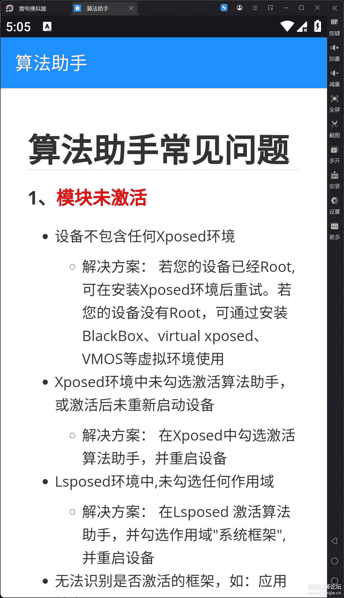
图1

从提示信息看，是环境中缺少Xposed框架所造成的，于是，找来Xposed框架的3.1.5版本装到雷电模拟器里，然后再打开设置激活算法助手模块出现这个提示：

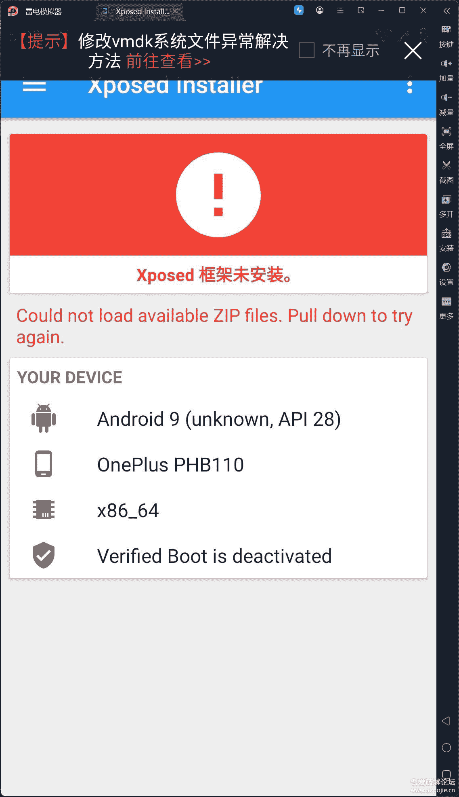
图2

Xposed自已的安装器还提示Xposed框架没有安装，这咋办，查了下，说是xposed只能适用于android 7 以下的版本，我是在雷电模拟器里安装的算法助手，模拟器的版本是9.1.41，再查了下模拟器的android版本应该在9以上了，所以，Xposed是用不了，新的替代框架是LSposed，那么找到它的最新版本1.9.2下载。

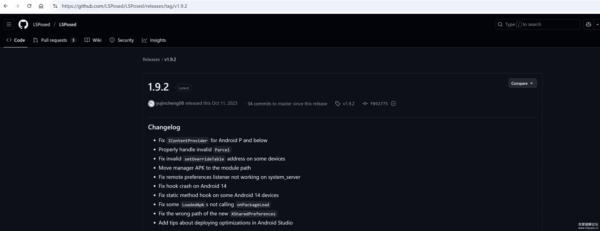
图3

在选项中选择zygisk版本的zip文件，如图4所示。

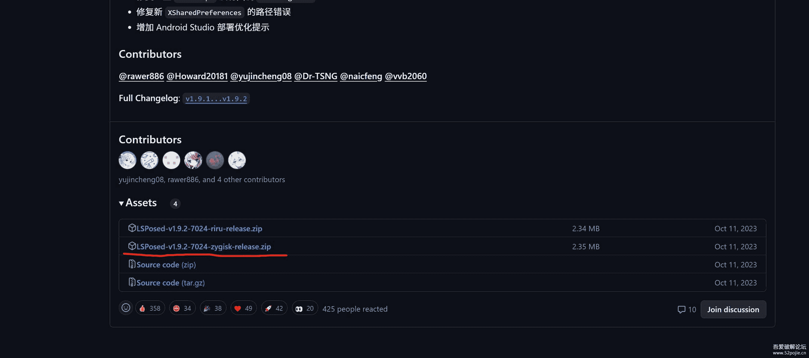
图4

下载完成后，把zip文件直接拖到模拟器里，我是在文件管理器拖到`/mnt/shared/pictures/`目录下，这样后面操作好找。

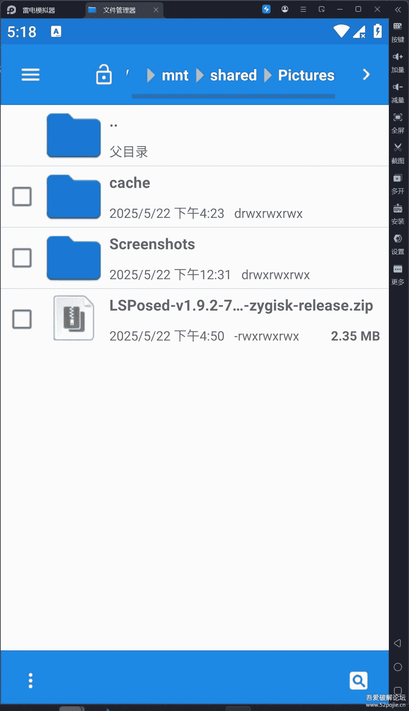
图5

然后打开模拟器的Magisk，点击模块图标：

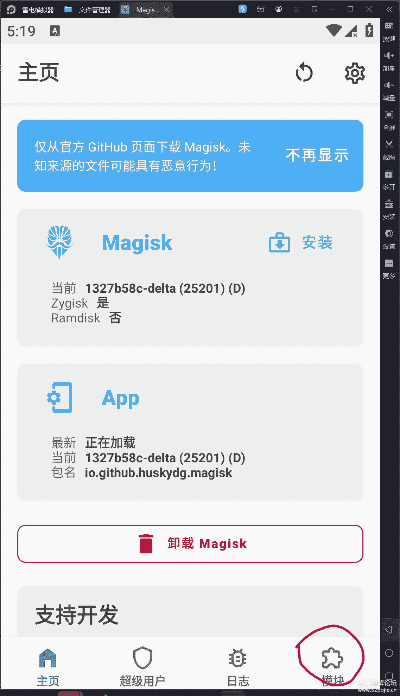
图6

这时会出现模块安装的界面，选择从本地安装选项：

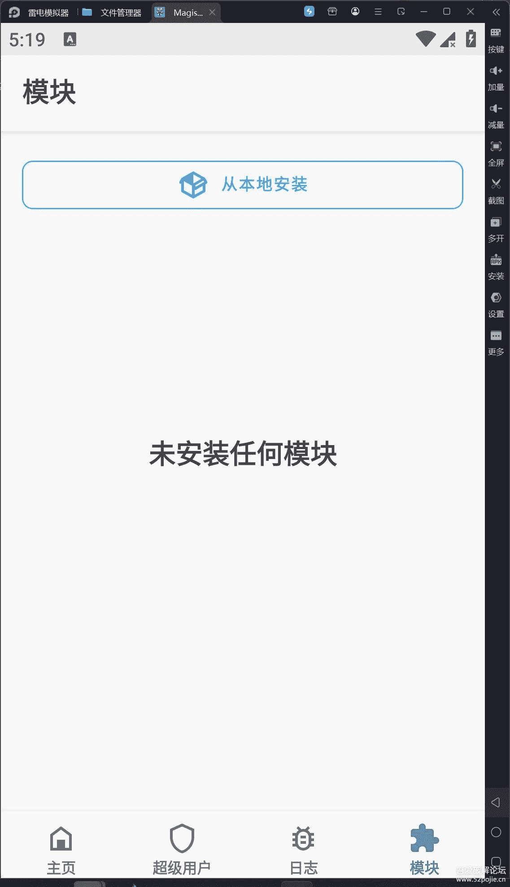
图7

在随后弹出的界面里选择文件管理器：

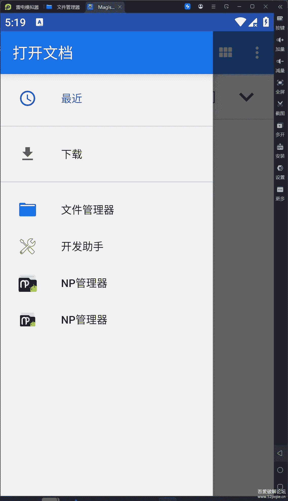
图8

然后进入到`/mnt/shared/pictures/`目录：

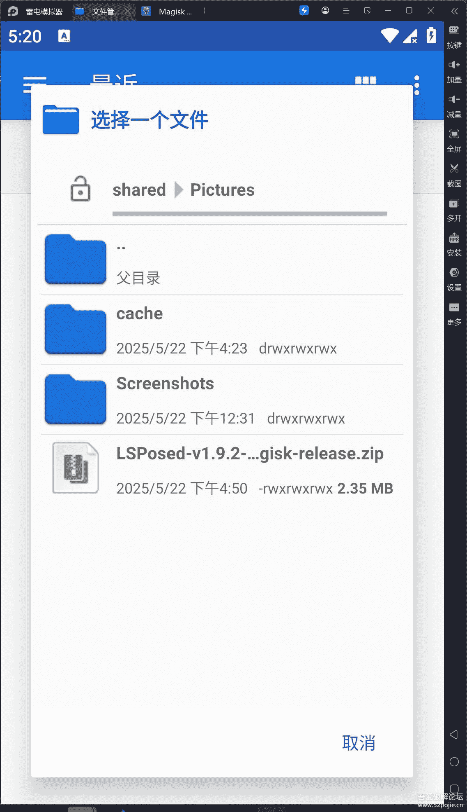
图9

选择先前拖到这里的LSPosed压缩文件，Magisk就开始自动解压安装，安装完成后的界面如图10所示：

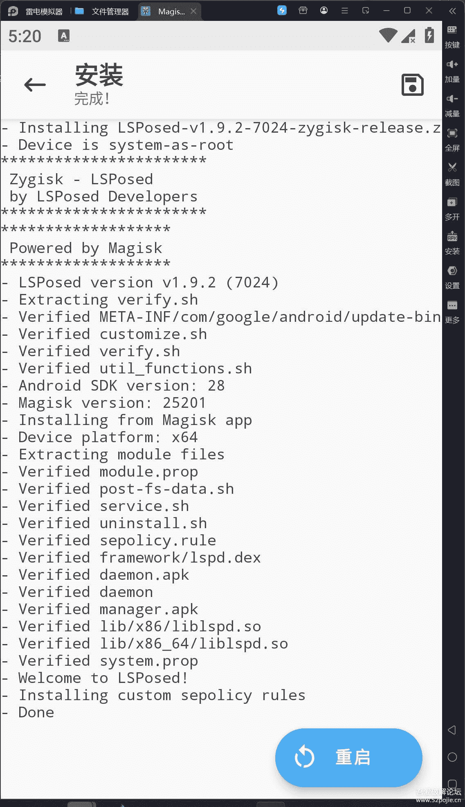
图10

这时点重启按钮，模拟器可能不会自动响应重启命令，如果没有响应，就手动重启吧。重启后还要在LSPosed中对算法助手模块进行设置才能激活它，这时要在模拟器中安装LSPosed的管理器，找到电脑本机里下载的LSPosed的zip文件，解压后，把`manager.apk`文件安装到模以器中：

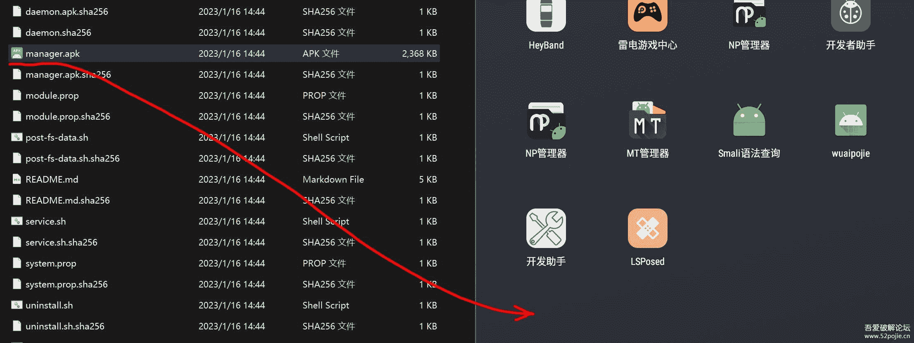
图11

安装完成LSPosed管理器后直接点击它：

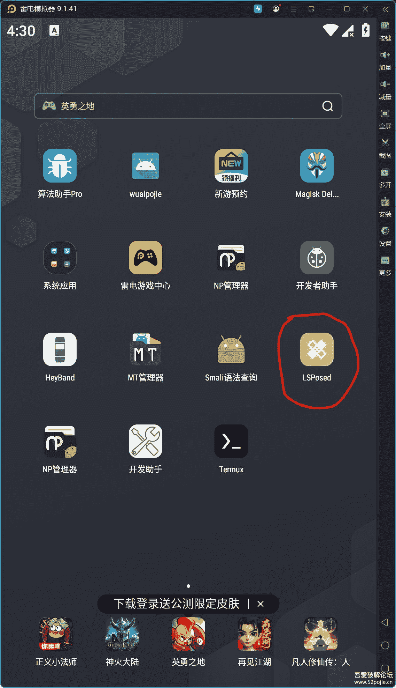
图12

在LSPosed界面中点击模块图标：

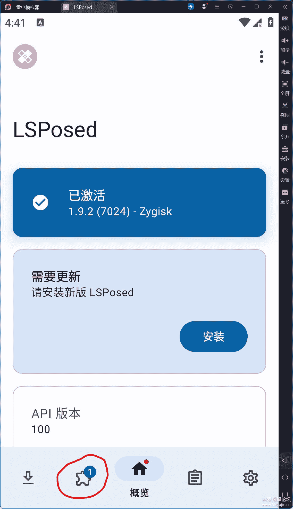
图13

再选择算法助手模块：

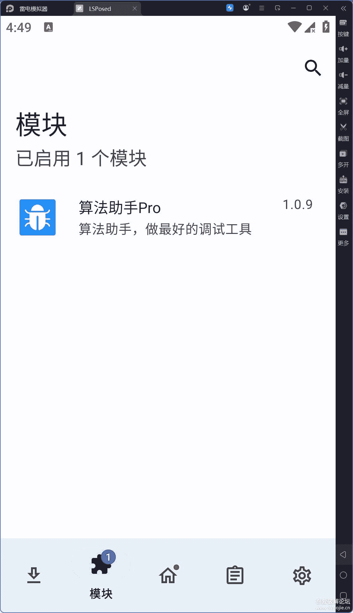
图14

点击算法助手选项进去后，设置如图15所示：

图15

设置完成后，也要重启模拟器，这个设置才起作用。重启后再打开算法助手，模块未激活的提示信息已经消失了，说明它已经激活了。

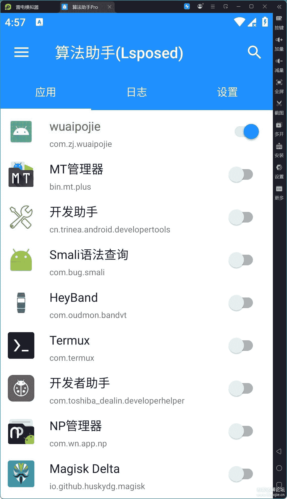
