# [Android 原创] 关于新手的第一次对漫漫看的APP key的破解

- 原帖: https://www.52pojie.cn/forum.php?mod=viewthread&tid=2034803
- 抓取时间: 2026-11-01T15:51:22.286Z

## 漫画App图片URL签名参数key逆向分析全纪录

大家好！如果你和我一样，对App内部那些神秘的动态参数（比如图片URL后面跟着的一长串像密码一样的东西）充满好奇，那么这份文档可能会给你一些启发。最近我尝试分析了一款漫画App的图片URL，想弄明白其中 `key` 这个参数是怎么来的。过程有点曲折，但也很有趣，希望能把我的探索经历和思考过程分享给大家，特别是刚接触逆向分析的朋友们(比如我)。

程序下载地址：[//wwrf.lanzout.com/i05dy2xe7qdg](https://wwrf.lanzout.com/i05dy2xe7qdg:https)

(后缀`zip`改`apk`安装)

我们的核心目标：

彻底搞清楚下面这个示例图片URL中，动态参数 `key` 是如何生成的：

`https://cdn-image.tumanapp.com/1/1164/cpt/199120/2u6kcp.webp?key=15798fe300ee5c57d36de715065de7c0&time=...&ed=...&v=...&i=...&p=...`

(其他参数如 `time`, `ed`, `v`, `i`, `p` 虽然存在，但我们本次的焦点是 `key`。)

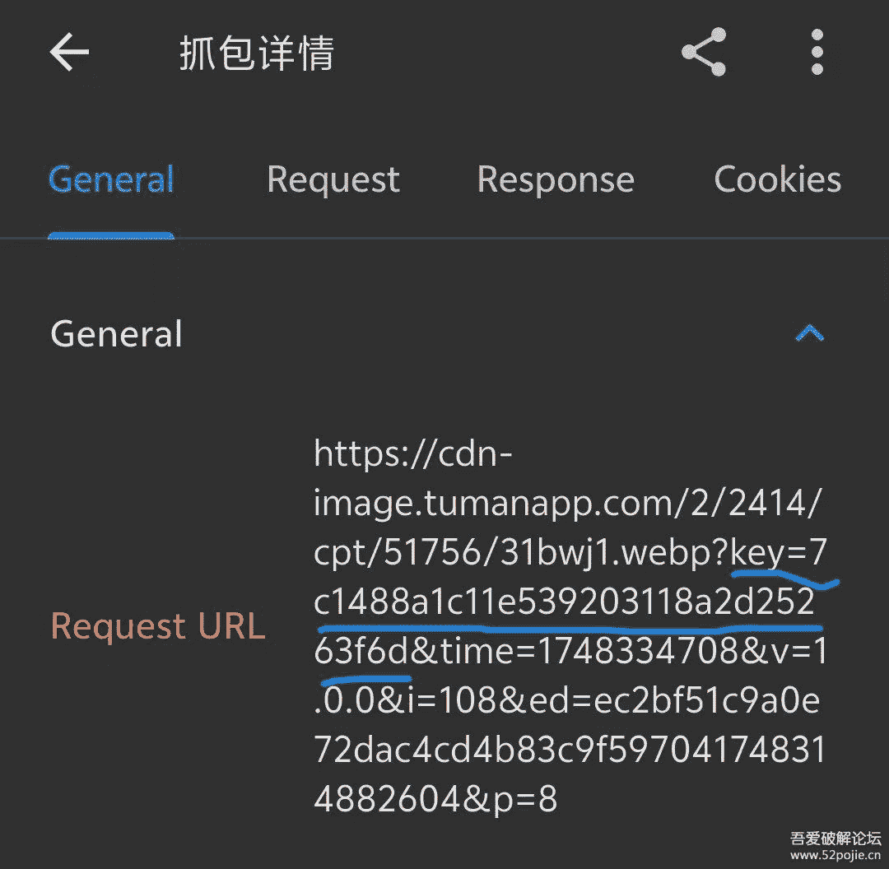

为什么只关注`key`呢？因为我发现，每次请求不同的漫画页面，这个`key`都会变，而且初步观察它似乎并不是通过某个简单的API接口直接返回给我们的。这就意味着，如果我们想做一些比如对图片资源进行研究的操作，就必须弄懂它的生成规则。所以，唯一的办法，似乎就是潜入App的内部代码看个究竟了——也就是我们常说的“逆向工程”。

## 一、 初步侦查：从URL和已知信息入手

### 1. key参数的“第一印象”：

我们先来仔细端详一下目标URL中的`key`参数：`key=15798fe300ee5c57d36de715065de7c0`。

这是一个32个字符的十六进制字符串。这种格式在计算机世界里非常具有标志性，它通常会让我们立刻联想到MD5哈希值。

MD5是一种广泛使用的密码哈希函数，它可以将任意长度的输入数据（比如一串文本）转换成一个固定长度的128位（通常表示为32位十六进制数）的“数字指纹”。如果`key`确实是MD5值，那么我们的任务就变成了找到是哪些原始数据被MD5运算后得到了这个`key`。

### 2. “顺藤摸瓜”：使用Jadx-GUI搜索图片域名

要分析App的行为，我们首先需要它的代码。我使用了`Jadx-GUI`这款工具，它可以反编译Android应用的`APK`安装包文件，将其内部的`Dalvik`字节码转换回近似可读的`Java`源代码。

既然我们的目标与图片URL有关，一个很自然的切入点就是图片URL中的域名部分：`cdn-image.tumanapp.com`。App代码里肯定有地方引用了这个域名来加载图片。

于是，我在`Jadx-GUI`中打开了目标App的`APK`文件，并使用其全局搜索功能，搜索字符串 `cdn-image.tumanapp.com`。

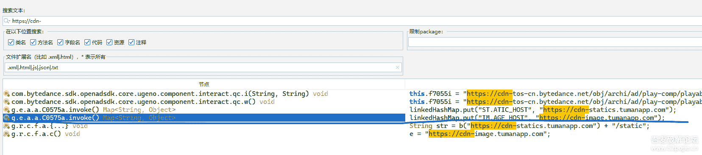

搜索结果很快就定位到了一个名为 `g.e.a.a.C0575a.invoke()` 的方法。这里的类名和包名（`g.e.a.a`）看起来有些奇怪，这是因为开发者通常会使用代码混淆工具来保护他们的代码，这些工具会把有意义的类名、方法名、变量名替换成这种无规律的短字符，以增加逆向分析的难度。尽管如此，我们还是找到了线索。我们点击进入这个`invoke()`方法查看其具体内容。

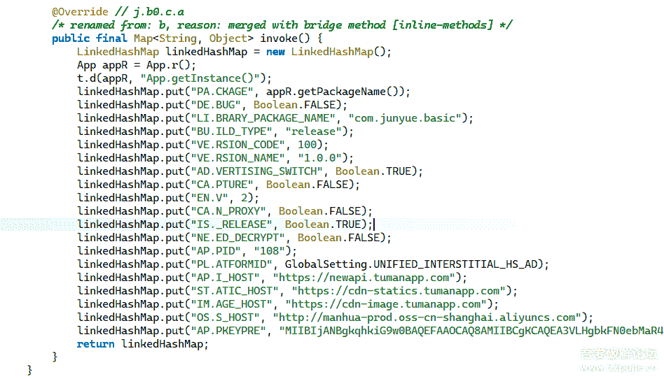

进入方法后，我们发现这里确实定义了大量的应用配置信息，它们被存储在一个 `LinkedHashMap`（一种能保持元素插入顺序的哈希映射表）中。其中，我们确认了以下与图片URL相关的配置：

- `put("IM.AGE_HOST", "https://cdn-image.tumanapp.com")`: 这正是我们搜索的图片CDN域名。
- 我们还注意到其他一些配置，比如 `AP.I_HOST`（主API服务器域名）、`VE.RSION_NAME`（版本号）、`AP.PID`（AppID）等，这些信息有助于我们了解App的整体通信架构。

初步思考：在这个配置类中，我们找到了图片服务器的地址，但并没有直接发现 `key` 参数的生成逻辑。这符合预期，因为动态参数通常不会硬编码在静态配置中。`key` 的生成很可能依赖于更复杂的客户端算法，或者（可能性较低，根据我们最初的观察）是从主API服务器获取的。我们的下一步是继续在客户端代码中寻找线索。

## 二、 寻找签名算法与核心代码

### 1. 通过`H0()`返回的具体Model类：

这个时候就需要扯到`device`和`ed`了。其实这两个参数是一样的数值，多抓几次包就可以发现。

但是之后呢？难道就此终结了吗？不，我不死心又搜索了一下"获取章节列表(选择这个作为搜索是需要抓包观察+对于发送请求的时机的把握)

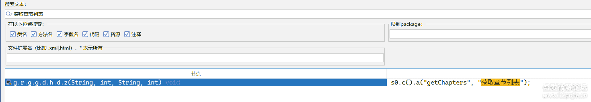

我们将代码向上翻，发现了一个似乎是用来提交某些信息的方法。

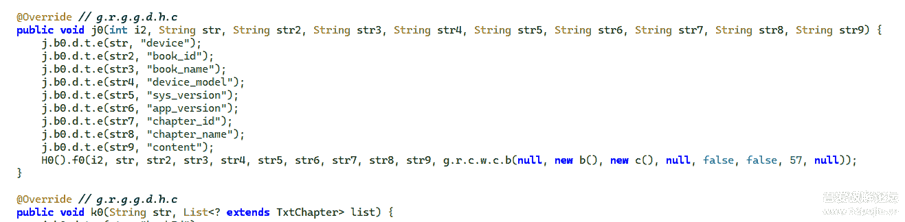

这里面的`H0()`引起我的注意，直接切换过去，看起来是`BasePresenter.kt`的反编译结果

```
package g.r.c.r;

import android.content.Context;
import androidx.lifecycle.Lifecycle;
import g.r.c.z.w;
import j.b0.d.t;

/* compiled from: BasePresenter.kt */
/* loaded from: classes2.dex */
public abstract class b {
    public Context a;
    public V b;
    public M c;
    public boolean e;
    public final w d = new w();

    /* renamed from: f, reason: collision with root package name */
    public boolean f13012f = true;

    public b(Context context) {
        this.a = context;
    }

    public final void E0(V v) {
        this.b = v;
        this.f13012f = false;
        L0(v);
    }

    public final void F0() {
        this.e = true;
        this.a = null;
        G0();
    }

    public final void G0() {
        this.b = null;
        this.f13012f = true;
        N0();
    }

    public final M H0() {
        M m2 = this.c;
        if (m2 != null) {
            return m2;
        }
        M mM0 = M0();
        t.c(mM0);
        this.c = mM0;
        return mM0;
    }

    public final V I0() {
        V v = this.b;
        t.c(v);
        return v;
    }

    public final boolean J0() {
        return this.e;
    }

    public final boolean K0() {
        return this.f13012f;
    }

    public void L0(V v) {
    }

    public abstract M M0();

    public void N0() {
    }

    public final void O0(Lifecycle.Event event) {
        t.e(event, "event");
        this.d.b(event);
        if (event == Lifecycle.Event.ON_DESTROY) {
            F0();
        }
        M m2 = this.c;
        if (!(m2 instanceof a)) {
            m2 = (M) null;
        }
        a aVar = m2;
        if (aVar != null) {
            aVar.G0(event);
        }
    }

    public final Context getContext() {
        Context context = this.a;
        t.c(context);
        return context;
    }
}
```

`H0()`方法本身是一个工厂方法或者获取器，用于获取Model实例。那么我们可以大概总结一下这玩意的核心思路：

`Presenter` -> `Model` -> 网络请求库 -> API接口

### 2. 确定MD5生成：

那之后呢？我们再次观察抓包得到的这些发出的请求，发没发现，里面有一个叫做`/cpt/`的东西，我们再去搜索一下看看。

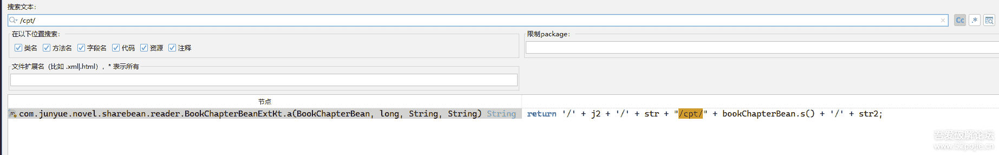

看上去是构建的完整的图片链接。

```
package com.junyue.novel.sharebean.reader;

import j.b0.d.t;

import j.i0.o;

/* compiled from: BookChapterBeanExt.kt */

/* loaded from: classes3.dex */

public final class BookChapterBeanExtKt {

    public static final String a(BookChapterBean bookChapterBean, long j2, String str, String str2) {

        t.e(bookChapterBean, "$this$getImageUrl");

        t.e(str, "cartoonId");

        if (str2 != null && o.s(str2, "static/nocpt.png", false, 2, null)) {

            return '/' + str2;

        }

        return '/' + j2 + '/' + str + "/cpt/" + bookChapterBean.s() + '/' + str2;

    }

}
```

之后搜索一下`Md5.getMd5`，别问，问就是找了半个小时找到的关键词（悲

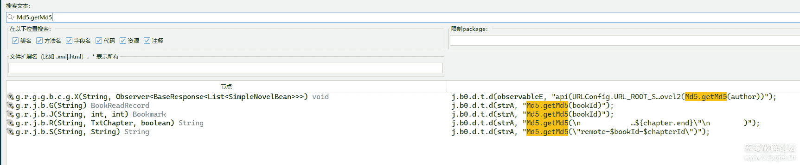

```
   public final List F(String str) {
        j.b0.d.t.e(str, "bookId");
        String strA = g.r.c.z.b0.a(str);
        j.b0.d.t.d(strA, Person.KEY_KEY);
        return E(strA);
    }

    public final BookReadRecord G(String str) {
        if (str == null) {
            return null;
        }
        String strA = g.r.c.z.b0.a(str);
        j.b0.d.t.d(strA, "Md5.getMd5(bookId)");
        return H(strA);
    }
```

发现都和一个叫做`g.r.c.z.b0.a`的调用有关，直接马不停蹄地搜索这个。

```
package g.r.c.z;

import android.util.Log;

import java.math.BigInteger;

import java.security.MessageDigest;

import java.security.NoSuchAlgorithmException;

/* compiled from: Md5.java */

/* loaded from: classes2.dex */

public class b0 {

    public static final String a = "b0";

    public static String a(String str) {

        NoSuchAlgorithmException e;

        StringBuilder sb;

        StringBuilder sb2 = new StringBuilder();

        try {

            sb = new StringBuilder(new BigInteger(1, MessageDigest.getInstance("MD5").digest(str.getBytes())).toString(16));

            while (sb.length() 
```

分析一下：

- `MessageDigest.getInstance("MD5")`: 获取标准的MD5摘要算法实例。
- `md.digest(str.getBytes())`: 对输入字符串的字节数组进行MD5计算，返回一个字节数组。
- `new BigInteger(1, digest)`: 将字节数组转换为一个正的大整数。
- `bigInt.toString(16)`: 将大整数转换为16进制字符串。

看来`g.r.c.z.b0.a(String)`就是用来计算输入字符串的MD5哈希值，并返回一个32位的十六进制小写字符串。

### 3. 之后呢？

我现在完全不知道到该如何搜索了，线索完全断了。怎么办？

整理一下我们现在知道什么吧。(`key`不一样无所谓的，我把两次抓包的结果不不小心搞混了)

- `key` (`15798fe300ee5c57d36de715065de7c0`):
- 32位MD5哈希串。
- 客户端生成 (可能性极高，因为`newapi.tumanapp.com`不参与)。
- 输入参数推测: 图片路径，`ed`值，`time`值，`v`值，`i`值，`p`值，密钥盐B。

### 4. 搞一下各种请求参数：

直接搜索`&key=`，

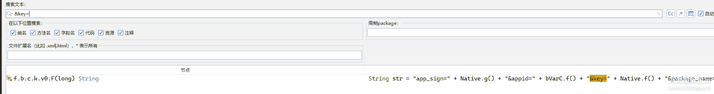

一把抓住，顷刻炼化


```
// 这是RtcClient方法
public final String F(long j2) throws Throwable {
        // 获取应用上下文和一些配置信息
        f.b.c.l.a d2 = f.b.c.l.a.d(); // 可能是一个全局的 ApplicationContext 或配置管理器实例
        a.b c2 = d2.c(); // 从 d2 获取内部配置对象 c2
        Context context = d2.getContext(); // 获取 Context

        // 生成一个随机数 (0-65535)
        String valueOf = String.valueOf((int) (Math.random() * 65535.0d));

        // 关键的字符串拼接，用于计算签名的原始字符串 (我们称之为 preSignStr)
        String str = "app_sign=" + Native.g()       // Native.g() 是一个native调用，可能返回一个固定的key或设备相关信息
                     + "&appid=" + c2.f()           // c2.f() 可能返回 AppID (类似于 "108")
                     + "&key=" + Native.f()         // Native.f() 是另一个native调用，非常可疑！这可能就是密钥盐B！或者盐A的一部分
                     + "&package_name=" + f.b.c.o.h.b(context) // 获取包名
                     + "&rand=" + valueOf           // 上面生成的随机数
                     + "×tamp=" + j2;          // 传入的时间戳 (可能是秒级)

        // 对 preSignStr 进行某种哈希或编码 (我们称之为 sign)
        String a2 = f.b.c.o.h.a(str); // f.b.c.o.h.a() 极有可能是一个哈希函数 (MD5?) 或HMAC函数

        // 再次进行字符串拼接，构建最终的查询参数字符串
        StringBuilder sb = new StringBuilder();
        sb.append("appid=");
        sb.append(c2.f());        // AppID
        sb.append("&");
        sb.append("rand=");
        sb.append(valueOf);       // 随机数
        sb.append("&");
        sb.append("timestamp=");
        sb.append(j2);            // 时间戳
        sb.append("&");
        sb.append("sign=");
        sb.append(a2);            // 上一步计算得到的签名 (sign)
        sb.append("&");
        sb.append("type=");
        sb.append(f.b.c.o.i.d()); // 某个类型参数
        sb.append("&");
        sb.append("v=");
        sb.append(f.b.c.o.i.g()); // 版本号 (可能就是 "1.0.0")
        sb.append("&");
        sb.append("p=");
        sb.append(f.b.c.o.i.c()); // 平台参数 (可能就是 "8")

        // 一个可选的调试信息？
        if (f.b.c.l.a.d().c().p()) { // 检查某个配置开关
            sb.append("&origin=");
            sb.append(str.replace('&', '|').replace('=', '|')); // 将 preSignStr 也加入到参数中，但分隔符被替换了
        }
        return sb.toString(); // 返回最终的查询参数字符串
    }
```

注意到``，直接抓住！

```
package f.b.c.o;

import android.content.Context;

import android.content.ContextWrapper;

import android.util.Log;

import java.math.BigInteger;

import java.security.MessageDigest;

import java.security.NoSuchAlgorithmException;

/* compiled from: Utils.java */

/* loaded from: classes.dex */

public final class h {

    public static String a(String str) {

        NoSuchAlgorithmException e;

        StringBuilder sb;

        StringBuilder sb2 = new StringBuilder();

        try {

            sb = new StringBuilder(new BigInteger(1, MessageDigest.getInstance("MD5").digest(str.getBytes())).toString(16));

            while (sb.length()
```

`f.b.c.o.h.a(String str)` 就是`MD5`加密函数。这印证了我们在分析`F(long j2)`方法时的猜测。

现在注意到有一个`+ "&key=" + Native.f()`，还是直接仙人指路搜索过去。

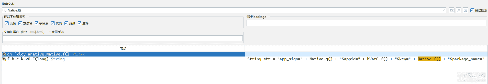

打开第一个。


```java
package cn.fxlcy.anative;

import android.annotation.SuppressLint;
import android.content.Context;
import android.content.pm.PackageManager;
import android.os.Build;
import android.util.Base64;
import androidx.annotation.Keep;
import androidx.core.app.Person;
import com.kuaishou.weapon.p0.t;
import f.b.a.a;
import f.b.a.b;
import f.b.a.c;
import f.b.a.d;
import java.io.File;
import java.io.FileWriter;
import java.io.IOException;
import java.security.MessageDigest;
import okhttp3.Interceptor;
import okhttp3.Response;
import org.json.JSONException;
import org.json.JSONObject;

/* loaded from: classes.dex */
public class Native {

    @Keep
    public static final Object ALOCK = new Object();

    @SuppressLint({"StaticFieldLeak"})
    public static a a = null;
    public static c b = null;
    public static String c = "";
    public static String d = null;
    public static String e = "";

    /* renamed from: f, reason: collision with root package name */
    public static boolean f146f = true;

    public static Response a(Interceptor.Chain chain) throws IOException {
        return b.f(chain);
    }

    public static String b(String str) {
        return new String(Base64.decode(str, 0));
    }

    public static byte[] c(byte[] bArr) {
        if (bArr == null) {
            return null;
        }
        return b.e(bArr);
    }

    public static Response d(Interceptor.Chain chain) throws IOException {
        try {
            synchronized (ALOCK) {
                if (f146f) {
                    l();
                    f146f = false;
                }
            }
            Response responseA = d.c.a(chain);
            if (responseA == null) {
                responseA = a(chain);
            }
            return responseA == null ? chain.proceed(chain.request()) : responseA;
        } catch (Throwable th) {
            if (th instanceof IOException) {
                throw th;
            }
            throw new IOException(th);
        }
    }

    public static String[] e(String str, boolean z) {
        return b.g(str, z);
    }

    public static String f() {
        return "MIIBIjANBgkqhkiG9w0BAQEFAAOCAQ8AMIIBCgKCAQEA3VLHgbkFN0ebMaR4e0Dz6Z2mFexPBFKGqK0tuRhzu7XOrG92nKWfnublf2p1i22UN81whBLINjMttOuqW6fM9DCnAPTelud1zCXWYWIsv5Z19inJSG8vytJ7xg1dnfuRSRUkx11IE7bm0T/sM0sI4GgcktQJNSizyirHtuJjUUxxQabEhFkFeqQ5r+A69KjB5QkotCc4pG5lENyTARHGSsfaiJthaiH0yJ/8tUlyMgJ9H6/jbQg0wlLcEUzdfe2KuCPrTRzIzx4Cjm1JogT6JV2byvXpzAMC3O48LDiekJdVztg2Cj7E0cGrOsGs+IK6F7TWsKD/cIELTFhLz6dExQIDAQAB";
    }

    public static String g() {
        return e;
    }

    public static void h(Context context) {
        b = new c("3VLHgbkFN0ebMaR4e0Dz6Z2m".getBytes(), "FexPBFKG".getBytes(), Base64.decode("MIIBIjANBgkqhkiG9w0BAQEFAAOCAQ8AMIIBCgKCAQEA3VLHgbkFN0ebMaR4e0Dz6Z2mFexPBFKGqK0tuRhzu7XOrG92nKWfnublf2p1i22UN81whBLINjMttOuqW6fM9DCnAPTelud1zCXWYWIsv5Z19inJSG8vytJ7xg1dnfuRSRUkx11IE7bm0T/sM0sI4GgcktQJNSizyirHtuJjUUxxQabEhFkFeqQ5r+A69KjB5QkotCc4pG5lENyTARHGSsfaiJthaiH0yJ/8tUlyMgJ9H6/jbQg0wlLcEUzdfe2KuCPrTRzIzx4Cjm1JogT6JV2byvXpzAMC3O48LDiekJdVztg2Cj7E0cGrOsGs+IK6F7TWsKD/cIELTFhLz6dExQIDAQAB", 0));
        new b(context);
        a = new a(context, false);
        d = context.getFilesDir().getAbsolutePath();
        PackageManager packageManager = context.getPackageManager();
        String packageName = context.getPackageName();
        try {
            e = k((Build.VERSION.SDK_INT >= 28 ? packageManager.getPackageInfo(packageName, 134217728).signingInfo.getApkContentsSigners() : packageManager.getPackageInfo(packageName, 64).signatures)[0].toCharsString().getBytes());
        } catch (Exception e2) {
            throw new RuntimeException(e2);
        }
    }

    public static long i() {
        return System.currentTimeMillis() / 1000;
    }

    public static String j(byte[] bArr) {
        StringBuilder sb = new StringBuilder();
        for (byte b2 : bArr) {
            sb.append(String.format("%02x", Byte.valueOf(b2)));
        }
        return sb.toString();
    }

    public static String k(byte[] bArr) {
        try {
            return j(MessageDigest.getInstance("MD5").digest(bArr));
        } catch (Exception unused) {
            return "";
        }
    }

    public static void l() throws JSONException, IOException {
        String str;
        if (c.isEmpty()) {
            try {
                JSONObject jSONObjectC = a.c();
                String string = new JSONObject(a.b(b(jSONObjectC.getString(t.a)) + b(jSONObjectC.getString("z")) + b(jSONObjectC.getString("a")), "MIGfMA0GCSqGSIb3DQEBAQUAA4GNADCBiQKBgQCCX+ktw91mt0E6EgD+5DiWL8RZusboHw3a6PvINTjO6rRrO2Jv/AWVO9NatFn0ho5NGGg7UpHTVkgjYXWuapkEgvLNkQeqLX6ERHZomy2IiYo7xewiExf6zDVrDTDhCB1PRWPNROV7FtBMsiKrodVERC/+sra3XGgWOr1Ef8CsUwIDAQAB")).getString(Person.KEY_KEY);
                if (string.split("\n").length > 1) {
                    c = string.split("\n")[0];
                    str = string.split("\n")[1];
                } else {
                    c = string;
                    str = "android";
                }
                byte bD = a.d();
                File file = new File(d + "/vuk.kk");
                if (!file.exists()) {
                    file.createNewFile();
                }
                FileWriter fileWriter = new FileWriter(file);
                byte[] bytes = c.getBytes();
                for (int i2 = 0; i2
```
不看不知道，一看吓一跳！这个 `Native` 类里真是藏龙卧虎：

### `public static String f()`
这个方法让我大跌眼镜！它居然直接返回了一个硬编码的超长字符串！

```java
public static String f() {

    return "MIIBIjANBgkqhkiG9w0BAQEFAAOCAQ8AMIIBCgKCAQEA3VLHgbkFN0ebMaR4e0Dz6Z2mFexPBFKGqK0tuRhzu7XOrG92nKWfnublf2p1i22UN81whBLINjMttOuqW6fM9DCnAPTelud1zCXWYWIsv5Z19inJSG8vytJ7xg1dnfuRSRUkx11IE7bm0T/sM0sI4GgcktQJNSizyirHtuJjUUxxQabEhFkFeqQ5r+A69KjB5QkotCc4pG5lENyTARHGSsfaiJthaiH0yJ/8tUlyMgJ9H6/jbQg0wlLcEUzdfe2KuCPrTRzIzx4Cjm1JogT6JV2byvXpzAMC3O48LDiekJdVztg2Cj7E0cGrOsGs+IK6F7TWsKD/cIELTFhLz6dExQIDAQAB";

}
```

这个字符串，和我最早在 `g.e.a.a` 配置文件里看到的 `AP.PKEYPRE` 的值一模一样！原来这个RSA公钥是被硬编码在这里，并通过 `Native.f()` 提供给其他代码使用的。在 `RtcClient.F()` 方法的 `preSignStr` 构造中，这个RSA公钥字符串就是作为 `&key=` 参数的值参与了签名计算。这意味着，这个RSA公钥字符串本身，也扮演了“盐”的角色，或者说是签名原始数据的一部分。

### `public static String m(String str)`
这个方法更是重量级！它的实现逻辑，简直就是为图片URL的 `key` 和 `time` 参数量身定做的！

```java
public static String m(String str) {
    String str2 = c; // c 是一个静态字段，就是我们要找的 vuk (密钥盐)
    if (str2 == null || str2.isEmpty()) {
        throw new RuntimeException("vuk is not initialized");
    }
    int i2 = 0;
    int i3 = 0;
    while (i2
```

这个方法接收一个字符串 `str`（我们推测是图片的完整URL），然后：
- 获取一个静态字段 `c` 的值（这个 `c` 就是核心密钥盐 `vuk`）。
- 从输入URL `str` 中截取从第三个斜杠开始的部分得到 `strSubstring`。
- 获取当前的秒级时间戳 `strValueOf`。
- 把 `strSubstring`、`strValueOf` 和 `vuk` 用 `@` 符号拼接起来。
- 对拼接后的字符串调用 `Native.k()`（即 `MD5` 函数）进行哈希。
- 最后返回 `MD5` 结果 + `:` + 秒级时间戳字符串。

这不就是图片URL里 `key`（冒号前的MD5值）和 `time`（冒号后的时间戳）的生成方式吗？！我感觉我离真相只有一步之遥了！

## 追踪核心密钥盐 `vuk` (`Native.c`) 的诞生

现在，所有的焦点都集中在了 `Native.m()` 方法中使用的那个神秘的静态字段 `c`（即 `vuk` 密钥盐）上。它是从哪里来的呢？

通过查看 `Native` 类的代码，我发现 `Native.c` 是在一个名为 `Native.l()` 的静态方法中被初始化的。这个 `l()` 方法的逻辑，简直就是一场寻盐之旅：
- `Native.l()` 会先判断 `Native.c` 是否为空，如果为空（意味着还未初始化），它才会执行后续的初始化逻辑。
- 它会调用 `f.b.a.a` 类的一个实例（这个实例在 `Native.h()` 中被创建并赋值给静态字段 `Native.a`）的 `c()` 方法，即 `a.c()`。
- `Frida` 闪亮登场：我们有动态分析工具 `Frida`！它可以让我们在App运行时“hook”住指定的方法，观察它的输入参数和返回值。这回算是一把hook住，顷刻炼化。我立刻编写了一个简单的 `Frida` 脚本来 hook `f.b.a.a.c()` 方法。

```javascript
Java.perform(function() {

  var D1X1Class = Java.use('f.b.a.a');

  D1X1Class.c.implementation = function() {

      console.log("[+] Entered f.b.a.a.c()");

      var originalResult = this.c();

      if (originalResult !== null) {

          console.log("[+] f.b.a.a.c() returned JSONObject: " + originalResult.toString());

      } else {

          console.log("[+] f.b.a.a.c() returned null");

      }

      return originalResult;

  };

});
```

运行App并附加 `Frida` 脚本后，控制台打印出了 `f.b.a.a.c()` 的返回值：

[+] `f.b.a.a.c()` returned `JSONObject`: {"a":"ajM5TCt...", "k":"ZHBKK1c...", "z":"dmV5VjN...", "p":true, "v":true}

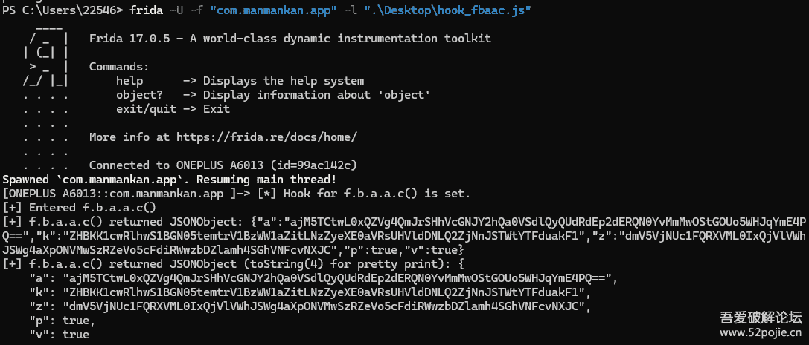


原来`f.b.a.a.c()`方法是从服务器（通过分析其Smali代码可知，它会向API基础URL`/b/随机数`发送一个带签名的POST请求）获取了一个JSON对象，这个JSON对象里包含了三个键`"a"`、`"k"`、`"z"`，它们的值都是Base64编码的加密字符串。这应该就是承载着加密`vuk`信息的“宝箱”了！

## `Native.l()` 对 `JSONObject` 的处理

- `Native.l()` 接下来会处理这个从 `f.b.a.a.c()` 获取到的 `JSONObject`（`jSONObjectC`）：
- 它会根据 `com.kuaishou.weapon.p0.t.a` 静态字段的值（我们之前通过Jadx搜索，确认了这个字段的值是字符串 `"k"`）、字符串 `"z"` 和字符串 `"a"` 作为键，分别从 `jSONObjectC` 中获取对应的Base64编码的加密片段。
- 然后，对这三个加密片段分别进行Base64解码（通过调用 `Native.b(String)` 方法，其内部实现是 `Base64.decode(str, 0)`）。
- 将解码后得到的三个字节数组，按照 `k` 片段 + `z` 片段 + `a` 片段的顺序拼接起来。
- 将拼接后的完整加密字节数据再次进行Base64编码，得到一个最终的、预备进行RSA解密的密文字符串。

## RSA 解密，`vuk` 现身

- `Native.l()` 随后调用 `f.b.a.a` 实例的 `b(String base64Ciphertext, String rsaPublicKeyString)` 方法。第一个参数就是上一步得到的最终密文字符串；第二个参数则是一个硬编码在 `Native.l()` 方法内部的RSA公钥字符串（`"MIGfMA0GCSqGSIb3DQEBAQUAA4GNADCBiQKBgQCCX+ktw91mt0E6EgD..."`）。这个 `f.b.a.a.b()` 方法的作用就是使用这个公钥对密文进行RSA解密。
- 我再次祭出Frida，hook了 `f.b.a.a.b()` 方法。当App运行时，Frida清晰地捕获了调用，并打印出了传入的密文（与我根据上述逻辑手动模拟拼接并编码的结果一致）和那个硬编码的RSA公钥。最激动人心的时刻到来了——该方法解密后的返回值是一个JSON字符串：`{"key":"123456"}`！

代码在这里

```java
Java.perform(function() {
var D1X1Class = Java.use('f.b.a.a');

D1X1Class.b.implementation = function(base64Ciphertext, rsaPublicKeyString) {
  console.log("[+] f.b.a.a.b() called.");
  console.log("  [-] Ciphertext (param1): " + base64Ciphertext);
  console.log("  [-] RSA Public Key String (param2): " + rsaPublicKeyString); // 这个公钥是硬编码的

  var decryptedResult = this.b(base64Ciphertext, rsaPublicKeyString);

  console.log("  [+] Decrypted String (return value): " + decryptedResult);
  return decryptedResult;
};

});
```

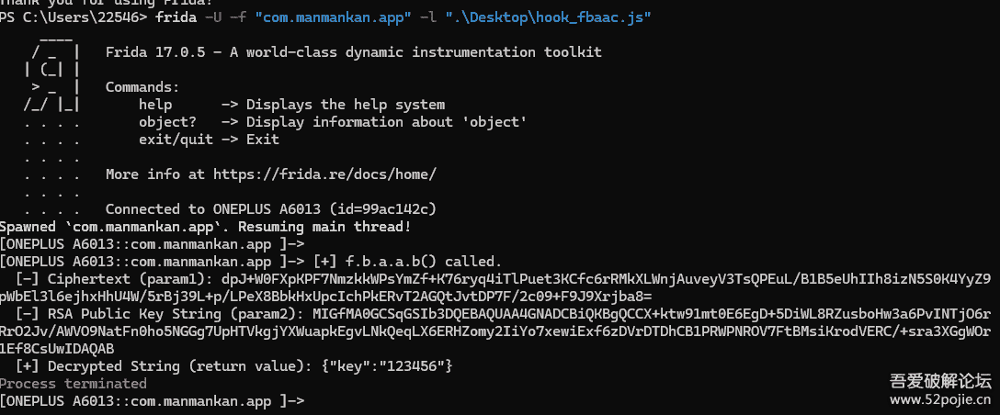

- `Native.l()` 最后从这个解密后的JSON字符串（`{"key":"123456"}`）中，提取出键名为 `Person.KEY_KEY`（`androidx.core.app.Person.KEY_KEY` 是一个AndroidX库中的常量，其值通常就是字符串 `"key"`）的字段的值。如果这个值包含换行符，则只取第一行。这个提取出来的字符串最终被赋值给 `Native` 类的静态字段 `c`。
- 因此，我们终于确定了核心密钥盐 `vuk`（即 `Native.c`）的值就是字符串 `"123456"`！为了保险起见，我多次运行App并观察了Frida的hook结果，确认这个解密出来的 `"123456"` 是稳定不变的。

## 5. `key` 参数在网络请求中的最终“加冕”

我们已经知道了 `Native.m()` 如何生成 `key:time` 对，那么它们又是如何最终出现在图片URL中的呢？

通过进一步的代码追踪，我找到了 `f.b.a.c` 类（反编译自 `D1X4.java`）。这个类似乎扮演着网络请求助手的角色：

- 它有一个静态方法 `i(String str)`，这个方法非常简单，就是直接调用了 `Native.m(str)`。
- 它有一个实例方法 `d(String url, Map params)`，这个方法会先调用 `i(url)`（也就是 `Native.m(url)`）来获取 `key:time` 字符串，然后将其解析并构造成 `key=生成的MD5值&time=生成的时间戳` 这样的查询参数形式，再巧妙地附加到输入的原始 `url` 字符串的末尾。
- 最关键的是该类的另一个实例方法 `f(Interceptor.Chain chain)`。从它的参数和实现来看，这非常像是一个OkHttp网络请求拦截器（`Interceptor`）的 `intercept` 方法的逻辑。OkHttp拦截器是一种强大的机制，它允许我们在网络请求实际发送到服务器之前，或者在收到服务器响应之后，对请求或响应进行修改或处理。在这个 `f()` 方法中，当一个网络请求（比如请求图片）将要发出之前，它会获取原始请求的URL字符串，然后调用上面提到的 `d()` 方法来为这个URL添加上通过 `Native.m()` 计算得到的 `key` 和 `time` 签名参数，并用这个新的、包含了签名的URL去执行实际的网络请求。
- 一个非常重要的细节是：在这个拦截器逻辑中，传递给 `d()` 方法（并最终传递给 `Native.m()`）的URL参数，是包含了协议（http/https）和主机名的完整URL字符串。

## 6. Java代码模拟与最终的胜利！

掌握了以上所有信息——核心密钥盐 `vuk="123456"`，`Native.m()` 生成 `key:time` 对的完整Java逻辑，以及 `Native.m()` 的输入是包含协议和主机名的完整URL——我终于可以胸有成竹地编写Java代码来模拟这个签名过程了。

我创建了一个 `KeyGenerator.java` 测试类，严格按照 `Native.m()` 的逻辑：

- 将密钥盐 `vuk` 设置为 `"123456"`。
- 关键的输入：作为模拟 `Native.m()` 函数输入的图片路径，我使用了包含协议和主机名的完整URL，例如：`https://cdn-image.tumanapp.com/1/1164/cpt/199120/2u6kcp.webp`。
- 在模拟 `Native.m()` 的内部逻辑中，首先按照其源码实现，从输入的完整URL中截取第三个斜杠 `/` 之后的部分作为实际参与签名的路径（例如，对于上面的完整URL，截取结果是 `/1/1164/cpt/199120/2u6kcp.webp`）。
- 然后，使用这个截取后的路径、原始目标URL中给出的 `time` 值（例如 `1748338381`，我特意使用原始URL中的时间戳，是为了确保如果我的签名算法正确，生成的 `key` 应该与原始 `key` 完全一致，从而方便验证）和密钥盐 `vuk`（`"123456"`），按照 `截取路径@时间戳@vuk` 的格式拼接字符串。
- 对拼接结果进行MD5运算（使用与 `Native.k()` 一致的Java MD5实现）。

当我运行这个Java测试代码后，控制台打印出了激动人心的结果：

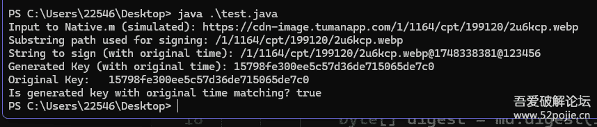

Input to Native.m (simulated): https://cdn-image.tumanapp.com/1/1164/cpt/199120/2u6kcp.webp

```text
Substring path used for signing: /1/1164/cpt/199120/2u6kcp.webp

String to sign (with original time): /1/1164/cpt/199120/2u6kcp.webp@1748338381@123456

Generated Key (with original time): 15798fe300ee5c57d36de715065de7c0

Original Key:   15798fe300ee5c57d36de715065de7c0

Is generated key with original time matching? true

true！完全匹配！我们成功了！ 这一刻，所有的努力都得到了回报！目标App图片URL中key参数的生成机制被我们彻底搞清楚了！
```

这是模拟的代码


        String fullImageUrlFromServer = "https://cdn-image.tumanapp.com/1/1164/cpt/199120/2u6kcp.webp"; // 使用完整URL

```java
import java.math.BigInteger;
import java.nio.charset.StandardCharsets;
import java.security.MessageDigest;
import java.security.NoSuchAlgorithmException;

public class KeyGenerator {

    // 密钥盐 vuk
    private static final String VUK = "123456";

    // MD5 计算函数 (模拟 Native.k() / f.b.c.o.h.a() / g.r.c.z.b0.a())
    public static String calculateMd5(String input) {
        if (input == null) {
            return "";
        }
        try {
            MessageDigest md = MessageDigest.getInstance("MD5");
            byte[] digest = md.digest(input.getBytes(StandardCharsets.UTF_8)); // 使用UTF-8编码
            BigInteger bigInt = new BigInteger(1, digest);
            StringBuilder md5Hex = new StringBuilder(bigInt.toString(16));
            while (md5Hex.length()  generateKeyAndTime(String imagePath) {
        if (imagePath == null || imagePath.isEmpty()) {
            throw new IllegalArgumentException("Image path cannot be null or empty.");
        }

        // 1. 截取图片路径 (从第三个 '/' 之后开始)
        String substringPath = "";
        int slashCount = 0;
        int startIndex = 0;
        for (int i = 0; i (keyParam, timestampSeconds);
    }

    // 辅助类 Pair (如果你的Java版本低于某个版本，可能需要自己实现或使用其他库的Pair)
    public static class Pair {
        public final K key;
        public final V value;

        public Pair(K key, V value) {
            this.key = key;
            this.value = value;
        }

        @Override
        public String toString() {
            return "Pair{" +
                   "key=" + key +
                   ", value=" + value +
                   '}';
        }
    }

    public static void main(String[] args) {
// KeyGenerator.java - main method
        String originalTime = "1748338381"; // 原始URL中的time
        String VUK = "123456";

        // 模拟 Native.m() 的路径截取，现在作用于完整URL
        String substringPathForOriginalTest = "";
        int slashCount = 0;
        int startIndex = 0;
        for (int i = 0; i 
```

快跟我一起高呼`Java`大法好！(逃

## 三、总结与后续思考

后续写得有点捞了，请见谅（因为马上就要上课了，匆匆结尾

本次对漫画App图片URL动态参数的逆向分析是一次结合了静态代码分析（使用`Jadx-GUI`阅读反编译的`Java`和`Smali`代码(`smali`代码过于逆天且冗长就没有放研究过程)）和动态运行时分析（使用`Frida`进行方法`hook`和参数捕获）的综合实践。

`key`的生成流程总结：

- App在初始化时（通过`Native.l()`调用`f.b.a.a.c()`和`f.b.a.a.b()`）会通过一次网络请求和`RSA`解密，获取到一个核心的密钥盐`vuk`，其值为`"123456"`。
- 当需要获取图片时，App会调用`cn.fxlcy.anative.Native.m(String fullImageUrl)`方法。
- 该方法接收完整的图片URL作为输入，截取其主机名后的路径部分。
- 将截取的路径、当前的秒级时间戳、以及密钥盐`vuk`按照特定格式（路径@时间戳@`vuk`）拼接。
- 对拼接后的字符串进行`MD5`哈希运算，得到的值即为图片URL中的`key`参数。URL中的`time`参数即为该过程中使用的秒级时间戳。
- 这些签名参数最终通过一个`OkHttp`拦截器（逻辑在`f.b.a.c.f()`中）自动附加到实际发出的图片请求URL上。

对于另一个动态参数`ed`，虽然本次分析未将其作为主要目标完全破解其生成源头，但根据其在同一设备上的固定性以及在相关网络请求头中的出现情况，我们推测它是一个在设备首次初始化时生成并存储的、与设备相关的唯一标识参数。其具体生成方式有待进一步分析`com.junyue.basic.util.Apps.getDevicesId(Context)`等相关代码。

本次逆向难度评级（新手视角）：偏上 (★★★☆☆ ~ ★★★★☆)

作为我的第一次逆向尝试，这次经历的整体难度我个人认为是偏上。主要体现在以下几个方面：

- 代码混淆的存在：类名、方法名、变量名的混淆（例如 `g.e.a.a`, `f.b.a.a` 等）在一开始确实给我造成了不小的困扰，需要花费更多精力去理解代码的组织结构和功能模块。对于新手来说，这无疑增加了最初的上手门槛。
- 关键逻辑涉及Native层调用和间接获取：核心密钥盐`vuk`并非直接硬编码在`Java`层，而是通过`Native.l()`方法，间接调用了`f.b.a.a`类的方法，这些方法又涉及到网络请求和`RSA`解密。这种多层嵌套和间接获取的方式，使得追踪过程更加曲折。如果`Native.l()`本身是`native`方法，难度会更高。
- 部分方法无法直接反编译：`f.b.a.a.c()`方法在`Jadx-GUI`中显示为“Method dump skipped”，这迫使我不得不学习和尝试使用`Smali`代码分析和动态分析工具`Frida`。对于初学者而言，直接上手`Frida`并编写有效的`hook`脚本是有一定学习曲线的。
- 多重加密和编码步骤：获取`vuk`的过程涉及到`Base64`编码/解码、字符串拼接、`RSA`公钥解密，理解这些步骤并正确模拟它们需要对加密基础有一定的了解。
- 细节决定成败：例如，`Native.m()`方法输入的图片路径是完整URL还是纯路径，这个细节直接影响了最终签名结果的正确性，需要非常仔细地比对和验证。

尽管如此，也有一些降低难度的因素：

- 核心签名算法相对标准：`MD5`和`RSA`是常见的算法，相关的原理和实现资料比较容易找到。
- 关键密钥盐最终是固定值：如果`vuk`是动态变化的，或者依赖于更复杂的设备信息计算，难度会指数级上升。`"123456"`这个相对简单的固定值，一旦通过`Frida`获取到，就大大简化了后续的模拟。
- 有明确的切入点：从图片URL域名入手，以及对`key`参数`MD5`特征的判断，为整个分析过程提供了有效的起点。
- `Jadx-GUI`和`Frida`等工具的强大支持：没有这些现代化的逆向工具，分析过程会艰难得多。

总的来说，这次逆向分析涉及了代码阅读、逻辑推理、加密算法识别、动态调试等多个方面，对于初学者来说，确实是一次很好的综合锻炼和学习机会。虽然过程有些“肝”，但最终成功破解的成就感是难以言表的。

### 心得体会

这次探索再次证明了在逆向工程中：

- 系统性的方法论很重要：不能盲目地在代码中寻找，要有明确的目标和分析路径，从外到内，从表象到核心。
- 多种工具的结合使用是关键：`Jadx-GUI`用于静态分析，`Frida`用于动态分析，它们各自的优势能互补，帮助我们克服各种障碍。
- 对常见加密算法和Android机制的理解有帮助：了解`MD5`、`RSA`、`JNI`、`OkHttp`拦截器等，能更快地抓住重点，理解代码的意图。
- 耐心、细致和不放弃的精神是必备的：逆向往往是一个反复试错和不断探索的过程。遇到困难时，换个角度思考，或者尝试不同的工具和方法，可能就会有新的发现。
- 记录和整理至关重要：将分析过程中的发现、假设、验证步骤都记录下来，有助于理清思路，避免重复劳动，也方便后续的回顾和总结。
