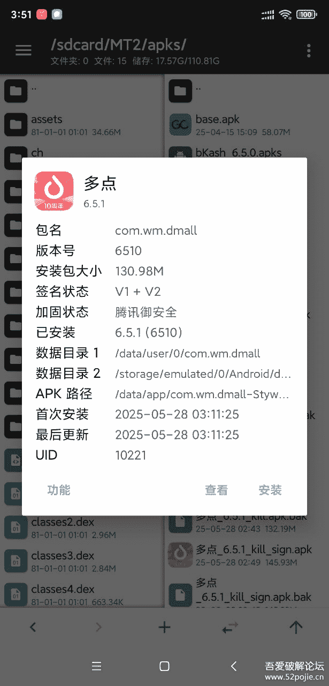
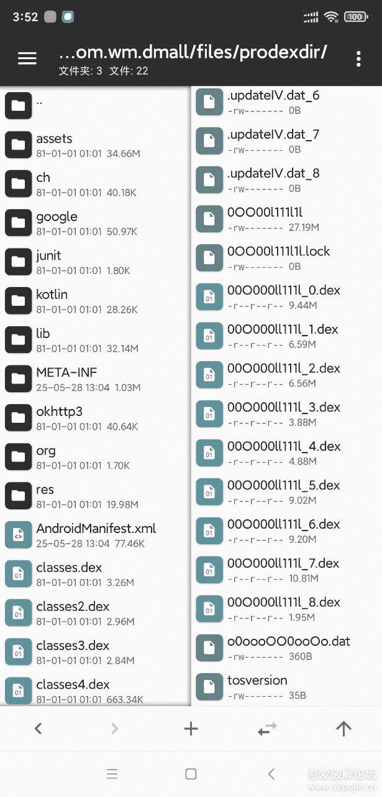
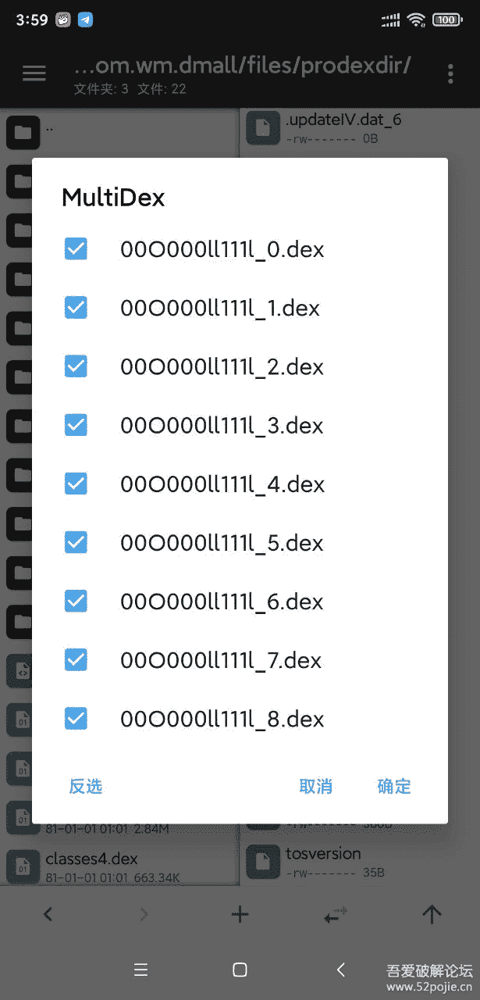
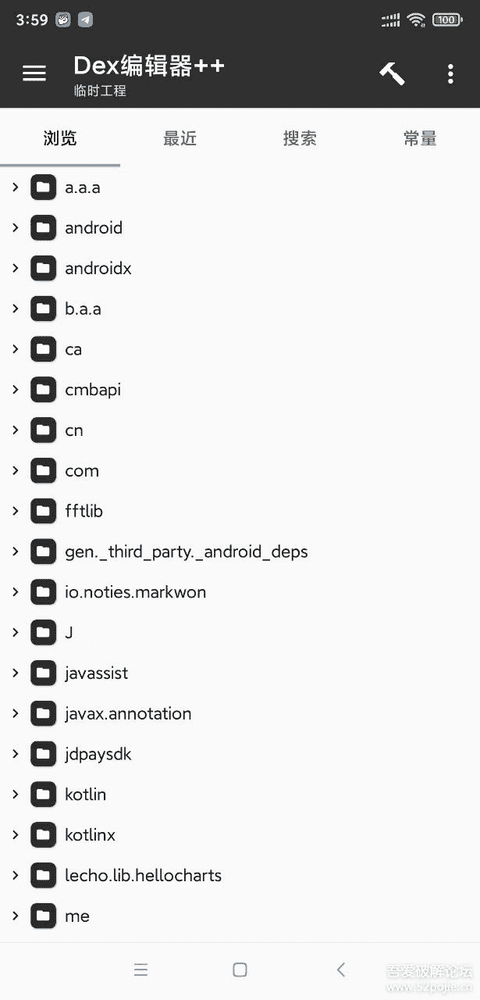

# [Android 原创] 记一次脱腾讯御安全的壳无意中的发现

- 原帖: https://www.52pojie.cn/forum.php?mod=viewthread&tid=2035077
- 抓取时间: 2026-11-01T15:51:17.633Z

我们使用mt管理器打开对应的app，查壳是腾讯御安全的壳

先把app安装上并正常运行一次，然后再打开数据目录`/data/user/0/com.wm.dmall`，`com.wm.dmall`是演示app的包名，再进入`files/proodexdir`目录，找到里面的dex就是原始的dex了，可以直接用Dex编辑器打开

这是无意中发现的，没什么技术含量，只是网上找了一圈发现没有相关文章，特发帖记录一下
