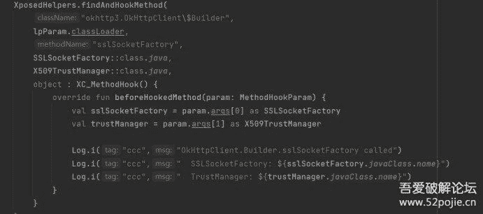
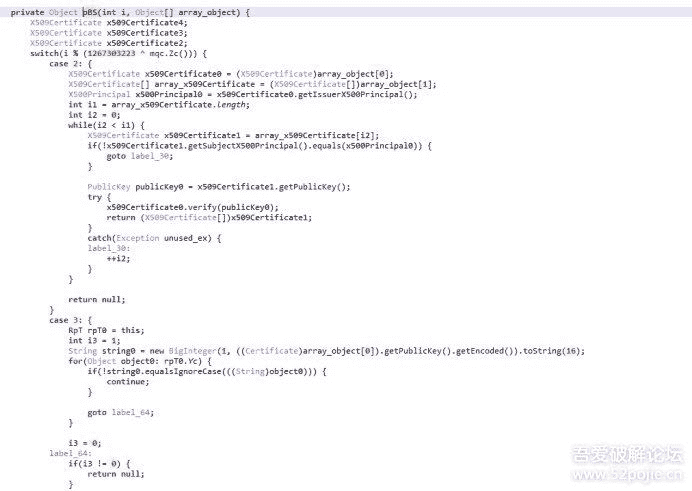
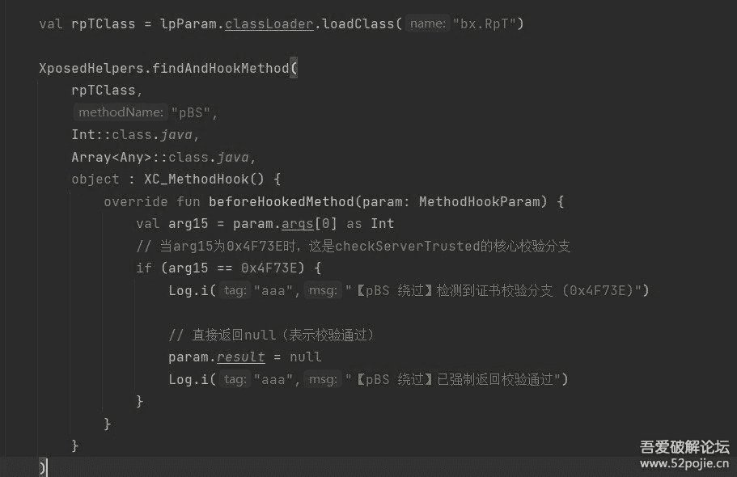

# [Android 原创] APP抓包之自定义SSLPing绕过

- 原帖: https://www.52pojie.cn/forum.php?mod=viewthread&tid=2038422
- 抓取时间: 2026-11-01T15:43:54.679Z

工具：google px4 真机、Lsposed、Fiddler、JEB

某支付类 app，使用 `justtrustme` 插件依然抓到的是 `connect` 包，说明证书校验失败，使用的不是系统的证书校验 SSLPing，而是自定义的证书校验 SSLPing。

首先找证书校验所在类，然后替换掉证书校验方法返回值。

自定义证书校验方法混淆，但是系统调用特征依然存在。从 `sslSocketFactory`、`trustManager` 入手，hook 代码如下：

调试输出如下：

自定义证书验证方法在 `RpT` 类，使用 `jeb` 反编译查看：

`checkServerTrusted` 这个方法用于服务器证书校验逻辑，实际调用 `pBS` 方法，继续看：

验证失败抛异常，验证通过返回 `null`。开始写 hook 代码：

调试输出如下：

可以抓到包了。

