# [Android 脱壳] 某Guard的SO加固探秘(有趣的GNUHash)

- 原帖: https://www.52pojie.cn/forum.php?mod=viewthread&tid=2040136
- 抓取时间: 2026-11-01T15:43:38.579Z

## 1. 前言

最近瑣事一堆，而且也有點懶惰，分析周期拉得挺長的。

動調分析了很多次，每次都有新發現，這也使得文章中很多前面的部份是後面補充上去的。

注：本文只分析該加固的具體流程，以及修復的思路。

## 2. 簡單處理反調試

只處理anti ida debug的部份，能順利動調就足夠了。

通過hook `strtstr`來bypass，然後以`frida -U -f XXX -l test.js --pause`的方式啟動APP，之後IDA再attach。


```javascript
function hook_strstr() {
    // 更多比較函數: strcmp、strncmp、memcmp
    var pfn_strstr = Module.findExportByName("libc.so", "strstr");

    Interceptor.attach(pfn_strstr, {
        onEnter: function (args) {
            var str1 = Memory.readCString(args[0]);
            var str2 = Memory.readCString(args[1]);
            if (str1.indexOf("TracerPid:") != -1) {
                Memory.writeUtf8String(args[0], "TracerPid:     0");
                console.log(`[hook_strstr] ${str1} ---> ${args[0].readCString()}`)
            }

        },
        onLeave: function (retval) {

        }
    });

}
```

然後就可以愉快地動調分析了^^，主要邏輯都在`.init_array`中。

## 3. `init_array_func1`

最開始會調用`check_emu_and_get_lib_info()`檢查模擬器，並且獲取一些lib信息( 包括`libc.so`、`liblog.so`、`libstd++.so`、`libOpenSLES.so`、`libmediandk.so` )，這些信息被保存在`g_somedataX`中，如`libc.so`的信息就在`g_somedata1`。

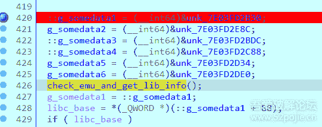

### 3.1 模擬器檢查 & 保存lib信息

進入`check_emu_and_get_libc_info()`函數，看看具體實現。

首先調用了`get_infos()`，其中會通過`openat`系統調用打開`/proc/self/maps`，返回的`fd`保存在`infos`中。同時也把`read`、`close`等系統調用保存到`infos`中。

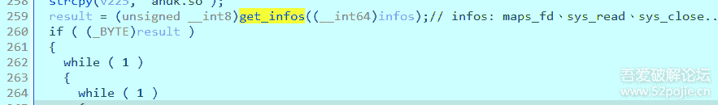

然後調用`get_maps_item()`遍歷`/proc/self/maps`。

`maps_item`是諸如`12c00000-12c40000 rw-p 00000000 00:00 0  XXX`這樣的字符串。

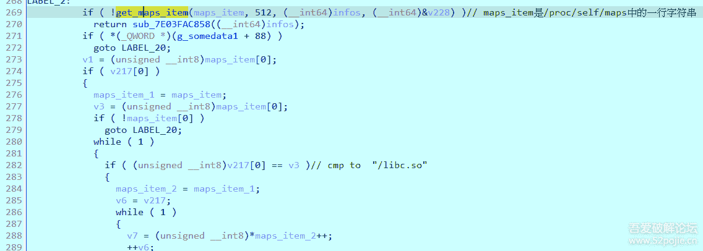

遍歷`/proc/self/maps`的目的是為了獲取指定幾個lib的信息，下面以`libOpenSLES.so`為例看看它是如何處理的。

通過以下方式，將hex字串的基址轉換為num形式，記為`libOpenSLES_base`。

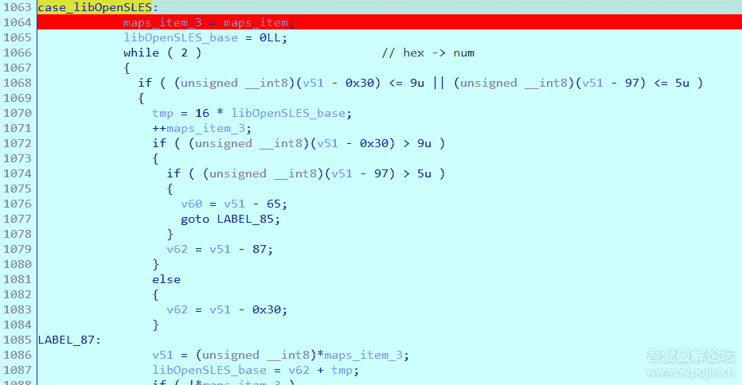

轉換完基址後，進行了一些合法性檢查。

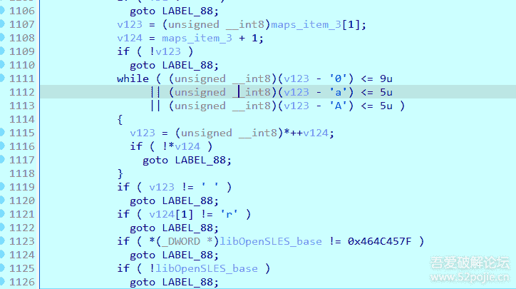

然後獲取了該so的`e_machine`，若是`62`或`3`，就代表是`EM_X86_64`或`EM_386`，一般模擬器就是這兩個架構之一。

檢測到後會記錄在`g_mb_emu_flag`。

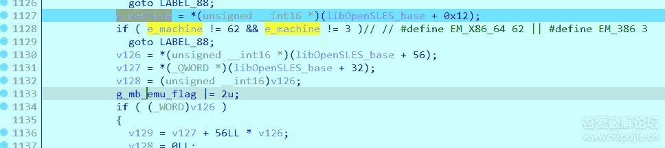

至於上述轉換的基址最終會被保存在`g_somedataX`全局變量中，如`libc.so`的就保存在`*(_QWORD *)(g_somedata1 + 88)`。

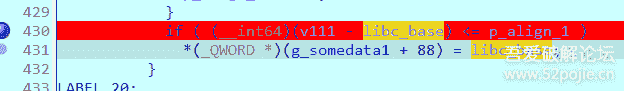

### 3.2 對lib的簡易預鏈接

回到`init_array_func1()`繼續分析。

下面是對`libc.so`進行了類似`prelink_image()`的操作，即遍歷了`libc.so`的`.dynamic`，相關數據被保存在`g_somedata1`中。

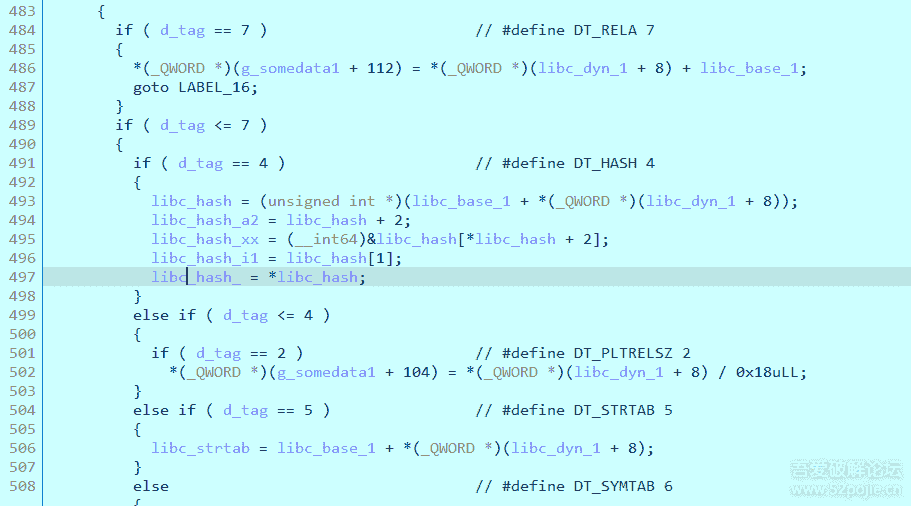

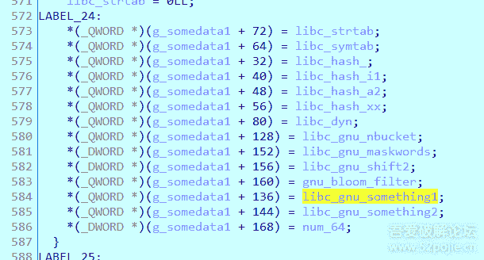

除了對`libc.so`外，還有對`libstdc++.so`和`liblog.so`進行了上述操作。

### 3.3 got表替換

之後解密了一些諸如`dlopen`、`dlsym`、`dlerror`、`dlclose`等字串。

遍歷`libc.so`的`jmprel`表( 重定向表 )，記錄所有dl系列的函數地址，如`dlopen`函數地址被保存在`g_dlopen`中。

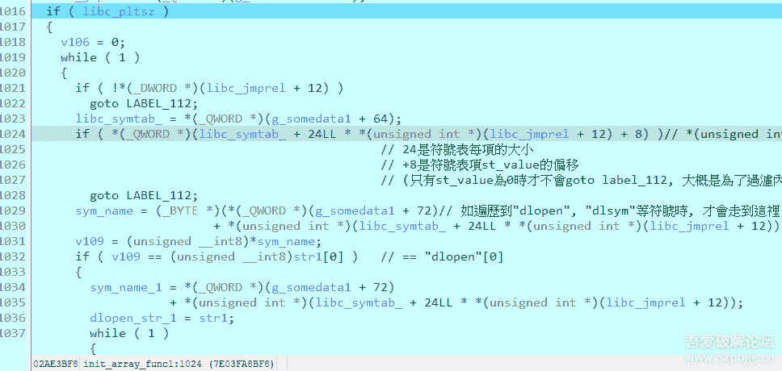

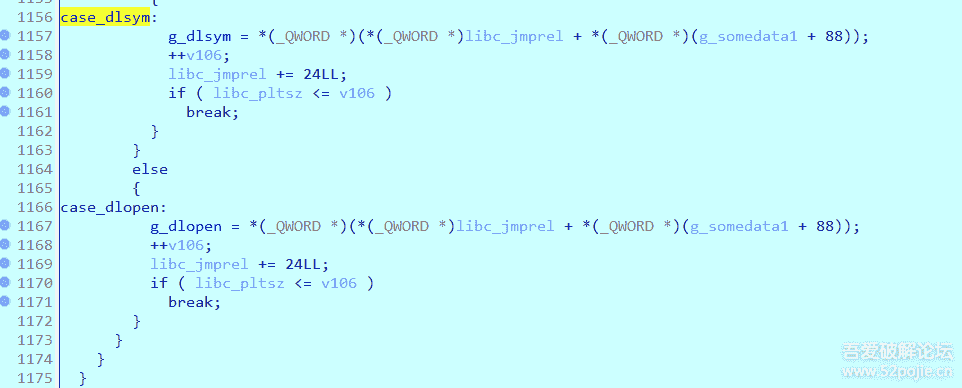

獲取完dl系列的函數後，之後又是一堆的內聯形式的字符串解密，解密了一堆函數名存放在各個變量中。

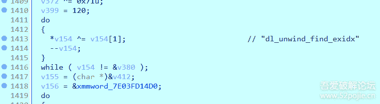

然後初始化了一個`SBOX`，大概是用於之後某處的加/解密，應該不用太關注。

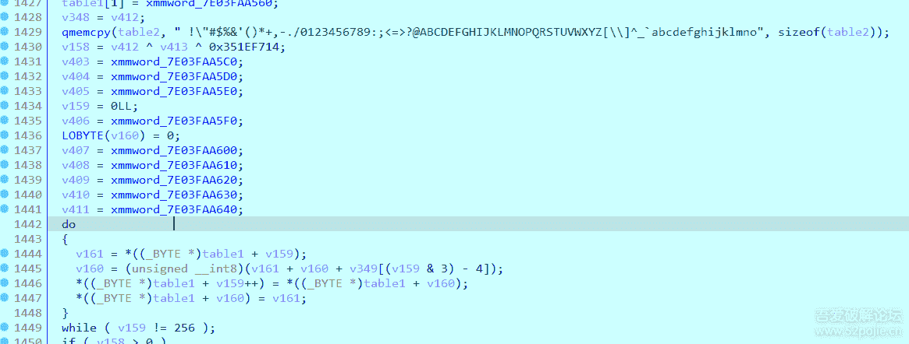

再之後調用了`mprotect`系統調用，賦予`libil2cpp.so`前`0x1000`可讀可寫的權限。

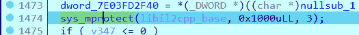

繼續向下看，上面解密的部份字符串如下所示，可以看到基本上都是一些函數名，分佈在不同lib中。

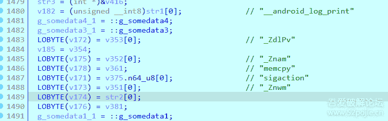

接下來以`_Znwm`為例繼續分析後續的流程。

`_Znwm`應該是屬於`libstdc++.so`的函數，因此當遍歷到`_Znwm`時會跳到如下地方，然後從`g_somedata3 + 88`獲取`libstdc++.so`的基址。

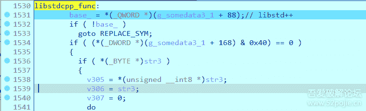

繼續向下單步執行，會走到下圖這裡，看到`5381`這個關鍵值。

如果有看過AOSP的`SymbolName::gnu_hash()`，會發現這個正是其中GNU HASH的初始值，後續的循環邏輯也與源碼中一致。

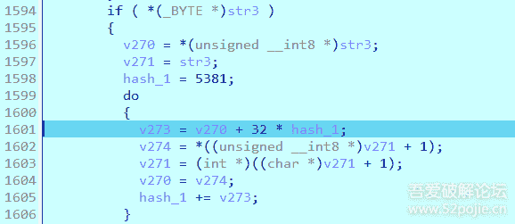

之後的計算過程也與`soinfo::gnu_lookup()`中大同小異，該函數作用於linker的`relocate()`，它通過特殊的GNU HASH邏輯，能快速計算出指定符號名對應的符號索引，之後linker就能通過符號索引取得對應符號的地址。

下圖的邏輯基本上就是對`soinfo::gnu_lookup()`的模擬，符號索引記為`n`。

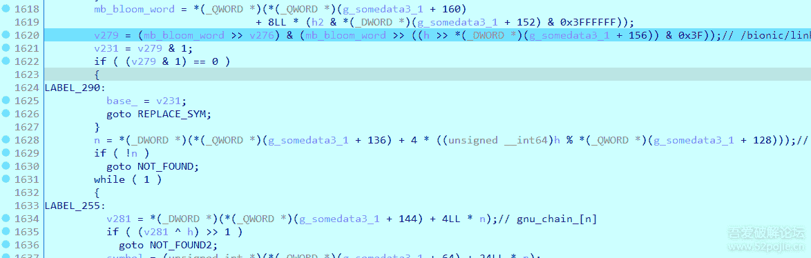

`base_`是`libstdc++.so`的基址，`symbol`是`symtab[n]`( 這個`symtab`是`libstdc++.so`的符號表 )，因此下圖執行後，`base_`就是`_Znwm`的真實地址。

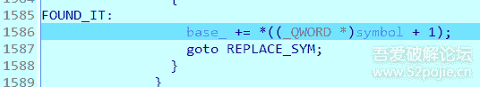

取得`_Znwm`的真實地址後，會其賦給`libil2cpp.so`的某處。

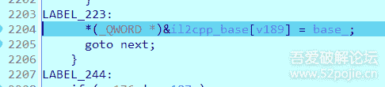

這個「某處」在`.got`表，原本是`tan`函數，由此可知`.got`中的一大堆`tan`函數應該是作為占位函數的存在。

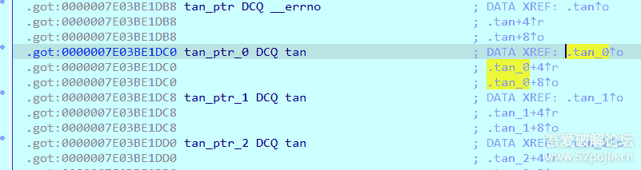

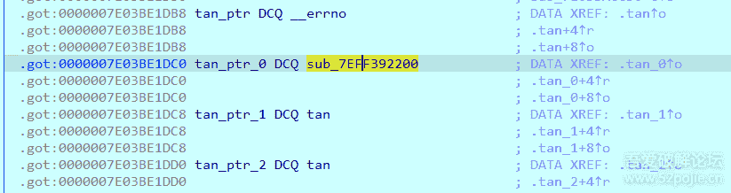

比較特別的是，一些函數如`memcpy`、`memset`等，它雖然同樣會按上述GNU HASH的方式取得其真實地址，但在替換時卻不會使用，而是將替換為自實現的`memcpy`、`memset`，一定程度上增加了安全性。

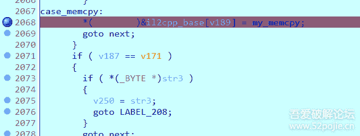

最後遍歷完所有需要替換的函數時，會再次調用`mprotect`系統調用收回寫權限。

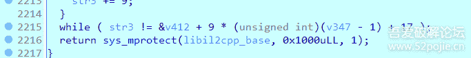

注：`_Znwm`其實是`operator new`。

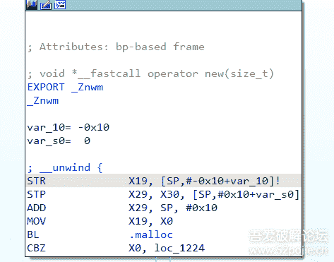

## 4. `init_array_func2`

`tan_new()`是指原本是`tan()`函數，但在`init_array_func1()`中被替換為`_Znwm()`函數( `new` )。

`g_from_initarray2`全局變量中會保存一些殼so的信息，以及後續解密會用到的參數等。

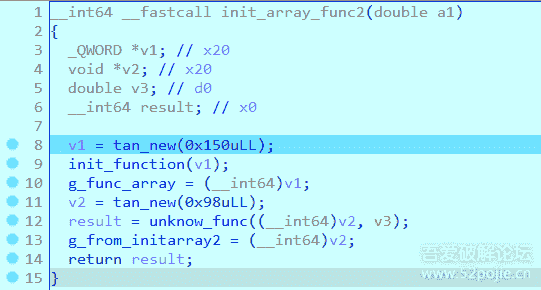

`init_function()`中把一堆函數賦給了`result`，最終`result`被保存在全局變量`g_func_array`中。

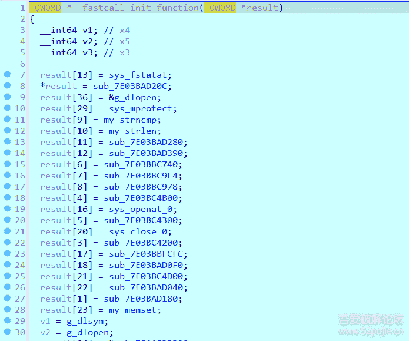

一開始無法直接看出`unknow_func()`的作用，大概只能看出其中解密了一句有意思的字串`nichoushazaichouxiashishi`。

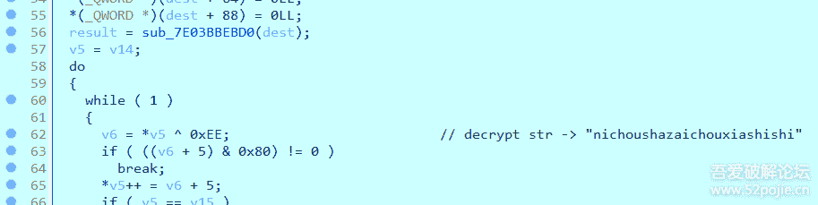

而在後續通過對`init_array_func3()`的分析，可以知道`unknow_func()`干了以下事情：

- 保存殼so的`.dynamic`中的某幾項。

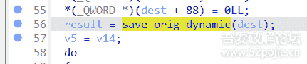

如殼so的符號表被保存在`g_from_initarray2 + 96`。

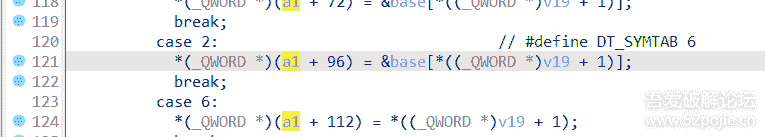

- `unknow_func()`中的一堆計算是為了生成一個異或值，用於`init_array_func3()`裡解密符號表。該異或值被保存在`g_from_initarray2 + 120`。

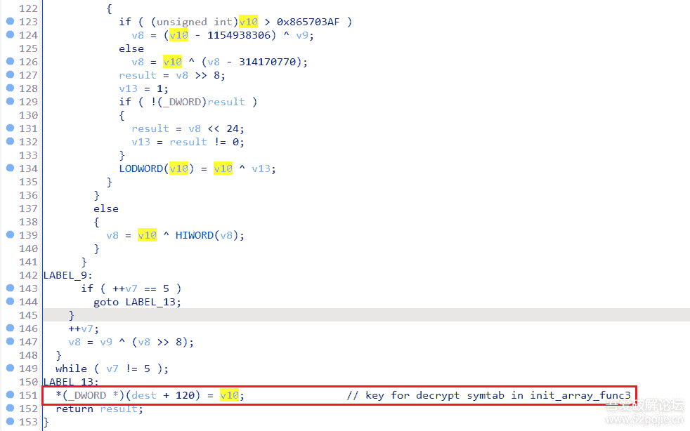

## 5. `init_array_func3`

`init_array_func3()`分成了3部份，前2部份是主要邏輯，最後1個函數大概只是在收尾。

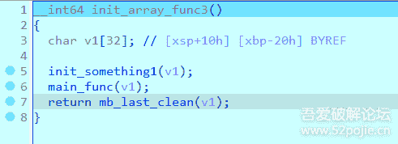

### 5.1 `init_something1`

`init_something1()`如下，把一些函數、`g_func_array`等賦給了`a1`，而`a1`等下又會作為第0個參數被傳入`main_func()`。

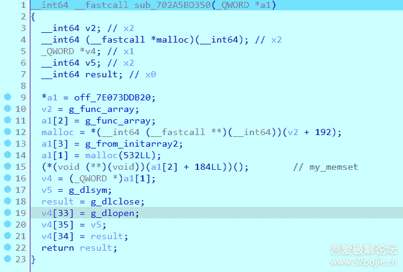

### 5.2 `main_func`

`main_func()`一開始會間接調用`0x2AD8380`( 記為`decrypt1` )，其中解密了子so的`strtab`、`rela`、`.dynamic`、代碼段等信息。

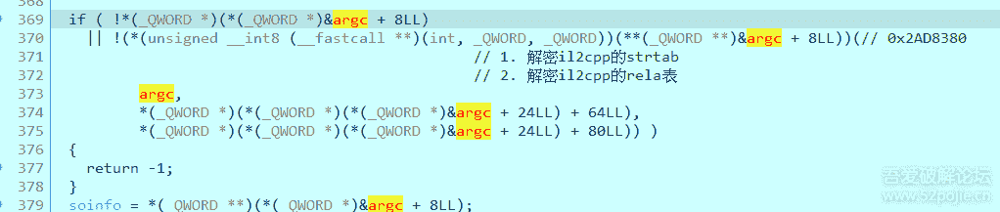

#### 5.2.1 子so信息解密

接下來先分析`decrypt1()`的具體實現。開始是一大堆加/解密table的初始化。

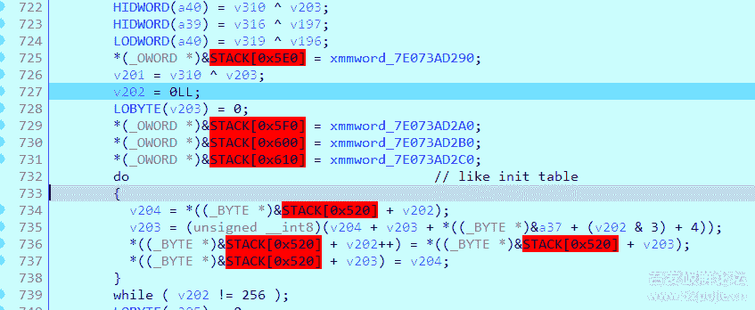

然後是第1處的字符串解密邏輯，解密的起始位置是`0x458`。

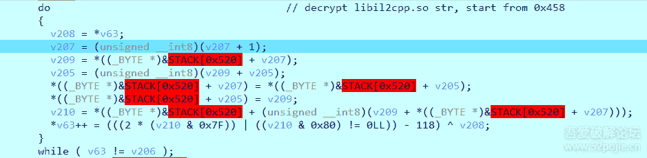

解密前/後如下所示。

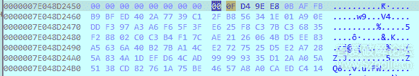

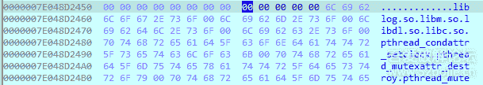

然後是第2處字符串解密邏輯，這處的邏輯會被多次調用。

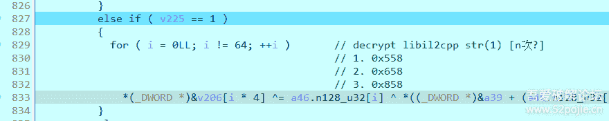

第3處字符串解密邏輯。

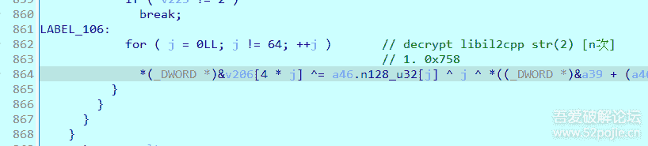

第4處字符串解密邏輯。

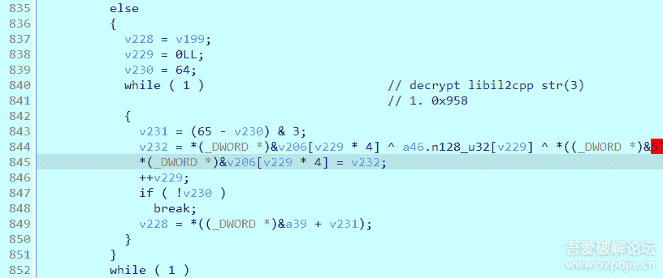

第5處字符串解密邏輯。

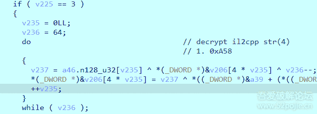

大概共有5處字符串解密邏輯，所有均為內聯的形式( 不像傳統加固那樣具有一個統一個字符串解密函數 )。

之後會在下圖`JUMPOUT`處解密子so的重定向表、`.dynamic`信息、代碼段等信息。

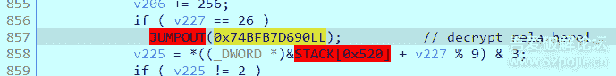

`JUMPOUT`裡的第1處解密邏輯如下，這裡解密的是子so的部份重定向信息。

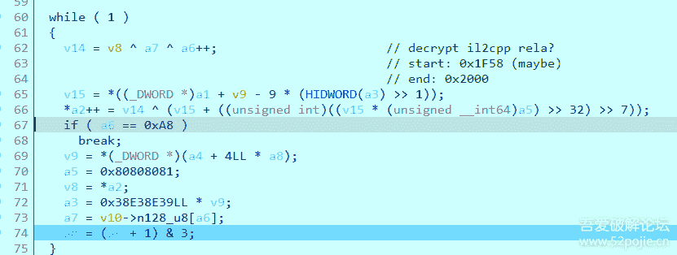

接著是第2處解密邏輯，這裡不單只會解密子so的重定向表，還會解密子so的`.dynamic`信息、代碼段等信息。

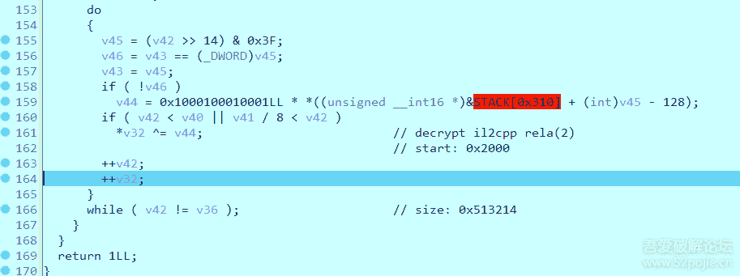

#### 5.2.2 子so預鏈接

回到`main_func()`。

之後會根據`decrypt1()`中解密的`.dynamic`信息進行預鏈接，相關數據被保存在`soinfo`變量中。

注：雖然解密的子so`.dynamic`信息中包含符號表，但實際上這裡的預鏈接並沒有存儲子so的符號表信息，後續「解密子so符號表」中解密&使用的符號表都是殼so的( 從`g_from_initarray2 + 96`中獲取 )。

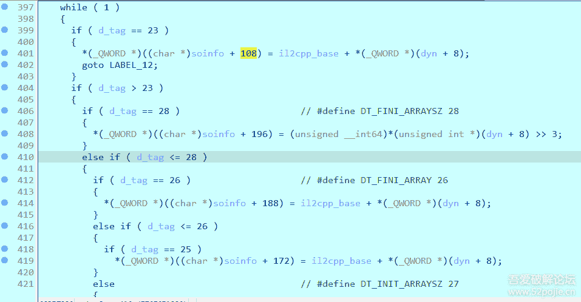

而`d_tag == 1`( `DT_NEEDED` )的情況會在之後單獨處理，這裡先將子so的所有`DT_NEEDED`庫名保存在`m_addr`( 由`malloc`而來的一片內存空間 )中。

`m_addr`可以理解成一個數組，每個元素的大小為`0xAC`，第1個屬性是庫名，之後就是一些預鏈接信息。

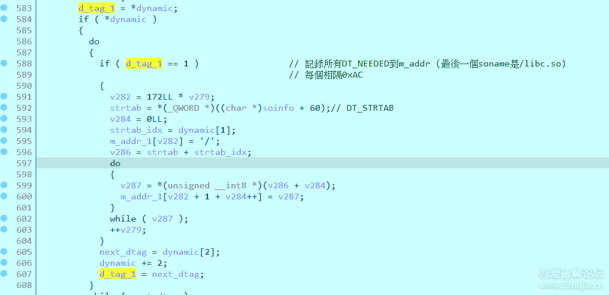

而後會調用`prelink_DT_NEEDED()`，該函數大概是對子so的依賴庫進行`prelink_image()`操作。


執行`prelink_DT_NEEDED()`前，`m_addr`如下，只有庫名。

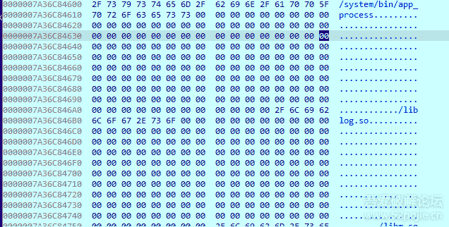

執行後，`m_addr`多了對應庫的預鏈接的信息，如第1個紅框是`app_process`符號表的地址，第2個紅框是字符串表。

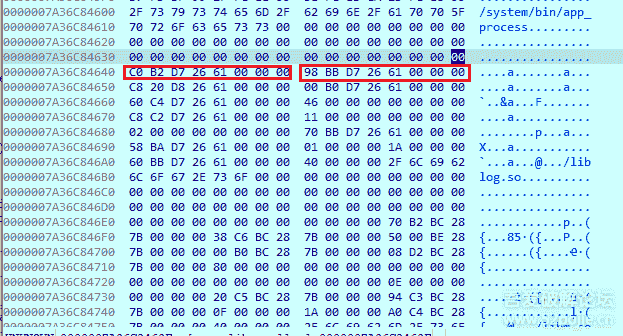

接著就是子so的重定向工作。

#### 5.2.3 子so的`DT_JMPREL`重定向

下面是第1處重定向邏輯，用的重定向表是上面預鏈接時的`DT_JMPREL`(`23`)。

當`sym`為`0`時，重定向過程如下。其中`soinfo[3]`是`base`，`my_rela`是自定義的重定向表中的一項元素。

- `*(base + *my_rela)`本身指向一個大偏移值，如`0x26FD768`，這個值應該也是在`decrypt1()`裡解密的。
- `my_rela[2]`是一個小偏移值，如`0x10`。

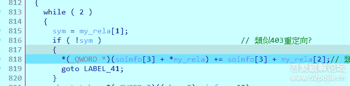

`my_rela`是類似如下的三元組，大致可以對應常規的，不同的是`r_info`中沒有type信息( 如`0x403`、`0x402`等重定向類型 )。


```
LOAD:00000074BD5BBC8C DCQ 0x26F8778
LOAD:00000074BD5BBC94 DCQ 0
LOAD:00000074BD5BBC9C DCQ 0x10
```

當`sym`不為0時，會先從`strtab`獲取`sym`對應的字符串，假設是`"free"`，然後調用`get_target_addr()`嘗試尋找函數地址，有以下幾種情況：

- 目標函數在`g_func_array`中，直接從其中返回對應函數地址。
- 目標函數是自實現的，如`memcpy`、`memset`等，直接返回對應自實現的函數地址。
- 目標函數是`dl`系列的，直接返回`g_dlopen`、`g_dlsym`等全局變量（這些全局變量是在之前已經賦值的）。
- 找不到時，默認返回`0`。


若`get_target_addr()`成功返回對應函數地址，則直接在下面這裡進行重定向。


若`get_target_addr()`返回`0`，則會遍歷保存在`m_addr`的子`so`依據庫，然後進行`GNU HASH`看看目標符號是否在指定`so`中。


通過`GNU HASH`成功找到符號偏移，加上基址就是目標函數的真實地址。

最終根據`my_rela`將該函數地址賦給對應地方，完成重定向（類似`0x401`重定向）。


### 5.2.4 子so的`DT_RELA`重定向

然後是調用`relocate()`進行第2處重定向邏輯，用的重定向表是上面預鏈接時的`DT_RELA(7)`，記這個重定向表為`rela`。


`relocate()`的實現就跟linker的實現比較一致了，可以看到熟悉的`0x401`、`0x101`等重定向類型了。


通過以下腳本檢查`rela`重定向表的類型，會發現只有`0x403`重定向。

```
import struct

type_map = {}
def parse_my_rela_item(item):
    global g_libil2cpp_data

    # '
```

### 5.2.5 清理現場

可以選擇在這個時機dump一些子`so`的解密數據，如子`so`的字符串表、`.dynamic`信息和重定向表。

`relocate()`後，會清空子`so`字符串表，起始偏移是`0x45C`，循環裡清空了`0xA20`字節，之後又單獨清空了`8`字節，共`0xA28`字節，由這裡可以看出字符串表的真實範圍是由`0x45C → 0xE84`。


然後清空子`so`的`.dynamic`信息，範圍由`0x26FFB28 → 0x26FFCB8`。


然後清空`rela`，範圍由`0xE84 → 0x552C74`。


最後清空`my_rela`（大概是自定義的重定向表），範圍由`0x552C74 → 0x55FF04`。


### 5.2.6 解密子so符號表

完成子`so`的預鏈接和重定向後，會解密子`so`的符號表（以及解密對應的符號名）。

而上面提到，在對子`so`進行預鏈接時並不包括符號表的部份，因此這裡解密的其實是殼`so`的符號表，以及殼`so`的字符串表。

`so`文件每個符號表項的結構定義如下：

```
struct Elf64_Sym {

  [4] Elf64_Word      st_name;  // Symbol name (index into string table)

  [1] unsigned char   st_info;  // Symbol's type and binding attributes

  [1] unsigned char   st_other; // Must be zero; reserved

  [2] Elf64_Half      st_shndx; // Which section (header tbl index) it's defined in

  [8] Elf64_Addr      st_value; // Value or address associated with the symbol

  [8] Elf64_Xword     st_size;  // Size of the symbol

}
```

根據`st_other`是否`0x10`來判斷當前符號（`Elf64_Sym`）是否需要解密。


`Elf64_Sym`中有兩個東西需要解密：

- `st_name`指向的字符串。
- `st_value`符號偏移值。

首先會解密`st_name`指向的字符串，同樣是通過多處內聯的形式進行解密。


然後就是解密`st_value`，解密邏輯是個簡單的異或，而該異或值是`*(g_from_initarray2 + 120)`，它是在`init_array_func2()`的`unknow_func()`中計算出來的，固定是`0xFDE673F1`。


一般的符號的解密流程如上所述，而在遇到`il2cpp_domain_get_assemblies`時會做一些特殊處理，不再是異或`0xFDE673F1`，而是直接賦予一個函數偏移。


另一種特殊情況是`st_other == 0x30`。


發現該符號名解密後是`JNI_OnLoad`（當然這並不代表`st_other == 0x30`就是獨指`JNI_OnLoad`的情況）。


由此大概可以知道，`st_other`是分類標誌，`0x10`代表`libil2cpp.so`的符號（如`il2cpp_XXX`），`0x30`代表其他符號等等。

### 5.2.7 main_func最後

調用了`do_something3()`，在其中把`libFairGuard.so`中某個函數賦給了一個全局變量。然後是一些清理堆棧的操作。

一開始沒看懂`do_something3()`的作用，後來看乐子人大佬的文章才發現裡面貌似hook了`libil2cpp.so`的某個函數，目的是為了解密`global-metadata.dat`。


最後間接調用了一堆函數，應該就是子`so`的初始化函數。


## 6. so修復

簡單記錄下修復思路，按該思路是可以完美修復的。

（完整的修復腳本就不放出來了，免得又被和諧了）

### 6.1 前置準備

根據上述分析，在合適的時機dump以下數據。

- 子`so`的字符串表（`0x45C → 0xE84`），記為`strtab`。
- 子`so`的`DT_RELA`（`0xE84 → 0x552C74`），記為`rela`。
- 子`so`的`DT_JMPREL`（`0x552C74 → 0x55FF04`），記為`my_rela`。
- 子`so`的動態段信息（`0x26FFB28 → 0x26FFCB8`），記為`dyn`。
- 殼`so`的字符串表（`0x2ACE9F8 → 0x2AD0360`），記為`k_strtab`。
- 殼`so`的符號表（`0x2AC89C8 → 0x2ACE9F8`），記為`k_symtab`。
- 子`so`的代碼段等信息，記為`0x55FF04_0x289B0A0`。

上面分析時提到`my_rela`與一般的重定向項不同，因此為了讓linker能順利識別，需要手動轉換一下。

轉換思路是將`my_rela`每項都變為`0x403`或`0x402`重定向，前者直接轉換即可，後者比較麻煩，要修改為對應的符號索引。

觀察後會發現殼`so`的符號表中存在一堆沒用的空符號，可以利用這些空符號。

記轉換後的`my_rela`記為`my_rela_convert`。

### 6.2 正式開始用`010Editor`進行修復

載體為最原本的`libil2cpp.so`。

殼`so`的`.dynamic`的`size`為`0x320`，而實際大小只有`0x1B0`，大概是為了兼容子`so`的`.dynamic`。


因此可以直接將`dyn`複製到對應位置（`0x2B0C010`）。

將其中`DT_STRTAB(5)`那項改為殼`so`的字符串表（`0x2ACE9F8`）、將其中`DT_SYMTAB(6)`那項改為殼`so`的符號表（`0x2AC89C8`）。

目前這兩個位置（`0x2ACE9F8`、`0x2AC89C8`）仍是一些加密數據，後面會將其覆蓋為對應的解密數據。


然後修復`DT_JMPREL(0x17)`和`DT_RELA(7)`對應的兩張不同的重定向表。

前者的起始偏移是`0x552C74`，將`my_rela_convert`複製到這裡。


後者的起始偏移是`0xE84`，將`rela`複製到這裡。


然後將`k_strtab`複製到`0x2ACE9F8`。


然後將`strtab`（子`so`字符串表）複製到`0x2AD0360`（殼`so`字符串表結束位置）。

注：字符串表的大小可以從`.dynamic`裡獲取。


將`k_symtab`複製到`0x2ac89c8`（殼`so`符號表）。


將`0x55FF04_0x289B0A0`複製到`0x55FF04`位置，其中包含解密後的子`so`代碼段、數據段等信息。


這樣修復完後，雖然還不能替換到原APP中，但已經可以使用`Il2cppDumper`，只需手動查找`CodeRegistration`和`MetadataRegistration`即可。

```
Input CodeRegistration: 0x26F8D30
Input MetadataRegistration: 0x26F9A80
```

若追求完美修復（即替換APP的`libil2cpp.so`且不會閃退），可檢查以下地方（結合linker日志來分析）：

- `strtab_size_`是否正確。
- `.dynamic`信息中需要修改的有：`DT_NEEDED`、`DT_HASH`、`DT_VERNEED`、`DT_VERNEEDNUM`。
- `.got`表是否有寫權限，如沒有，則手動修改`phdr table`（將`PT_GNU_RELROy`那段修改為`RW`的`loadable seg`）。
- 將子`so`的`JNI_OnLoad`替換為真實的`JNI_OnLoad`，原本的`JNI_OnLoad`會用到殼`so`在`init_array`初始化的一些變量，若子`so`調用了原本的`JNI_OnLoad`會crash。
- 把解密後的`global-metadat.dat` dump出來，然後替換到指定位置（該位置可從`maps`裡查看）。

## 7. About U3D

用dump出來的`global-metadata.dat`，加上完美修復後的`libil2cpp.so`，可以直接使用`Il2cppDumper`。


## 8. 結語

經過之前分析某盾，本以為修復`so`會花很長時間，沒想到比想像中快得多，反而是加固流程的分析花了比較多的時間。總的來說該加固整體的感覺和某盾是挺像的，難度也在伯仲之間。

最後特別感謝乐子人大佬的文章，對修復`so`的幫助很大。
