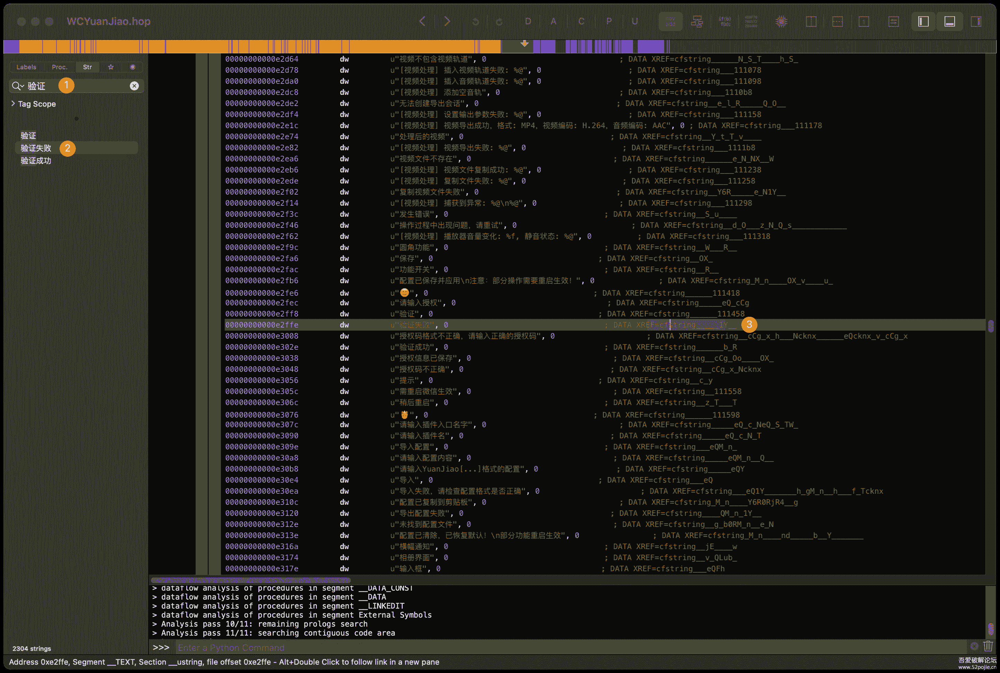
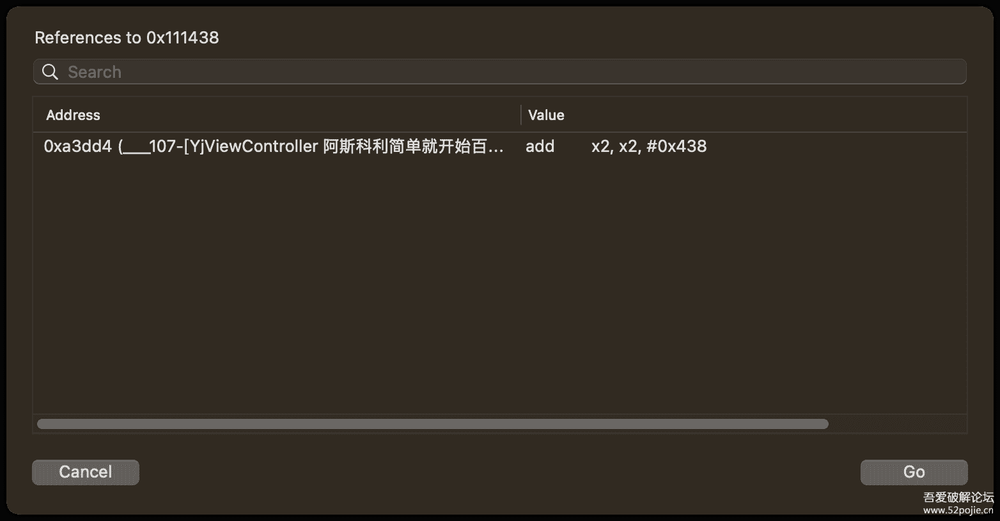
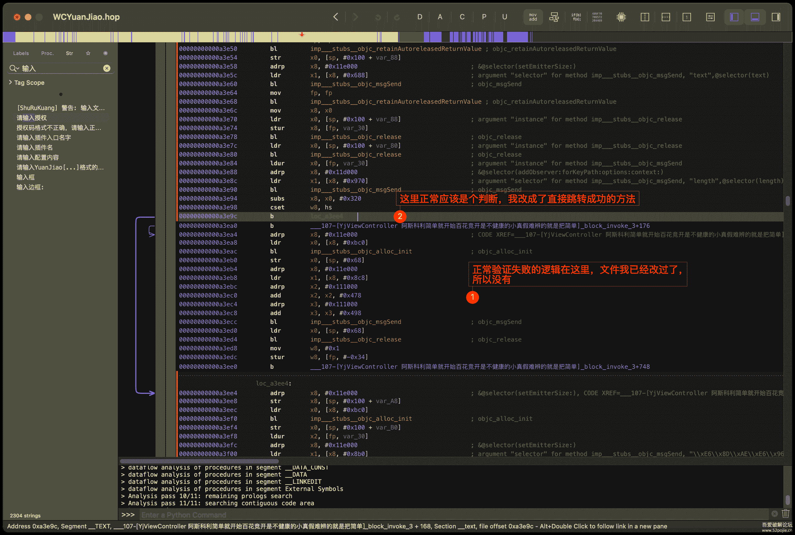
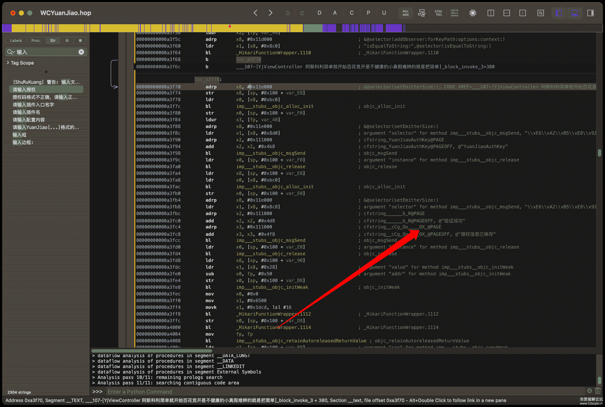

# [iOS 原创] iOS-WCYuanJiao美化插件逆向

- 原帖: `https://www.52pojie.cn/forum.php?mod=viewthread&tid=2041799`
- 抓取时间: 2026-11-01T15:43:35.244Z

兄弟们，我又又又又又又来潜水了。

今天分享一个vx插件圆角美化的逆向教程。喜欢记得给个三连Star！！！

首先，我们安装插件到vx，可以看到设置进入他的圆角界面，但是打开开关会提示你需要授权，不然无法使用。

好了，既然有了出发点，我们就可以直接开始了！

## 工具

- `WCYuanJiao.dylib`
- `hopper`

上图：

查看交叉引用：

双击跳转：

双击我强制跳转的方法你就可以看到成功的方法：

大功告成，安装打开即可使用。

喜欢记得给个三连Star。

插件自己去找，vx圆角美化，一找就能找到
