# [Android 原创] 新手记录一次引流弹窗去除

- 原帖: https://www.52pojie.cn/forum.php?mod=viewthread&tid=2042142
- 抓取时间: 2026-11-01T15:43:28.397Z

新手来也，不提供软件，只提供思路。

这是一款免费的软件，奈何有人给他加了引流弹窗，按论坛上各位前辈的方法，开搞，用`np`查壳未加固

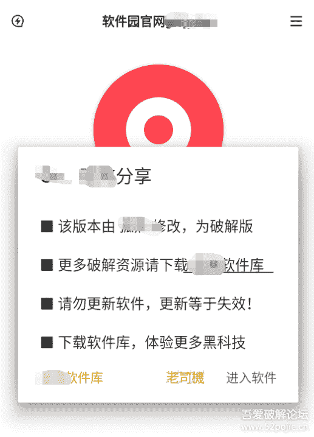

首先这个弹窗不是本地的，是写在云端上的，断网就不会弹窗，用小蓝鸟抓包，验证了我的想法

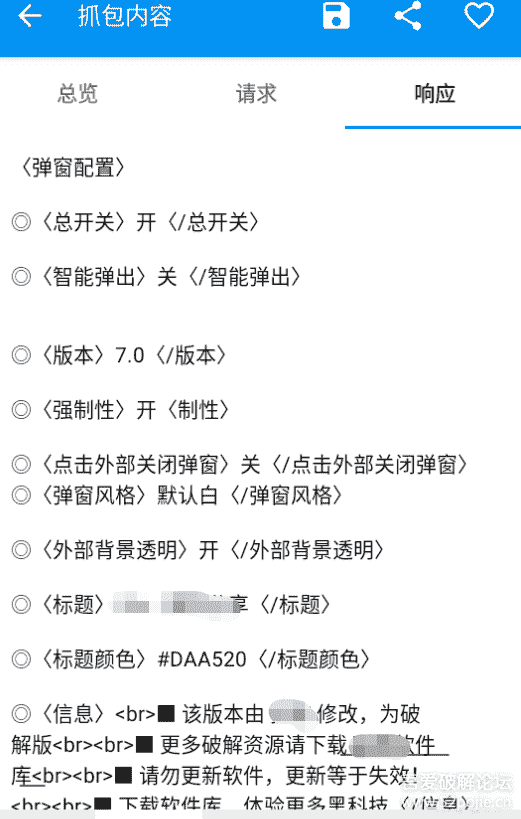

上算法助手，弹窗拦截

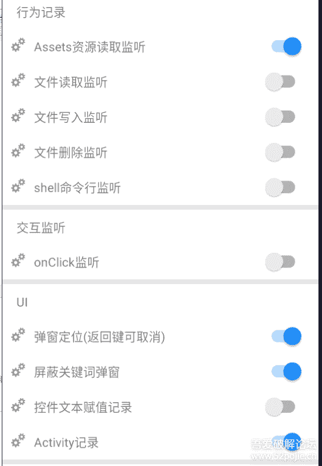

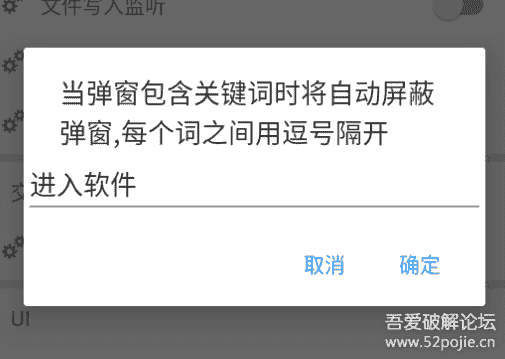

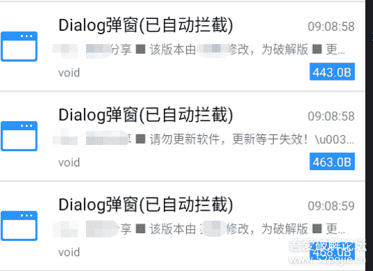

实际上有两个弹窗

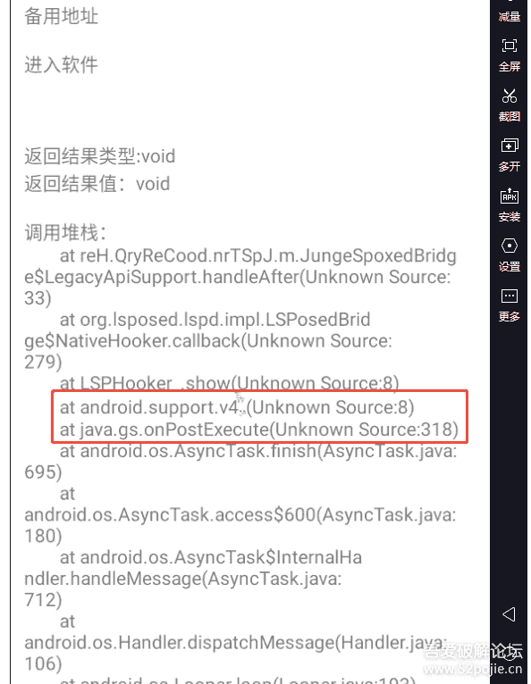

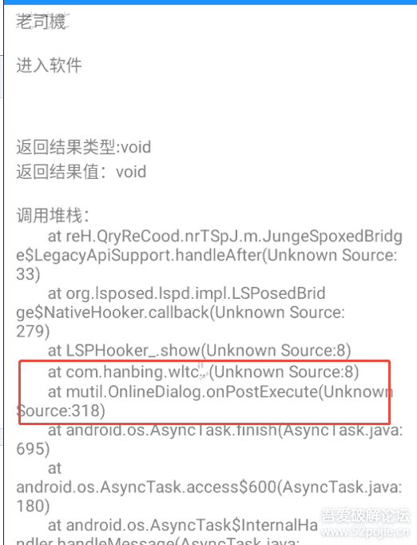

直接上`np`，直接搜方法名，要注意的是这个里面有一些小字符漏了就搜不到了

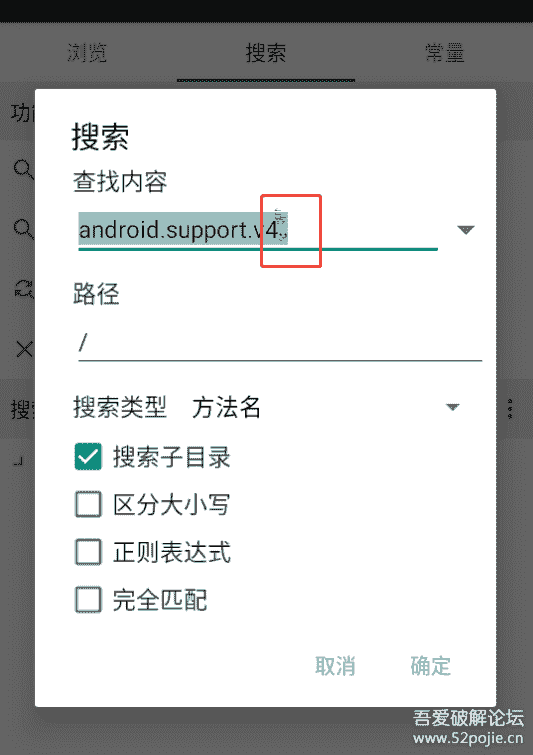

已经看到了弹窗

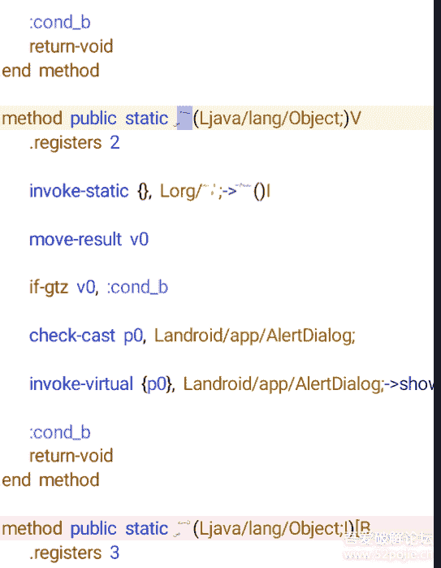

看`p0`这里是弹窗，往上找，是一个`check HttpURLConnection`

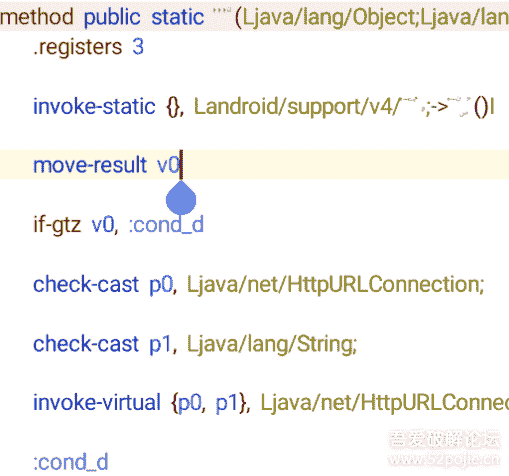

哪有啥比较快的方法直接把这两弹窗，云注入弹窗我不太会，哈哈哈哈哈

再看下抓包信息，

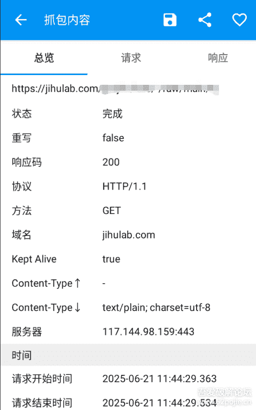

这不是极弧吗，类似GitHub的网站，`get`请求直接浏览器打开看下

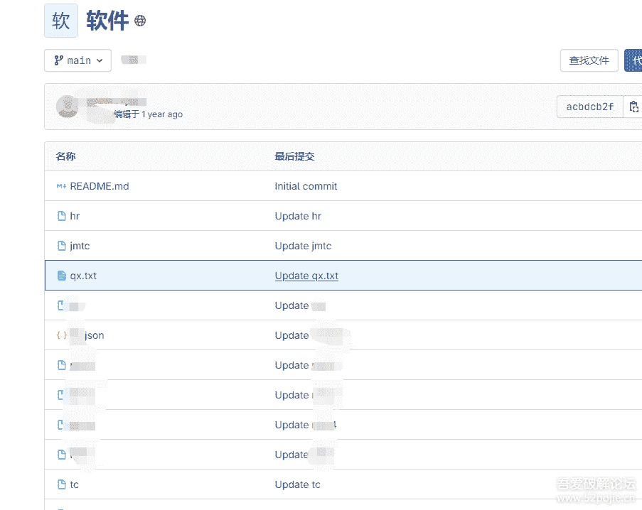

弹窗内容及配置写好了，直接搜索极狐的名字把，把两个`classes.dex`文件编译+

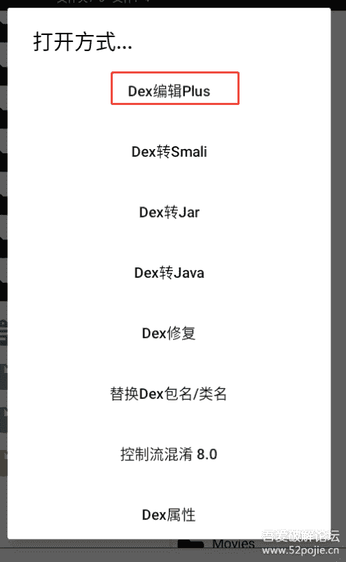

直接搜索关键词，选代码

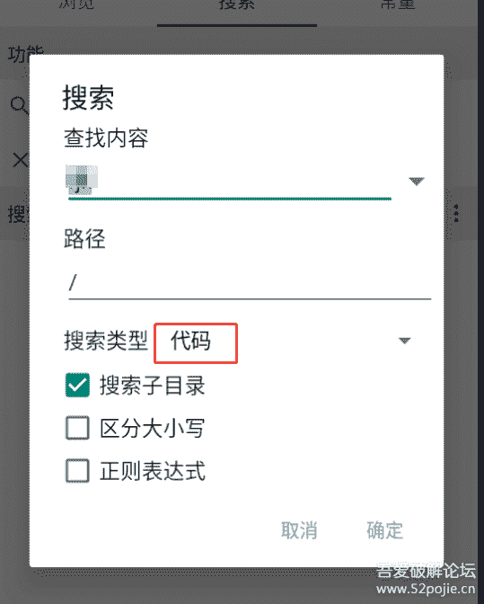

就5个结果，看了一下后面三个没用，第二个`mainactive`，这不就来了吗，进去看看

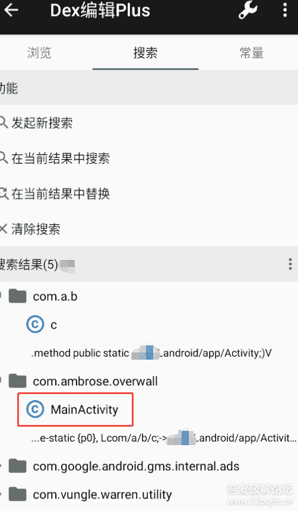

这不是之前算法助手抓取的调用堆栈里的吗，直接注释掉这三行，前面加`#`就行

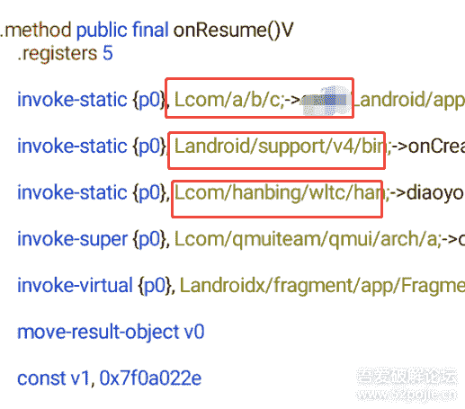

试了下打开不弹窗了，结束，新手菜鸟，各位大佬轻点喷

，有更好的方法欢迎大家在评论区发表
