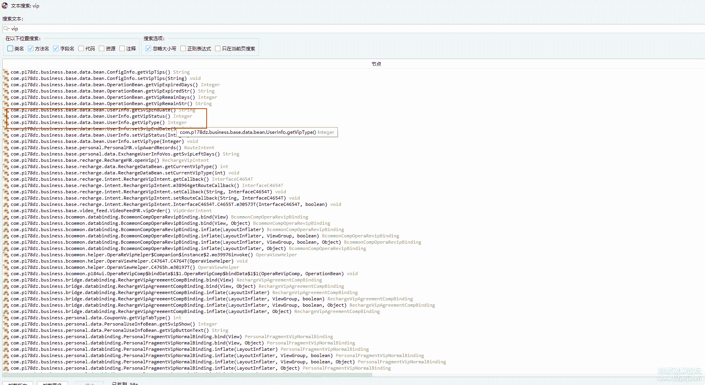
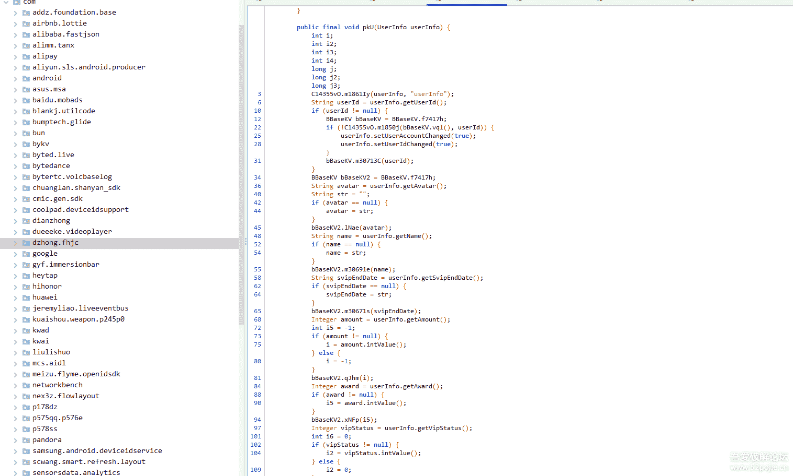
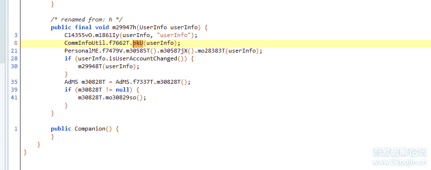
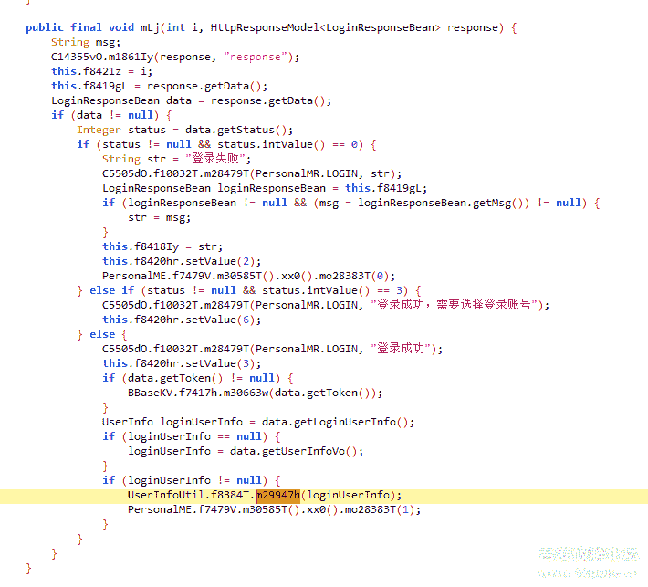
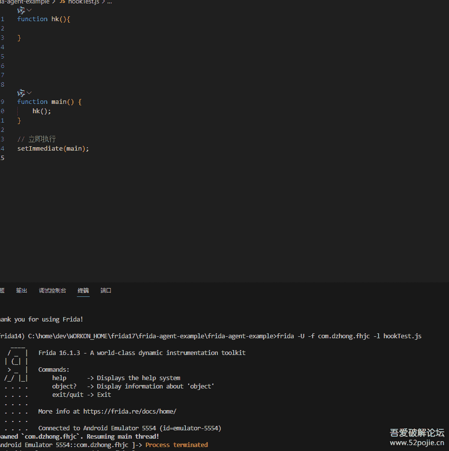
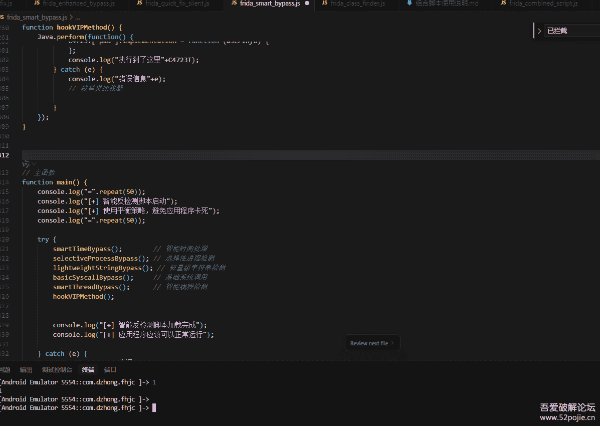
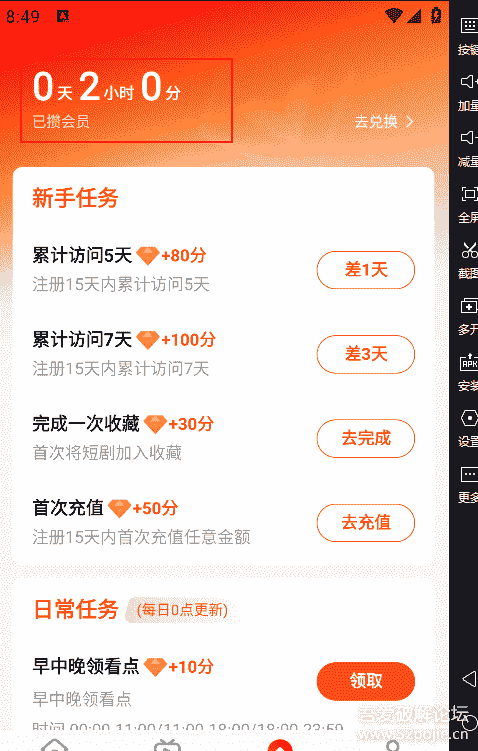

# [Android 原创] 解锁繁花剧场会员

- 原帖: https://www.52pojie.cn/forum.php?mod=viewthread&tid=2044152
- 抓取时间: 2026-11-01T15:43:23.055Z

老规矩 先搜索 VIP



查找调用处 发现这个方法进行了调用



继续一步一步的跟进去





这里我们知道逻辑大概是 调用请求获取用户的信息 通过 `userInfo` 中的 `getVipStatus` `getVipType` `getSvipEndDate` 判断 VIP 的等级 类型 和到期时间。

先试一下 `frida` hook 一下



果然有检测

好了先写过检测的脚本 费了九牛二虎之力终于写好了



我们再来看看 原先的 我们打开的界面


hook 之后的




好了 大功告成 第一次发帖写的不好 请见谅 APP名称 繁花剧场 可以在应用商城下载到

下面是 JS 代码：

```javascript
console.log("[+] 启动智能反检测脚本...");

// 智能时间管理
var g_start_time = Date.now();
var g_last_time = 0;
var g_time_calls = 0;
var g_proc_blocks = 0;

// 1. 智能时间检测绕过 - 允许时间正常流逝
function smartTimeBypass() {
    console.log("[+] 智能时间检测绕过...");
   
    var clock_gettimePtr = Module.findExportByName("libc.so", "clock_gettime");
    if (clock_gettimePtr) {
        Interceptor.attach(clock_gettimePtr, {
            onEnter: function(args) {
                this.clk_id = args[0].toInt32();
                this.tp = args[1];
            },
            onLeave: function(retval) {
                if (retval.toInt32() === 0 && this.tp) {
                    try {
                        // 读取当前返回的时间
                        var current_sec = Memory.readU64(this.tp).toNumber();
                        var current_nsec = Memory.readU64(this.tp.add(8)).toNumber();
                        var current_time = current_sec * 1000 + Math.floor(current_nsec / 1000000);
                        
                        // 检测异常快速的时间调用（可能是检测行为）
                        if (g_last_time > 0) {
                            var time_diff = current_time - g_last_time;
                           
                            // 如果时间间隔小于1毫秒，可能是检测行为
                            if (time_diff  0) {
                            var time_diff = current_time - g_last_time;
                            if (time_diff  0) {
                    try {
                        var content = Memory.readUtf8String(this.buf, Math.min(retval.toInt32(), 256));
                        
                        // 检查是否包含 Frida 相关信息
                        if (content.toLowerCase().indexOf("frida") !== -1 ||
                            content.indexOf("gum-js-loop") !== -1 ||
                            content.indexOf("gmain") !== -1) {
                           
                            // 替换为无害的内容
                            var fake_content = "com.android.systemui\n";
                            Memory.writeUtf8String(this.buf, fake_content);
                            retval.replace(fake_content.length);
                        }
                    } catch (e) {
                        // 忽略读取错误
                    }
                }
            }
        });
    }
}

// 3. 轻量级字符串检测绕过
function lightweightStringBypass() {
    console.log("[+] 轻量级字符串检测绕过...");
   
    var dangerous_strings = ["frida", "gum", "linjector"];
   
    var strstrPtr = Module.findExportByName("libc.so", "strstr");
    if (strstrPtr) {
        Interceptor.attach(strstrPtr, {
            onEnter: function(args) {
                try {
                    this.needle = Memory.readUtf8String(args[1]);
                } catch (e) {
                    this.needle = null;
                }
            },
            onLeave: function(retval) {
                if (this.needle) {
                    var needle_lower = this.needle.toLowerCase();
                    for (var i = 0; i  0 || g_proc_blocks > 0) {
        console.log("[+] 状态: 处理了 " + g_time_calls + " 次异常时间调用, 阻止了 " + g_proc_blocks + " 次进程检测");
    }
}, 60000);
```
