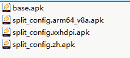
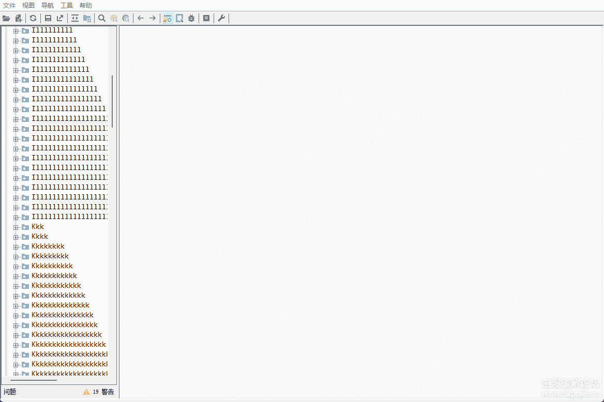
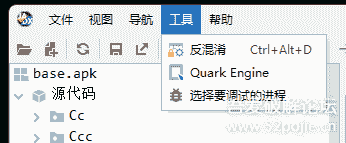
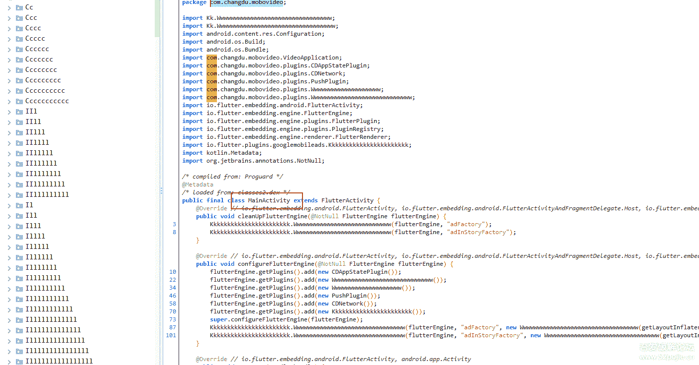
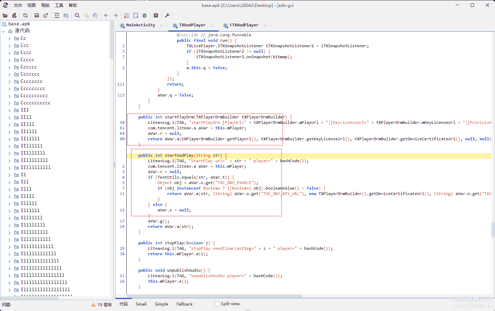
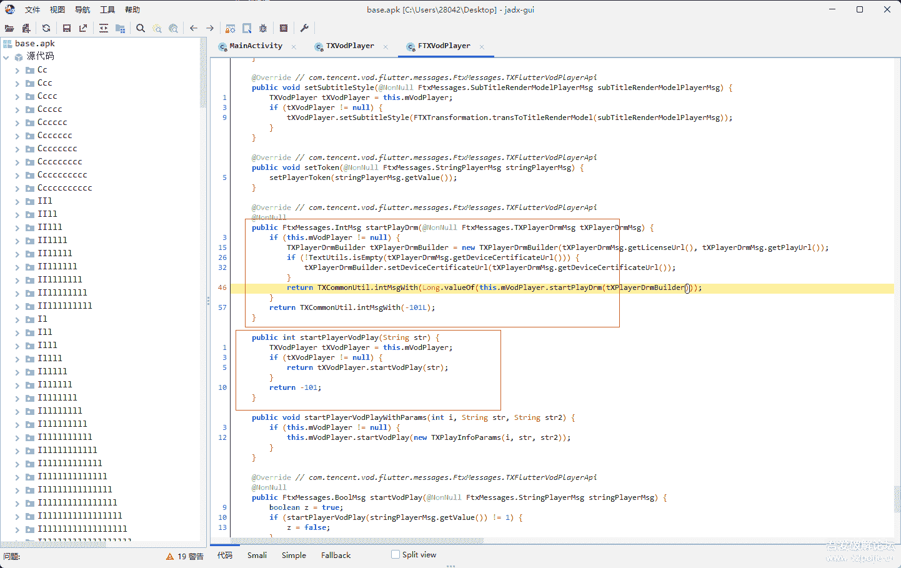
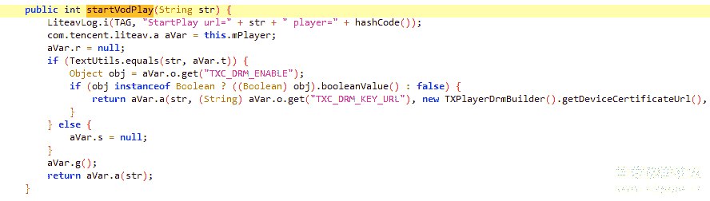
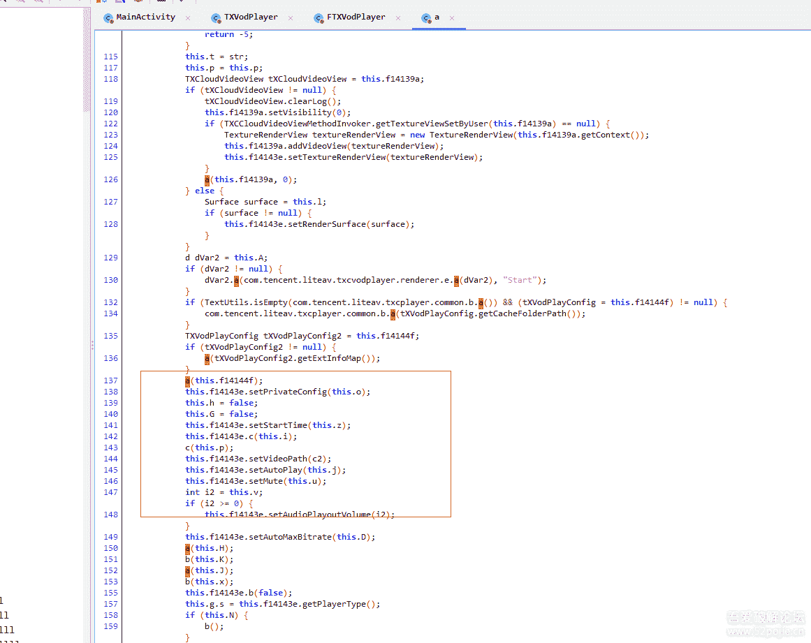
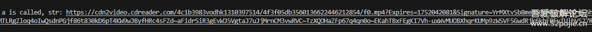
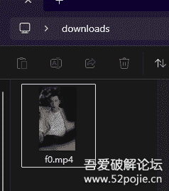

# [Android 原创] 某海外平台短视频app逆向分析研究

- 原帖：https://www.52pojie.cn/forum.php?mod=viewthread&tid=2044552
- 抓取时间：2026-11-01T15:43:17.092Z

## 一、安装包提取与初步分析

首先从海外平台下载此应用到测试机中，然后通过 `mt管理器` 提取出他的安装包，发现安装包是 `apks` 格式的。

网上搜索了一下，发现 `apks` 是某海外平台的格式，直接将 `apks` 修改后缀名为 `zip` 后解压，发现如下几个 `apk` 子包体内容：



其核心代码都放在 `base.apk` 中，所以我们只要先分析里面的代码。

通过 `jadx` 打开后发现其代码已经被混淆了：



于是通过 `jadx` 的反混淆功能后，也于事无补：



那先不管，先通过开发者工具测试，找到 `app` 的当前 `activity`，如下图：



大概看了一遍后也没啥用，这里只是好奇想看看启动的入口而已。


然后继续回到 `jadx` 找相应的代码，根据多个小时的代码分析和测试。


最终发现如下几个代码文件信息量非常大，估计可能就是播放源的操作：





## 二、定位播放源与 Hook 验证

最后通过 `frida` 的 `hook` 这几个方法后，发现来回播放视频都会调用 `TXVodPlayer` 的 `startVodPlay(String str)` 方法，其中 `str` 就是播放源的 `uri` 链接地址。



返回的时候调用了 `aVar.a(str)`，继续跟踪其方法：



发现 `a` 方法内部有控制其播放的操作，由此可以判定已经找到了下载源和播放视频的调用方法。

最后 `frida` 去 `hook` 此调用的 `startVodPlay` 方法：

```javascript
let TXVodPlayer = Java.use("com.tencent.rtmp.TXVodPlayer");
TXVodPlayer["startVodPlay"].overload('java.lang.String').implementation = function (str) {
    console.log('startVodPlay is called' + ', ' + 'str: ' + str);
    let ret = this.startVodPlay(str);
    return ret;
};
```

结果出现了加密的 `uri` 下载源：



## 三、下载加密 URI 视频

将其下载源放入浏览器后发现没权限等提示，很恼火。

于是灵机一动，通过 `AI` 写一段 `python` 读取下载源的代码，并保存为 `mp4` 格式：

```python
import requests
import os
import re
from urllib.parse import urlparse
from datetime import datetime

def download_video(url, output_dir="downloads"):
    """
    下载带有签名的视频文件

    参数:
        url (str): 视频URL
        output_dir (str): 保存目录
    """
    # 创建保存目录
    os.makedirs(output_dir, exist_ok=True)

    # 从URL中提取文件名
    parsed_url = urlparse(url)
    filename = os.path.basename(parsed_url.path)

    # 检查URL中的Expires参数
    match = re.search(r'Expires=(\d+)', url)
    if match:
        expires_timestamp = int(match.group(1))
        expires_date = datetime.utcfromtimestamp(expires_timestamp)
        now = datetime.utcnow()

        # 检查链接是否过期
        if now > expires_date:
            print(f"警告: 链接已于 {expires_date} 过期!")
            return False

    # 设置请求头
    headers = {
        "User-Agent": "Mozilla/5.0 (Windows NT 10.0; Win64; x64) AppleWebKit/537.36 (KHTML, like Gecko) Chrome/91.0.4472.124 Safari/537.36",
        "Accept": "video/webm,video/ogg,video/*;q=0.9,application/ogg;q=0.7,audio/*;q=0.6,*/*;q=0.5",
        "Referer": "https://xxxxxx.com/",  # 假设来源网站
    }

    # 文件保存路径
    save_path = os.path.join(output_dir, filename)

    try:
        print(f"开始下载: {filename}")

        # 使用流式下载
        response = requests.get(url, headers=headers, stream=True)
        response.raise_for_status()  # 检查HTTP错误

        total_size = int(response.headers.get('content-length', 0))
        downloaded = 0

        # 写入文件
        with open(save_path, 'wb') as f:
            for chunk in response.iter_content(chunk_size=8192):
                if chunk:  # 过滤掉保持连接的新块
                    f.write(chunk)
                    downloaded += len(chunk)

                    # 显示下载进度
                    if total_size > 0:
                        percent = (downloaded / total_size) * 100
                        print(f"\r下载进度: {percent:.2f}% ({downloaded}/{total_size} bytes)", end='')

        print(f"\n视频已成功保存到: {save_path}")
        print(f"文件大小: {downloaded / (1024 * 1024):.2f} MB")

        # 验证文件完整性
        if total_size > 0 and downloaded != total_size:
            print("警告: 下载文件大小与预期不符，文件可能不完整")
            return False

        return save_path

    except Exception as e:
        print(f"下载失败: {e}")
        return False

if __name__ == "__main__":
    # 您的视频URL
    video_url = "https://xxxxx.xxxx.com/4c1b3983vodhk1310397514/4f3f05db3560136622446212854/f0.mp4?Expires=1752042081&Signature=YrMXtvSb8me66QuH05nMW48rmS6h-~P7xAQ21JlPxFGpS1FGKyFI1gzKz05--dotLXEwhPM4a920SGh2jfCXTdqswVn7KCn-LPz1u30xHX2XnqcRf5HfWkRCwfu4MTLRgZloq4oIwQsdnPGjf86t830kD6pT4KW9wJByfHRc4sFZd~aFidrSiR3gEvWJ5VgtaJ7uJjMrnCM3vwRVC~TzXQOHaZFp67q4qn0o~EKahTBxFEgKI7Vh-uxWvMUOBXhqrKUMp9zWSVF5GwdRjk6kbFBEvIUlhV527RUZzPpcM0cOwmzC8PopzOo4jS~~lxmIg~fNjPAs9sNbyhgMgExlyw__&Key-Pair-Id=K3BZ1QB768QHY7"

    # 下载视频
    result = download_video(video_url)

    if result:
        print("下载完成!")
    else:
        print("下载失败!")
```

运行后成功下载 `mp4` 格式视频：



至此完成此 `app` 的播放逆向分析。

## 四、免责声明

最后叠甲：

【宇宙免责声明】

本文内容仅供学习研究，请勿用于非法途径。
