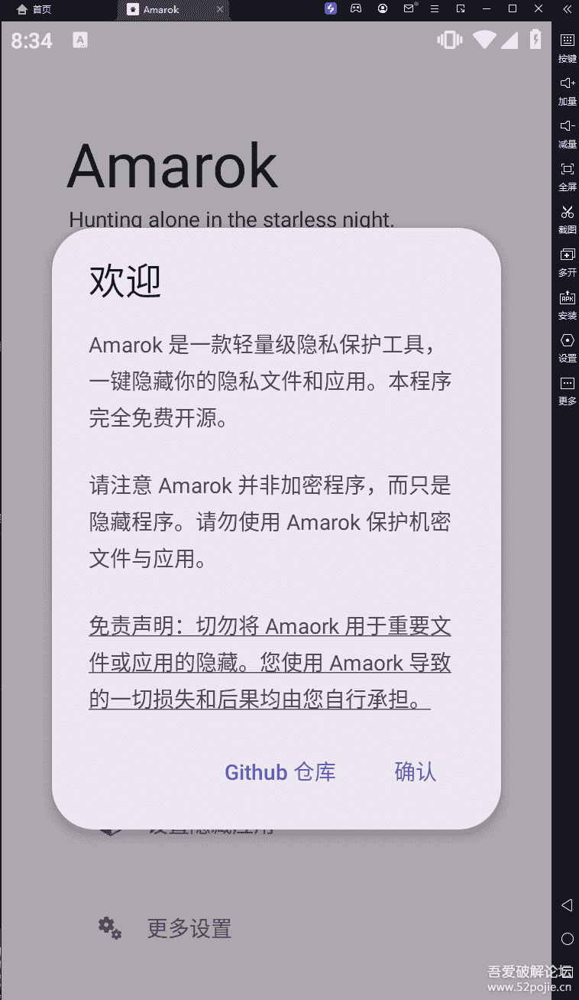
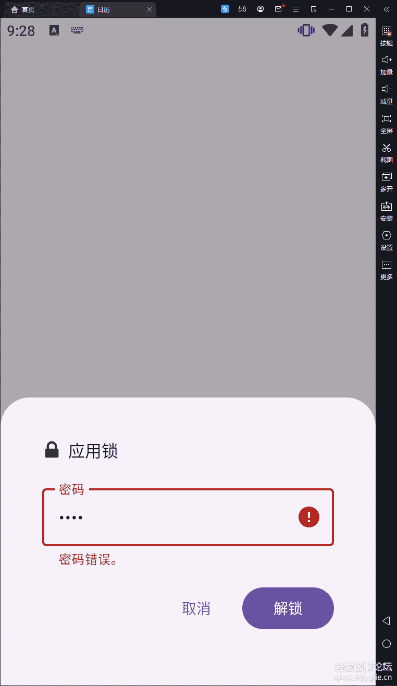
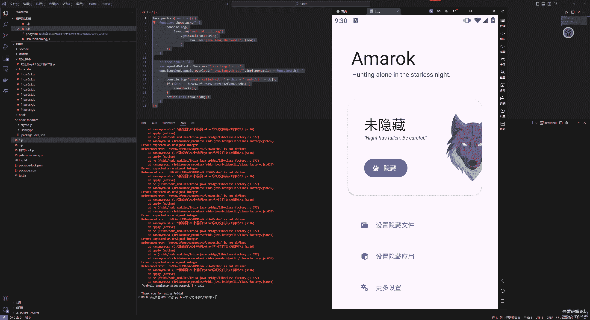
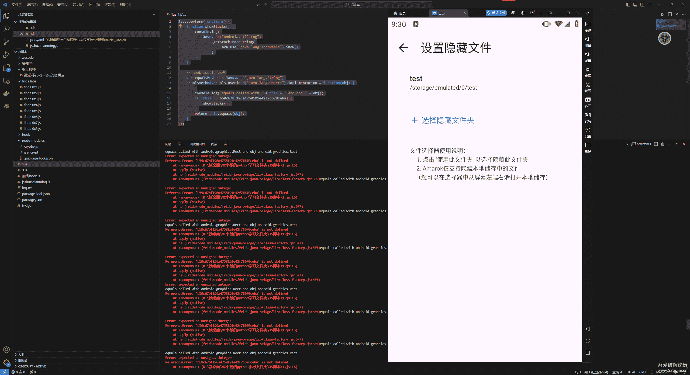
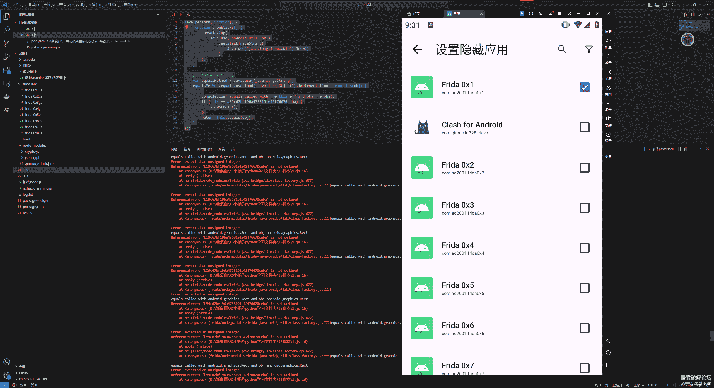
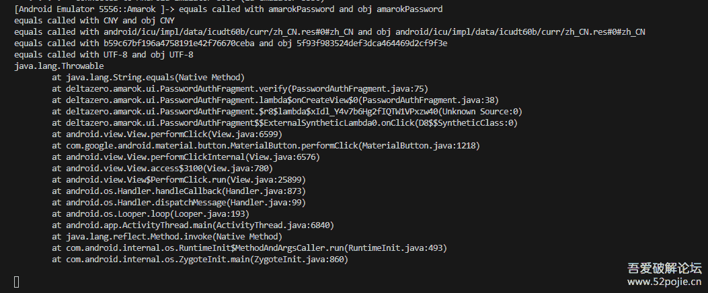
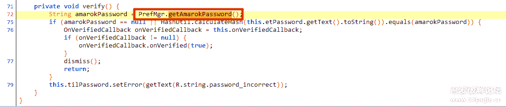
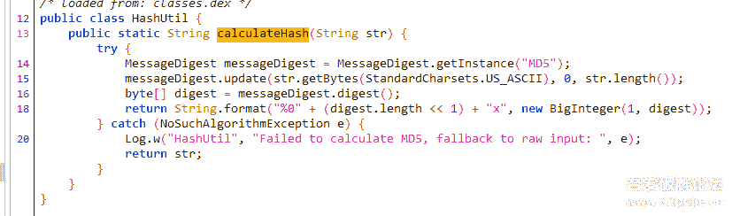
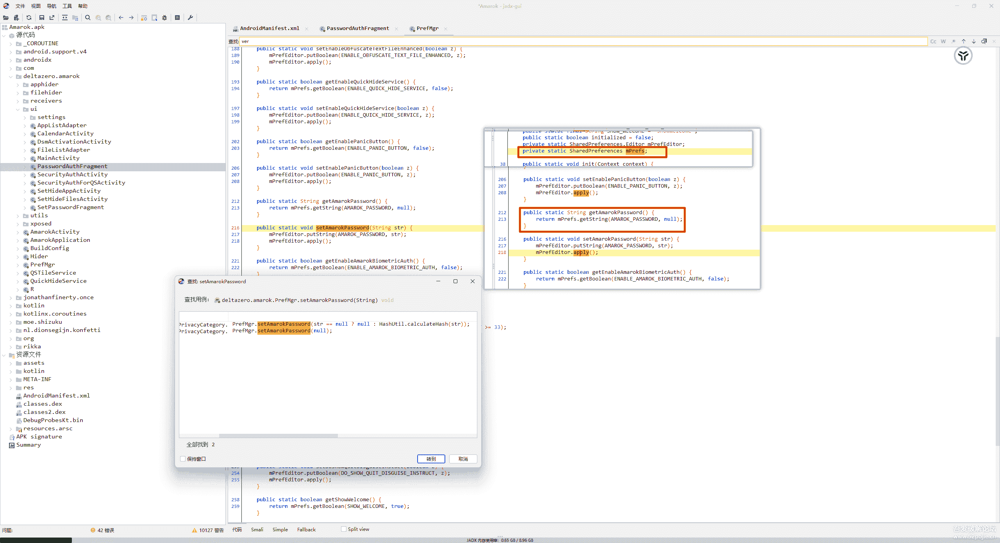
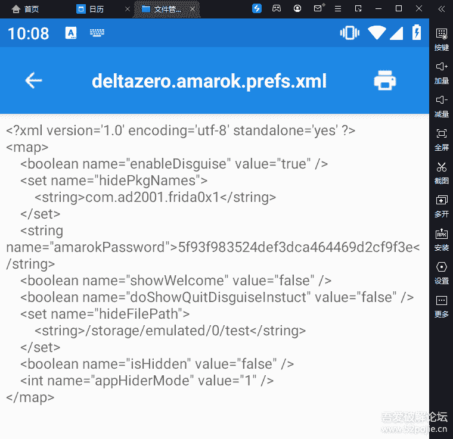

# [Android 原创] Amarok密码“绕过”

- 原帖: https://www.52pojie.cn/forum.php?mod=viewthread&tid=2044563
- 抓取时间: 2026-11-01T15:43:14.111Z

Amarok是一个开源软件，可以伪装成极简日历的可以用来隐藏文件夹和文件，这个软件我只在国内的一些取证比赛中见过，应该挺小众的，hook起来也很好hook，逻辑在Java层，通过计算输入的MD5值和密码的MD5值进行对比。写这篇文章就是记录一下这个邪门的方法，如果有大佬知道原因，也请指导一二。

设备：雷电模拟器

`frida` 16.5.2





起因就是纯菜，`if` 判断的时候漏打了一个双引号

```
Java.perform(function() {
    function showStacks() {
        console.log(
            Java.use("android.util.Log")
                .getStackTraceString(
                    Java.use("java.lang.Throwable").$new()
                )
        );
    }

    // hook equals 方法
    var equalsMethod = Java.use("java.lang.String")
    equalsMethod.equals.overload("java.lang.Object").implementation = function(obj) {

        console.log("equals called with " + this + " and obj " + obj);
        if (this == b59c67bf196a4758191e42f76670ceba) {
            showStacks();
        }
        return this.equals(obj);
    }
});
```

在密码错误的情况下进行注入操作，点击解锁。虽然一串的报错，但是可以看到是正常进来的。





隐藏的软件也是可以看到的，也可以正常操作





之后又测试了几次，最好在注入之前点一下解锁，否则会有很多equals判断。然后就是一旦进入要快速执行 `exit` 退出注入，否则会闪退。操作起来还是比较麻烦的，图一乐呵，记录一下偶然发现。

写都写了，把正常hook也写一下

hook `equals` 方法，根据输出的对比值，初步可以判断是对比的哈希值，计算自己输入的密码的MD5，确认是正确的，那就判断查找堆栈

```
Java.perform(function() {

    function showStacks() {

        console.log(

            Java.use("android.util.Log")

                .getStackTraceString(

                    Java.use("java.lang.Throwable").$new()

                )

        );

    }

    // hook equals 方法

    var equalsMethod = Java.use("java.lang.String")

    equalsMethod.equals.overload("java.lang.Object").implementation = function(obj) {

        console.log("equals called with " + this + " and obj " + obj);

        if (this == "b59c67bf196a4758191e42f76670ceba") {

            showStacks();

        }

        return this.equals(obj);

    }

});
```



`HashUtil.calculateHash(this.etPassword.getText().toString())` 这一串是处理自己输出的内容的

`amarokPassword` 就跟密码有关了



`alculateHash` 这个方法就是计算MD5的，将输入的字符串计算MD5和 `amarokPassword` 进行比较



查看Java层代码发现密码的MD5是存放在文件中，找到试试 `cmd5` 爆破一下就差不多了。



`SharedPreferences` 的数据存储位置一般位于 `/data/data/包名/shared_prefs/`



Amarok的GitHub链接：[//github.com/deltazefiro/Amarok-Hider](https://github.com/deltazefiro/Amarok-Hider:https)
