# [Android 原创] 记一次`sh`脚本验证分析

- 原帖: `https://www.52pojie.cn/forum.php?mod=viewthread&tid=2045731`
- 抓取时间: 2026-11-01T15:43:11.031Z

初次发帖有啥讲的不对的地方还请各位大佬指教

我发现某站和论坛关于`sh`这种逆向的教学很少，打算出一期教学视频，仅供学习交流

## 用到的工具

- ida pro7.7版本

如图所示，这个是一个打包好的（没有加固和混淆），由于`sh`脚本的主要是由c语言进行编写的，所有我们使用ida pro 进行盘它

在这里补充一点，ida pro需要在属性这里添加`-dCULTURE=all`这段代码，不然无法识别中文字符串

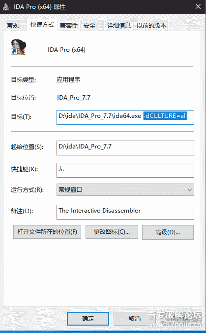

一般的`sh`脚本都是64位的（可以通过拖入不同位数的ida来确认），拖入之后默认即可，等待它完成编译，之后在上边找到视图-->打开子视图-->字串

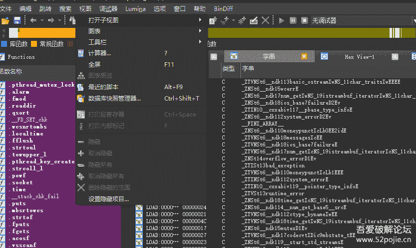

之后在字符串视图，按下`ctrl＋f`即可搜索，我们搜索一些常见的如成功、认证、登录这种，之后点击认证成功进里面去看看

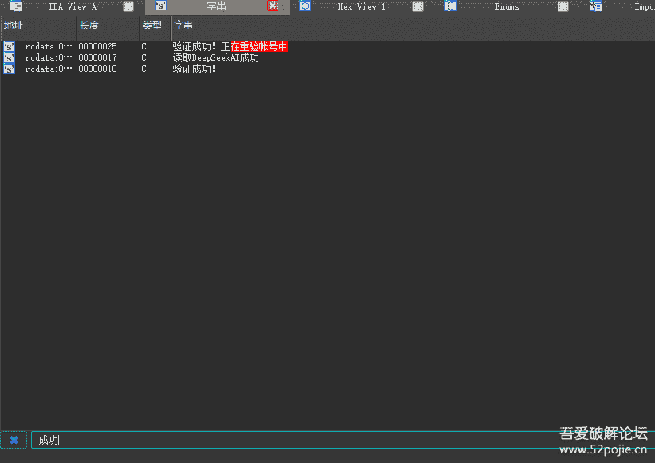

进入里面之后，注意看我画线的地方，点击我画线的这个函数去查看是从哪里进行调用的

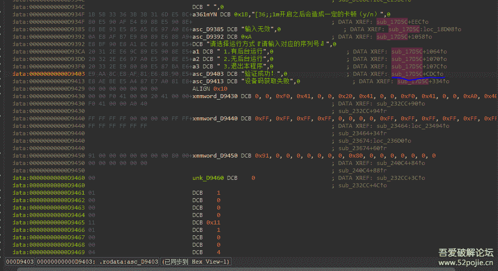

注意看这里，标记处是认证成功的函数，下面的`loc_17F38`这个地方是会走校验`id`失败的（可以点击跳转过去），我们现在要复制`loc_18A24`（紫色标记处的）因为后面会用到

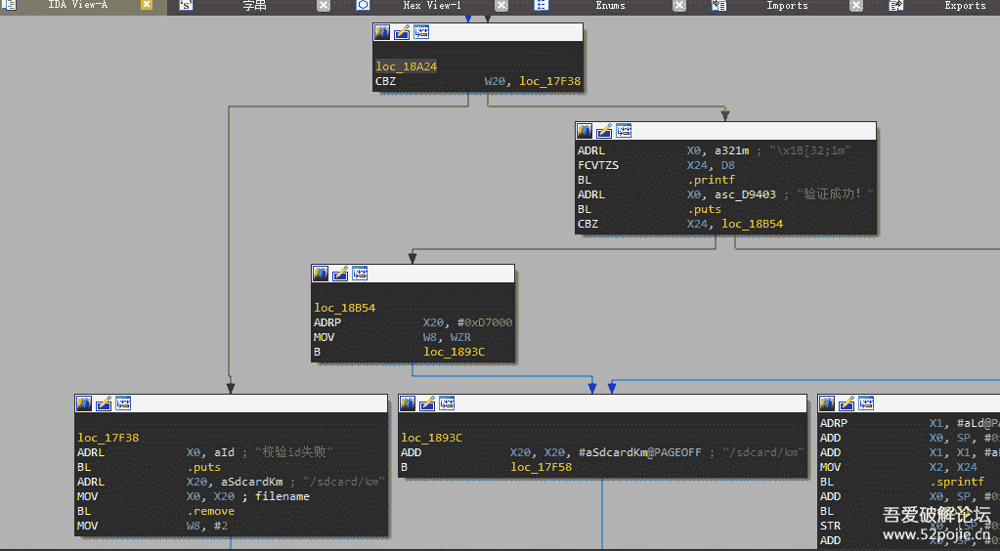

这个时候我们返回字符串视图，搜索关键词“设备”，刚刚我们找到了认证成功的地方了，现在我们要去找他认证错误的逻辑，选择“设备码已重新获取！正在重新验证密码”

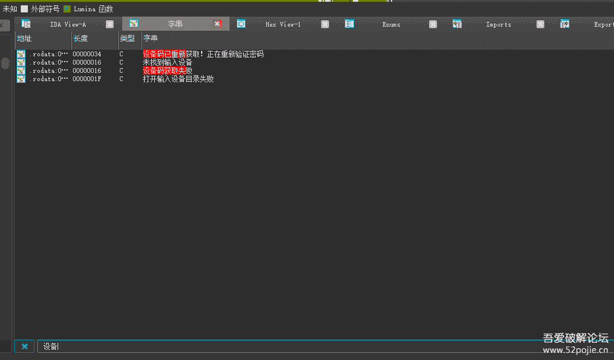

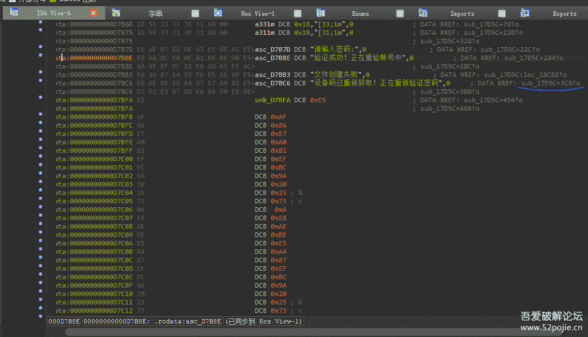

跳转之后我们往上追，我们发现了（如下图）这个`bl`就是执行上面然后继续执行跳转的值（因为是初学者，表述的不是很好，见谅），那现在就可以在这里进行修改，让他跳转到我们刚刚复制的那个认证成功的地方

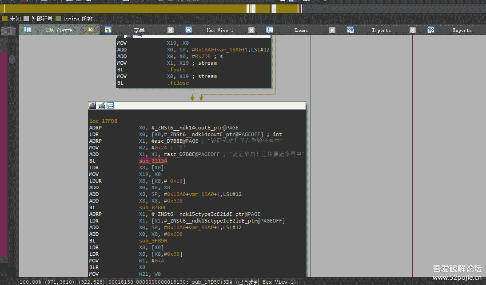

我们在`bl`这里，右键-->`Asse`

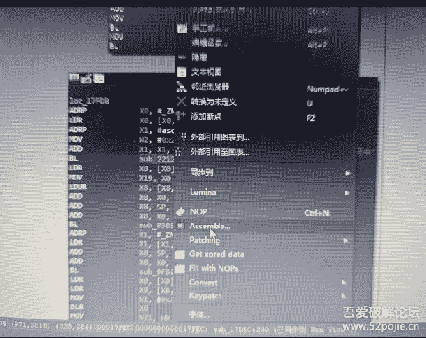

把里面的删掉，改为`b`（无条件跳转），之后选框里右键（如果你没有出现如图中的`paste`，就重新复制一遍）

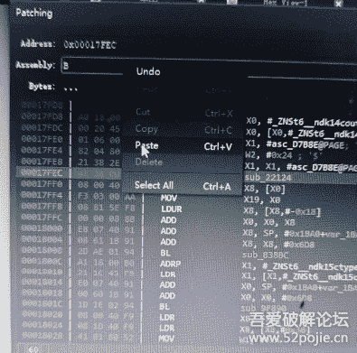

复制粘贴上去后，按下回车即可，之后点击x号，这样我们就修改好了

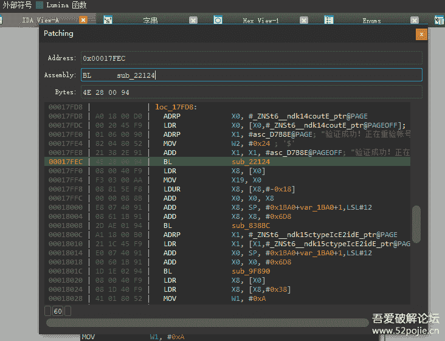

之后我们点击任意地方（因为我是全插件版本的，和你们的可能不一样）点击我鼠标选择的地方，可以选择一个你喜欢的文件夹进行保存

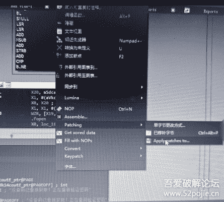

普通版本ida pro的保存方法如下

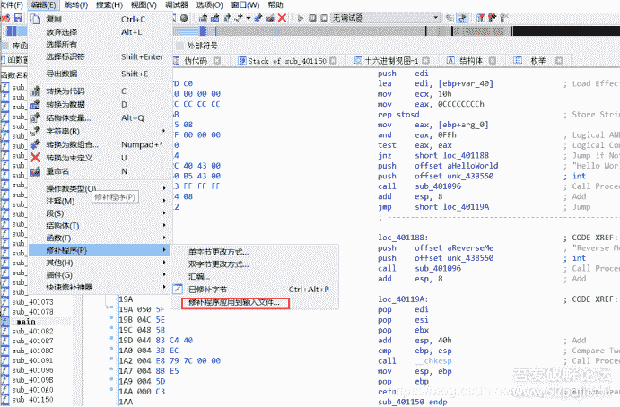

刷入对应的驱动，运行后的效果

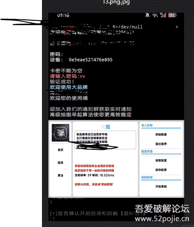

我的贴子讲的可能不是很好，希望各位能够谅解一下（我也是一名小白

）
