# [Android 原创] 【逆向思路】Via浏览器去除白名单限制
- 原帖: https://www.52pojie.cn/forum.php?mod=viewthread&tid=2047991
- 抓取时间: 2026-11-01T15:42:39.702Z
屏幕前的各位现在正在浏览这篇帖子时，可能有很大一部分人都用的是 Via 浏览器吧？
我用 Via 已经很多年了，就是喜欢 Via 的小巧精致，和百度、夸克浏览器的臃肿形成了强烈对比，也挽救了我的旧手机。Via 浏览器是真正的"小而美"。
不过，免费又好用的Via也有一些缺点，比如我们熟知的白名单限制。众所周知，Via 浏览器在 4.4.1 版本之后对部分网站进行了白名单限制，在白名单网站中，资源嗅探等功能被 Via 自行屏蔽。特别是当我们通过嗅探下载一些视频时，这就让人很不舒服。
在网上找了一圈，有关去除 Via 白名单限制的帖子很少，所以我现在打算教大家如何去除。
由于本人技术能力有限，请各位海涵！
我们用 Via 打开B站，点击资源嗅探按钮，发现：

Via 提示"该站点不支持资源嗅探"，那我们就从这个提示入手
我们把网断了，清空 Via 存储(防止有数据缓存)，再次打开B站，点击资源嗅探：
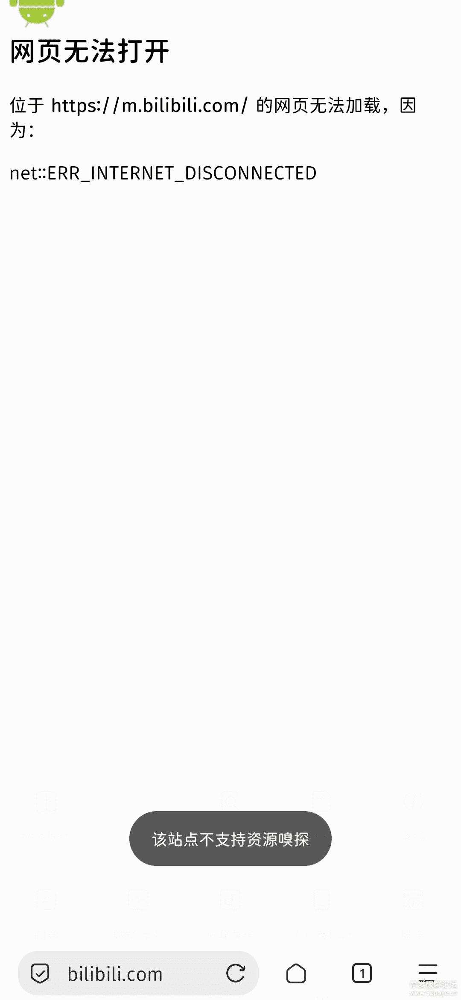
发现虽然网页无法加载，但是提示仍正常。于是我们可以判断，该提示是在本地安装包内，并不是通过网络加载
很狗的方法，不过很有用
接下来，我们提取安装包，用 MT 打开它。
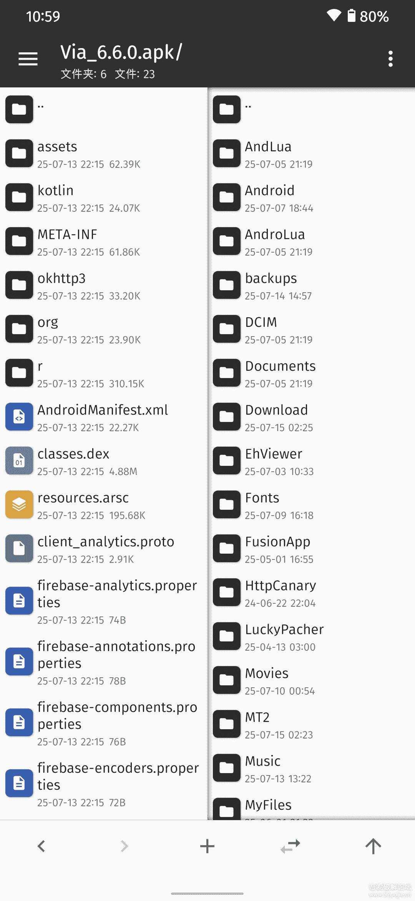
一般，软件中很多字符串都会在安装包内的`resources.arsc`文件中进行声明。
我们打开它，并搜索资源值"该站点不支持资源嗅探"，发现成功搜到：
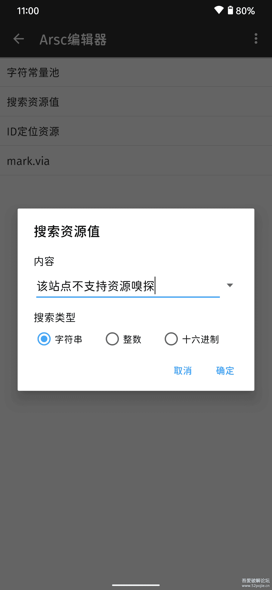
我们长按复制资源id
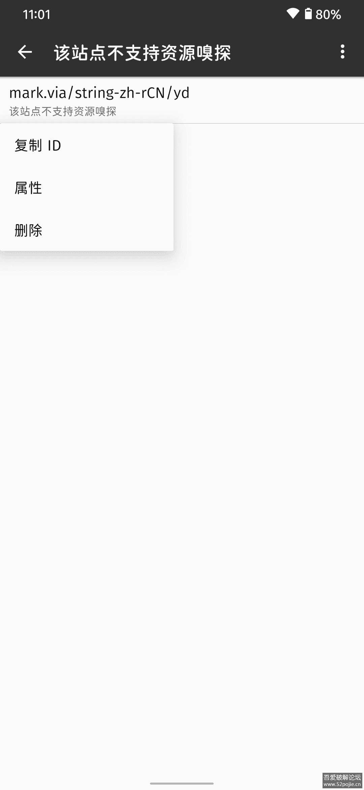
再拿到dex里进行搜索：
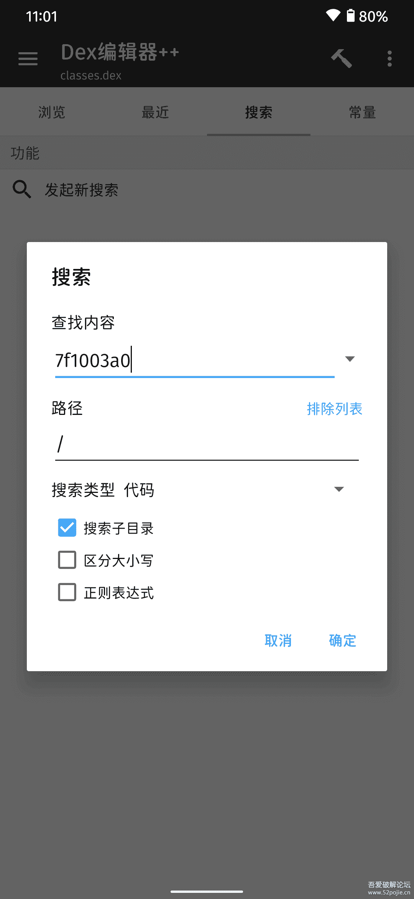
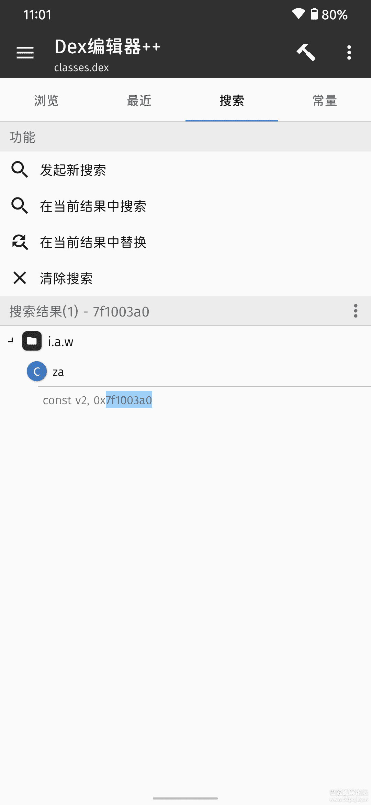
只有一个结果，我们进入并定位：
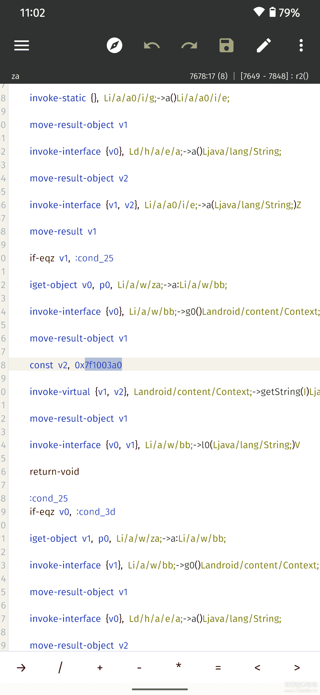
为了方便，我们可以把这个方法转成Java：
[Java] 纯文本查看 复制代码
```
package i.a.w;

import d.h.a.e.a;
import i.a.a0.i.g;
import i.a.a0.l.d;

public class za {
    public void r2() {
        a E = E();
        if (E != null && g.a().a(E.a())) {
            bb bbVar = this.a;
            bbVar.l0(bbVar.g0().getString(0x7f1003a0));
            return;
        }
        if (E != null && !d.n(this.a.g0(), E.a())) {
            this.m = E.c();
        }
        int z = z(this.m);
        if (E != null) {
            m.a.a.a("log id: %d, resource id: %d, has resource: %s", new Object[]{Integer.valueOf(E.c()), Integer.valueOf(E.D().getId()), Boolean.valueOf(i.a.w.rb.d.c().g(this.m))});
        }
        if (z != -1 && i.a.w.rb.d.c().g(this.m)) {
            q2(10, null);
            return;
        }
        this.a.l0(this.a.g0().getString(0x7f10021c) + this.a.g0().getString(0x7f100290));
    }
}
```
这里给大家解释一下重要步骤
>
 // 取资源对象
 `res = E()`
 // 发现是白名单中的网站
 `if (res != null && g.a().a(res.a()))`
 // 直接给 UI 设置文案 A（`0x7f1003a0`）并 return；
 // 本地未找到资源
 `else if (res != null && !d.n(ctx, res.a()))`
 // 本地缺失，把 logId 记下来
 `this.m = res.c()`
 // 计算状态码
 `int z = z(this.m)`
 // 打一条调试日志（无论后面走哪条路都会打）
 log: logId、iconResId、本地资源包是否存在
 // 资源包已存在且状态码合法
 `if (z != -1 && 本地资源包存在)`
 `q2(10, null)` // 真正去加载/展示
 return;
 // 兜底失败提示
 给 UI 设置文案 B（两段字符串拼接：`0x7f10021c` + `0x7f100290`）
综合分析上述代码，我们发现只要 `g.a().a(E.a())` 返回 true，Via 就会提示"该站点不支持资源嗅探"。
如果仅仅用 const 修改返回值，提示确实会改变，但仍然无法嗅探到资源。
我们跳转这些方法，发现很多都是虚拟方法，还有一些并无判断，只是调用了非常多的方法
如果我们继续找下去，可能很久都找不到结果。
很多老哥在这里就已经放弃了，但是为何不换一种方式思考呢。
其实到现在，才进入正题。
我们可以分析得到，如果要进行提示，系统必须判断此刻的网站是否是白名单内的网站。我们不难想到，进行白名单比对最简单的方法是比对网址，如果网址位于白名单内，那么就返回提示语。这点也可以从我们断网但正常提示这点侧面印证。
那么，我们就可以这个为新的切入点。
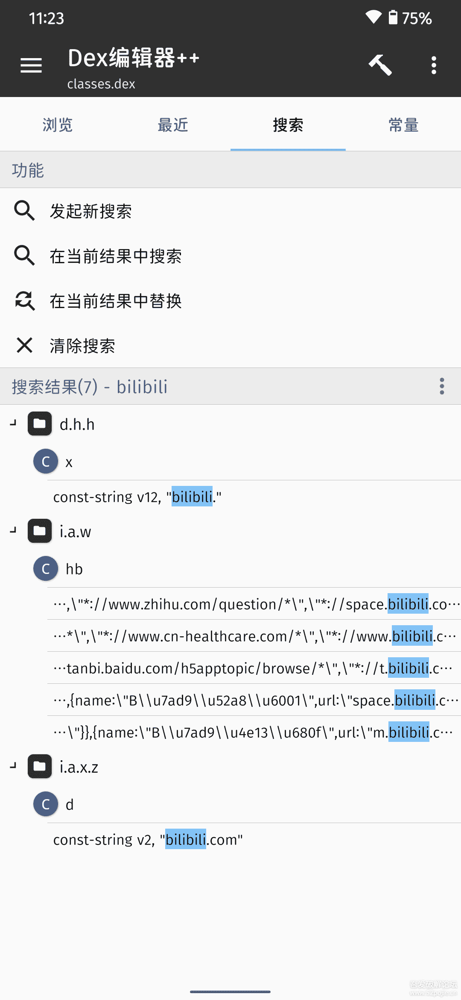
直接在dex中搜索明文"`bilibili`"，发现有很多结果。(在`resources.arsc` 里搜索？那你想多了，不可能那么简单)
逐一分析可知，这些都是一些常见网站的声明，与白名单并无明显联系。
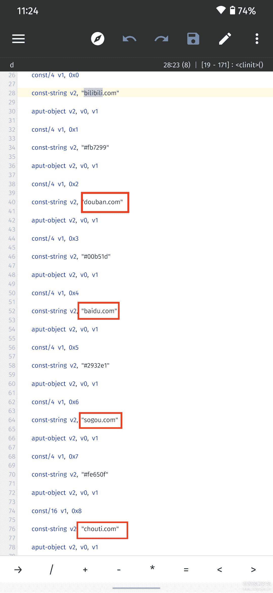
现在估计又有很多人想要放弃了
我们不妨合理猜想，也许包含"`bilibili`"的白名单可能被某种算法加密了。
我要介绍一种不怎么常用的方式。
那就是——注入日志记录
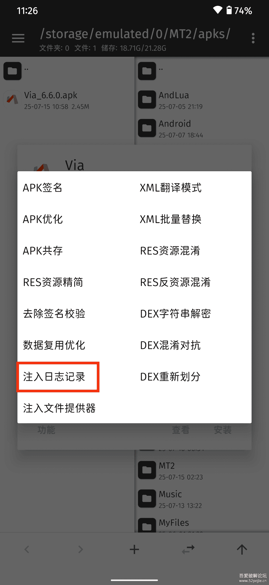
我们点击 Via 原包，再点击"功能"，就可以发现注入日志记录这个功能。这是一个被忽视的功能，但它其实就是制胜秘诀。
我们直接对 Via 注入日志记录，然后安装。
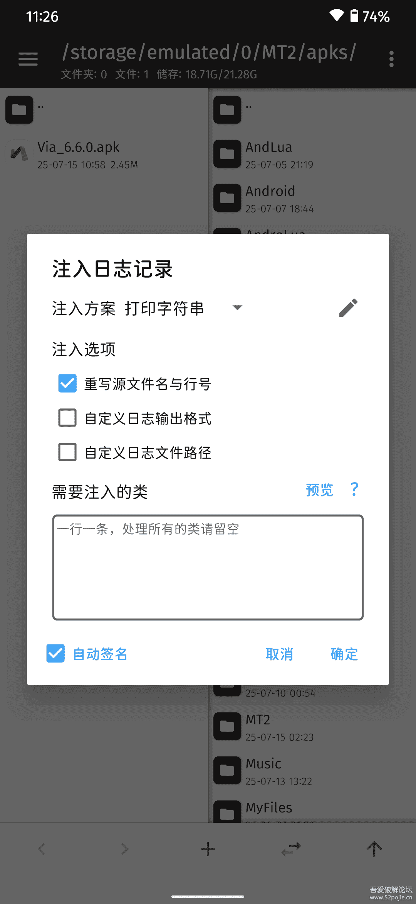
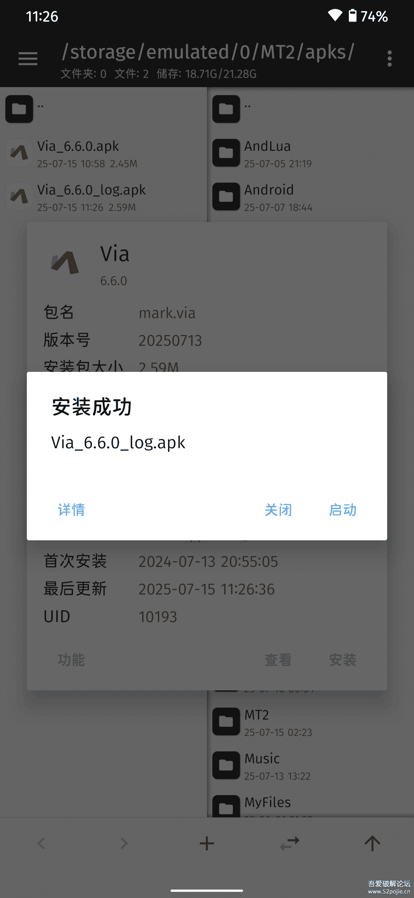
这里要注意，一定要给 Via 存储权限(如果没有权限就在`AndroidManifest.xml`里声明)，否则日志文件就不会出现在`/storage/emulated/0/MT2/logs/`，而是在`/data/data/mark.via/logs/`，需要root权限才能够访问。
现在我们打开 Via ，打开B站网页端，然后点击资源嗅探按钮，等待提示完全消失。然后打开 MT ，定位目录。
这里为了省事，直接定位到`/data/data/mark.via/logs/`。
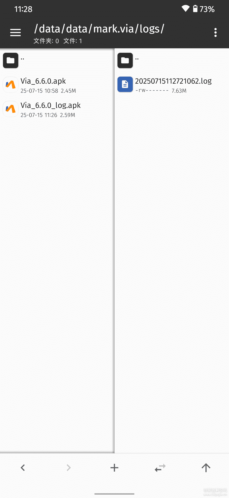
可以看到 log 文件已经生成。
我们再打开 log 文件，发现有非常多的条目。不用急，按照我们的猜想，Via 会将网址与白名单比对，即使白名单内容加密，那么在 log 文件中也一定会有解密信息。
我们直接搜索关键字符"`bilibili`" ，在排除一些无用条目后，我们可以迅速地定位到这几行关键信息：
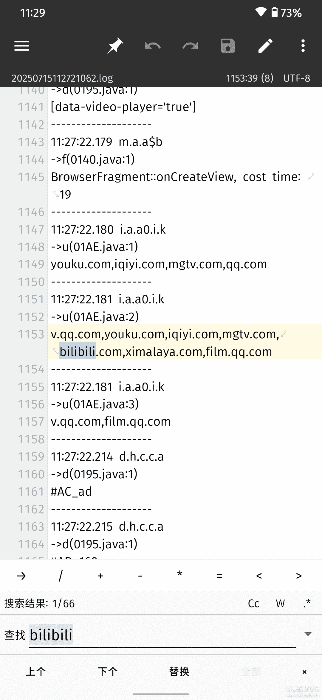
诶，正好。这不就是 Via 提示"该站点不支持资源嗅探"的几个网站吗？
我们通过log信息直接定位到方法：
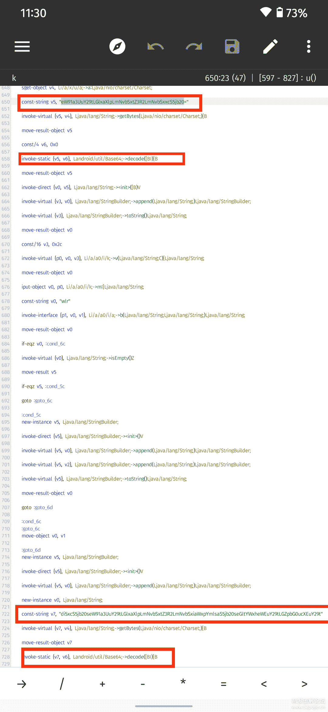
发现这个`u`方法定义了几个非常可疑的字符串，再把这几个字符串送去进行 decode，这其实就是进行解密。有经验的同学们一眼就发现，这几个字符串就是非常常见的 `Base64` 编码，我们通过看字符串最后面的等于号和调用方法就可以判断出来。
为了进一步验证我们的猜想，我们可以用 `Base64` 转码器对于这几个字符串进行转码：
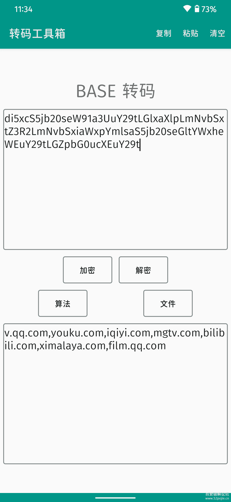
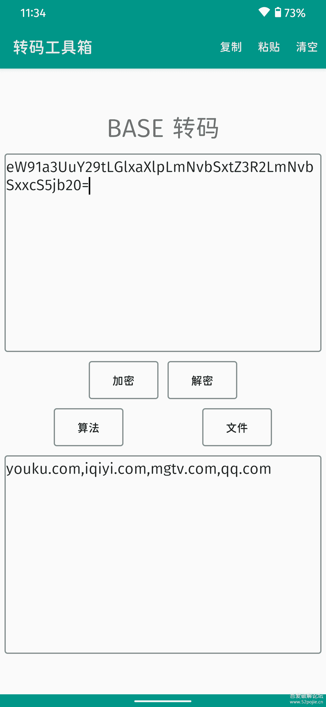
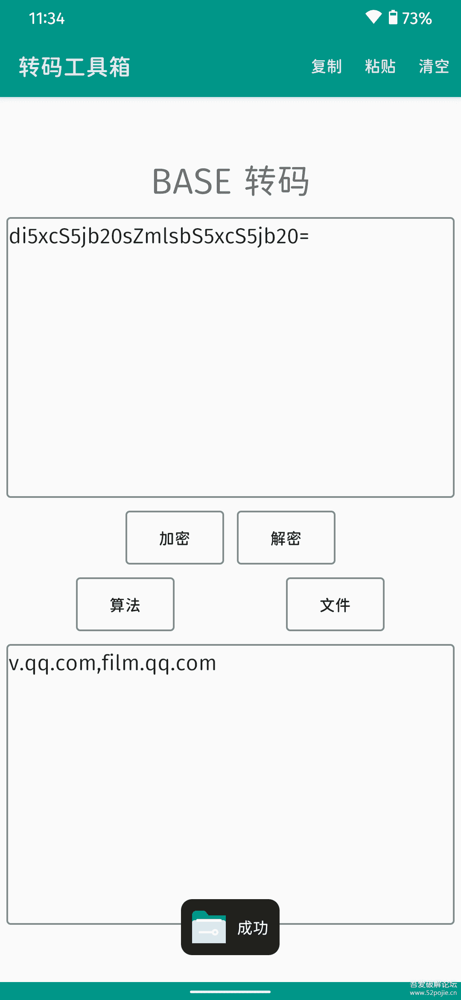
转码成功，而且转码结果正是刚才 log 中提到的 Via 白名单网站。
至此，分析过程结束，这个`u`方法实际上就是对白名单内容进行解密比对的关键方法，那么我们就可以直接修改字符串，将其改为任意无效内容，或直接清空`u`方法，让其直接 return 一个空值，也能达到同样的效果。
保存修改，签名安装。
再次打开B站，发现[破解](https://www.52pojie.cn/)成功：
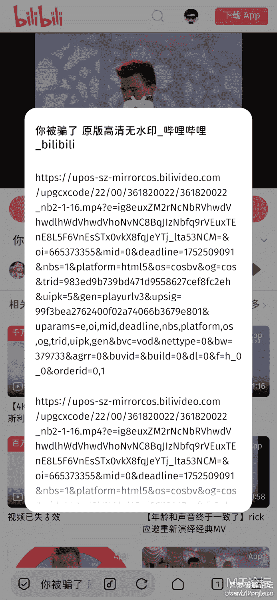
经过这次的修改，相信大家的技术应该都有所提高。主要是为了带大家熟悉一下注入日志记录这个功能，并分享一下我个人的思路。
感谢大家能够阅读到这里，如果有不同的想法，可在下方评论区分享留言，大佬见笑。
知道你们想练手，把 Via 原包和转码工具箱都打包好了，可以自己试试：
下载链接
```
