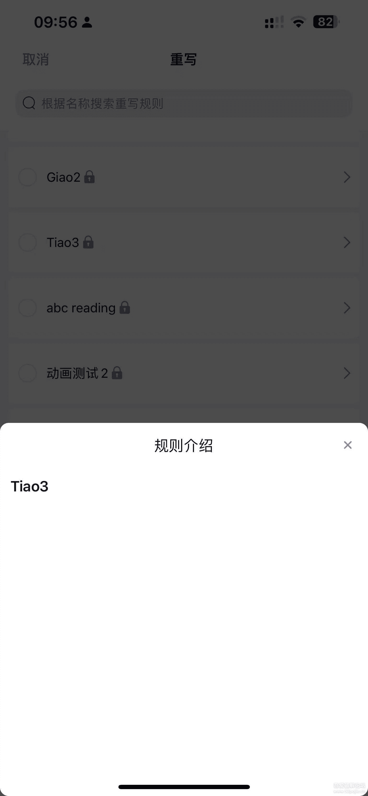
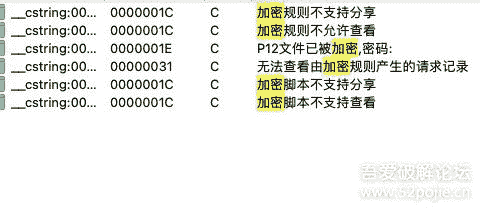
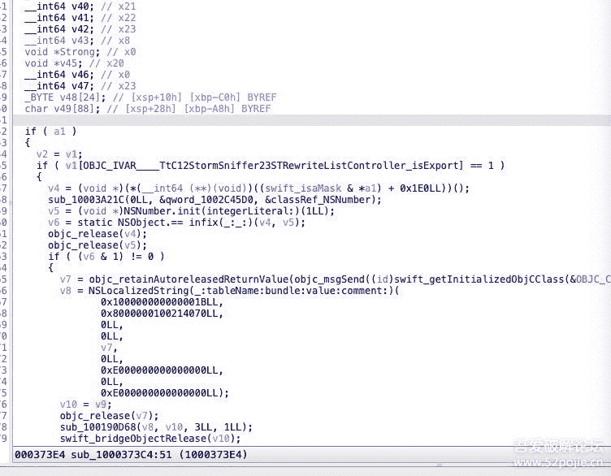
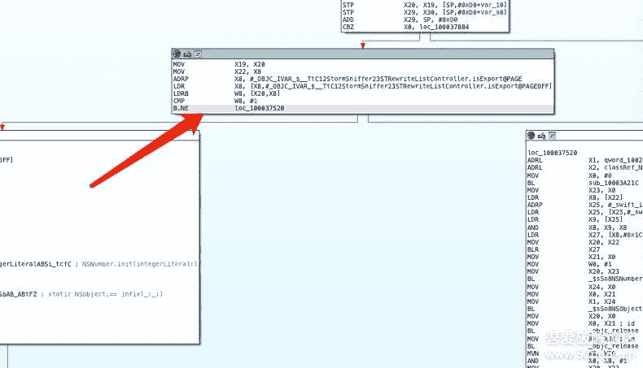
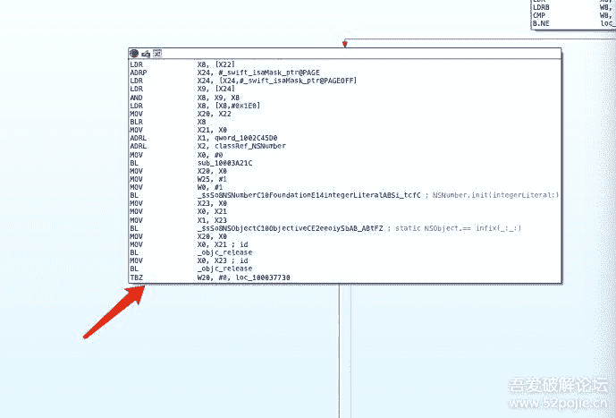
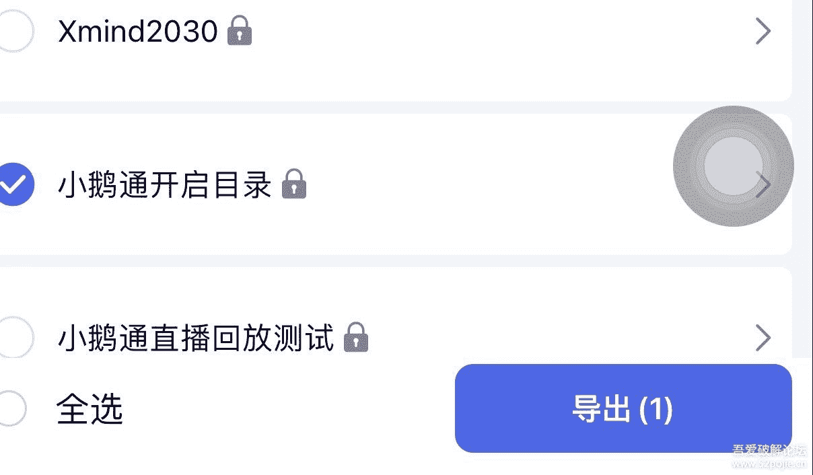
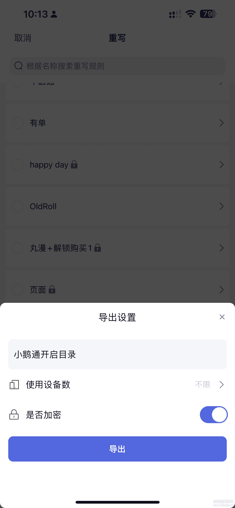

# [iOS 原创] ios 某抓包软件的加密规则不允许查看逆向分析

- 原帖: https://www.52pojie.cn/forum.php?mod=viewthread&tid=2049407
- 抓取时间: 2026-11-01T15:42:18.900Z

### 进入目标软件



可以看到规则是加密的，而且不能分享导出

今天就来逆向研究一下


### 打开 `ida` 导入可执行文件


首先定位

本来想从加密规则不允许查看入手的，捣鼓半天没成功，索性换了个入口

进入加密规则不允许分享的函数内部


根据分析得知

1. 导出规则分支（`isExport == 1`）

```
if (v1[OBJC_IVAR____TtC12StormSniffer23STRewriteListController_isExport] == 1)
```


这是重要的判断

我们可以先利用`Frida`的`path`脚本先`hook`测试一下改一下跳转逻辑（只修改这一处没有效果）

接着分析吧


这段汇编代码的作用非常明确：
- 访问`STRewriteListController`类的`isExport`成员变量
- 检查其值是否等于 1
- 根据检查结果跳转到不同的处理分支（导出模式或普通模式）

这与我们之前对伪代码的分析完全一致，是区分导出逻辑和普通状态更新逻辑的关键判断点

我还把这个跳转也`frida` `hook`修改一下看下效果



`hook`成功啦

