# [Android 原创] Android-app抓包-root真机配合Yakit抓包教程

- 原帖: https://www.52pojie.cn/forum.php?mod=viewthread&tid=2050770
- 抓取时间: 2026-11-01T15:42:02.928Z

做app渗透测试的时候，使用模拟器经常遇到模拟器与真实设备的环境差异会导致测试场景失真，甚至遗漏关键漏洞或无法复现真实行为等情况，对于依赖真实硬件、存在反模拟器逻辑、或对系统环境敏感的 APP，必须使用真机才能复现真实用户的通信场景，确保抓包内容的完整性和真实性，避免遗漏漏洞。

## 1. 准备工具

在使用真机配合抓包工具抓取APP数据包之前，需要准备以下工具：

一部root真机（这里使用的是Pixel 3aXL）、抓包工具（Yakit）

## 2. 网络配置

### 2.1 电脑端

**a.** 首先确保电脑和手机连接的是同一网络，无论是使用同一wifi、还是使用USB网络共享等，只要能`ping`通就行！（这里使用的是同一wifi）

**b.** `win+R` -> 输入 `cmd` -> 输入 `ipcongfig` -> 查看网络ip并记录

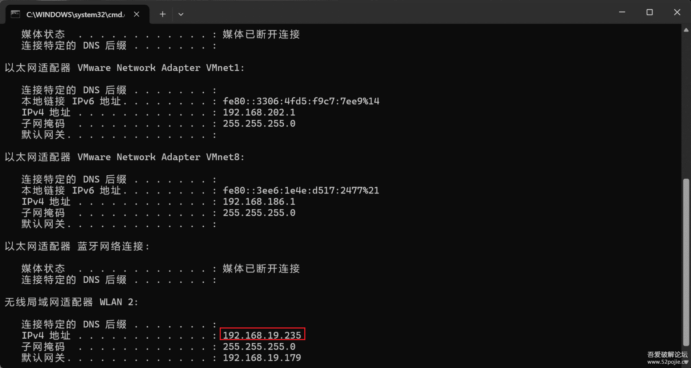

**b.** 打开抓包工具进行网络配置，如下图所示："劫持代理监听主机"：`ipconfig`中相同ip "劫持代理监听端口"：随便找一个不使用的端口 配置完成后 -> 劫持启动

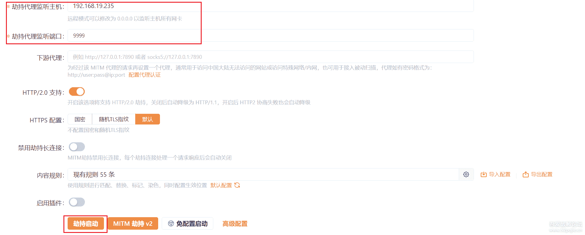

### 2.2 移动端

**a.** 点击"设置"-"网络和互联网"-"互联网"-进入你连接的网络

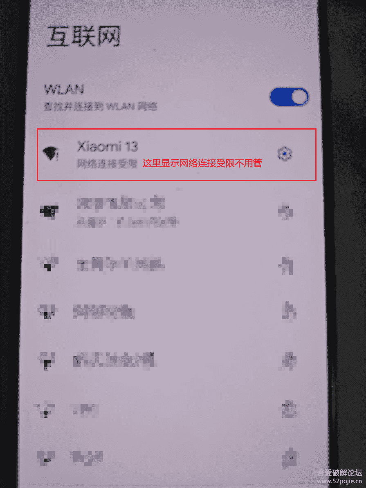

**b.** 更改网络代理-设置为"手动"

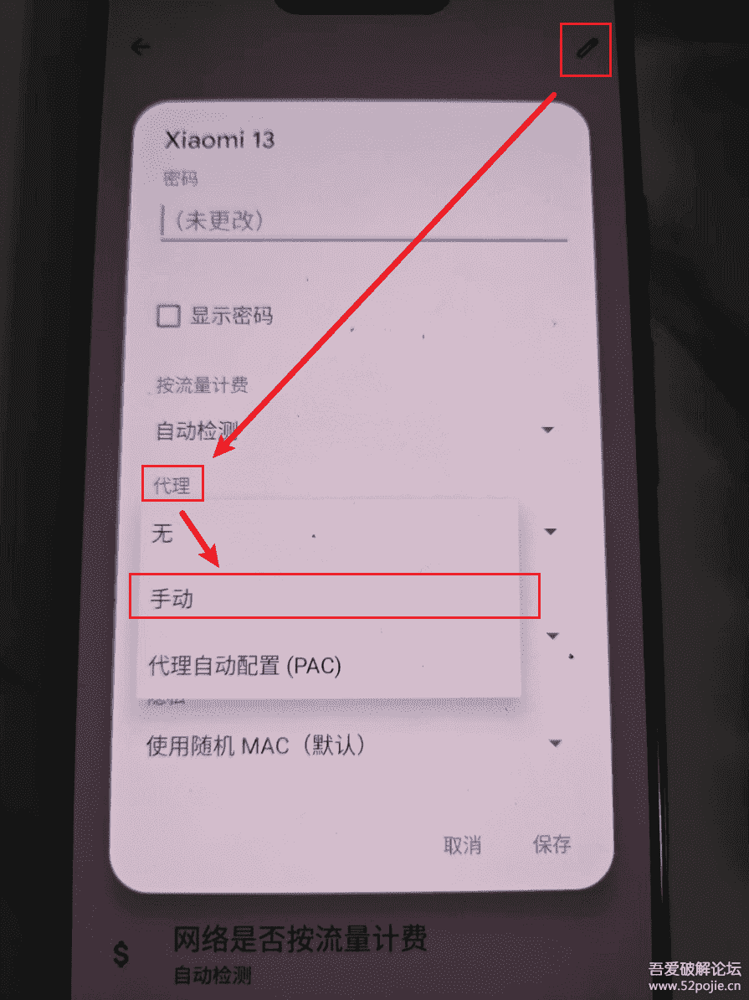

**c.** 代理主机名与代理端口设置与抓包工具中劫持代理中设置的主机名与端口相同-点击保存

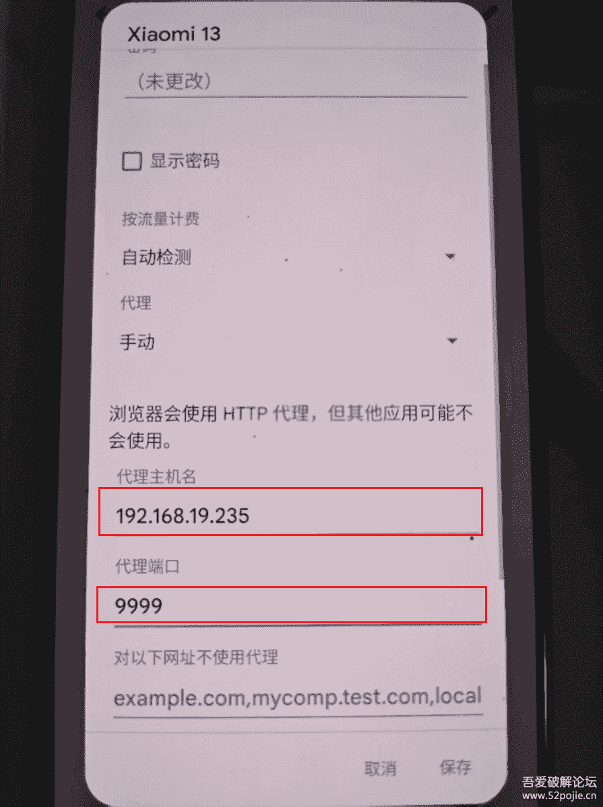

此时就已经可以抓到数据包了， 但如果此时你使用手机浏览器访问百度`https://m.baidu.com/`，会直接出现下图错误，导致你无法抓取到https流量的数据包

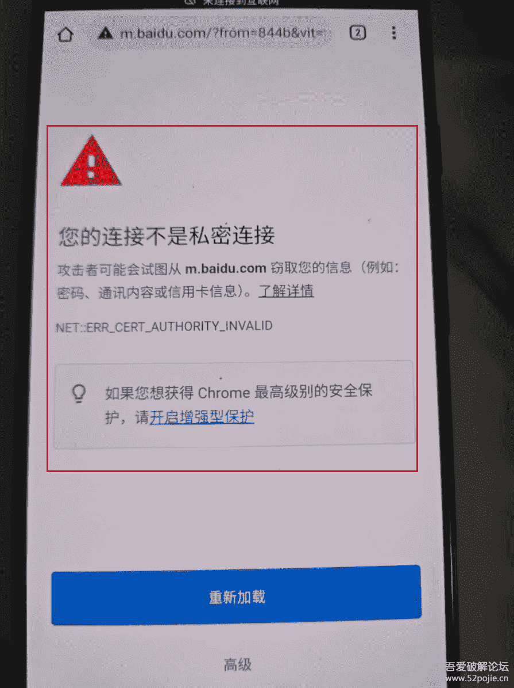

这时候需要我们进行证书配置后，才可以使用抓包工具对https的流量进行抓包！

## 3. 证书配置

**a.** 回到`yakit` -> "MITI交互式劫持"处 -> 点击"高级配置"-选择"证书下载"-将证书下载至一个合适的位置

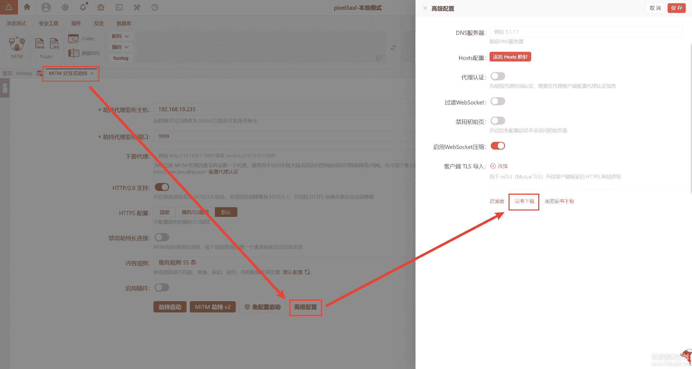

**b.** 将下载好的证书的文件后缀改为"`.crt`"


**c.** 找一个在手机上你可以访问到的路径（这里使用的是`/storage/self/primary/Pictures`），使用`adb`命令将证书传输到你的手机中 命令：[Shell] 纯文本查看 复制代码

```
adb push C:\Users\xxx\Desktop\yakit证书.crt /storage/self/primary/Pictures
```

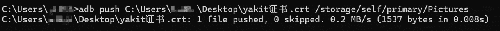

**d.** 后回到手机 -> "设置" -> "安全" -> "加密与凭证"-"安装证书" -> "CA证书" -> 将刚刚保存的证书安装

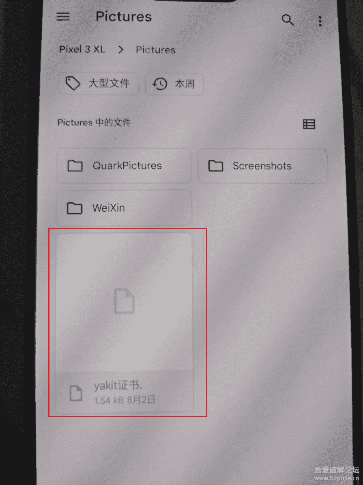

**e.** 回到电脑 -> 使用`adb shell` -> 进入`/data/misc/user/0/cacerts-added`目录中 -> 就可以看到你刚刚安装的证书

**f.** 使用`adb`命令，将`10fb1fcc.0`移动至`/etc/security/cacerts`中给`10fb1fcc.0`赋予644或777的权限 -> `chmod 777 /etc/security/cacerts/10fb1fcc.0`

至此，就可以抓取https流量的包了？？？

## 4. 遇到的问题及解决方案

逻辑是上面哪个逻辑，但最后到f和g的步骤时，会发现无法将`10fb1fcc.0`移动至`/etc/security/cacerts`中，先是爆出类似于"`/system/bin/sh: /system/bin/remount: inaccessible or not found`"这样的错误，利用网上解决方案：

进入`adb shell`后

[Shell] 纯文本查看 复制代码

```
su
mount -o rw,remount /
mount -o rw,remount /system
cp /data/misc/user/0/cacerts-added/10fb1fcc.0 /system/etc/security/cacerts/
reboot
```

但是，出现了"`'/dev/block/dm-4' is read-only`"这样的错误 查询了多方面的资料，直接上解决办法：

1. 使用获取root权限的MT管理器将`/data/misc/user/0/cacerts-added/10fb1fcc.0`移动到`/system/etc/security/cacerts/`目录中

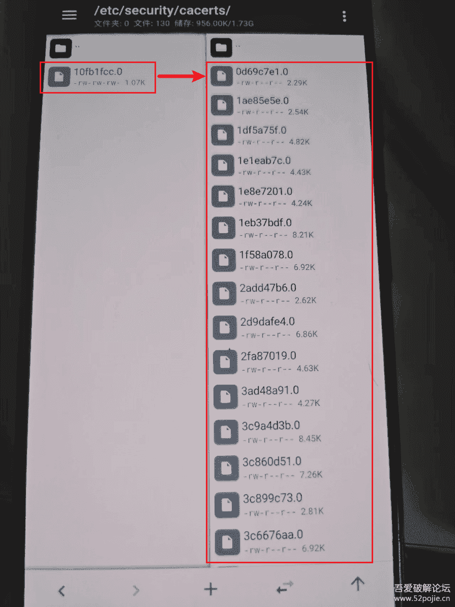

2. 如果发现上述方法不行，下载Magisk的模块- "`Move_Certificates`" ，跟安装LSPosed模块的步骤一样，将`Move_Certificates`模块安装 下载地址：https://github.com/ys1231/MoveCertificate

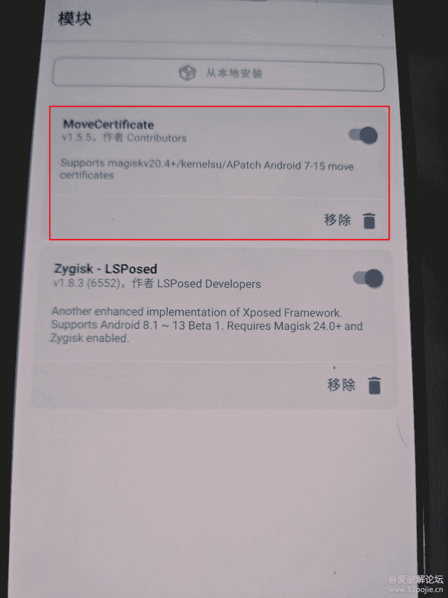

在Magisk安装模块后重启，此时先将证书放入`data/local/tmp/cert`中，再使用MT管理器将证书移动到`/system/etc/security/cacerts/reboot`目录下即可！

此时就可以正常抓到https流量的数据包了！

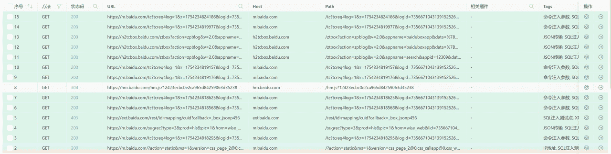

手机访问百度也不会出现证书错误的问题了

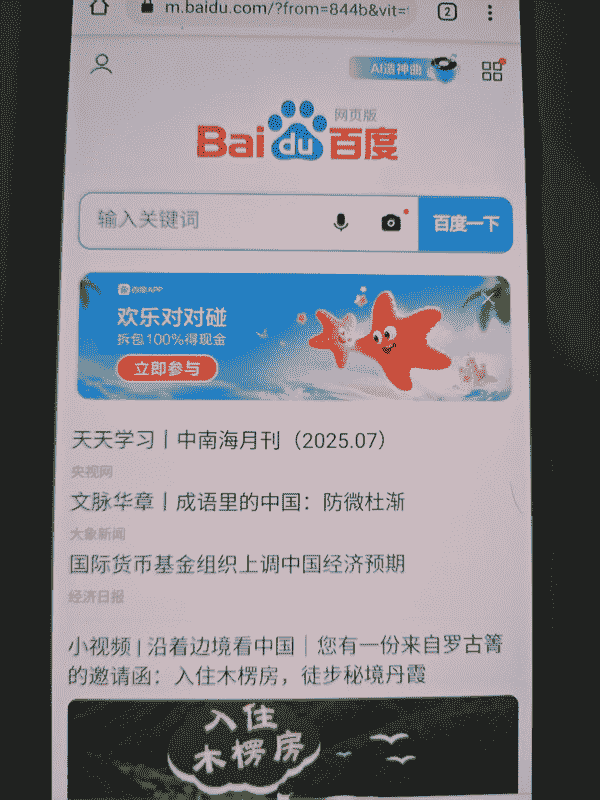

至此，就可以抓取https流量的包了！！！

## 5. 参考文章

1. https://www.yaklang.com/Yaklab/WeChatAppEx/
2. https://blog.csdn.net/m0_65663088/article/details/135996157
3. https://blog.csdn.net/qq_31050167/article/details/132185050
4. https://tieba.baidu.com/p/6793975096
5. https://www.cnblogs.com/exuli/p/18346107
