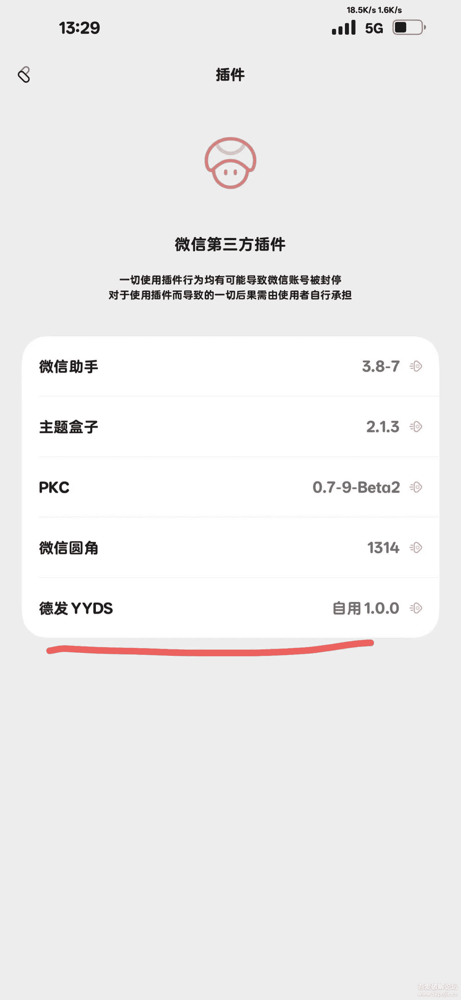
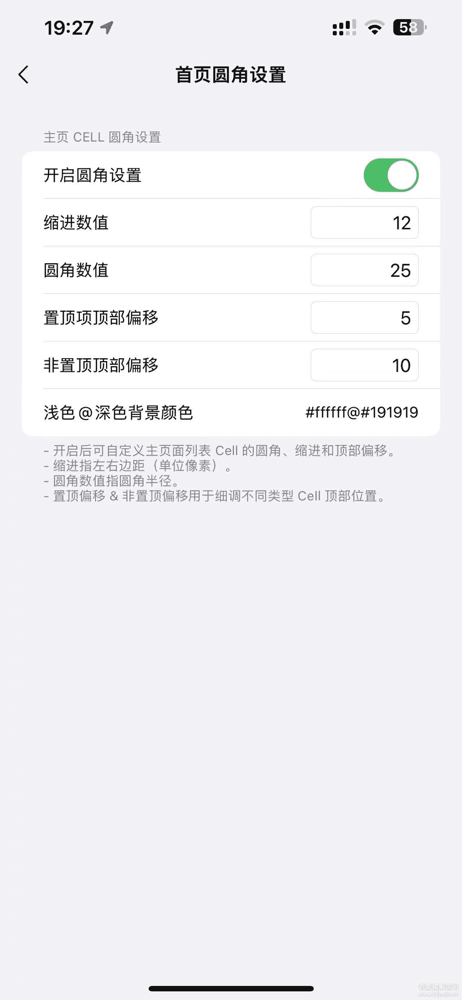
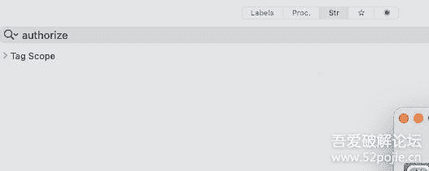
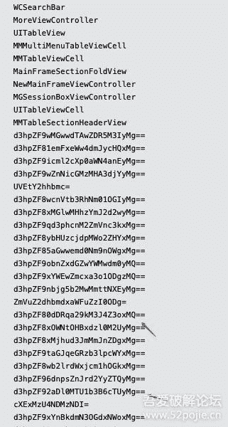
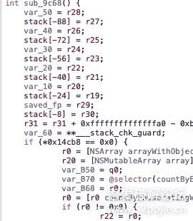

# [iOS 原创] iOS-WX美化插件逆向

- 原帖: https://www.52pojie.cn/forum.php?mod=viewthread&tid=2051249
- 抓取时间: 2026-11-01T15:41:58.628Z

先说下这是逆向授权后才显示出来的插件设置界面

在没有授权前，插件注入是没有显示任何信息的

重点来了！

那我们应该怎么分析呢？

首先想到的是 ———— 授权 （关键词）

但是搜不到任何有关的信息

请出我们的老朋友-----hopper

但是我们看到一些 base64 编码的信息。

我们 x 交叉查看一下

进入函数

经过分析得知

函数 `sub_9c68()` 的核心作用是：判断当前用户的用户名是否存在于一个通过 Base64 编码字符串解码得到的列表中，并返回布尔结果（存在返回 true，否则返回 false）。

最后调试的就不说了，最终是函数直接返回 1 ，就能进入正常的设置界面啦
