# [Android 原创] VMOS Pro 3.1.1最新版全方位破解分析

- 原帖: https://www.52pojie.cn/forum.php?mod=viewthread&tid=2051458
- 抓取时间: 2026-11-01T15:41:53.883Z

## 前言

app：VMOS Pro 3.1.1（[//www.vmos.cn](https://www.vmos.cn/:https)）

工具：jadx, reqable, frida, pycharm, 雷电模拟器, 算法助手, 真机

方法：hook

难点：加壳, 加密, 混淆

### app界面

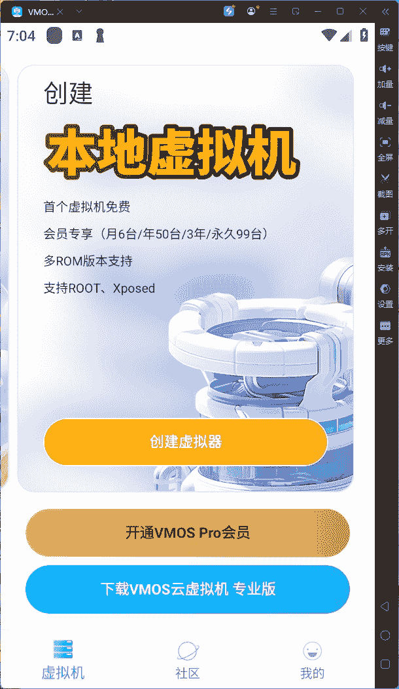

## 正文

注：该版本有360加固，需要先脱壳。不想脱壳的可以下载3.0.7版本（无壳）

### 一：初次探索

1. 我们直接点击创建虚拟机，跳转到本地虚拟机页面后可以看到有很多虚拟机，既然是破解那我们肯定是搞充money才能用的功能；一眼就看见了显眼的vip标志在朝我们扭着白花花的大屁股，卧槽，这能忍？开搞！！！直接上去狠狠得戳它，不好！有\*\*！！！
   
   

2. 普通兄弟可能会残忍拒绝，挡不住诱惑的兄弟可能已经手持马内下手了，但是既普通又挡不住诱惑的兄弟不经发出灵魂拷问，有没有不用马内就能\*\*的？？？有的！兄弟有的！直接拿出我们的算法助手开始弹窗定位
   
   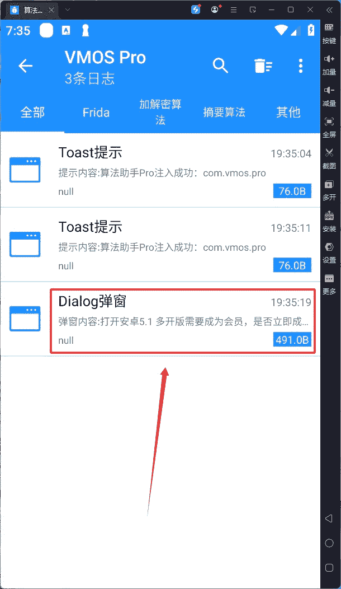

3. 轻松捕获弹窗，打响拔\*第一枪；进入弹窗堆栈，可以看到整个弹窗的流程（从下到上），英语好的兄弟可以直接看到有展示弹窗等多种方法，当然最让人眼前一亮的就是`checkVip`（检查会员）
   
   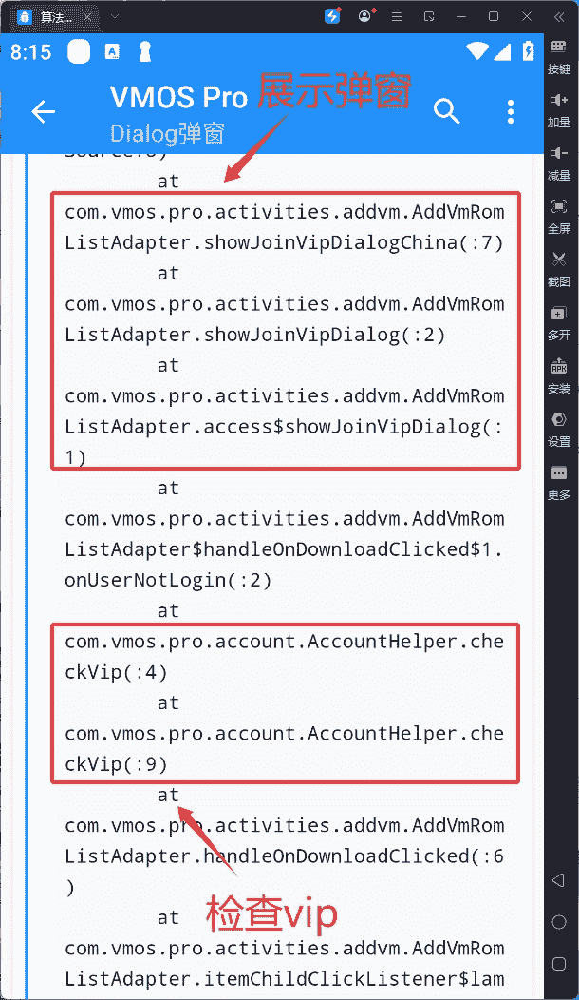

### 二：尝到甜头

1. 打开jadx将脱壳后的dex拖进去，直接搜索堆栈的`checkVip`方法，进入第二个方法后，我们能清晰得看到`checkVip`具体代码，其中重点为登录判断和正式会员判断，兄弟们试想一下如果我们已经登录了并且还是正式会员，那我们是不是就可以嘿嘿嘿了
   
   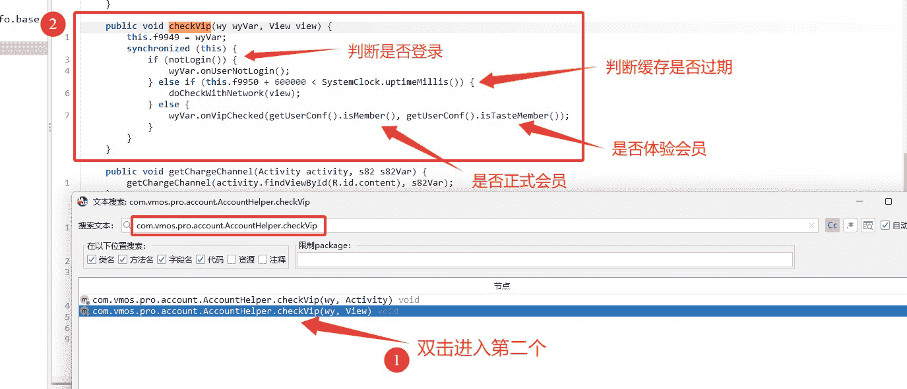

2. 分别进入`notLogin()`和`isMember()`方法后,可以看到它们都是布尔方法，返回值不是true就是false;我们只需要对它们进行Hook修改返回值就行，因为notLogin翻译为“没有登录”，所以我们得让它返回false;编写hook代码运行后可以看到弹窗消失并且成功下载vip专属虚拟机
   
   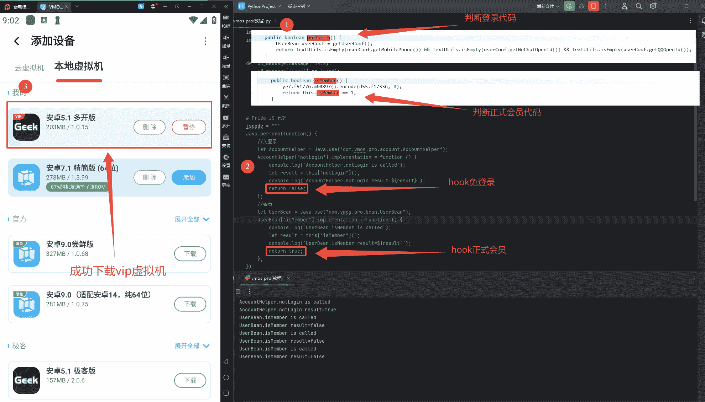

### 三：不堪丑陋

1. 有些心急的兄弟这时候就已经按耐不住心中的燥热了，裤子都脱一半了；哎，打住兄弟；俗话说：心急吃不了热豆腐，当我们仔细观察就会发现在“我的”页面中我们的信息还是普通用户，这也太不美观了吧，就像榜一大哥线下约见大美女主播，结果面了个乔碧萝；这™的受得了？整！必须给我整成大美女
   
   

2. 正常来说这种页面的信息都是通过读取用户配置来获取的，而我们之前看到的`isMember()`正是通过读取用户配置信息`getUserConf`来判断是否为会员；追上`getUserConf`后可以看到`UserBean`，而`UserBean`就是存储定义用户配置信息的类；在此类中能够清晰的看到各种用户配置信息，而`memberExpireTime`就是我们关注的重点，它表示会员到期时间
   
   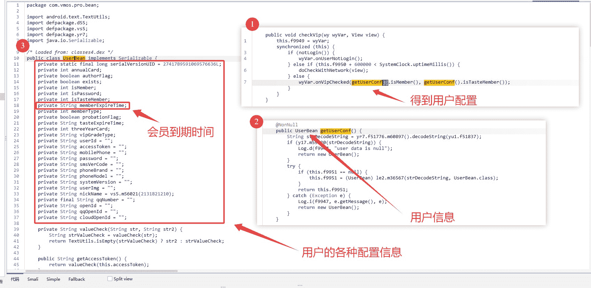

3. 直接下翻找到`memberExpireTime`相关代码，可以看到有个`getmemberExpireTime`方法，翻译过来就是“获取会员到期时间”；并且返回值是String类型，我们直接编写hook代码修改到期时间为“2099-12-31”；当然兄弟们也可以自行发挥修改成“9999-99-99”或者“地球爆炸后”都行，运行代码后可以看到页面成功变成尊贵的vip界面，瞬间高大上了有木有；乔碧萝整成了刘亦菲，榜一大哥乐开了花
   
   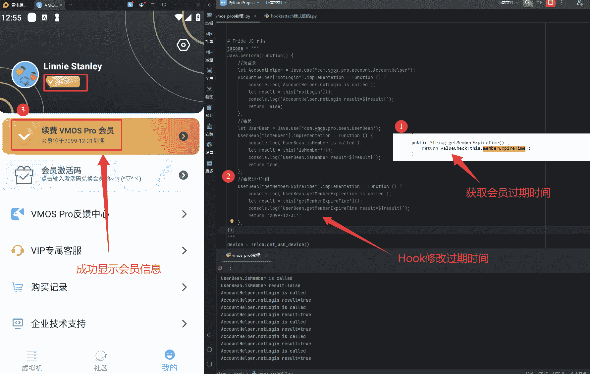
   
   

### 四：突发意外

1. 脸也整了，障碍也拔除了，兄弟们终于要准备开始了；激动的心，颤抖的手，准备大干一场时，我\*你\*\*的；我虚拟机呢？？？我刚下的vip虚拟机呢？？？气出坤叫了，兄弟们；而当我们停止运行Hook代码后，虚拟机又奇迹般回来了
   
   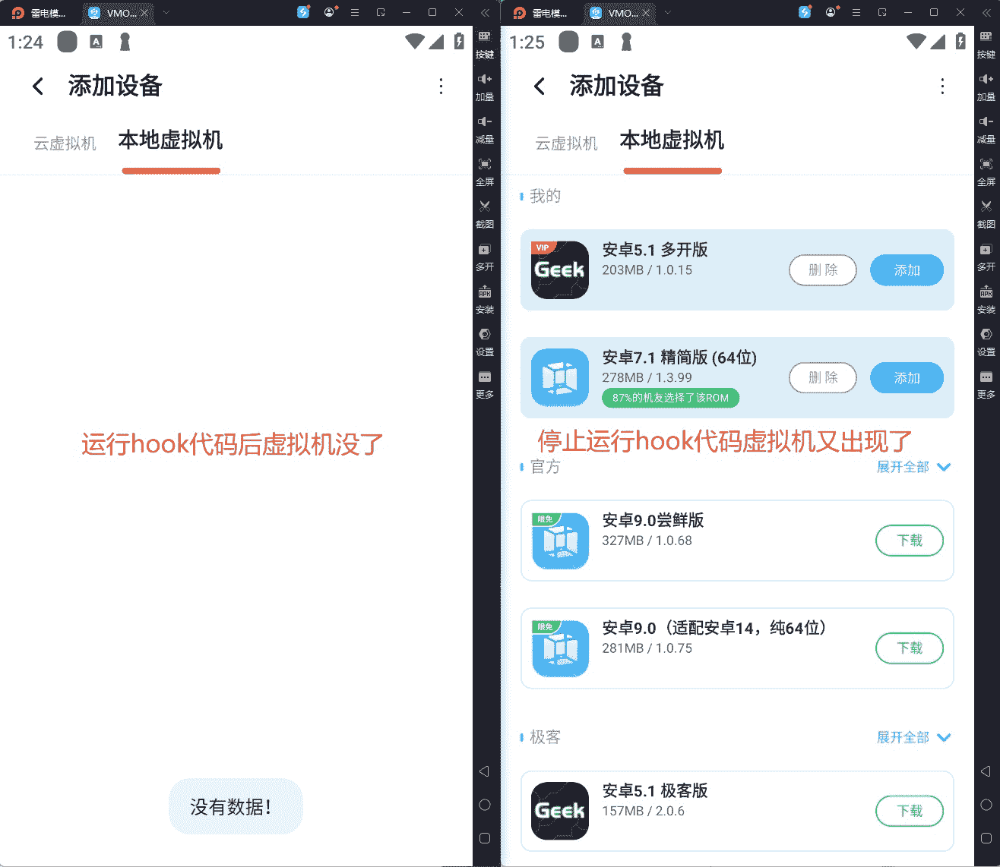

2. 看来是hook得不够全面，这个时候就得通过抓包来一探究竟了，一般这种数据都是从服务器获取的；我们打开reqable开启协同模式抓vmos pro的包，当我们正常点击立即创建后会抓到三个包，仔细观察可以推测三个包的作用分别为“获取虚拟机列表”，“给服务器发送信息”，“获取云虚拟机列表”；我们重点关注“获取虚拟机列表”，发现它的数据都进行了加密；有句话说得好：“衣服能穿就能脱”，咱们就狠狠得扒，势必看到挺拔的双峰
   
   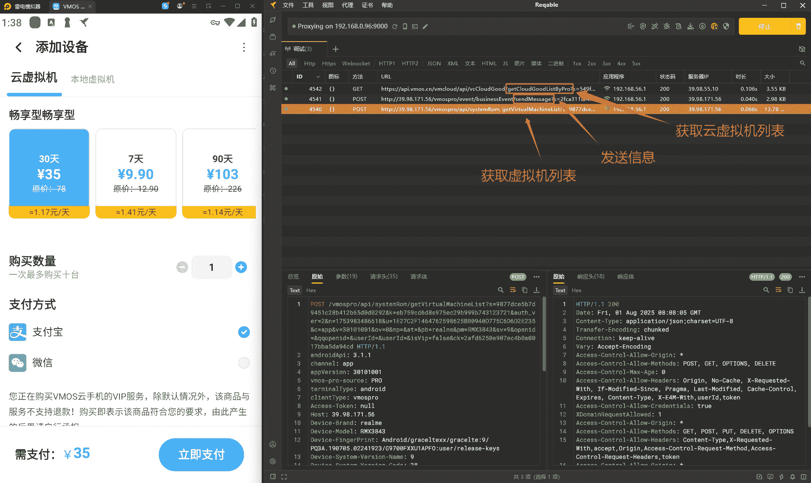
   
   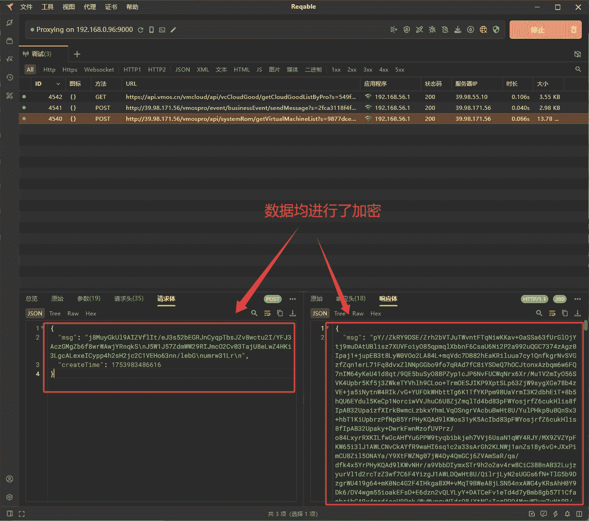

3. 咱们直接上jadx搜域名，可以看到有两条数据，兄弟们可以两条都hook试试，我已经帮兄弟们试了就是第二条，双击进入可以看到API接口`m64925`；包含了`post`请求，接口路径以及请求体`@Body Map map`等信息
   
   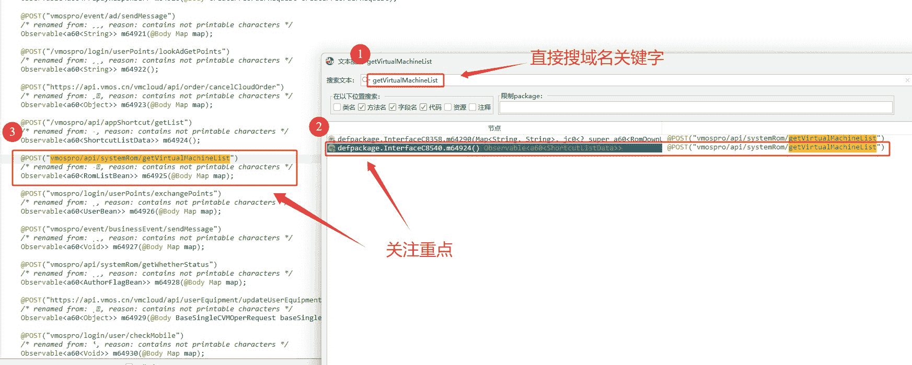

4. 我们直接查找它的用例，运气很好只有一条，跟进查看；可以看到整个加载虚拟机列表数据的具体流程：
   
   1. 显示加载状态
   2. 构建加密请求参数
   3. 发送网络请求获取虚拟机列表
   4. 处理失败/成功回调
   
   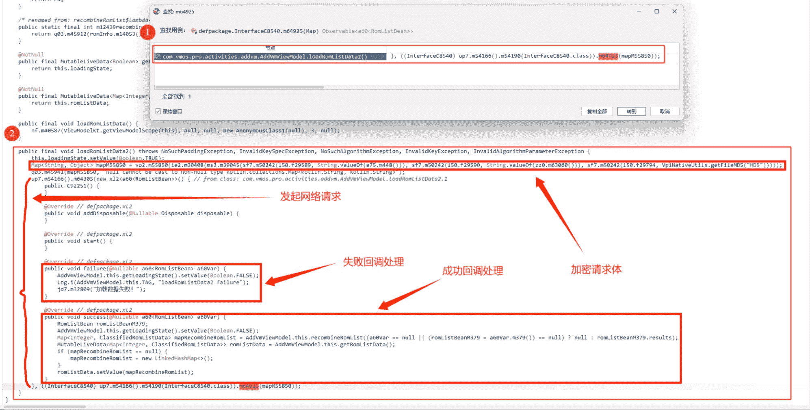

5. 仔细观察加密请求参数，我已经帮兄弟们省去了分析时间，可以清晰得看到这段代码的作用；获取三个参数，对参数进行格式化并转换为json格式，最后通过`m55850`进行加密
   
   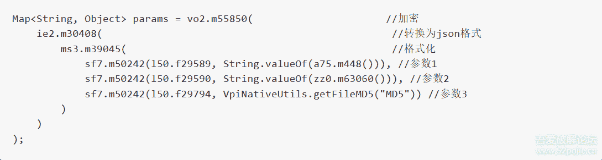

6. 跟进`m55850`可以看到该方法使用3DES-CBC算法对字符串进行加密，并最终返回加密结果和时间戳的map
   
   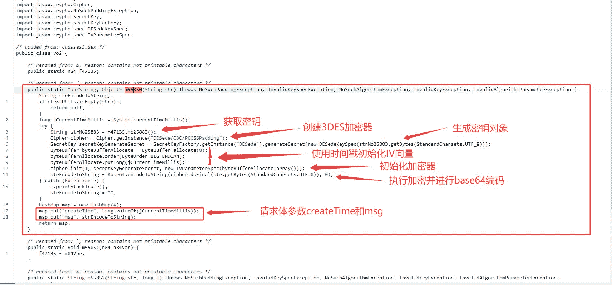

7. 咱们对其进行hook验证一下；成功hook并通过对比可以看到这就是对网络请求进行加密的地方，且三个参数分别为`minimalSupportKernelVersion`（最低支持的Linux内核版本）、`minimalSupportAndroidVersion`（最低支持的安卓API级别）以及`appSign`（apk签名校验值）；这时我们就要思考了，正常来说这三个参数一般都是固定了，按道理来说不应该出现得不出虚拟机列表的情况，绝对有鬼啊
   
   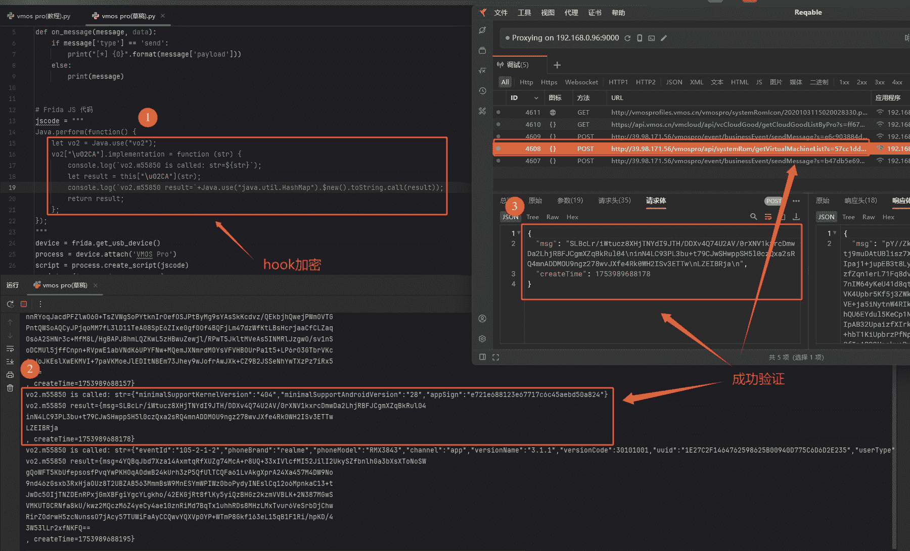

8. 这时我们看一下这个数据的请求头，好家伙，究竟是`post`劈了腿，还是`get`出了轨；问题就出现在该数据的请求头上，该`post`请求头有数个参数，在请求体不变的情况下，那就是请求头出现了问题导致服务器不返回虚拟机列表；我们直接对比一下两种数据，可以发现它们有三个参数不同，分别为`s`、`n`和`isVip`；咱们直接猜测，`s`可能是签名校验，`n`一看就知道是时间戳，`isVip`这明眼人都知道是啥；实践是检验真理的唯一标准，直接看代码
   
   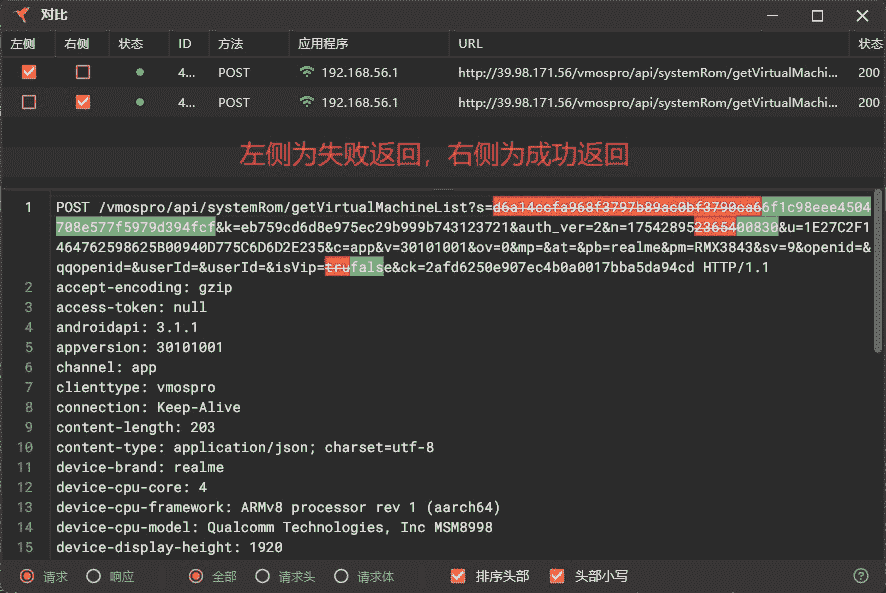

9. 我们选一个特别的参数进行搜索，这里`auth_ver`就是最佳选择；总共10条，并且我们一眼就能看见最下面的两个里面有`s`和`k`，并且`auth_ver`的值为2；直接跟进（这里我已经hook给兄弟们节省时间就是上面一条），仔细观察可以得出`s`是时间戳结合生成的设备签名，并非对请求签名，`n`就是时间戳，那么最终决定就在于`isVip`了
   
   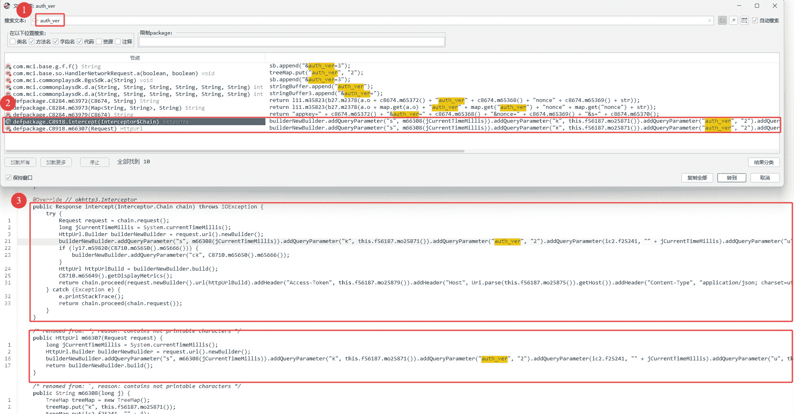

10. 继续跟进`mo25880`，这里需要注意的是跟进的是抽象类中的方法，我们需要找到继承这个抽象类的类中的具体`mo25880`方法；找到后可以发现它是字符串类型，并且能一眼看到“`isMember()`”这个方法；如果我们要进行Hook就不能再去对“`isMember()`”返回false，不然我们就不是会员了，并且`mo25880`它只有`intercept`调用它
   
   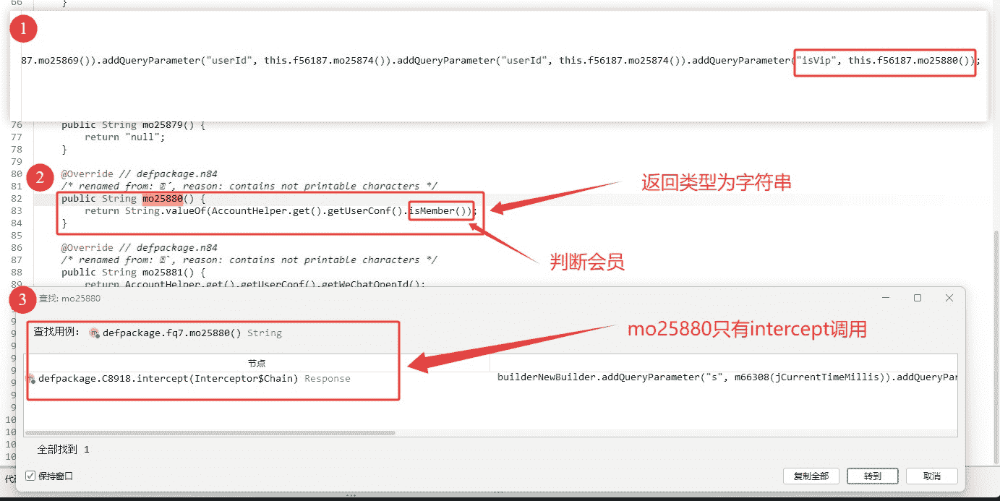

11. 所以我们直接hook“`mo25880`”让它返回字符串“`false`”，进行验证；可以看到，我们成功获取到了虚拟机的列表，那么我们就能猜测其中原理——默认情况下非会员也能从服务器获取虚拟机的列表，但是我们通过hook虽然成为了本地会员，但是服务器并没有记录，因此你向服务器发送一个它不认识的会员，那么它就不会给你返回正确的信息
   
   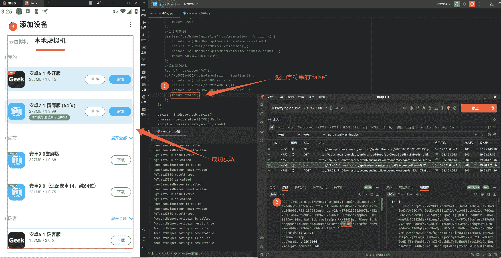

### 五：刺激加倍

1. 兄弟们费劲九牛二虎之力终于窥见双峰，不枉这么长时间的付出啊，但是费了这么大劲只为这未免太亏了，有些兄弟就想“我得多安排几个来慰问我疲惫的身心”；于是乎就出现下面这种情况，兄弟内心一万个草泥马
   
   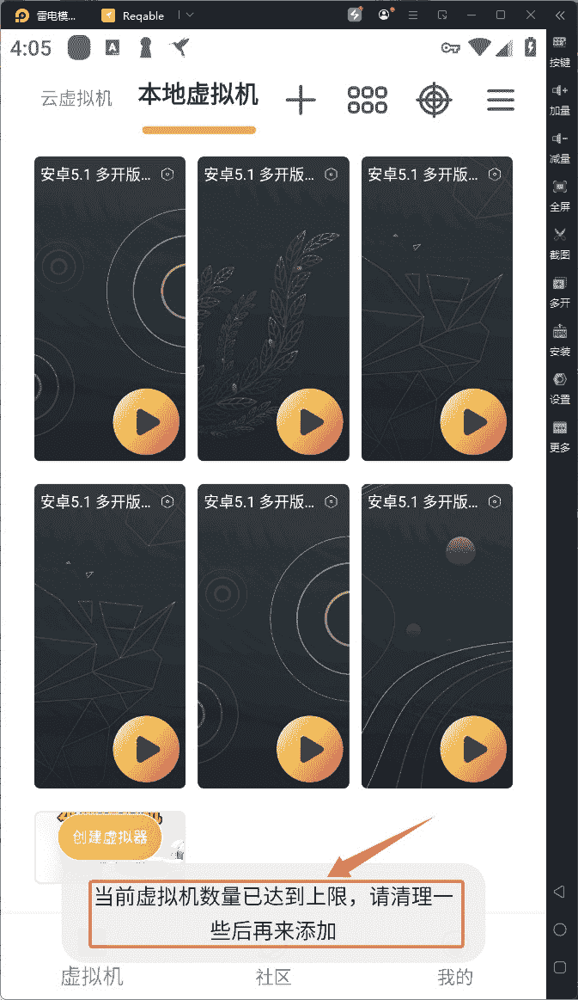

2. 咱们也是不忍心看兄弟这般模样，直接上算法助手选择控件文本赋值来定位；定位到后直接下拉看堆栈信息，仔细观察能够看到`checkoutVipCount`这个方法，翻译过来差不多就是"查看vip数量"
   
   

3. 直接去jadx定位具体代码；复制整行堆栈去jadx查找方法，选择第一个跟进，可以看到这就是用来判断能否添加虚拟机的方法；整个方法简述就是判断会员类型以及当前虚拟机数量来决定用户是否能够添加虚拟机，咱就直接看最前面几行代码；
   
   1. 首先判断用户是否为年卡且当前虚拟机数量小于50来对`z`进行布尔赋值
   - 接下来根据虚拟机数量是否小于3或`z`值来执行添加虚拟机界面
   
   那我们就可以通过hook来使自己成为年卡，这样`z`就为真(在虚拟机数量小于50的情况下)，因为下面`if`里面是或，所以只要其中一个条件为真那么就成立；这样就突破了限制
   
   

4. 我们直接跟进`getIsAnnualCard`，编写hook代码让它返回1；运行代码后再次添加虚拟机，可以看到成功突破虚拟机限制(数量50以内)；兄弟们已经乐坏了，也是能享受到帝王级的服务了
   
   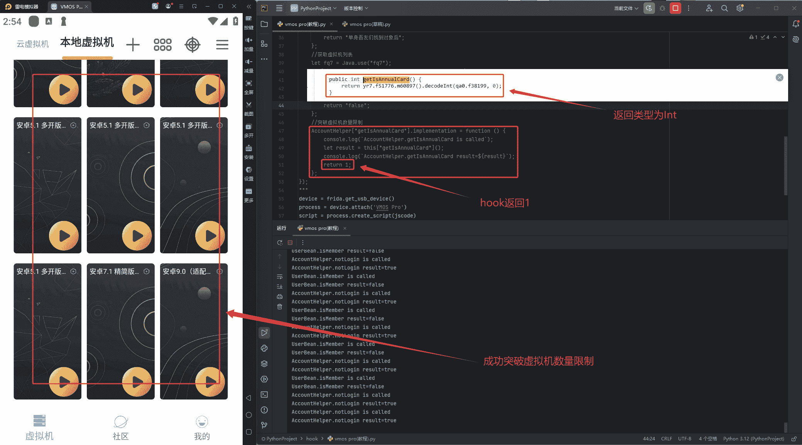

### 六：开发爽点

> 本章节请用真机进行，虚拟机无法在模拟器里运行

1. 有些兄弟可能还不满足于此，不仅要数量还要能够深入研究研究；但是有些兄弟们在深入的时候却碰壁了，奇怪了？怎么有些兄弟都已经深入，但有些兄弟却迟迟无法深入？这可把兄弟们急得团团转啊，无论兄弟们如何用力，始终无法深入，只能直勾勾干瞪眼看着其它兄弟深入研究；这怎能行？帮人帮到底，是兄弟！就帮兄弟深入！经过排查，我们可以发现极客版本的虚拟机自带`root`以及`xp`框架；但是非极客的虚拟机却需要手动开启`root`和`xp`，而我们却无法开启；这也就是为啥有些兄弟可以深入，有些兄弟只能干瞪眼，`root`都没有怎去深入
   
   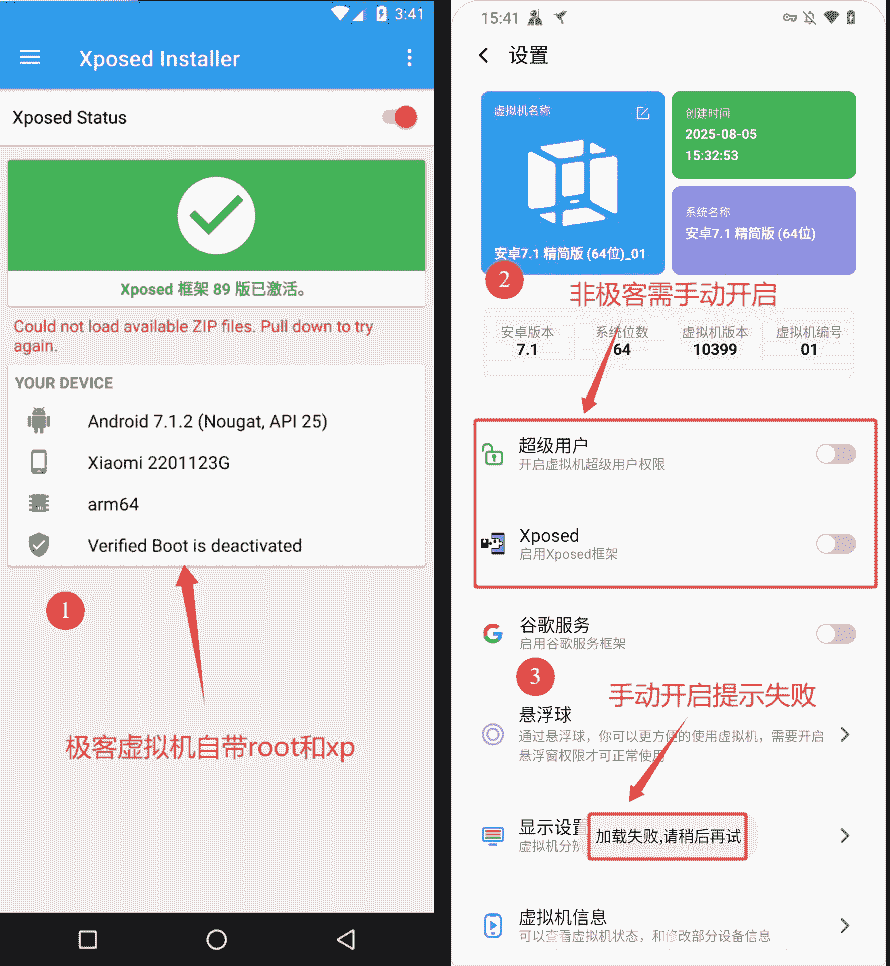

2. 当我们尝试开启超级用户和xposed时会开始下载，但是瞬间就出现加载失败，而当我们尝试开启谷歌服务时却惊讶的发现正常下载，并且下载完成后成功开启谷歌框架；这就意味着虚拟机需要从服务器下载对应的文件来实现功能的开启，二话不说直接抓包
   
   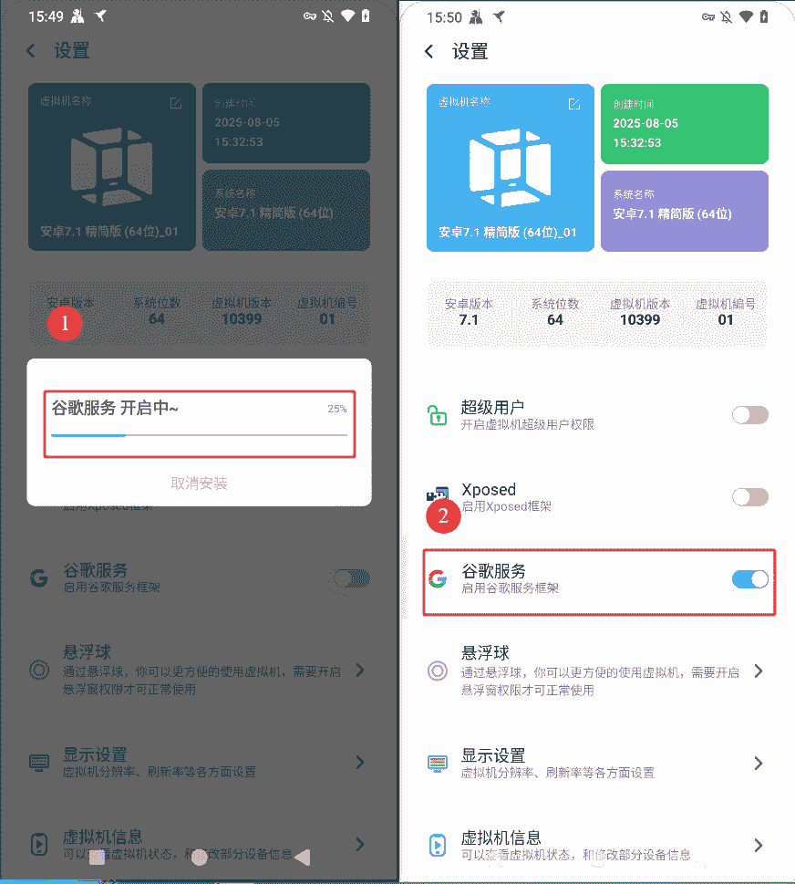

3. 当我们依次尝试并抓包后可以发现它们都是通过`getPluginUrl`这个api从服务器获取加密后的数据，这也验证了我们的猜想，接下来我们得去解密看看服务器都发了些啥
   
   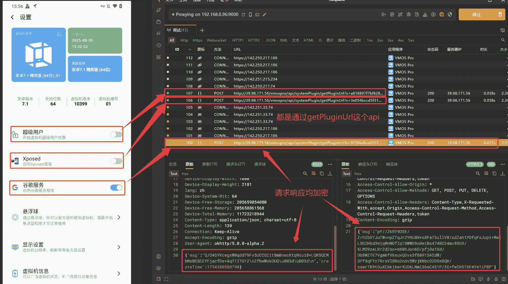

4. 咱们直接去jadx搜api，只有一个结果直接跟进，然后查找用例也只有一个结果直接跟进，之后我们就会看见我们的老朋友——`m55850`，也就是对请求参数进行加密
   
   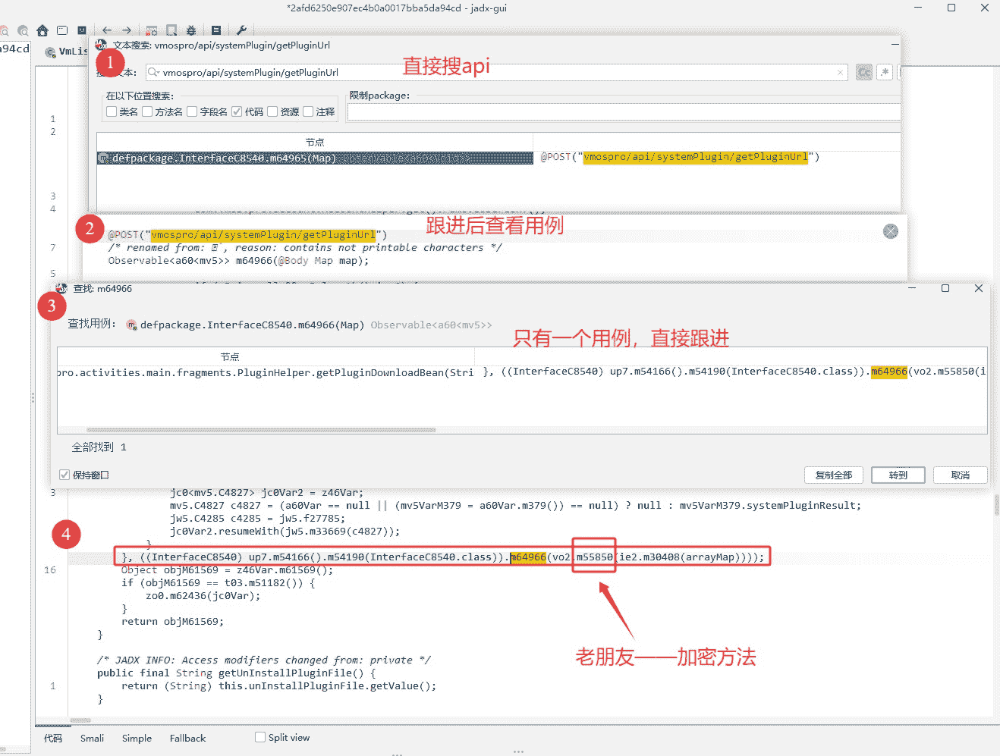

5. 我们对其hook后可以清楚得看到每个功能数据包完整的请求参数，分别为`systemVersion`(系统版本标识)、`romVersion`(虚拟机版本)以及`pluginType`(插件类型)；咱们的重点还是响应，继续研究
   
   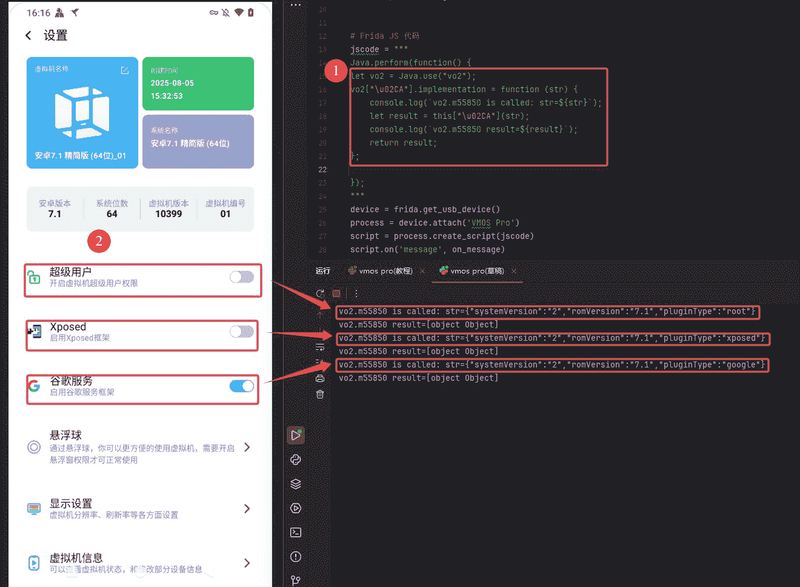

6. 仔细观察`getPluginDownloadBean`整个方法，大致就是先构建请求的参数，再发起网络请求并通过`failure()`和`success()`分别处理失败和成功的回调，其中`success()`就是我们研究的重点
   
   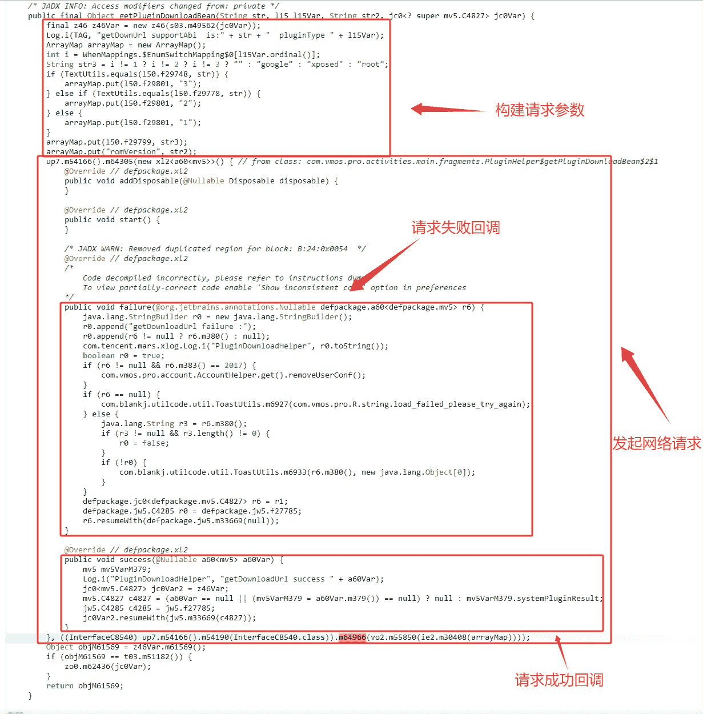

7. 直接编写代码对其进行hook，直接看结果，是不是瞬间恍然大悟，`root`、`xp`等都是从服务器获取对应的插件包进行安装，安装成功后才能开启对应的功能，而`root`和`xp`包发送后服务器会验证你是否是真的会员，如果是就会返回对应的插件包供你下载，否则返回空值；那兄弟们就要问了：那这样是不是就没办法深入了。非也非也，一般对于这种文件，服务器那边很少会对其链接地址进行改变，只要我们获取到正确的插件包地址，然后将其填进去，就能实现深入，当然只要服务器那边改变地址就得重新获取
   
   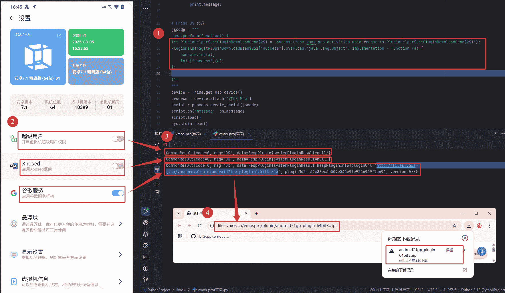

8. 这时有兄弟就会望着兜里的两个子说到：“那获取正确的插件包不得充会员啊，我要的是白嫖啊！”哎呀！兄弟，咱还真就能白嫖到，我的兄弟我必须宠着；我们知道，实现非极客虚拟机的`root`和`xp`就得获取对应的插件包，那么其它破解版的vmos pro是不是也是如此？？？咱直接嫖它们的不就行了吗？说干就干，直接上百度找破解版的vmos pro，下载后直接拉到jadx，搜索`getPluginDownloadBean`双击跟进快速定位到其中的`success()`方法

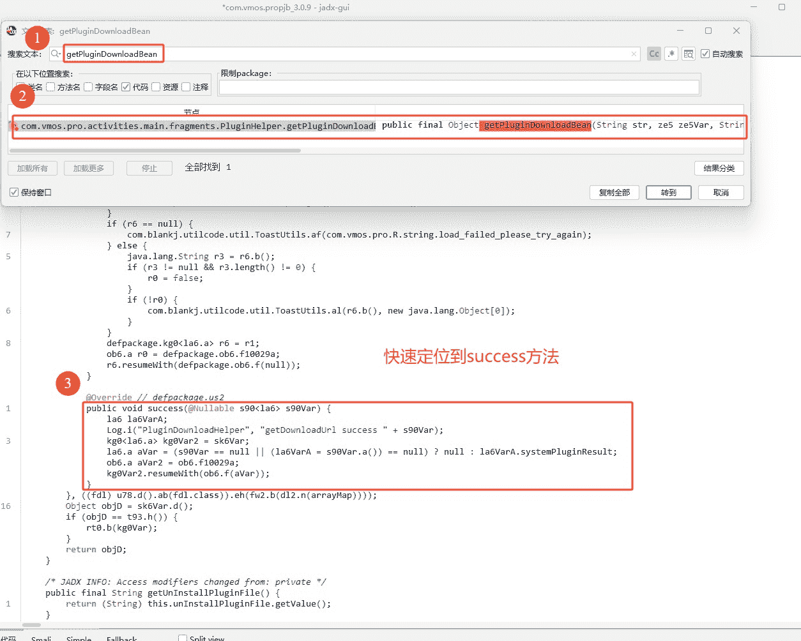

### 9. 下载安装破解版编写hook代码后运行
这里我对7.1和9.0版本的虚拟机进行测试，可以清楚得看到成功获取对应插件包的链接；我们将其保存记录下来

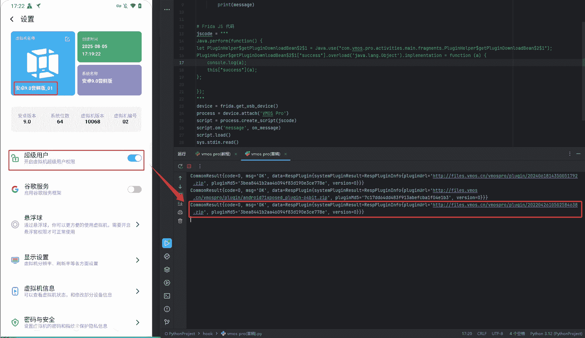

### 10. 接下来我们编写hook代码
我们也可以利用`getPluginDownloadBean()`方法来针对不同版本虚拟机进行Hook，它的`l15Var`和`str2`参数分别表示插件类型和虚拟机版本，我们通过保存对应的值作为判断虚拟机的条件以此来针对不同版本虚拟机的不同功能进行Hook修改对应的插件包链接；之后打开原版vmos pro运行代码，通过对7.1和9.0版本的虚拟机进行测试，可以看到全都完美实现各自的功能；这下兄弟们终于可以对每个虚拟机都深入研究研究了

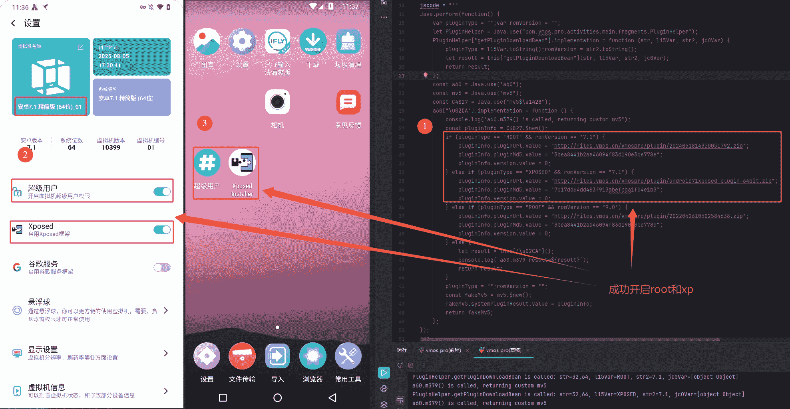
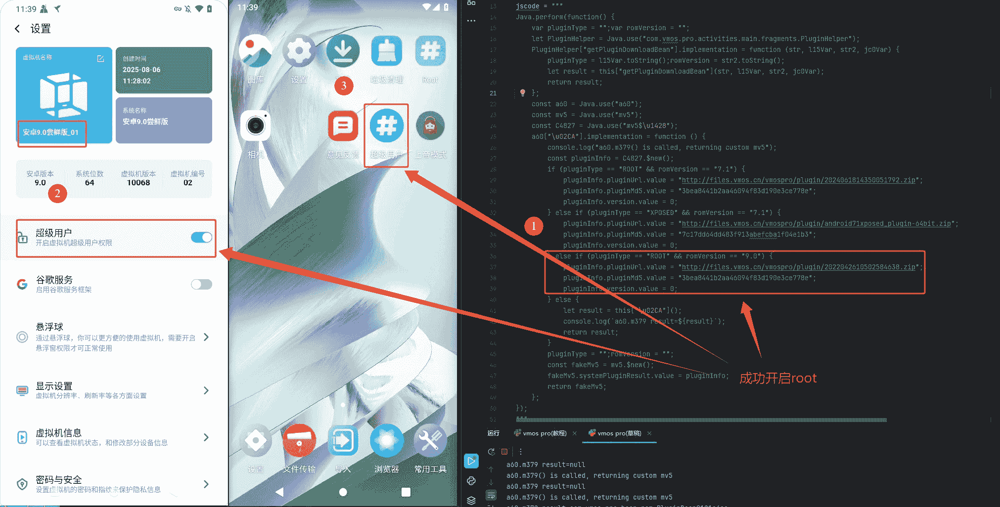

### 七：幻想意淫

#### 1.
到这里咱们已经满足了兄弟们的所有需求，但这时咱们却发现有位兄弟望着天上陷入沉思；难不成？？？哎呀卧槽，兄弟你是真敢想啊！地上的已经不能满足你了，需要天上的才能让兄弟沉醉今宵啊！！！奶奶滴，兄弟敢想咱们就敢做，干就完了！！！当我们点击创建云虚拟机后，会直接跳转到支付界面，点击支付后会让你绑定手机号，咱们就直接登录省去麻烦，之后就会跳转到支付宝付款界面

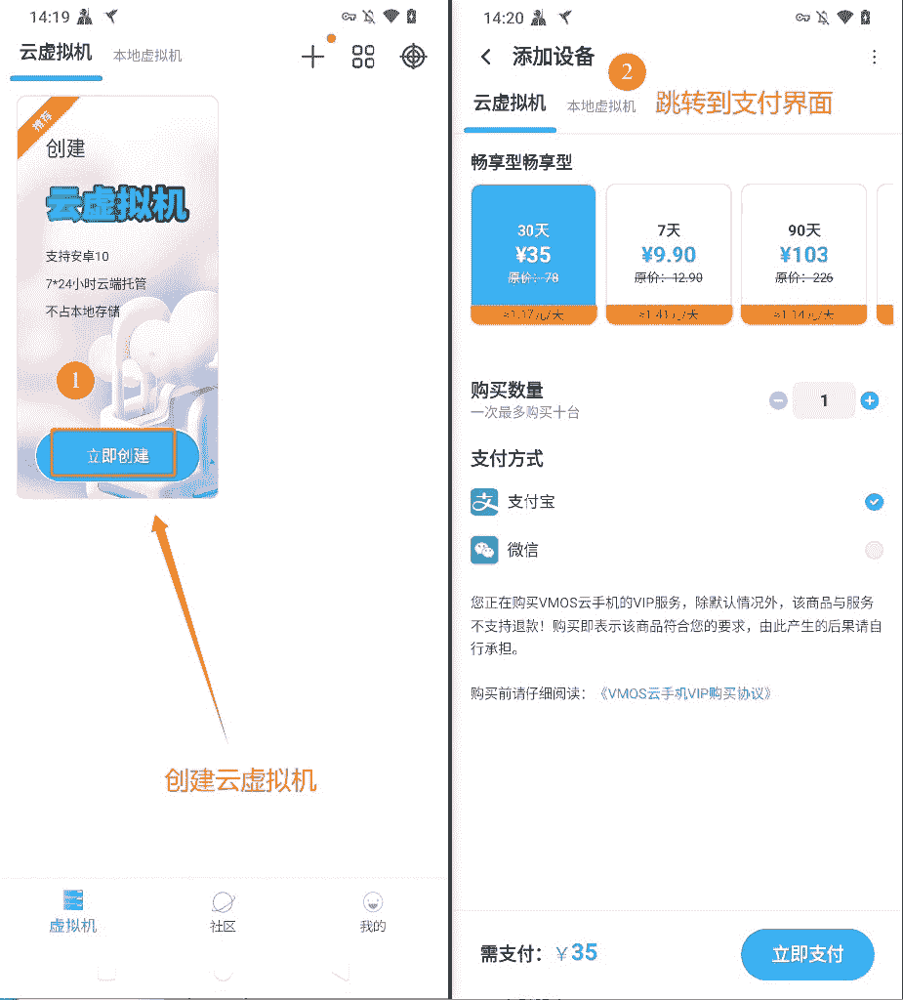

#### 2.
到了支付这里，无非就两种情况要么支付成功要么支付失败；咱们想要继续进行就得支付成功，所以我们得伪造支付成功，当然此伪造仅针对客户端进行伪造；对于支付宝，咱们一定要记住“9000”这个数，这是支付宝支付成功的代码，也是很多单机游戏实现伪造充值的关键；直接去`jadx`中搜“`= 9000`”，选择第二个跟进就能看到相关代码

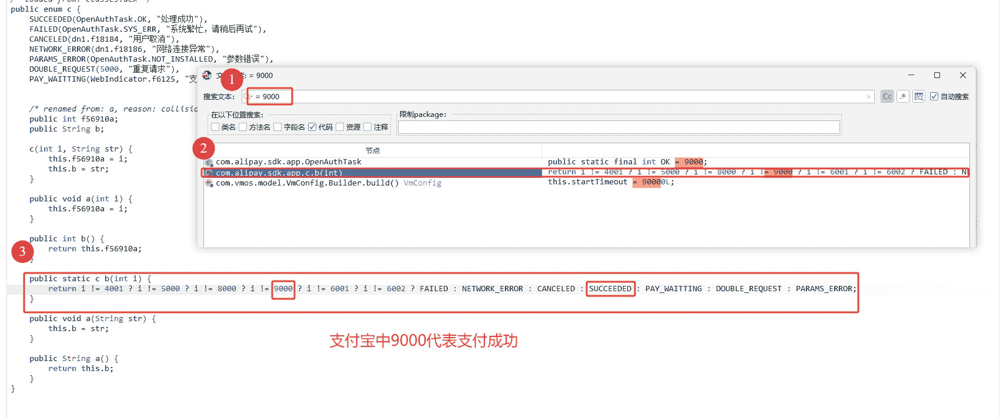

#### 3.
直接编写hook代码对其进行hook，同时我们也把`reqable`打开抓包观察，运行代码后可以看到我们成功伪造了支付结果，但是显示“云机库存不足”

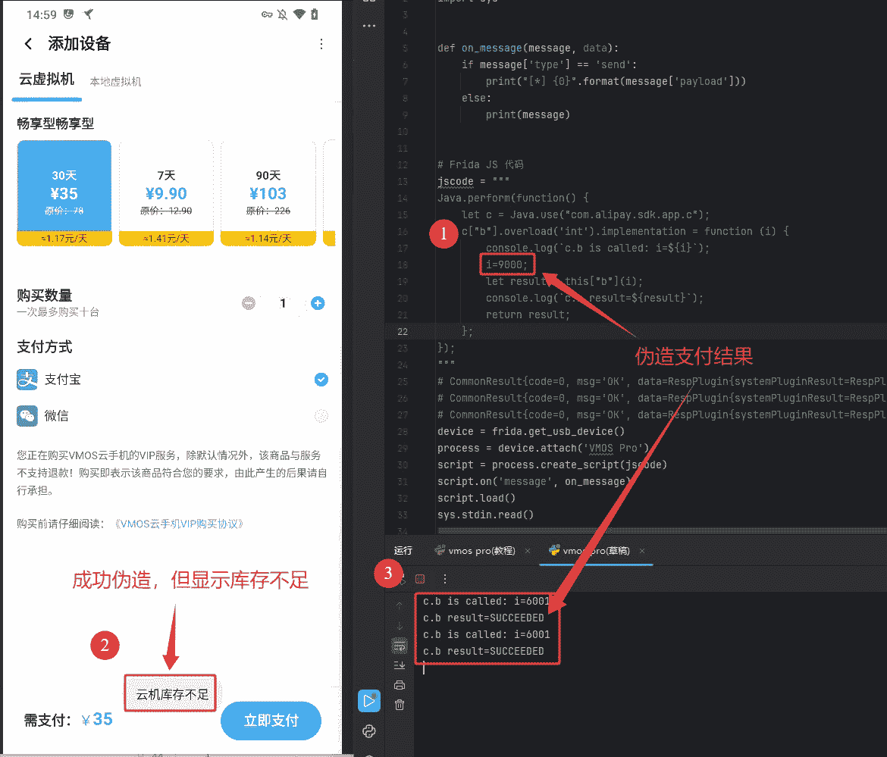

#### 4.
咱们直接去`reqable`上看看，直接筛选“云机库存不足”，可以看到“`createCloudMonthPhone()`”(创建云手机)这个api，间接证明了我们成功对客户端的支付结果进行了伪造，仔细观察，大致的流程就是：
1. 创建订单发起支付
- 验证支付结果
- 支付成功则携带订单ID通过`createCloudMonthPhone()`向服务器发送请求
- 服务器进行验证，如果成功则返回云机链接，失败则返回失败信息

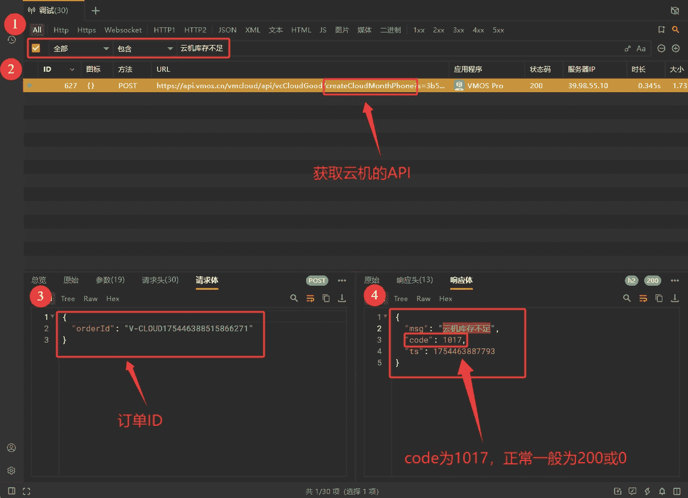

#### 5.
我们可以看到该包响应为1017，正常来说一般成功的响应为200或0，当然也不排除其它的，我们直接在`reqable`上对响应进行修改并启动，之后重新进行支付流程，可以看到这次不再显示“云机库存不足”，而是跳转到了云虚拟机的列表，说明该包的正确code就是200

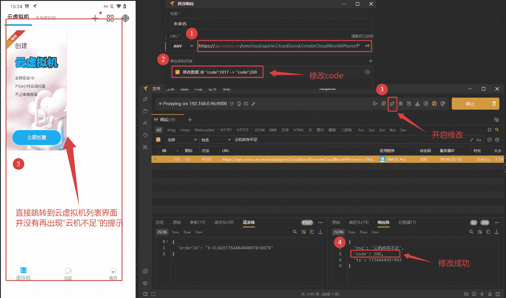

#### 6.
咱们继续去`jadx`中看看具体代码，直接搜`createCloudMonthPhone()`，我已经帮兄弟们验证了就是第六条，直接跟进；兄弟们是不是有种熟悉的感觉！跟之前的`getPluginDownloadBean()`一模一样的结构，都是构建请求然后发送，获取失败和成功回调；所以`createCloudMonthPhone()`也是可以直接按照`getPluginDownloadBean()`的方式，获取正确的云虚拟机链接然后Hook回填进去就成功了

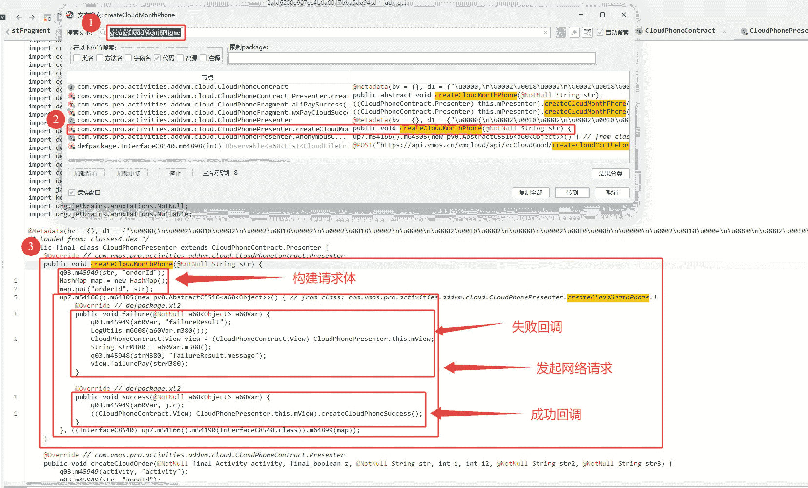

## 结语：
以上就是本次分析的所有内容了，感谢兄弟们观看，由于本人技术有限，帖子部分地方可能讲解错误敬请谅解；此次分析过程，可以说难度一般，就是步骤有点多，需要耐心一步步去解决所有问题，整个分析过程我尽量讲解得清楚详细一点，能让各位能从中学到一些，也能让萌新们看懂逆向的流程步骤，学一些思路等等；该app可以说是手机虚拟机软件的前几了，有能力的兄弟还是要支持一下正版，上述的内容仅供交流学习，请勿用于任何非法途径；感谢兄弟们观看支持，喜欢的兄弟不妨投币支持支持，兄弟们的支持就是我最大的动力，再次感谢，大家一起交流学习

{:301_975:}
