# [Android 原创] 一木记账破解

- 原帖：https://www.52pojie.cn/forum.php?mod=viewthread&tid=2052613
- 抓取时间：2026-11-01T15:41:36.545Z

首先非常感谢吾爱[破解](https://www.52pojie.cn/)，给了这么大的平台给我们交流技术。维护社区人人有责。

## 声明

本帖内容仅供参考与学习交流之用，严禁将本帖所述方法、代码、资料等用于任何违法、违规或侵犯他人合法权益的行为。若任何个人或组织擅自将本帖内容用于非法用途，由此产生的一切不良后果及法律责任均由使用者自行承担，与本社区及本帖作者无关。本帖不对因使用或依赖本文内容而可能导致的任何损失、纠纷或责任承担任何直接或间接的法律责任。

## 操作步骤

最近在使用这软件发现还是很不错的，但由于囊中羞涩故此去寻找方法修改，我发现很多贴子的方法都比较复杂甚至已经无法使用了，所有我在这分享一个简单的，只需要修改四个地方即可。

### 基础工作

使用 MT 管理器提取安装包，然后对 4 个 class 文件使用 `Dex编辑器+++` 打开，接着在常量部分搜素“会员”，找到“永久会员”点进去点搜素，再点进去进行编辑。

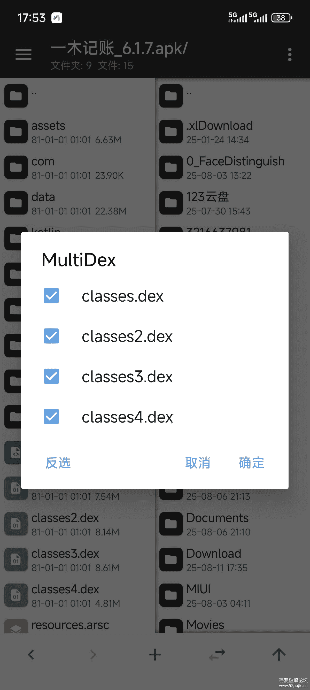

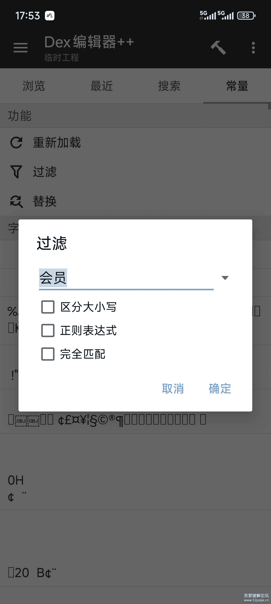


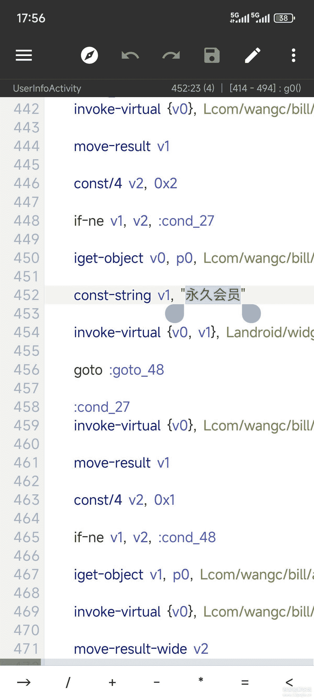

### 修改永久会员

第一个修改的地方就是这永久会员下面的 `const/4 v0, 0x1` 修改为 `const/4 v0, 0x2`（1 改为 2 就行）。

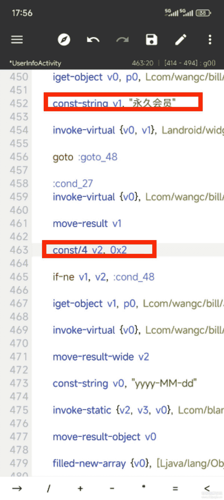

接着点击上面的 `getVip Type()` 长按再点跳转。

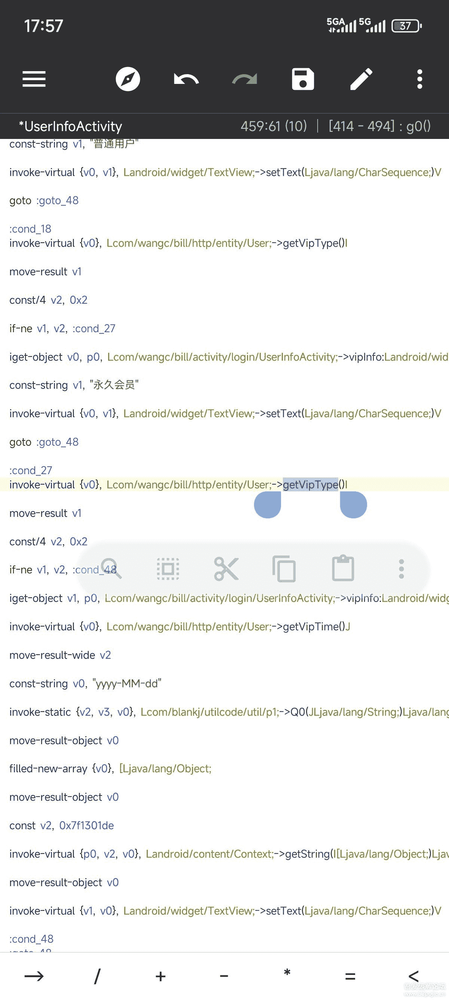

跳转后就是如下所示，我们在这两个红框区域放入两行代码：

```smali
const/4 v0, 0x2
const-wide v0,0x32d57bf5e8L
```

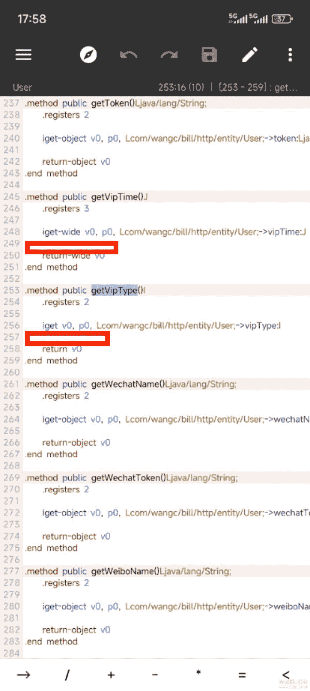

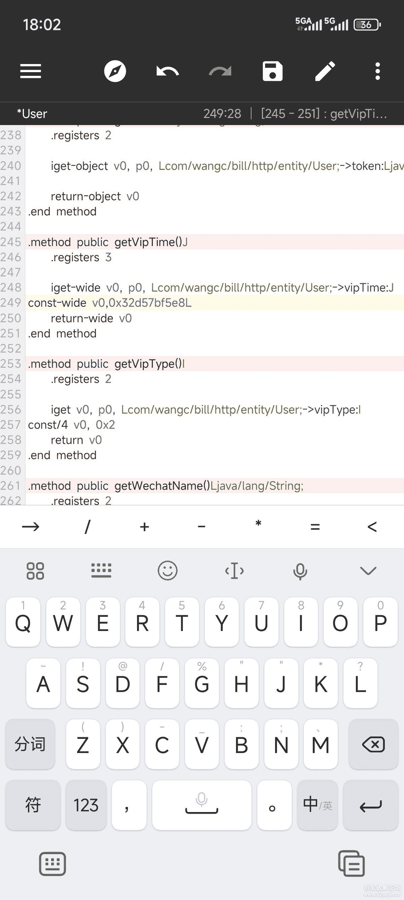

### 批量替换 `vipType` 读取

然后就返回到搜索的位置，发起新搜索（保存），搜索内容是 `iget (.*), .*, Lcom/wangc/bill/http/entity/User;->vipType:I`，选择`代码`和`正则化`。

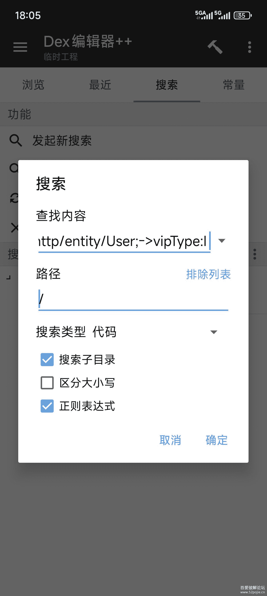

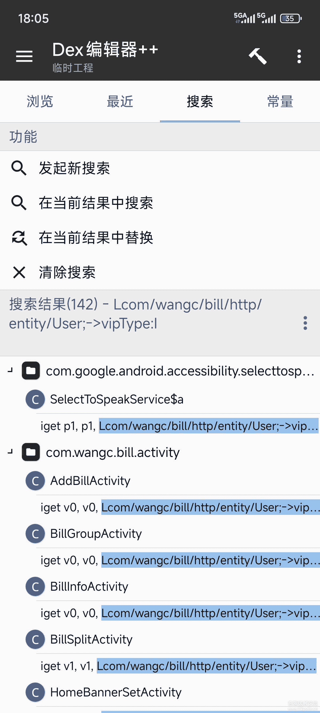

接着替换 `const/4 $1, 0x2`。

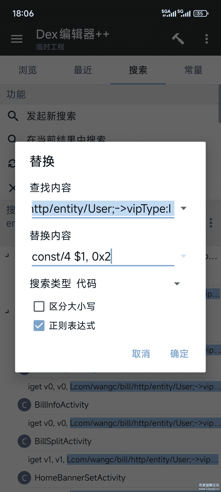

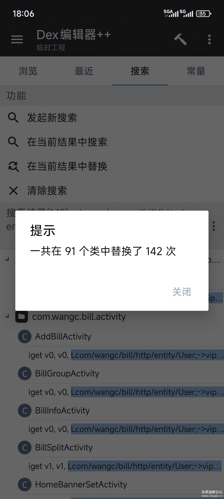

替换完成后退出保存就行，如果没有加固就自己加固一下（MT 自带）就行。

可能教程看着有点多，但是实际操作起来很简单很快。

## 补充说明

另外，如果自动记账一次就掉，那么你不给这软件使用 wifi 和流量权限就行。
