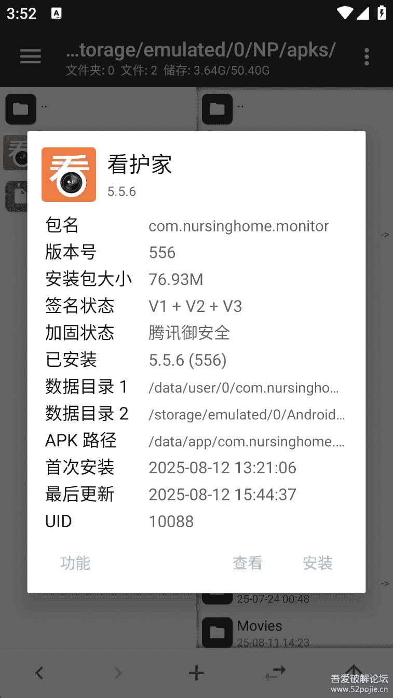
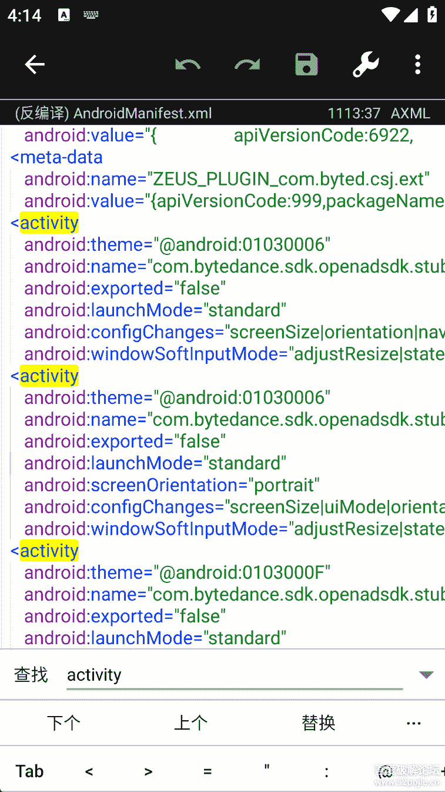

# [Android 原创] 某护家去除广告办法(新手入门)

- 原帖: `https://www.52pojie.cn/forum.php?mod=viewthread&tid=2052822`
- 抓取时间: `2026-11-01T23:56:00`

昨晚刚学到 第四课《安卓逆向这档事》四、恭喜你获得广告&弹窗静默卡
练习了课后作业，感觉自己强的可怕，然后就实战一下
选了个广告比较烦人的`apk`

`image.png` (206.14 KB, 下载次数: 0)
`https://www.52pojie.cn/forum.php?mod=attachment&aid=Mjc5NjMxMnwyMjdmZDM1YnwxNzkzNTc3MzU4fDE2ODA4NnwyMDUyODIy&nothumb=yes`
2025-8-12 15:52 上传

然后发现跟自己练习的不一样，貌似还需要 `https://www.52pojie.cn/forum-5-1.html` （参考了实战腾讯御安全脱壳与修复，多图详细解说 然后发现安卓9不支持）

打开`xml`后发现全是广告

`image.png` (376.58 KB, 下载次数: 0)
`https://www.52pojie.cn/forum.php?mod=attachment&aid=Mjc5NjMxM3wwZjY0NzgxZXwxNzkzNTc3MzU4fDE2ODA4NnwyMDUyODIy&nothumb=yes`
2025-8-12 16:14 上传

看到大佬的总结 【必须使用 `AndroidManifest` 中的 元素表示所有 `Activity`。系统不会识别和运行任何未进行声明的`Activity`。】

那么删除这些广告声明是否就可以达到目的
反编译后`1485`行，还是交给`ai`来处理去广告吧
处理完后进行替换

安装会提示签名不一致，从新登录账号就可以实现无广告了

去广告的效果实现了，但是总感觉怪怪的，又说不清哪里怪
