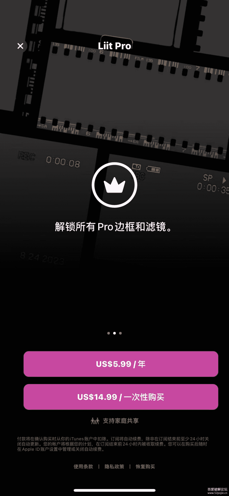
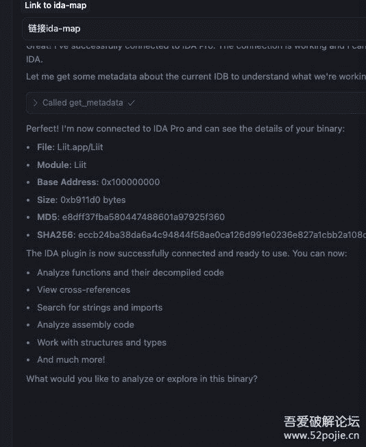
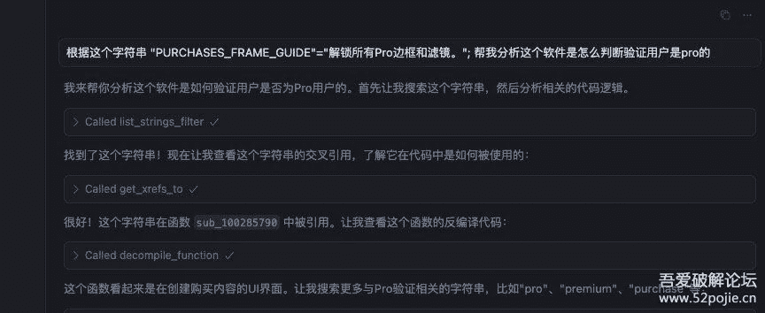
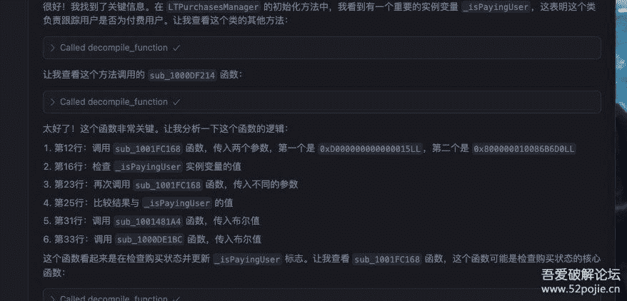
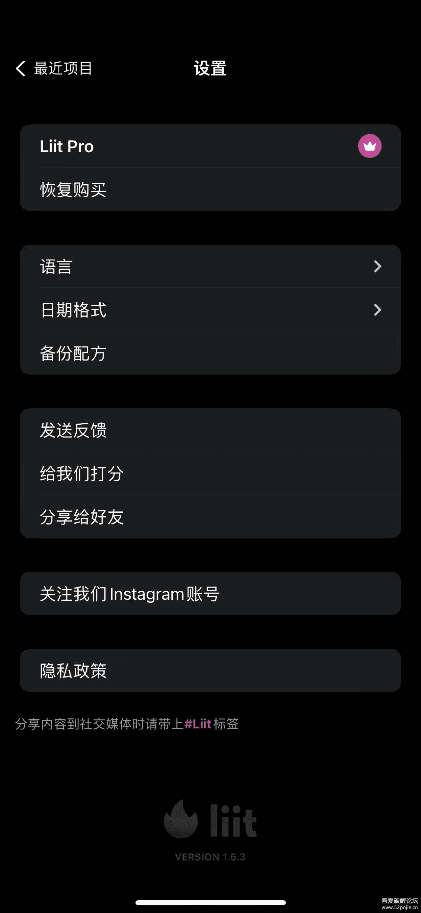

# [iOS 原创] 利用ida-pro-mcp，对ios某滤镜软件进行逆向分析

- 原帖: https://www.52pojie.cn/forum.php?mod=viewthread&tid=2055361
- 抓取时间: 2026-11-01T14:00:02.145Z

首先打开软件，发现需要解锁会员才可以使用全部的滤镜和素材。

今天我们就来尝试使用`ida-pro-mcp`帮我们进行逆向分析定位

利用`cursor`进行`mcp`的链接。具体配置自行网上查找

现在发现`ida-mcp`已经成功链接，

还是老样子，我们根据字符串信息，开始让`gpt`帮我来自动分析定位。（真是方便啊）

很快，`gpt`已经帮我们定位到了关键点

我们可以用`frida` hook一下返回值看一下，`gpt`帮我们分析的对不对

哎，效果很好，大家有兴趣的可以试试
