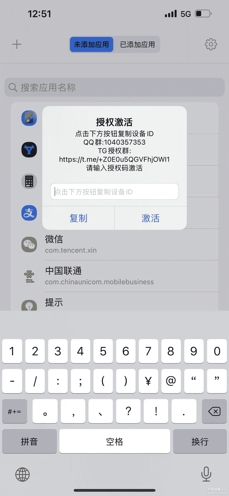
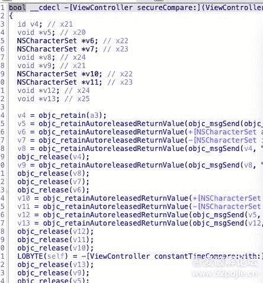
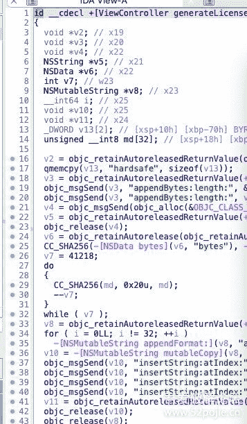

# [iOS 原创] ios 某软件的逆向分析学习

- 原帖: https://www.52pojie.cn/forum.php?mod=viewthread&tid=2057449
- 抓取时间: 2026-11-01T13:59:39.132Z

首次打开软件，显示需要激活才能使用

其实这软件刚出来那会，研究过，功力不够，没搞成

进入正题吧，还是`ida-mcp`作为辅助

首先从弹窗 可以看到一些 值得我们去分析入口的信息——----------- 设备id 授权码 激活等

打开`ida` 拖入可执行文件，等待加载完成

经过`mcp`的分析，得知：

## 验证流程推测

基于这些核心函数，`TrollOpen`的激活验证流程可能是：

设备绑定：使用 `deviceUniqueID` 和 `deviceSerialNumber` 获取设备唯一标识

许可证验证：通过 `validateLicense:` 验证许可证有效性

安全比较：使用 `secureCompare` 和 `constantTimeCompare` 进行安全验证

状态检查：通过 `isActivated` 和 `getActivatedStatus` 检查激活状态

状态保存：通过 `saveActivatedStatus:` 保存激活结果

这些函数共同构成了`TrollOpen`的激活验证系统，包含了设备绑定、许可证验证、安全比较和状态管理等关键环节。

今天我们主要讲下如何通过`deviceUniqueID` 生成的激活码逻辑思路:

调用 `secureCompare` 函数验证输入的许可证密钥

我们可以进入这个函数去看一下代码逻辑;

## 函数功能分析

### 1. 函数签名

;

接收用户输入的许可证密钥

返回布尔值表示验证是否成功

### 2. 验证逻辑流程

第一步：获取正确的许可证密钥

;

调用 `generateLicenseKey` 方法生成正确的许可证密钥

这个密钥可能是基于设备信息或其他因素动态生成的

接着是调用 `generateLicenseKey` 方法生成正确的许可证密钥

许可证生成的逻辑思路比较复杂

第一步：获取设备唯一标识

第二步：创建盐值（`Salt`）

第三步：组合数据

第四步：`SHA256`哈希

第五步：多次哈希迭代对哈希结果进行41218次迭代哈希

第六步：转换为十六进制字符串

第七步：格式化许可证

最终形成激活码

https://xwzios-crack.pages.dev/
