# [Android 原创] 论如何在忙成狗的日子里，靠师傅带飞顺便逆向个放松解压APP会员

- 原帖: https://www.52pojie.cn/forum.php?mod=viewthread&tid=2058263
- 抓取时间: 2026-11-01T13:59:29.125Z

## 前言

声明：本文仅供学习交流使用，所涉及的APP和[破解](https://www.52pojie.cn/)版均不提供下载渠道。所涉及的技术请勿用于非法活动，否则所带来的一切后果自负。

最近忙得跟陀螺似的，安卓逆向学习直接给我搁那“加载中...”。但是不慌！咱主打一个心态稳如老狗，为啥？因为我有秘密武器——正己师傅！（对，就是那位传说中的技术大神！）人家出的教程，那叫一个丝滑流畅，深入浅出，比我追的偶像剧还上头！简直是逆向界的“人间清醒”+“行走的百科全书”！前两天我手机里蹦出来个叫“心潮”的APP。正己师傅的教程在脑子里自动循环播放，我这不就来劲了嘛！于是，就有了这篇《论如何在忙成狗的日子里，靠师傅带飞顺便逆向个APP》的奇遇记！

## 工具

- Np/Mp管理器
- 小黄鸟
- 雷电模拟器
- `jadx-gui`

## 附件地址

`aHR0cHM6Ly93d3cud2FuZG91amlhLmNvbS9hcHBzLzY5NjI4MzQ=`

## 教程

### 方法一、`hook`注入

#### 1、软件分析

可以看到软件未加固

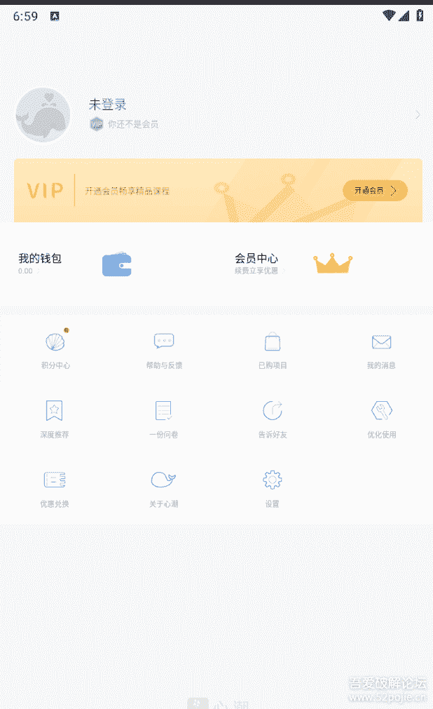

2、搜索关键字`vip`，然后找到这个`FlushInfo`类，

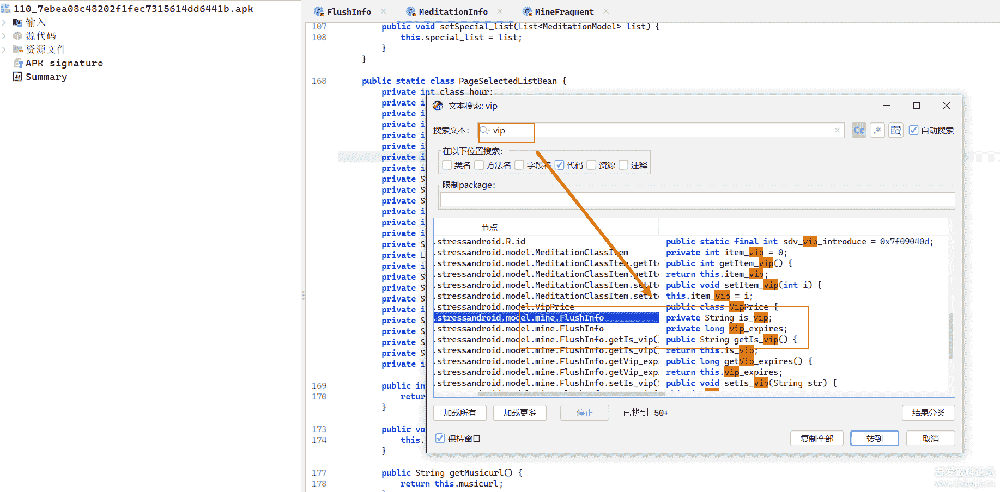

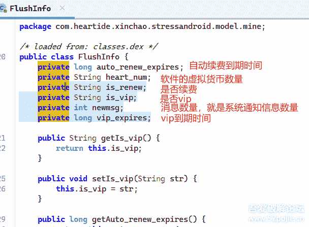

这里到期时间是`long`型，所以需要返回时间戳

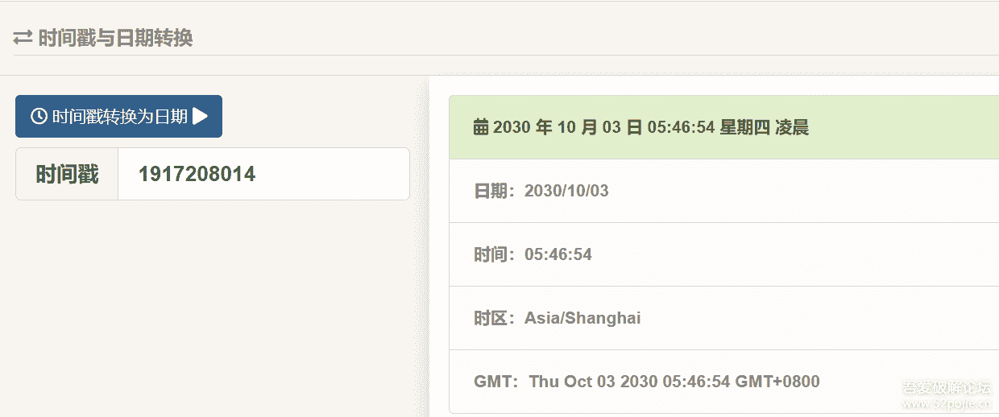

然后根据字段的含义，`hook`对应的方法，返回对应数据即可

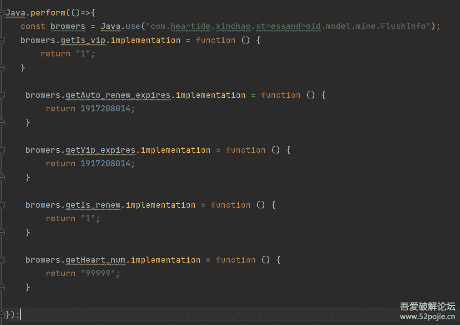

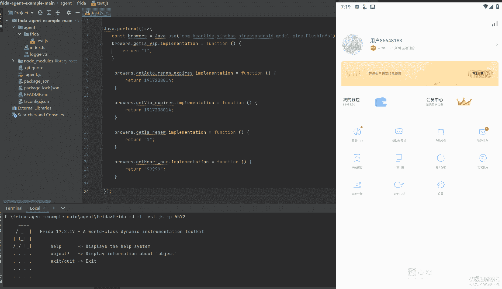

这里注意，我是以进程`pid`方式`hook`注入，所以执行`hook`脚本之后，点击会员中心 -> 开通会员 -> 随便选择1个开通 -> 支付宝支付 -> 取消支付，再返回app就正常显示`vip`了

检查`vip`功能

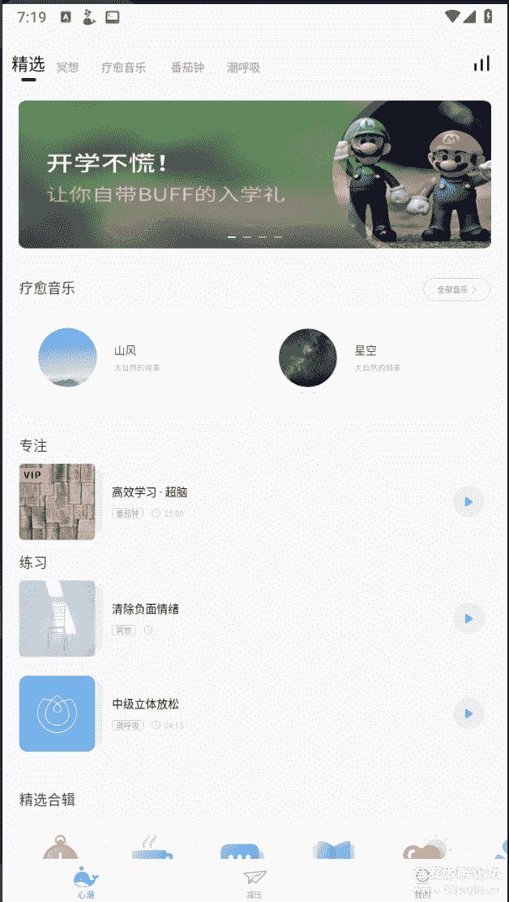

选择`vip`内容“高校学习 超脑”，使用正常

### 方法二、小黄鸟

打开小黄鸟，抓包

找到这个包

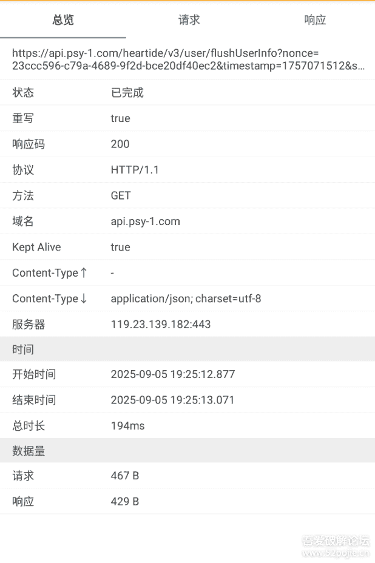

选择重写

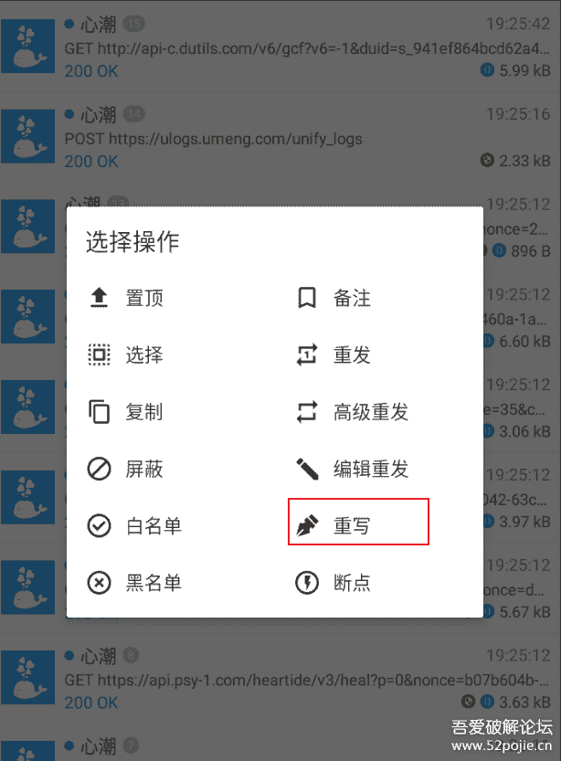

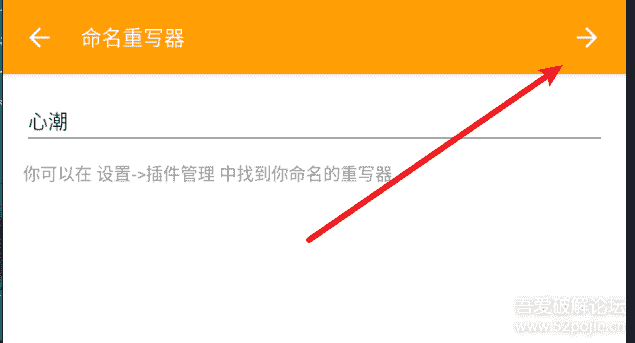

选择响应

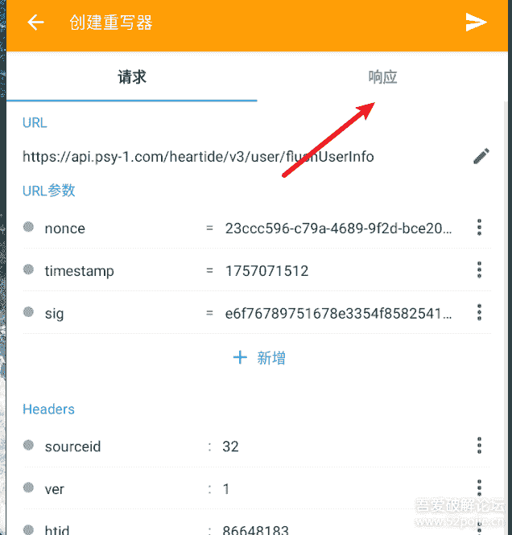

点击 跟随服务器

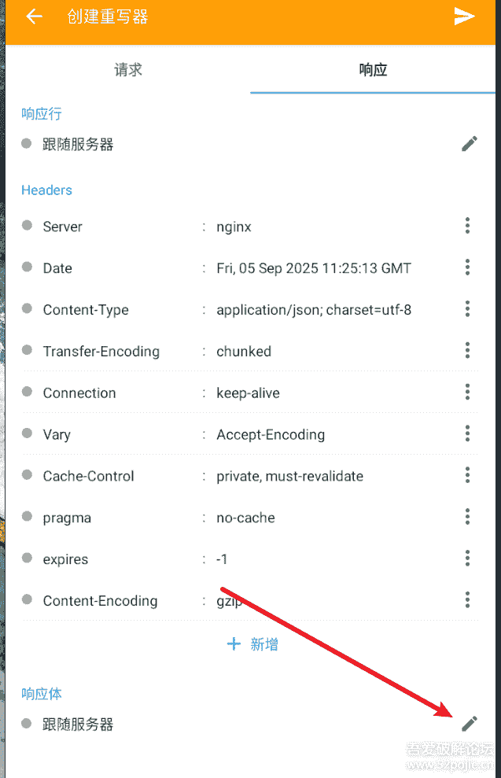

选择 在线编辑

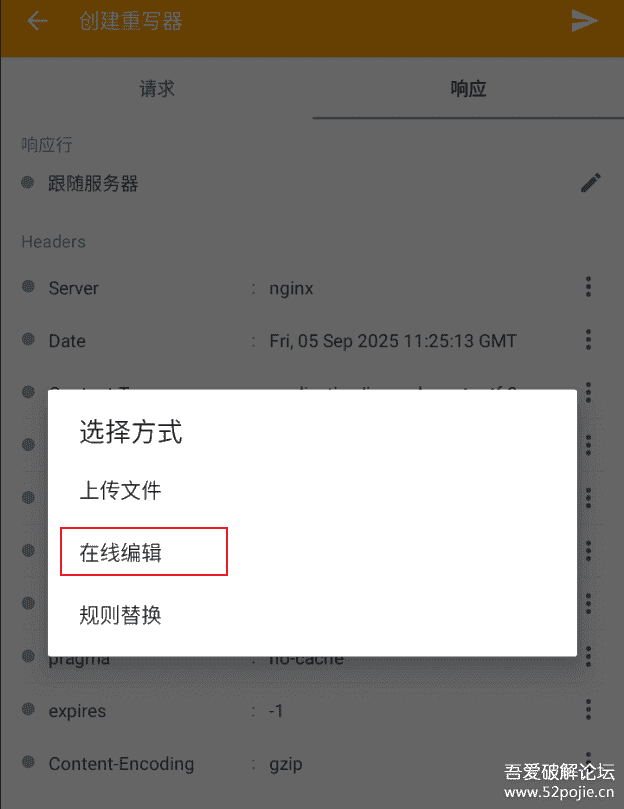

这里修改字段和方式一的一样改法

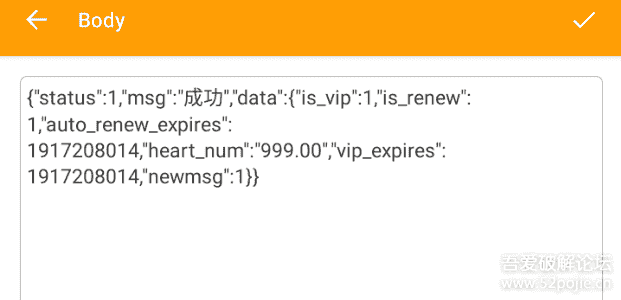

