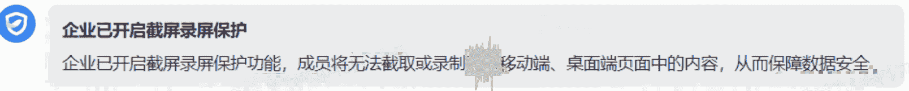
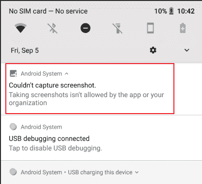
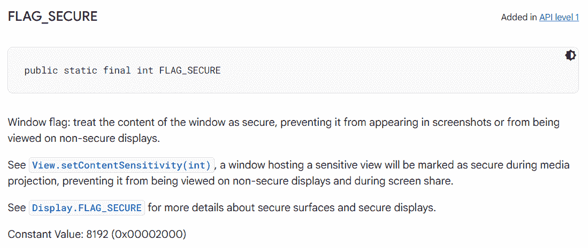
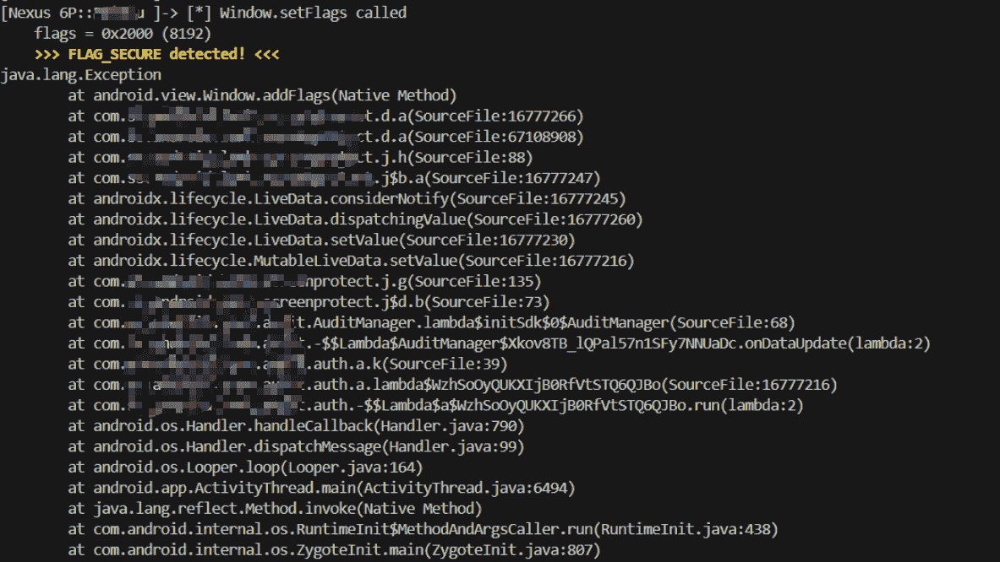
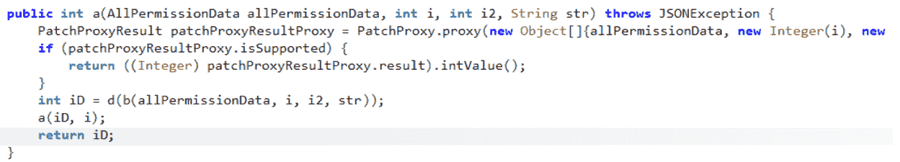
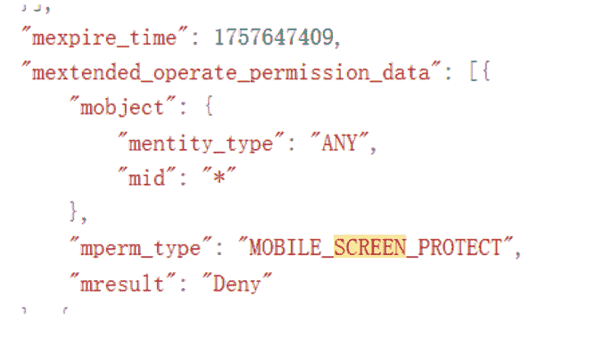
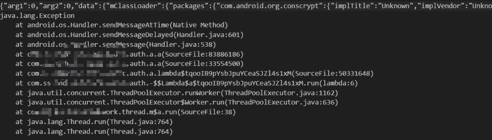
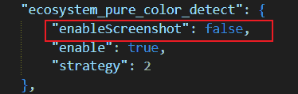
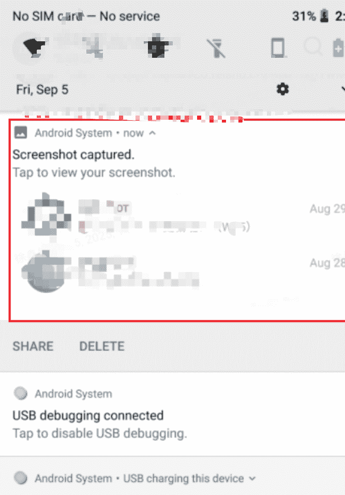

# [Android 原创] 绕过某企业办公 APP 的截图限制

- 原帖: https://www.52pojie.cn/forum.php?mod=viewthread&tid=2058264
- 抓取时间: 2026-11-01T13:59:25.125Z

本文仅作为个人技术学习与研究的记录，旨在分享逆向分析的思路和方法，不涉及也不鼓励任何形式的商业破解、盗版传播或非法用途。文中所有示例与操作均出于技术探讨目的，且涉及的关键信息已进行脱敏处理，不会影响或泄露实际软件的商业利益。

如有内容存在侵权或不当之处，请联系我，我将第一时间删除或修正。

本文为分享使用`frida`绕过某企业办公软件禁止截图的设置的过程

## 问题

如图，早上打开办公软件，收到了新设置不让截图的通知



打开app任意界面截图的时候，提示无法截图



## 分析

安卓提供app设置截图权限的api有

1. `setFlags(flags, mask)` — 该方法属于 `Window`（通常通过 `getWindow()` 获取），调用 `setFlags(flags, mask)` 会先清除 `mask` 指定的位，然后设置 `flags` 指定的位。常用于：设置或清除窗口属性，例如禁止截图、控制状态栏样式、窗口尺寸格式等。通过 `getWindow().setFlags(WindowManager.LayoutParams.FLAG_SECURE, WindowManager.LayoutParams.FLAG_SECURE)` 可彻底开启不允许截图功能。

2. `addFlags(flags)` — `Window` 的方法，用于向当前已有的窗口标志中“追加”指定的标志，即在原有 `flags` 基础上通过位或 (`|`) 增加新的标志。常用于：使用 `addFlags(flags)` 中调用 `setFlags`。

当 `flag` 设置为 `0x2000` 的时候，即为设置了不允许截图



对上述 api  hook，定位到设置的位置



根据调用栈推测，应该是企业设置了以后，后端会将某个标志数据一起传给 app，当 app 登录该企业账号的时候就会更新设置



跟踪分析可以发现 `allPermissionData` 里面就包含了对是否允许截图的设置标志

设置的条件是根据这个 json 文件中对 `MOBILE_SCREEN_PROTECT` 的设置



它是使用 `android.os.Handler` 发送的这个 json 信息，hook 相关发送的 api，定位到写入的地方

`sendMessageAtTime(Message msg, long uptimeMillis)`



对同步抓包中的数据包识别，根据代码中的`"init"`、`"api"`等关键字猜测大概率是这个传入设置



## 解决方案

绕过很简单，对 `setflags` 的 hook 修改返回即可

```
var FLAG_SECURE = 0x2000;
console.log("    >>> Removing FLAG_SECURE so screenshot is allowed 
```

结果：正常截图



目前就是实时的用 `frida` 测试了方案，如果需要长期融入日常使用可以转换成 `xposed` 脚本，结合 `lspatch` 也可以在无 root 的情况下使用。

对于其他禁止截图的 APP 本质上采用一样的方法。应该都可以绕过。因为手机截图毕竟都得用 android 本身的 api，那么禁止的手段也是与其相关。
