# [Android 原创] 某黑盒app登录参数逆向分析

- 原帖: https://www.52pojie.cn/forum.php?mod=viewthread&tid=2065441
- 抓取时间: 2026-11-01T13:57:50.423Z

本文章中所有内容仅供学习交流使用，不用于其他任何目的，不提供完整代码，抓包内容、敏感网址、数据接口等均已做脱敏处理，严禁用于商业用途和非法用途，否则由此产生的一切后果均与作者无关.本文章未经许可禁止转载，禁止任何修改后二次传播，擅自使用本文讲解的技术而导致的任何意外，作者均不负责

## 一、样本基本信息

包名：`com.max.xiaoheihe`

接口信息：`*******`[`/account/login`](https://api.xiaoheihe.cn/account/login) 登陆的接口

样本：某黑盒

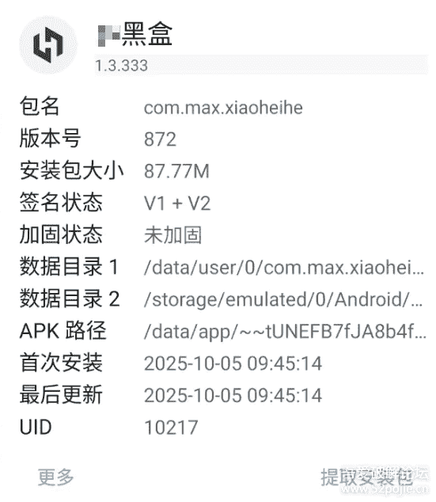

目标参数信息：请求头`noce`

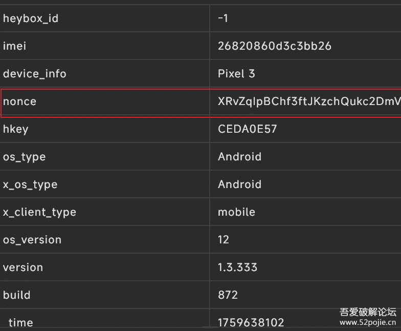

## 二、frida检测处理

先随意写一个脚本注入，用来测试`firda`是否有被检测

```javascript
function java_hook() {  Java.perform(function () {
    console.log("java_hook")
  })
}
```

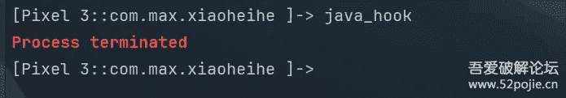

可以看到手机上正常进入，但是`frida`进程已经被杀死了，有明显的进程检测的特征，我们还是先看看是哪一个`so`文件加载的线程导致杀死了`frida`

```javascript
function hook_dlopen() {  var android_dlopen_ext = Module.findExportByName(null, "android_dlopen_ext");

  console.log("addr_android_dlopen_ext", android_dlopen_ext);

  Interceptor.attach(android_dlopen_ext, {

    onEnter: function (args) {

      var pathptr = args[0];

      if (pathptr != null && pathptr != undefined) {

        var path = ptr(pathptr).readCString();

        console.log("android_dlopen_ext:", path)

      }

    },

    onLeave: function (retvel) {

    }

  })

}
```

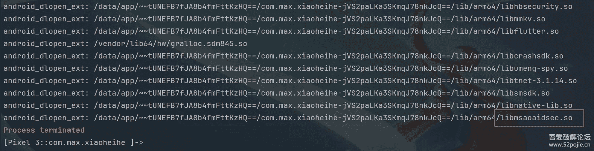

`firda`在加载到`libmsaoaidsec.so`文件的时候将`frida`进程杀死，去打印线程的加载情况，`libmsaoaidsec.so`（之前案例中也有遇到，所以知道是线程的检测）加载了哪些线程

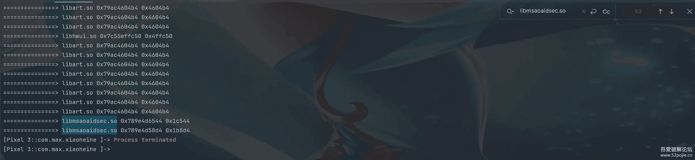

```javascript
function patch_func_nop(addr) {  Memory.patchCode(addr, 8, function (code) {
    code.writeByteArray([0xE0, 0x03, 0x00, 0xAA]);
    code.writeByteArray([0xC0, 0x03, 0x5F, 0xD6]);
  });
}

function hook_pth() {
  var pth_create = Module.findExportByName("libc.so", "pthread_create");
  console.log("[pth_create]", pth_create);
  Interceptor.attach(pth_create, {
    onEnter: function (args) {
      var module = Process.findModuleByAddress(args[2]);
      if (module != null) {
        console.log("开启线程-->", module.name, args[2].sub(module.base));
        if (module.name.indexOf("libmsaoaidsec.so") != -1) {
          patch_func_nop(module.base.add(0x1c544));
          patch_func_nop(module.base.add(0x1b8d4));
          // patch_func_nop(module.base.add(0x26e5c));
        }

      }

    },
    onLeave: function (retval) {
    }
  });

}

function hook_remove(so_name) {
  Interceptor.attach(Module.findExportByName(null, "android_dlopen_ext"), {
    onEnter: function (args) {
      var pathptr = args[0];
      if (pathptr !== undefined && pathptr != null) {
        var path = ptr(pathptr).readCString();
        if (args[0].readCString() != null && args[0].readCString().indexOf("libmsaoaidsec.so") >= 0) {
          hook_pth()
        }
      }
    },
    onLeave: function (retval) {
    }
  });
}

function main() {
    hook_remove('libmsaoaidsec.so')
}

setImmediate(main)
```

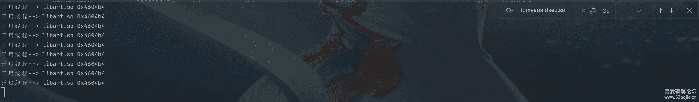

这样就可以过掉`frida`检测

## 三、java层分析

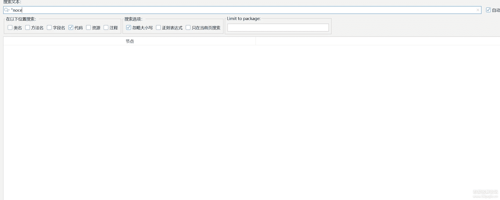

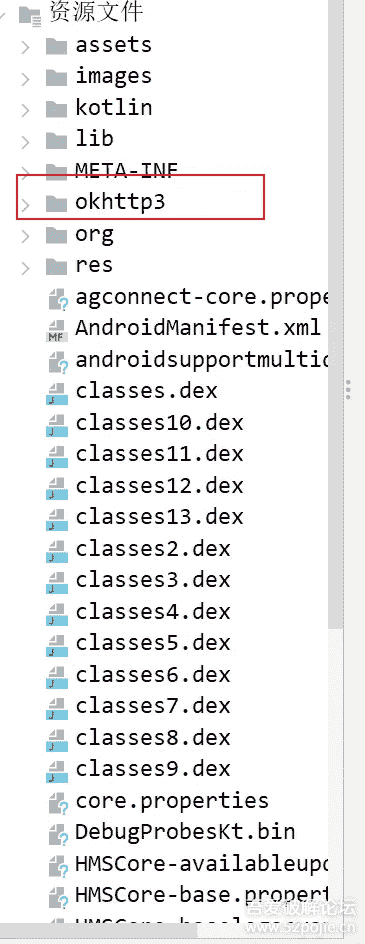

`noce`关键词是搜不到的，参考之前的经验，我直接搜索了接口（不断地删改去尝试），因为在资源目录看到了`okhttp`框架

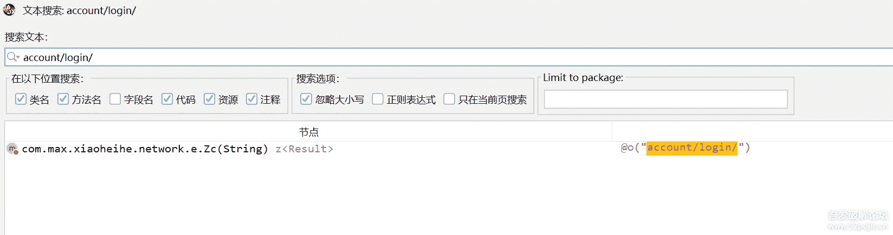

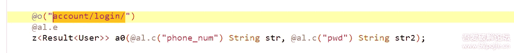

这样就可以看到一个接口的信息，这里的话看到接口传入了两个参数，一个是登录的电话号码，一个是密码，但是没有找到请求头和载荷的入参，去看看这个`a0`的调用

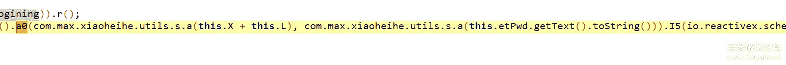

可以大致看到这里就是单纯的对账号密码进行一个拼接，取值的处理，然后送到`a`函数里面进行加密处理，跟进去看看

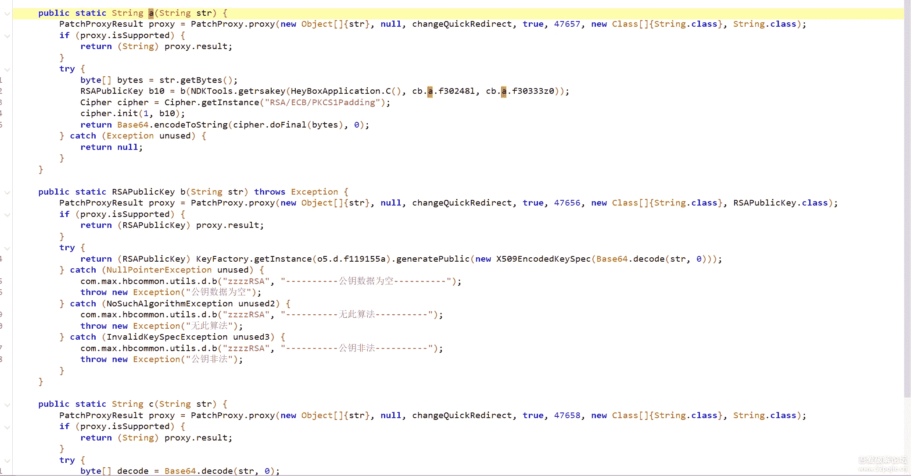

没有混淆的RSA加密，很清晰的看出来，同时请求里面也可以看到手机号码和密码都是加密了的，这个不是重点。

通过 ai 搜了一下同时花哥{:1_932:}的指导，这是一个`Retrofit`框架，它是通过拦截器去添加请求头和载荷的，通过 hook `getBytes` 来找到生成位置堆栈信息

```javascript
function sting_put() {  Java.perform(function () {

    var StringClass = Java.use('java.lang.String');

    // 1.  Hook 带字符集名称的 getBytes(String charsetName) 方法（入参为字符集名称）

    StringClass.getBytes.overload('java.lang.String').implementation = function () {

      console.log('\n[Hook] String.getBytes() 被调用');

      console.log('  字符串内容: ' + this.toString()); // 打印当前字符串

      console.log('  调用栈:');

      console.log(Java.use('android.util.Log').getStackTraceString(Java.use('java.lang.Exception').$new())); // 打印调用栈

      return this.getBytes();

    };

    // 2. Hook 带 Charset 类型的 getBytes(Charset charset) 方法（入参为Charset对象）

    StringClass.getBytes.overload('java.nio.charset.Charset').implementation = function (charset) {

      console.log('\n[Hook] String.getBytes(Charset) 被调用');

      console.log('  入参 charset: ' + (charset ? charset.displayName() : 'null')); // 打印Charset信息

      console.log('  字符串内容: ' + this.toString());

      console.log('  调用栈:');

      console.log(Java.use('android.util.Log').getStackTraceString(Java.use('java.lang.Exception').$new()));

      return this.getBytes(charset);

    };

  });

}
```

因为日志比较多，我们简单优化一下代码，发现`noce`是32位的字符串，我们将字符串的长度做一个限制，再来打印堆栈

```javascript
function sting_put() {  Java.perform(function () {
    // 获取String类
    var StringClass = Java.use('java.lang.String');
    // 1.  Hook 带字符集名称的 getBytes(String charsetName) 方法（入参为字符集名称）
    StringClass.getBytes.overload('java.lang.String').implementation = function () {
      let str = this.toString();
      console.log(str)
      if (str.length == 32) {
        console.log('\n[Hook] String.getBytes() 被调用');
        console.log('  字符串内容: ' + str); // 打印当前字符串
        console.log('  调用栈:');
        console.log(Java.use('android.util.Log').getStackTraceString(Java.use('java.lang.Exception').$new())); // 打印调用栈
        return this.getBytes();
      }
      return this.getBytes();
    };

  });
}
```

这样我们可以精准定位出生成位置`com.max.xiaoheihe.router.serviceimpl.i.b`，再往下走就开始调用 native 方法了，我们从这里入手去看看

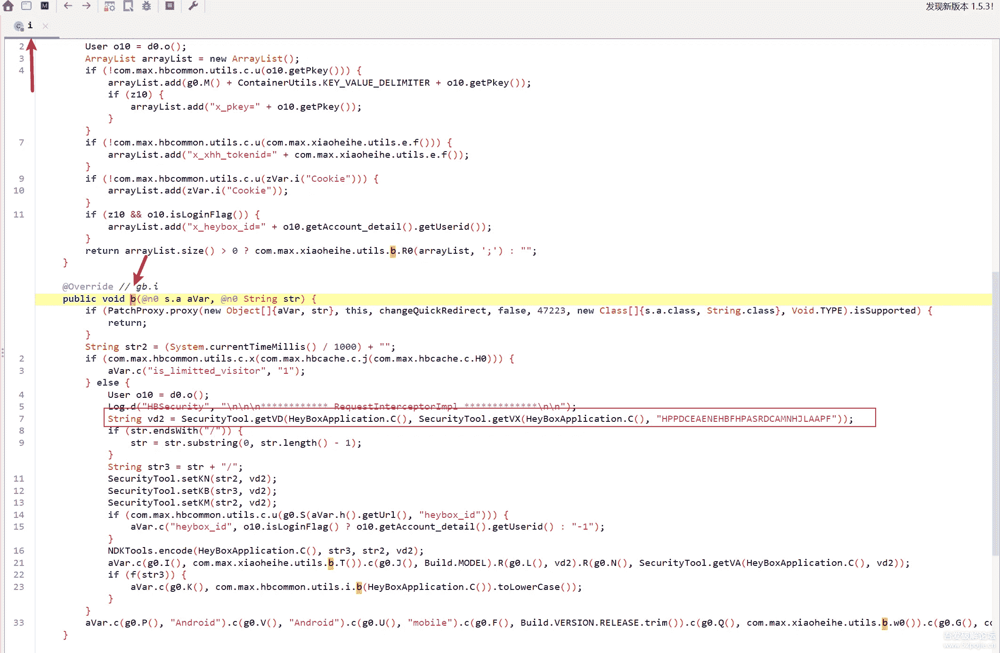

从打印堆栈可以定位到这里，下一层的函数是`getVD`和`getVX`，我们先写一个 hook 代码和抓包的信息联合一起分析，看看是否是这个位置

```javascript
function hook_native_method() {  Java.perform(function () {

    let SecurityTool = Java.use("com.max.security.SecurityTool");

    SecurityTool["getVD"].implementation = function (context, str) {

      console.log(`SecurityTool.getVD is called: context=${context}, str=${str}`);

      let result = this["getVD"](context, str);

      console.log(`SecurityTool.getVD result=${result}`);

      return result;

    };

  })

}
```

因为外层是一个`getVD`的函数，先 hook 外层看看情况

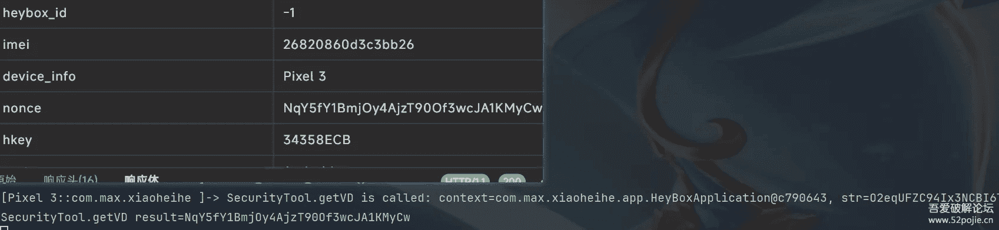

没问题，就是我们需要的参数。我们继续对这个函数调用进行一个分析


```java
String vd2 = SecurityTool.getVD(HeyBoxApplication.C(), SecurityTool.getVX(HeyBoxApplication.C(), "HPPDCEAENEHBFHPASRDCAMNHJLAAPF"));
HeyBoxApplication.C(), SecurityTool.getVX(HeyBoxApplication.C(), "HPPDCEAENEHBFHPASRDCAMNHJLAAPF")
SecurityTool.getVX(HeyBoxApplication.C(), "HPPDCEAENEHBFHPASRDCAMNHJLAAPF")
```

这里有两个参数，一个是 `HeyBoxApplication.C()`，一个是 `SecurityTool.getVX(HeyBoxApplication.C(), "HPPDCEAENEHBFHPASRDCAMNHJLAAPF")` 函数调用。

```text
SecurityTool.getVD is called: context=com.max.xiaoheihe.app.HeyBoxApplication@c790643, str=O2eqUFZC94Ix3NCBI6lc77lsPh1qWayE
SecurityTool.getVD result=NqY5fY1BmjOy4AjzT90Of3wcJA1KMyCw
```

从日志可以看出第一个参数是一个设备的上下文信息，第二个参数是 `getVX()` 函数生成的 32 位字符串。

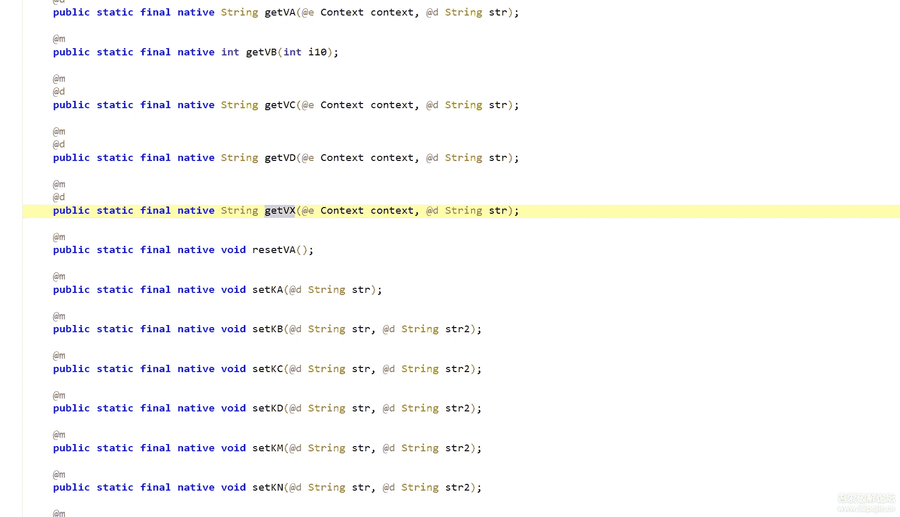

跟进去就可以看到一堆 so 层的 native 方法，我们找一下 so 文件的加载，然后去分析 so 层的逻辑。

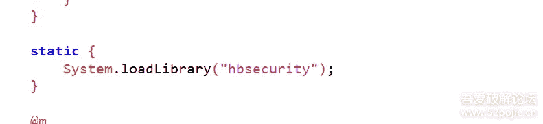

找到了，开干。

## 四、so层分析

### 1、getVX

在文件里定位到 so 文件，拖进 IDA 进行分析。


现在导出函数表搜索 Java，发现不是静态注册函数，我们 hook 一下 `RegisterNatives()` 函数，找到动态注册函数的偏移。

```javascript
function hook_RegisterNatives() {

  var addrRegisterNatives = null;

  var symbols = Module.enumerateSymbolsSync("libart.so");

  for (var i = 0; i = 0 &&

        symbol.name.indexOf("JNI") >= 0 &&

        symbol.name.indexOf("RegisterNatives") >= 0 &&

        symbol.name.indexOf("CheckJNI") ')

        var env = args[0];        

        var java_class = args[1]; 

        var class_name = Java.vm.tryGetEnv().getClassName(java_class);

        var taget_class = "com.max.security.SecurityTool";   

        if (class_name === taget_class) {

          console.log("\n[RegisterNatives] method_count:", args[3]);

          var methods_ptr = ptr(args[2]);

          var method_count = parseInt(args[3]);

          for (var i = 0; i 
```

需要注意的是这里注入的时间，需要跟着 Frida 检测处理的同时注入，也就是 so 加载的时机。

```text
setKA sig: (Ljava/lang/String;)V module_name: libhbsecurity.so offset: 0xa35c0 8
setKB sig: (Ljava/lang/String;Ljava/lang/String;)V module_name: libhbsecurity.so offset: 0xa3c34 8
setKM sig: (Ljava/lang/String;Ljava/lang/String;)V module_name: libhbsecurity.so offset: 0xa3d80 8
setKT sig: (Ljava/lang/String;Ljava/lang/String;)V module_name: libhbsecurity.so offset: 0xa3ecc 8
setKN sig: (Ljava/lang/String;Ljava/lang/String;)V module_name: libhbsecurity.so offset: 0xa3fd8 8
setKD sig: (Ljava/lang/String;Ljava/lang/String;)V module_name: libhbsecurity.so offset: 0xa40e0 8
setKC sig: (Ljava/lang/String;Ljava/lang/String;)V module_name: libhbsecurity.so offset: 0xa42d8 8
getVX sig: (Landroid/content/Context;Ljava/lang/String;)Ljava/lang/String; module_name: libhbsecurity.so offset: 0xa45d0 8
getVA sig: (Landroid/content/Context;Ljava/lang/String;)Ljava/lang/String; module_name: libhbsecurity.so offset: 0xa4834 8
getVB sig: (I)I module_name: libhbsecurity.so offset: 0xa5954 8
getVC sig: (Landroid/content/Context;Ljava/lang/String;)Ljava/lang/String; module_name: libhbsecurity.so offset: 0xa5a58 8
getVD sig: (Landroid/content/Context;Ljava/lang/String;)Ljava/lang/String; module_name: libhbsecurity.so offset: 0xa5e44 8
resetVA sig: ()V module_name: libhbsecurity.so offset: 0xa6428 8
```

根据 `getVX()` 函数偏移 `0xa45d0`，在 IDA 中利用快捷键 `G` 定位。

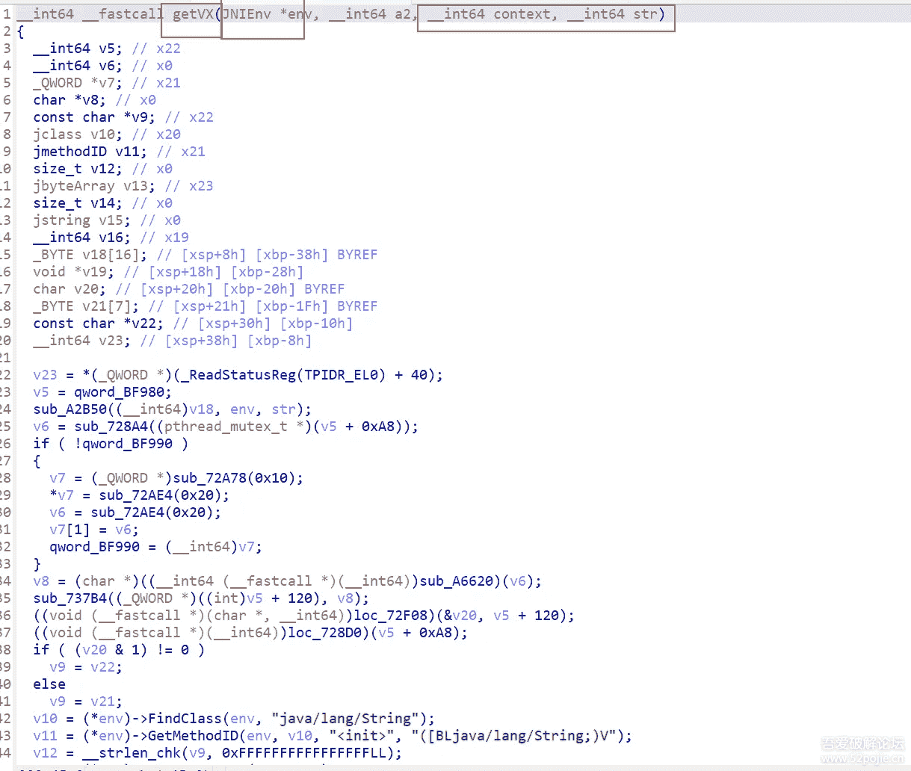

修改 IDA 中函数和入参的名称，方便再定位修改。

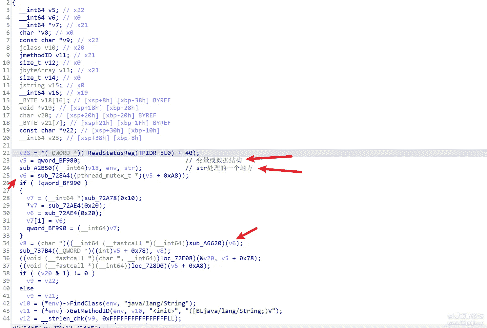

这里的话只有 `sub_A2B50()` 对入参 `str` 进行了一个处理，hook 一下看看情况。

```javascript
function print_arg(addr) {

    var module = Process.findRangeByAddress(addr);

    if (module != null) return hexdump(addr) + "\n";

    return ptr(addr) + "\n";

}

function hook_native_addr1(funcPtr, paramsNum) {

  var module = Process.findModuleByAddress(funcPtr);

  Interceptor.attach(funcPtr, {

    onEnter: function (args) {

      this.logs = [];

      this.params = [];

      this.logs.push("call " + module.name + "!" + ptr(funcPtr).sub(module.base) + "\n");

      for (let i = 0; i 
```

从日志内容（后续会上传日志文本，太多了）可以看出，没有明显的加密字符串返回，说明这里不是一个加密逻辑的点。然后 `v6` 对 `v5` 处理后的结果，看着像是地址的偏移，也可以来 hook 一下。

```javascript
function print_arg(addr) {
  var module = Process.findRangeByAddress(addr);
  if (module != null) return hexdump(addr) + "\n";
  return ptr(addr) + "\n";
}
function hook_native_addr1(funcPtr, paramsNum) {
  var module = Process.findModuleByAddress(funcPtr);
  Interceptor.attach(funcPtr, {
    onEnter: function (args) {
      this.logs = [];
      this.params = [];
      this.logs.push("call " + module.name + "!" + ptr(funcPtr).sub(module.base) + "\n");
      for (let i = 0; i 
```

（日志分析）都是一些空值，可能是指针的一些信息，不能直接用 `hexdump` 打印出来，我们接下来看的 `v6` 又进行了哪些处理。

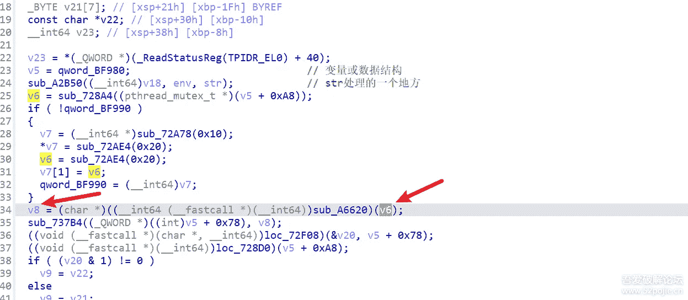

`v8` 是由 `v6` 生成的，我们直接 hook 看看。

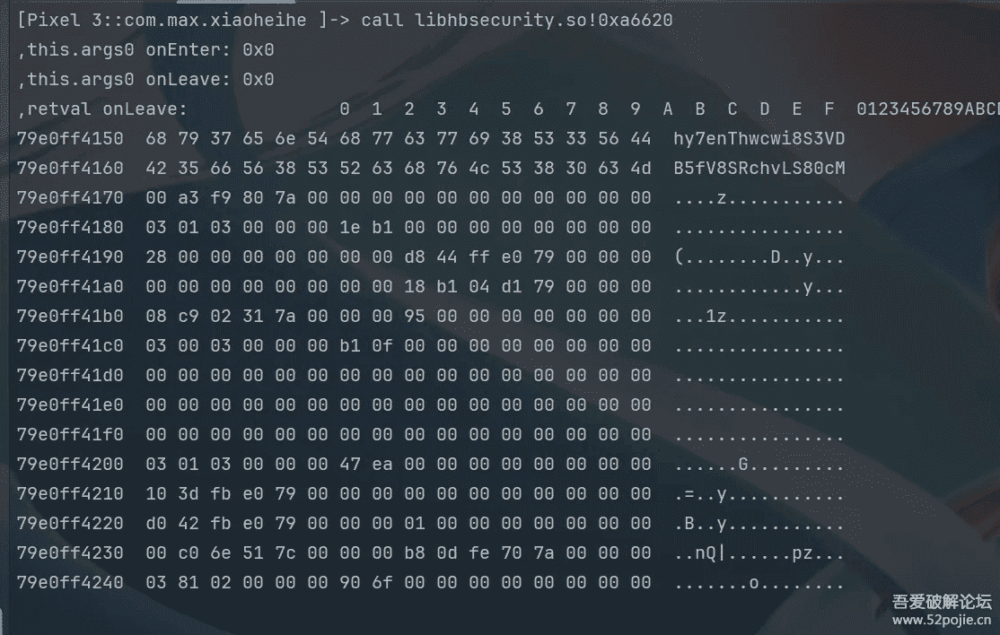

这里就会发现很像我们最后生成的结果，我们跟进去看看怎么去使用 `v6`。

```c
__int64 sub_A6620(){
    __int64 v0; // x19
    unsigned __int8 v1; // w8
    __int64 result; // x0
    v0 = sub_72AE4(0x21);
    *(_BYTE *)v0 = byte_230F4[(unsigned int)sub_4AC1C(0x3Eu)];
    *(_BYTE *)(v0 + 1) = byte_230F4[(unsigned int)sub_4AC1C(0x3Eu)];
    *(_BYTE *)(v0 + 2) = byte_230F4[(unsigned int)sub_4AC1C(0x3Eu)];
    *(_BYTE *)(v0 + 3) = byte_230F4[(unsigned int)sub_4AC1C(0x3Eu)];
    *(_BYTE *)(v0 + 4) = byte_230F4[(unsigned int)sub_4AC1C(0x3Eu)];
    *(_BYTE *)(v0 + 5) = byte_230F4[(unsigned int)sub_4AC1C(0x3Eu)];
    *(_BYTE *)(v0 + 6) = byte_230F4[(unsigned int)sub_4AC1C(0x3Eu)];
    *(_BYTE *)(v0 + 7) = byte_230F4[(unsigned int)sub_4AC1C(0x3Eu)];
    *(_BYTE *)(v0 + 8) = byte_230F4[(unsigned int)sub_4AC1C(0x3Eu)];
    *(_BYTE *)(v0 + 9) = byte_230F4[(unsigned int)sub_4AC1C(0x3Eu)];
    *(_BYTE *)(v0 + 10) = byte_230F4[(unsigned int)sub_4AC1C(0x3Eu)];
    *(_BYTE *)(v0 + 11) = byte_230F4[(unsigned int)sub_4AC1C(0x3Eu)];
    *(_BYTE *)(v0 + 12) = byte_230F4[(unsigned int)sub_4AC1C(0x3Eu)];
    *(_BYTE *)(v0 + 13) = byte_230F4[(unsigned int)sub_4AC1C(0x3Eu)];
    *(_BYTE *)(v0 + 14) = byte_230F4[(unsigned int)sub_4AC1C(0x3Eu)];
    *(_BYTE *)(v0 + 15) = byte_230F4[(unsigned int)sub_4AC1C(0x3Eu)];
    *(_BYTE *)(v0 + 16) = byte_230F4[(unsigned int)sub_4AC1C(0x3Eu)];
    *(_BYTE *)(v0 + 17) = byte_230F4[(unsigned int)sub_4AC1C(0x3Eu)];
    *(_BYTE *)(v0 + 18) = byte_230F4[(unsigned int)sub_4AC1C(0x3Eu)];
    *(_BYTE *)(v0 + 19) = byte_230F4[(unsigned int)sub_4AC1C(0x3Eu)];
    *(_BYTE *)(v0 + 20) = byte_230F4[(unsigned int)sub_4AC1C(0x3Eu)];
    *(_BYTE *)(v0 + 21) = byte_230F4[(unsigned int)sub_4AC1C(0x3Eu)];
    *(_BYTE *)(v0 + 22) = byte_230F4[(unsigned int)sub_4AC1C(0x3Eu)];
    *(_BYTE *)(v0 + 23) = byte_230F4[(unsigned int)sub_4AC1C(0x3Eu)];
    *(_BYTE *)(v0 + 24) = byte_230F4[(unsigned int)sub_4AC1C(0x3Eu)];
    *(_BYTE *)(v0 + 25) = byte_230F4[(unsigned int)sub_4AC1C(0x3Eu)];
    *(_BYTE *)(v0 + 26) = byte_230F4[(unsigned int)sub_4AC1C(0x3Eu)];
    *(_BYTE *)(v0 + 27) = byte_230F4[(unsigned int)sub_4AC1C(0x3Eu)];
    *(_BYTE *)(v0 + 28) = byte_230F4[(unsigned int)sub_4AC1C(0x3Eu)];
    *(_BYTE *)(v0 + 29) = byte_230F4[(unsigned int)sub_4AC1C(0x3Eu)];
    *(_BYTE *)(v0 + 30) = byte_230F4[(unsigned int)sub_4AC1C(0x3Eu)];
    v1 = byte_230F4[(unsigned int)sub_4AC1C(0x3Eu)];
    result = v0;
    *(_WORD *)(v0 + 31) = v1;
    return result;
}
```

我们在日志中发现他不停地去调用生成新的数字。可以看到 `sub_4AC1C()` 不断去处理 `0x3Eu` 来填充 `v0` 的字段长度，我们去 hook `sub_4AC1C()` 处理情况。

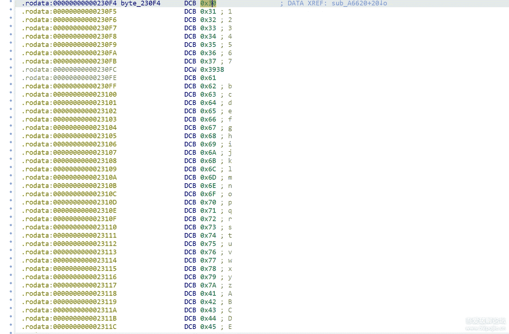

`byte_230F4` 可能是一个数组，用来存储数据映射后面产生的随机数，填充生成我们的加密字符串，我们需要根据汇编代码去找 `byte_230F4` 的值。

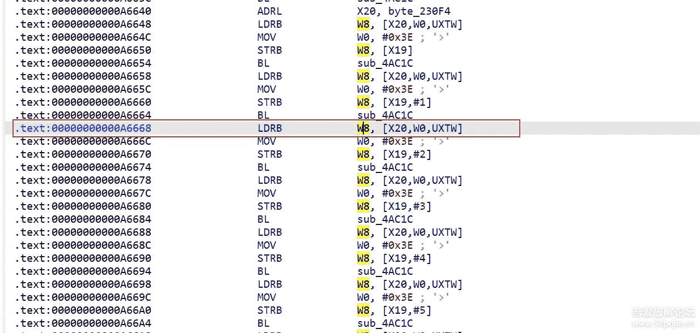

ARM64 的 `LDRB` 指令支持多种寻址方式，最常见的格式为：


# Reverse Engineering 分析笔记

## LDRB 指令说明

```
LDRB , [, ]

- ：目标寄存器（64 位通用寄存器，如X0-X30），用于存储加载的字节数据（零扩展后）。
- ：基址寄存器（64 位通用寄存器X0-X30或栈指针SP），存储内存访问的基地址。
- ：偏移量，用于计算最终内存地址（基地址 + 偏移量）。偏移量可以是：
- 立即数（如#0x10，范围通常为 ±4095）；
- 寄存器偏移（如Xm，表示基地址 + Xm的值）。
```

这里的话我们是将`x20`中下标为`w0`的值赋值给`w8`，也就是说，我们去找`x20`的值就可以知道他的映射关系

## Hook 示例代码

```javascript
function hook_so_x(funcPtr) {
  var module = Process.findModuleByAddress(funcPtr);
  Interceptor.attach(funcPtr, {
    onEnter: function (args) {
      console.log('enter')
      console.log('x20值--->', hexdump(this.context.x20));
    },
    onLeave: function (retval) {
    }
  })
}

function hook_arm_method() {
  var soAddr = Module.findBaseAddress("libhbsecurity.so");
  var funcAddr = soAddr.add(0xA6668);
  hook_so_x(funcAddr)
}
```

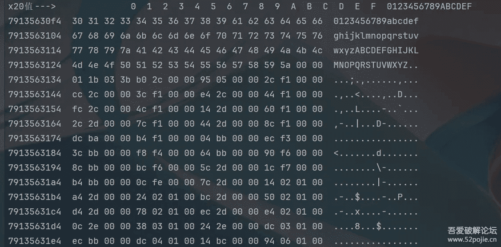

接着算法的一个分析，我们打印`sub_4AC1C`函数返回的一个结果，得到如图的一个日志


知道存在着映射关系，就要针对映射表和函数最后返回值来找映射关系

以值`OKnQWyZw7DKz1RqDapbJJ6e9MOfMeYlE`为例

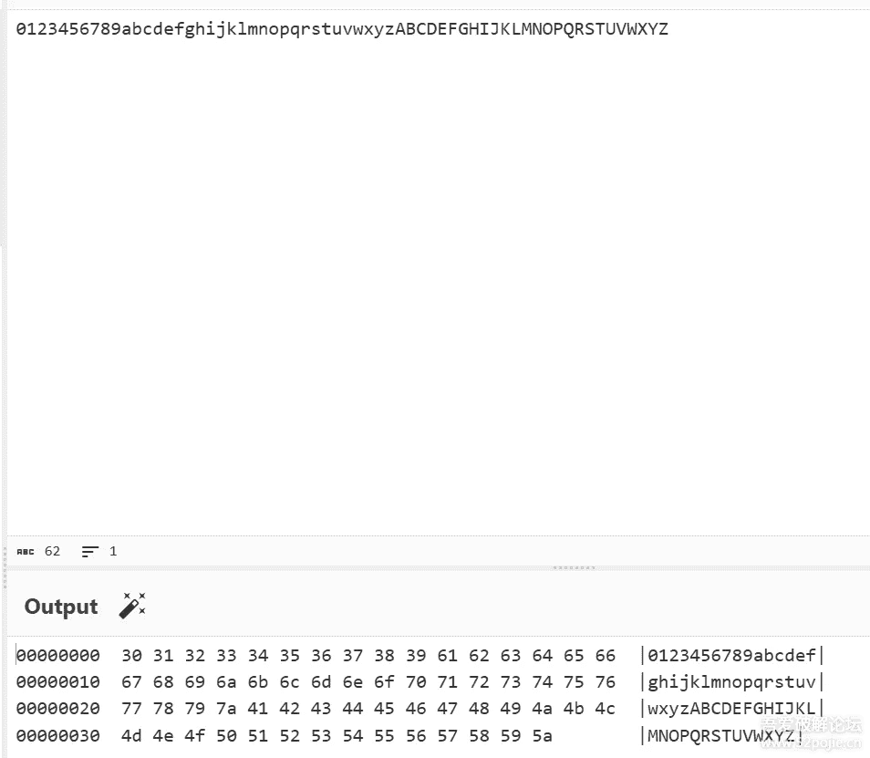

这是dump出来的映射表的值，日志是返回值

我们需要根据最后的结果，和日志返回值的进行对照，以及和映射表的值，找出规律。

首先我们观察可以发现整体包含三部分，小写字母，大写字母，数字0-9，我们有两点需要去判断

（1）各个类型之间的映射关系是否是连续的

（2）各个类型之前与映射表的关系，明显存在的偏移关系

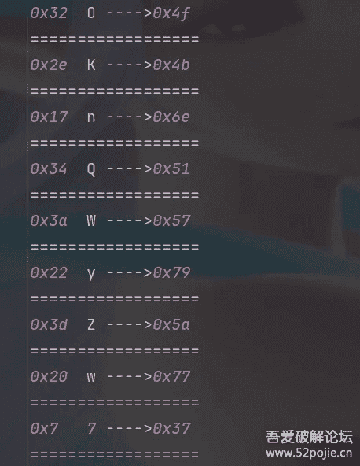

以`OKnQWyZw7DKz1RqDapbJJ6e9MOfMeYlE`为例

从这个两点的分析，我们可以去找我们目标字符串中有明显特征的偏移变化，如：

数字：1，9

小写字母：y，z

大写字母：Y,Z

这里不带着不推了，就是找规律，然后加减法的运算，给出一个结论

大写字母：偏移`0x1D`

小写字母：偏移`0x57`

数字：偏移`0x30`

```javascript
const CUSTOM_RANGES = {
  number: {min: 0x0, max: 0x9, startChar: '0'},       // 数字1-9范围
  lowercase: {min: 0x0A, max: 0x23, startChar: 'a'},  // 小写字母a-z范围
  uppercase: {min: 0x24, max: 0x3d, startChar: 'A'}   // 大写字母A-Z范围
};

function offset_Char(hexValue) {
  const hexNum = typeof hexValue === 'string'
    ? parseInt(hexValue, 16)
    : hexValue;

  if (hexNum >= CUSTOM_RANGES.number.min && hexNum = CUSTOM_RANGES.lowercase.min && hexNum = CUSTOM_RANGES.uppercase.min && hexNum 
}
```

这样打印出日志，就可以校验是否是符合映射表关系

## 2、getVd

`setKA` sig: `(Ljava/lang/String;)V` module_name: `libhbsecurity.so` offset: `0xa35c0` 8

`setKB` sig: `(Ljava/lang/String;Ljava/lang/String;)V` module_name: `libhbsecurity.so` offset: `0xa3c34` 8

`setKM` sig: `(Ljava/lang/String;Ljava/lang/String;)V` module_name: `libhbsecurity.so` offset: `0xa3d80` 8

`setKT` sig: `(Ljava/lang/String;Ljava/lang/String;)V` module_name: `libhbsecurity.so` offset: `0xa3ecc` 8

`setKN` sig: `(Ljava/lang/String;Ljava/lang/String;)V` module_name: `libhbsecurity.so` offset: `0xa3fd8` 8

`setKD` sig: `(Ljava/lang/String;Ljava/lang/String;)V` module_name: `libhbsecurity.so` offset: `0xa40e0` 8

`setKC` sig: `(Ljava/lang/String;Ljava/lang/String;)V` module_name: `libhbsecurity.so` offset: `0xa42d8` 8

`getVX` sig: `(Landroid/content/Context;Ljava/lang/String;)Ljava/lang/String;` module_name: `libhbsecurity.so` offset: `0xa45d0` 8

`getVA` sig: `(Landroid/content/Context;Ljava/lang/String;)Ljava/lang/String;` module_name: `libhbsecurity.so` offset: `0xa4834` 8

`getVB` sig: `(I)I` module_name: `libhbsecurity.so` offset: `0xa5954` 8

`getVC` sig: `(Landroid/content/Context;Ljava/lang/String;)Ljava/lang/String;` module_name: `libhbsecurity.so` offset: `0xa5a58` 8

`getVD` sig: `(Landroid/content/Context;Ljava/lang/String;)Ljava/lang/String;` module_name: `libhbsecurity.so` offset: `0xa5e44` 8

`resetVA` sig: `()V` module_name: `libhbsecurity.so` offset: `0xa6428` 8

在前面部分内容也已经得到了`getVD`的一个偏移`0xa5e44`

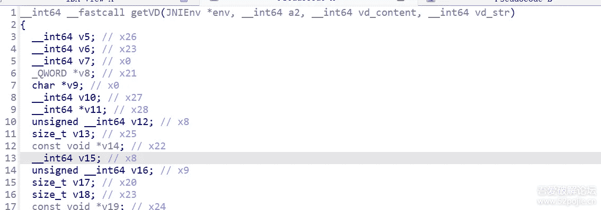

还是老规矩，直接来，改一下函数名称

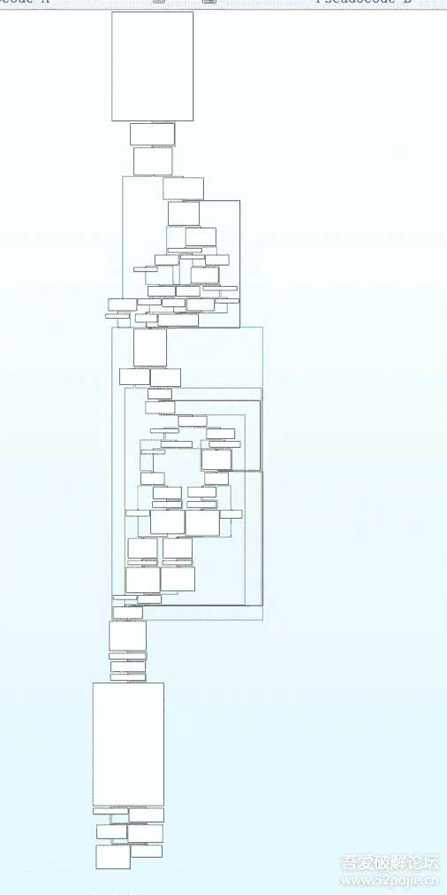

有控制流，属实不会分析，直接练手一下trace，高级的trace不会用，学习大佬文章了解的这个，先用这个练手学习

项目地址：`https://github.com/bmax121/sktrace`

参考文章：`aHR0cHM6Ly9iYnMua2FueHVlLmNvbS90aHJlYWQtMjY0NjgwLmh0bSA=`

指令：`python sktrace.py -m attach -l libhbsecurity.so -i 0xA5E44 *黑盒 > xhh1.log`

点击登陆调用一下

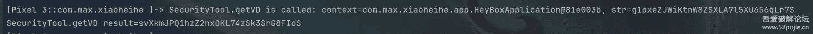

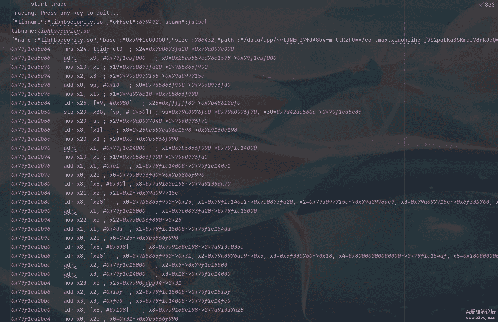

这样就是完成一次成功的trace，我们要去找最终结果字符串`svXkmJPQ1hzZ2nxOKL74zSk3SrG8FIoS`生成位置

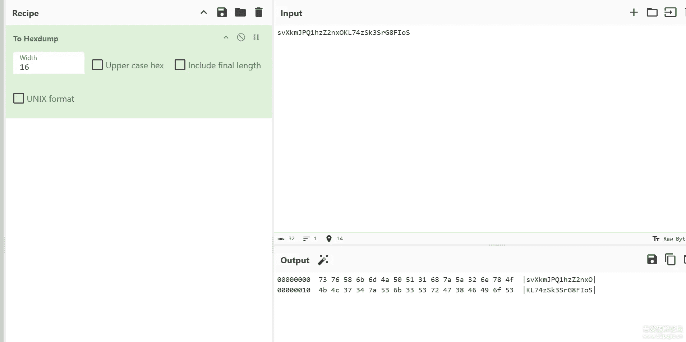

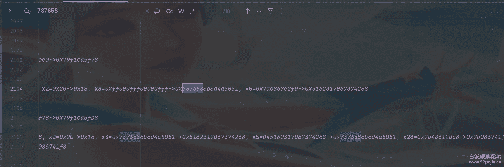

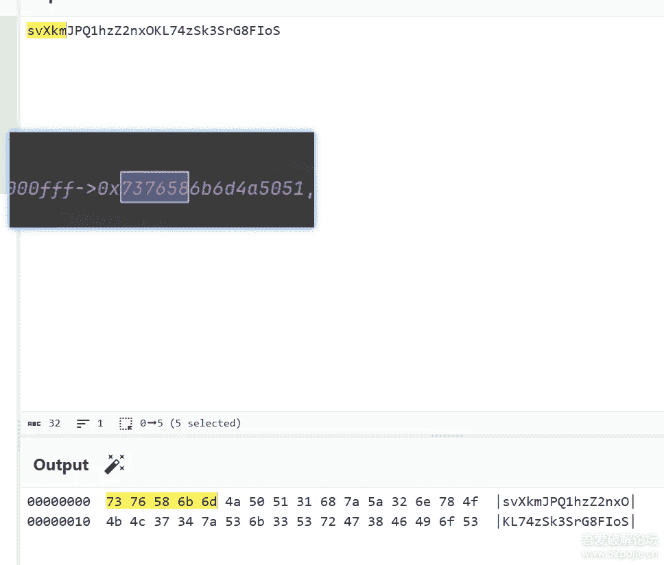

这样就找到了第一组数组，确定是在这个函数内生成的。我们去看看他的一个生成位置，也就是`0x73`以及后续一堆字符串的生成，我们直接搜索定位，留下标记

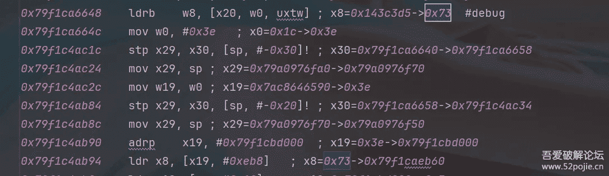

这里有两个，很明显在上面那里留下标记，依次这样找一下

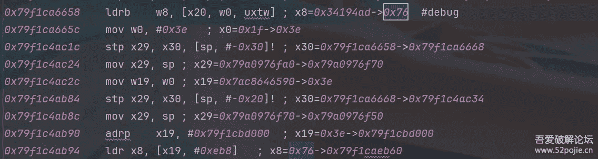

这样下来我们可以发现一个特征

`ldrb w8, [x20, w0, uxtw]` 都是在这样的一个汇编代码里面，非常眼熟，我们的`getVX`里的汇编是一样的，我们计算一下偏移，去ida里面看看第一个的生成位置

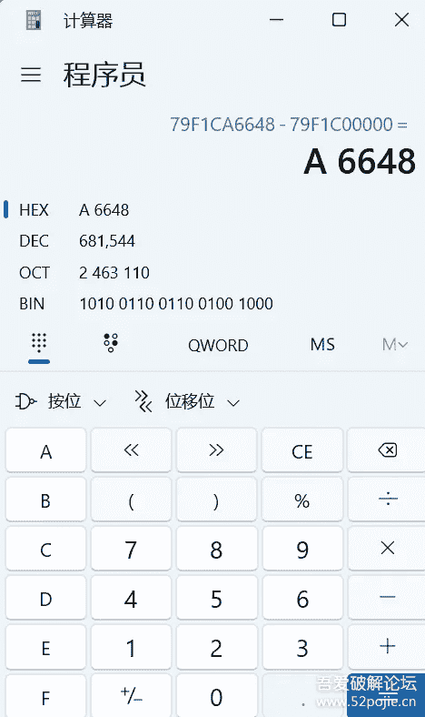

有点意思，虚晃一枪，最后还是这个随机数生成的

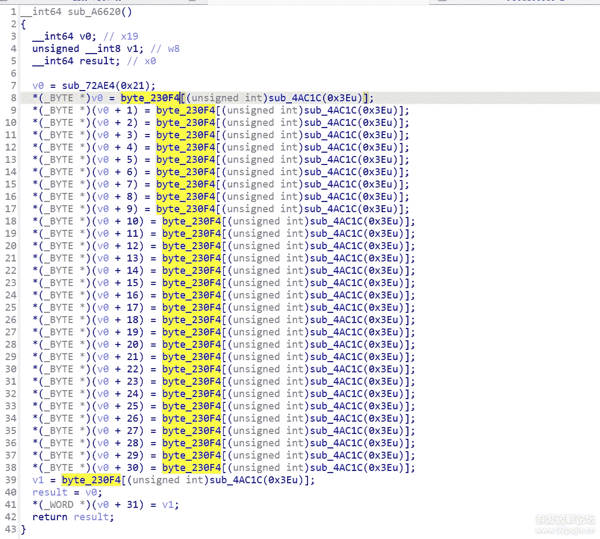

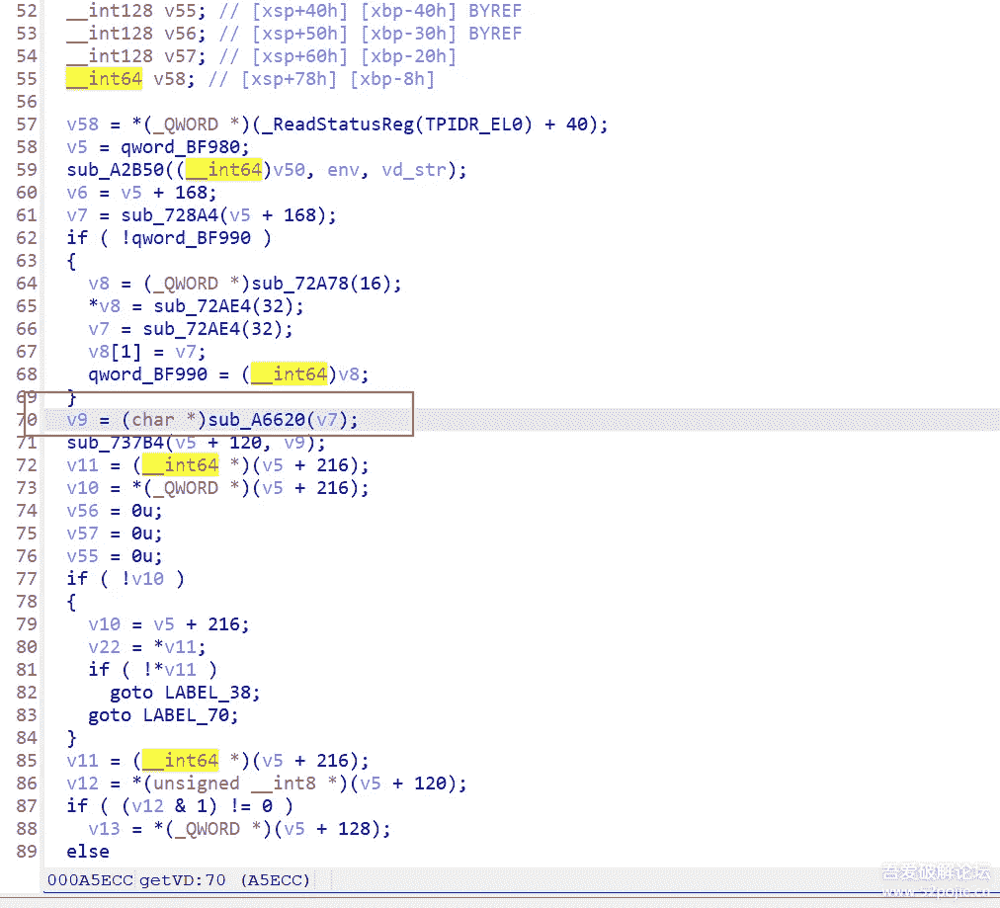

在`getVD`了里面同样调用了随机生成函数`sub_A6620`,既然这样，我们需要确定这个函数调用生成的值是否和我们最后结果是一致的，我们简单hook一下。

不演示了，是一致的

## 五、总结和反思

感谢大佬看到现在，做了挺久的一个项目，感谢我的小伙伴一起搞这个样本，学会了很多东西，感谢开源的大佬{:1_932:}


`[xhh日志.zip](https://www.52pojie.cn/forum.php?mod=attachment&aid=MjgwNzk0M3xlOTU1NjMxMnwxNzkzNTQxNDY4fDB8MjA2NTQ0MQ%3D%3D)`

(7.36 KB, 下载次数: 79)

2025-10-12 22:04 上传

点击文件名下载附件

日志

下载积分: 吾爱币 -1 CB
