# [Android 原创] 逆向某讯的`global-metadata.dat`的解密算法

- 原帖: https://www.52pojie.cn/forum.php?mod=viewthread&tid=2067386
- 抓取时间: 2026-11-01T13:57:42.517Z

最近想研究一下解密 `global-metadata.dat` 文件，于是准备了一份加固过的`apk`和一份未加固的`apk`。
话不多说直接开搞

## 1、尝试静态调试
搜索“`global-metadata.dat`”发现加固后的`libil2cpp.so`中加载函数是加密过的

## 2、尝试动态调试
使用`frida`在加载`libil2cpp.so`后将其`dump`出来，然后使用`soFixer`修复，使用`IDA`查看

```
function dump_so(libName:string) {
    Java.perform(function() {        
        // // 1. 更可靠地获取模块信息
        var libso = Process.getModuleByName(libName);
        if (!libso) {
            console.error("[!] 错误：未找到模块 libil2cpp.so");
            return;
        }

        // 2. 验证基地址和大小是否合理
        console.log("[+] 模块基址: " + libso.base);
        console.log("[+] 模块大小: " + libso.size);
        if (libso.size  0x10000000) { // 大小合理性检查，例如大于256MB则可疑
            console.error("[!] 模块大小异常，可能获取失败");
            return;
        }

        // 3. 安全地设置内存权限并读取
        try {
            // 修改内存权限为可读
            // var originProtection = 
            Memory.protect(libso.base, libso.size, 'r--');

            // 关键改进：分块读取内存，避免不连续映射区域导致崩溃
            var chunkSize = 0x1000; // 每次读取4KB
            var totalSize = libso.size;
            var file_path = "/sdcard/download/" + libso.name + "_" + libso.base + "_" + ptr(totalSize) + ".so";
            var file_handle = new File(file_path, "wb");

            if (file_handle) {
                for (var offset = 0; offset 
```

## 3、定位解密函数
搜索字符串`global-metadata.dat` `hook`，定位到函数`sub_48D10C()`。
结合`il2cpp`的源码

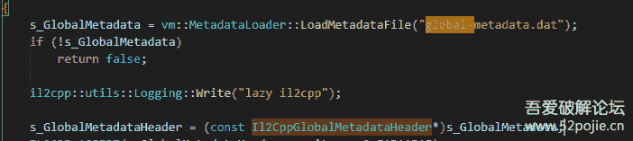
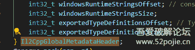

可以知道`exportedTypeDefinitionsOffset`和`exportedTypeDefinitionsSize`的偏移值，尝试在未加固的程序里`hook`一下该函数获取返回值。

```
 var libil2cpp: Module | null = null;

var isCalled = false;

var metadata_size = 0;

function hookdlopen() {

  var dlopen = Process.getModuleByName("libc.so").getExportByName("dlopen");

  if (dlopen !== null) {

    Interceptor.attach(dlopen, {

      onEnter: function (args) {

        var path = args[0].readCString();

        if (path && path.indexOf('libil2cpp.so') !== -1) {

          this.path = path;

          console.log("[+] 检测到 libil2cpp.so 加载");

        }        

      },

      onLeave: function (retval) {

        if (this.path && this.path.indexOf('libil2cpp.so') !== -1 && !isCalled) {

          libil2cpp = Process.getModuleByName("libil2cpp.so");

          if (!libil2cpp) {

            console.error("[!] 错误：未找到模块 libil2cpp.so");

            return;

          }

          else{

            console.log("[+] 成功获取 libil2cpp.so 模块: " + libil2cpp.name + " 基址: " + libil2cpp.base + " 大小: " + libil2cpp.size);

          }          

          hook_loadMetadata();

        }

      }

    });

  } else {

    console.error("无法找到 dlopen 函数");

  }

}

function hook_loadMetadata() {

  const loadMetadata = libil2cpp?.base.add(0x48D10C);

  if (loadMetadata) {

    console.log("[+] 成功获取函数 loadMetadata 地址: " + loadMetadata);

    Interceptor.attach(loadMetadata, {

      onEnter: function (args) {

        console.log('loadMetadata called');

      },

      onLeave(retval) {

        console.log('loadMetadata returned');

        if (!isCalled) {

          // 捕获元数据指针

          globalMetadata.ptr = retval;

          console.log("[+] 元数据加载成功! 地址: " + globalMetadata.ptr);

          // 读取头部

          const tamperedSanity = globalMetadata.ptr.readU32();

          const tamperedVersion = globalMetadata.ptr.add(4).readU32();

          console.log("    魔数: 0x" + tamperedSanity.toString(16));

          console.log("    版本: " + tamperedVersion);

          // 计算完整元数据大小

          const exportedTypeOffset = globalMetadata.ptr.add(0xE0).readU32(); // 偏移0xE0是exportedTypeDefinitionsOffset

          const exportedTypeSize = globalMetadata.ptr.add(0xE4).readU32();   // 偏移0xE4是exportedTypeDefinitionsSize

          globalMetadata.size = exportedTypeOffset + exportedTypeSize;

          metadata_size = globalMetadata.size;

          console.log("    估算元数据大小: " + globalMetadata.size + " 字节");

          console_byte_array(globalMetadata.ptr, globalMetadata.size);

          isCalled = true;

        }

      },

    });

  }

  else {

    console.error("loadMetadata function not found");

  }

}

function console_byte_array(ptr: NativePointer, size: number) {

  if (!ptr || size === 0) {

    console.error("[-] 错误: 未捕获到元数据");

    return;

  }

  const buffer = ptr.readByteArray(size);

    // console.log("    读取内存成功，开始写入文件...");

    if (buffer) {

      console.log("    元数据前64字节:");

      console.log(hexdump(ptr, {

        offset: 0,

        length: 64,

        header: true,

        ansi: true

      }));

      return true;

    }     

    else {

      console.log("    [!] 无法读取内存");

      return false;

    }

}
```

可以获取到与原`global-metadata.dat`相同的数据
可以确定在执行`sub_48D10C(loadmetadata)`函数后会将`global-metadata.dat`加载到内存中

## 4、比较加固后返回值
`hook`加固后的该函数，获取返回值，发现数据除了前四个字节其余部分是完全相同的。
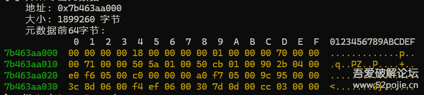
看起来数据应该就是在`sub_48D10C`中进行的解密

## 5、dump解密后数据
至此已经可以`dump`出解密后的`global-metadata.dat`数据

```
function dump_global_metadata(ptr: NativePointer, size: number) {
  Java.perform(function () {
    console.log("[+] 开始导出元数据...");
    console.log("    地址: " + ptr);
    console.log("    大小: " + size + " 字节");

    // 方法1：使用应用私有目录（推荐）
    try {
      if (console_byte_array(ptr, size)) {
        //分块读取内存，避免不连续映射区域导致崩溃
        var chunkSize = 0x1000; // 每次读取4KB
        var totalSize = size;
        var file_path = "/sdcard/download/global-metadata.dat";
        var file_handle = new File(file_path, "wb");
        if (file_handle) {
          for (var offset = 0; offset 
```

## 6、分析解密算法
不过目的不是要`dump`出`global-metadata.data`的数据而是获取其解密算法，所以进一步查看`sub_48D10C`的内容，分析如何解密，逐步分析两个函数的差异

## 7、深入`sub_48D10C`
继续深入`sub_48D10C`函数，和源码对比，发现`sub_45A3F0`函数对应的是`mmap`函数

```
unsigned __int64 __fastcall sub_48D10C(const char *a1)

{
  unsigned __int64 v2; // x8
  const char *v3; // x9
  __int64 v4; // x0
  char *v5; // x8
  unsigned __int64 v6; // x9
  __int64 v7; // x0
  const char *v8; // x1
  __int64 v9; // x20
  unsigned __int64 v10; // x19
  const char *v12; // [xsp+0h] [xbp-70h] BYREF
  __int64 v13; // [xsp+8h] [xbp-68h]
  _QWORD v14[2]; // [xsp+10h] [xbp-60h] BYREF
  const char *v15; // [xsp+20h] [xbp-50h]
  _QWORD v16[3]; // [xsp+28h] [xbp-48h] BYREF
  char *v17; // [xsp+40h] [xbp-30h] BYREF
  unsigned __int64 v18; // [xsp+48h] [xbp-28h]
  sub_44B644((__int64)v14);
  v12 = "Metadata";
  v13 = 8LL;
  v2 = (unsigned __int64)LOBYTE(v14[0]) >> 1;
  if ( (v14[0] & 1) != 0 )
    v3 = v15;
  else
    v3 = (char *)v14 + 1;
  if ( (v14[0] & 1) != 0 )
    v2 = v14[1];
  v17 = (char *)v3;
  v18 = v2;
  sub_44ADBC(&v17, &v12, v16);
  if ( (v14[0] & 1) != 0 )
    sub_8C66D0();
  v4 = sub_8C6670(a1);
  if ( (v16[0] & 1) != 0 )
    v5 = (char *)v16[2];
  else
    v5 = (char *)v16 + 1;
  if ( (v16[0] & 1) != 0 )
    v6 = v16[1];
  else
    v6 = (unsigned __int64)LOBYTE(v16[0]) >> 1;
  v12 = a1;
  v13 = v4;
  v17 = v5;
  v18 = v6;
  sub_44ADBC(&v17, &v12, v14);
  LODWORD(v17) = 0;
  v7 = sub_427A0C((__int64)v14, 3, 1u, 1u, 0, &v17);
  if ( (_DWORD)v17 )
  {
    if ( (v14[0] & 1) != 0 )
      v8 = v15;
    else
      v8 = (char *)v14 + 1;
    sub_45A264("ERROR: Could not open %s", v8);
  }
  else
  {
    v9 = v7;
    v10 = sub_45A3F0();
    sub_427C4C(v9, &v17);
    if ( !(_DWORD)v17 )
      goto LABEL_22;
    sub_45A400(v10);
  }
  v10 = 0LL;
LABEL_22:
  if ( (v14[0] & 1) != 0 )
    sub_8C66D0();
  if ( (v16[0] & 1) != 0 )
    sub_8C66D0();
  return v10;
}
```

## 8、分析`sub_45A3F0`
继续深入分析`sub_45A3F0`函数，发现只要`sub_4283B4`和`sub_428574`函数和返回值有关
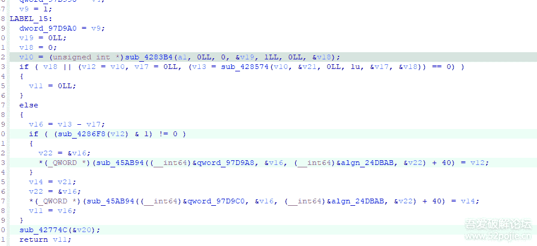
`sub_4283B4`函数看起来应该是和文件的加载有关和解密应该没有关系，那解密的逻辑应该就是藏在`sub_428574`里了

## 9、对比`sub_8C6750`
和返回值有关的函数只有`sub_8C6750`，与未加固的对比
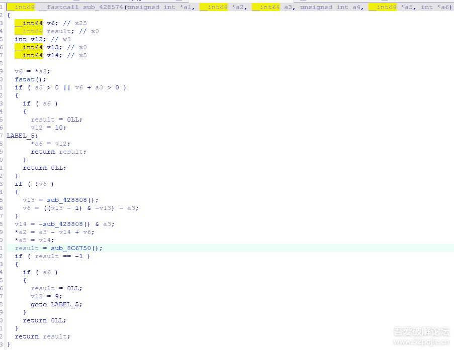
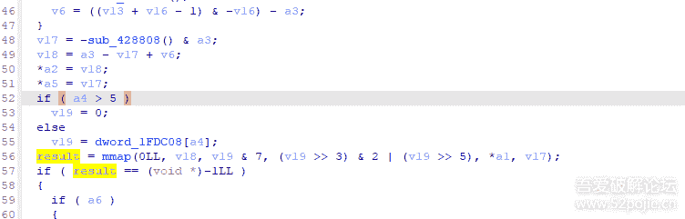


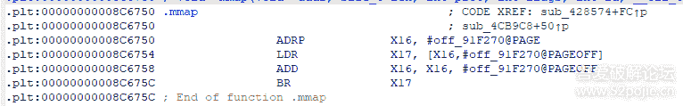

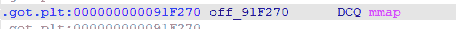

可以看到这里原本是调用导入函数`mmap`函数

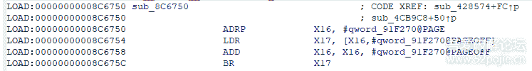

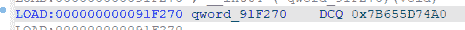

现在则是变成了指向某个地址，使用frida获取其实际地址并算出偏移值

```
function find_ptr(name:string,ptr_addr:number) {
  var qwordAddr = libil2cpp?.base.add(ptr_addr); // 替换为实际偏移量
  if (!qwordAddr)
    return;
  var m_ptr = qwordAddr.readPointer();
  var ptr_module = Process.findModuleByAddress(m_ptr);
  var rva = m_ptr.sub(ptr_module ? ptr_module.base : ptr(0));
  console.log(name+" 地址: " + m_ptr + " 所属模块: " + (ptr_module ? ptr_module.name : "未知模块") + " 偏移: " + rva);
}
find_ptr("mmap",0x91F270)
```

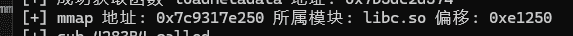

未加固

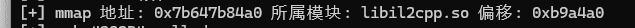

加固

## 10、找到偏移值的位置

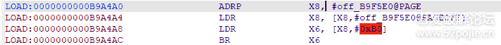

```
function find_mmap_ptr() {

  var qwordMmapAddr = libil2cpp?.base.add(0xB9F5E0); // 替换为实际偏移量

  if (!qwordMmapAddr)

    return;

  var mmapPtr = qwordMmapAddr.readPointer();

  var mmapModule = Process.findModuleByAddress(mmapPtr);

  var rva = mmapPtr.sub(mmapModule ? mmapModule.base : ptr(0));

  console.log("[+] mmap 地址: " + mmapPtr + " 所属模块: " + (mmapModule ? mmapModule.name : "未知模块") + " 偏移: " + rva);

}
```

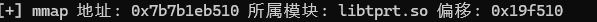

计算出偏移，发现是`libtprt.so`库里的，根据汇编代码可知最终调用的地址是`19f510+b0=1306c0`，也就是函数`1306c0`，应该离结果很近了！

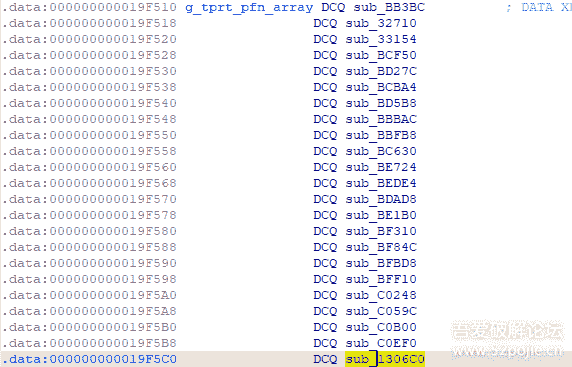

## 11、那么这个函数应该就是实际的`mmap`函数了，hook一下验证

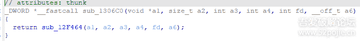

```
let libtprt: Module | null = null;
function load_libtprt(){
  if(libtprt){
    return;
  }
  libtprt = Process.getModuleByName("libtprt.so");
  if(!libtprt){
    console.error("[-] 错误: 未找到 libtprt.so 模块");
    return;
  }
  console.log("[+] 成功获取 libtprt.so 模块: " + libtprt.name + " 基址: " + libtprt.base + " 大小: " + libtprt.size);
  var sub_1306C0 = libtprt.base.add(0x1306C0);
  if(!sub_1306C0){
    console.error("[-] 错误: 未找到 sub_1306C0 函数地址");
    return;
  }
  console.log("[+] 成功获取 sub_1306C0 函数地址: " + sub_1306C0);
  Interceptor.attach(sub_1306C0,{
    onEnter: function(args){
      console.log("[+] sub_1306C0 被调用");
    },
    onLeave: function(retval){
      console.log("[+] sub_1306C0 返回: " + retval);      
      globalMetadata.ptr = retval;
      console.log("[+] 元数据加载成功! 地址: " + globalMetadata.ptr);

      const tamperedSanity = globalMetadata.ptr.readU32();
      const tamperedVersion = globalMetadata.ptr.add(4).readU32();
      console.log("    魔数: 0x" + tamperedSanity.toString(16));
      console.log("    版本: " + tamperedVersion);

      const exportedTypeOffset = globalMetadata.ptr.add(0xE0).readU32(); 
      const exportedTypeSize = globalMetadata.ptr.add(0xE4).readU32();  
      globalMetadata.size = exportedTypeOffset + exportedTypeSize;
      metadata_size = globalMetadata.size;
      console.log("    估算元数据大小: " + globalMetadata.size + " 字节");

      console_byte_array(globalMetadata.ptr, globalMetadata.size);
    }
  });
}
```

输出

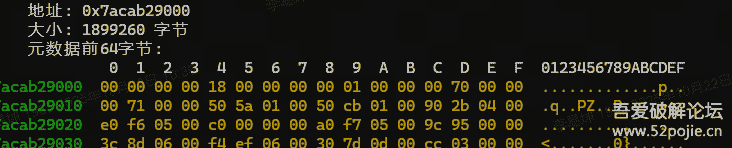

可以确认该函数就是`mmap`函数了，继续深入分析。

## 11、查看`sub_1306c0`函数，`F5`看一下伪C

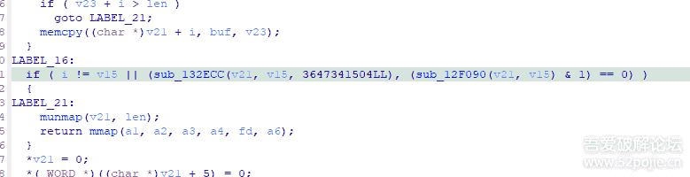

可以看到有一个数字非常的显眼3647341504，转成16进制是12 72 43 94，这与加密后的`global-metadata.dat`的头一致，猜测`sub_13ECC`就是解密函数，跟进去看看

```
__int64 __fastcall sub_132ECC(__int64 a1, unsigned __int64 a2, __int64 a3, __int64 a4)

{

  char v6; // w9

  unsigned __int64 v7; // x8

  _BYTE *v8; // x10

  unsigned int v10; // w21

  __int64 i; // x8

  __int64 v12; // x10

  int8x16_t v13; // q0

  __int64 v14; // x14

  __int64 v15; // x11

  __int64 v16; // x13

  __int64 v17; // x12

  __int64 v18; // x9

  _BYTE *v19; // x8

  __int64 v20[2]; // [xsp+8h] [xbp-18h] BYREF

  char v21; // [xsp+18h] [xbp-8h]

  if ( !a1 )

    return 0xFFFFFFFFLL;

  if ( a2 >> 20 )

  {

    if ( BYTE2(a3) )

      v10 = WORD1(a3);

    else

      v10 = -121;

    for ( i = 8LL; i != 4096; ++i )

      *(_BYTE *)(a1 + i) ^= v10;

    v20[0] = 0LL;

    v20[1] = 0LL;

    v21 = 0;

    sub_133038(v20, a2, a3, a4, (unsigned int)a3, (unsigned int)a3);

    sub_11B790(a1 + 4096, 0x4000LL, 0LL, 2LL, v20, 16LL);

    v12 = 0LL;

    if ( a2 - 69632 >= 0x10000 )

    {

      v13 = vdupq_n_s8(v10);

      v14 = 1LL;

      v15 = a1 + 69632;

      do

      {

        v16 = 0LL;

        v17 = v14;

        do

        {

          *(int8x16_t *)(v15 + v16) = veorq_s8(*(int8x16_t *)(v15 + v16), v13);

          v16 += 16LL;

        }

        while ( v16 != 0x4000 );

        ++v14;

        v15 += 0x10000LL;

      }

      while ( v17 != ((a2 - 135168) >> 16) + 1 );

      v12 = v17 
```

很明显这就是解密函数了，在`a2`小于1MB时对范围内的每个字节与密钥进行简单的逐字节异或，大于1MB时则需要进一步分析。查看一下该函数的调用树。

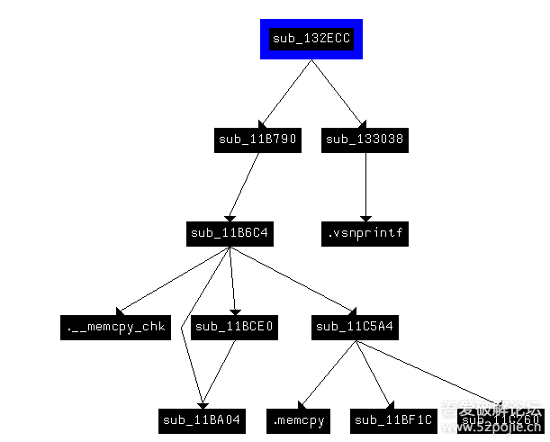

这里偷个懒直接把这些函数丢给ai分析一下

### 分析报告：`sub_132ECC`函数及其子函数

工作流程（大文件）：

- 初始化异或：
  - 对前 4096 字节的偏移 8–4095 进行异或（密钥来自`a3`）。
- AES 密钥生成：
  - 调用`sub_133038`基于`a2`、`a3`、`a4`生成 16 字节密钥。
- AES 解密核心：
  - 对接下来 16384 字节（偏移 4096–20479）分块（2048 字节/块）解密：
    - `sub_11B790`→`sub_11B6C4`→`sub_11BCE0`（密钥扩展）→`sub_11C5A4`（解密）。
- 剩余数据异或：
  - 对偏移 69632 之后的数据：
    - 向量化异或每 64KB 块的前 16KB（NEON 优化）。
    - 逐字节异或剩余部分。
- 小文件简化：
  - 仅对整个数据（偏移 8 开始）异或。

后面就是写脚本还原算法了，这部分就不写了

最后感谢@无问且问 大佬的帖子，这篇帖子 https://www.52pojie.cn/forum.php?mod=viewthread&tid=2010789&extra=page%3D1&page=1 给了我很大的帮助。如有不够完善或者有错误的地方欢迎大佬们指点~
