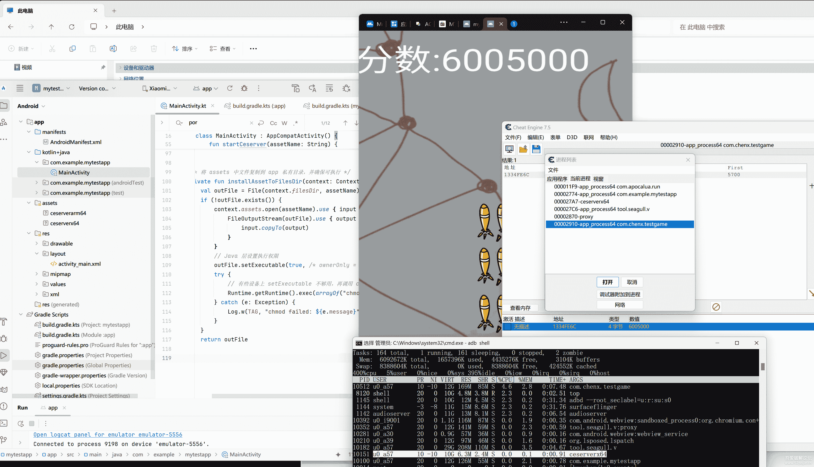
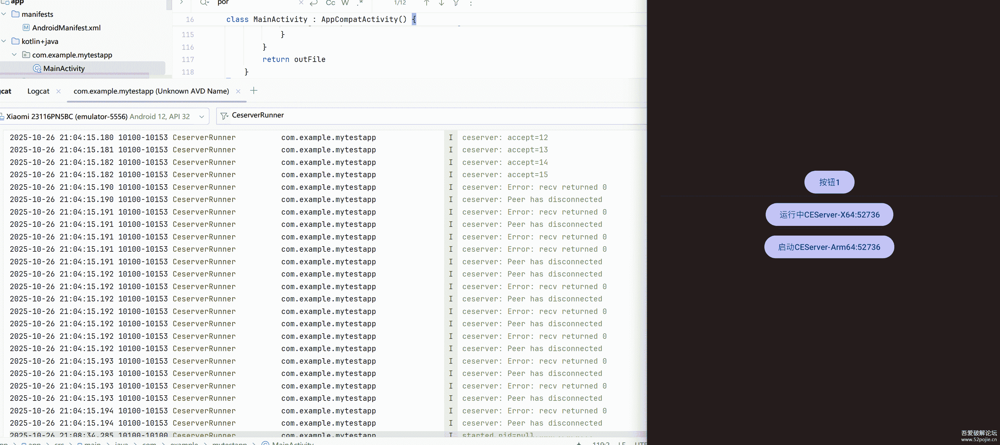

# [Android 原创] 安卓共享 UID 实现 Cheat Engine（CE）免 Root 修改

- 原帖：https://www.52pojie.cn/forum.php?mod=viewthread&tid=2068115
- 抓取时间：2026-11-01T13:57:32.892Z

## 免 root 修改原理：共享 UID

1. MT 管理器反编译要调式的 apk，修改 xml 添加一下信息，重新打包签名安装即可。
2. 自己写一个 `ceserver` 的启动 app 或使用 agg、gg 等修改器都可以。
3. 具体实现：
    1. `manifest` 添加 `android:sharedUserId`（自定义 id，反编译的 apk 的 id 要相同）。
       `android:sharedUserId="com.chenx"`
    2. `application` 要修改程序添加 `android:debuggable="true"`。
       `android:debuggable="true"`

## 手机 `CeServer` 源码

[`下载地址.txt`](https://www.52pojie.cn/forum.php?mod=attachment&aid=MjgwOTkxOXxjYWJlNjU5Y3wxNzkzNTQxNDUxfDB8MjA2ODExNQ%3D%3D)

(47 Bytes, 下载次数: 51)

2025-10-27 11:16 上传

点击文件名下载附件

下载积分：吾爱币 -1 CB
