# [Android 原创] 新手小白入门app：某路旅行请求头参数逆向分析

- 原帖: https://www.52pojie.cn/forum.php?mod=viewthread&tid=2068279
- 抓取时间: 2026-11-01T13:57:28.106Z

## 声明

本文章中所有内容仅供学习交流使用，不用于其他任何目的，不提供完整代码，抓包内容、敏感网址、数据接口等均已做脱敏处理，严禁用于商业用途和非法用途，否则由此产生的一切后果均与作者无关.本文章未经许可禁止转载，禁止任何修改后二次传播，擅自使用本文讲解的技术而导致的任何意外，作者均不负责，若有侵权，请联系作者立即删除。

## 前言

本人刚学习app方面的逆向几个星期，最近花了四天搞了一个简单的app，写一篇文章分享记录自己的逆向过程，方便自己后续回顾，也方便刚学习app的伙伴们入门练习，同时文章也还遗留了一些问题，如果大佬们有相关的文章和视频可以告送我，我再去学习学习。第一次写文章，大佬们不喜勿喷，欢迎技术指点，万分感谢！

## 正文

### 基本信息

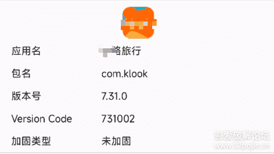

建议从谷歌商店下载，小米商城下载的好像有`frida`检测。

登录注册接口是某验4的一个无感，app端和web端好像都是一样的，本人已搞完了web的，不难，这一部分就不写出教程了，大佬们可以去web端玩玩。

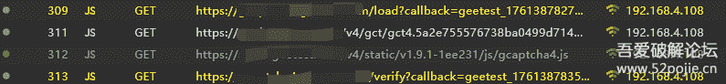

通过抓包可以看见，基本大多数的请求头中都会携带一个 `x-signature` ，因此接下来的文章内容以找到该参数的加密方式为主。

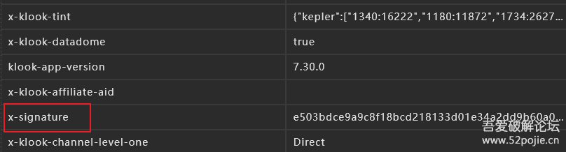

### 查找参数

#### 1. Frida检测

本人原先的流程是用`jadx`反编译`apk`，查看`java`层代码，写了一点`hook`脚本，发现无法注入才知道有`frida`检测的，为了方便文章查看，因此先写了`frida`检测这部分，后面再讲编写`hook`脚本部分。（本人没解决该`app`的`frida`检测，如果有大佬有类似的文章或者教程可以推荐给我）

首先第一步可以查看加载了哪写`so`文件，导致断开了`frida`

```javascript
var dlopen = Module.findExportByName(null, "dlopen");//低版本
var android_dlopen_ext = Module.findExportByName(null, "android_dlopen_ext");//高版本

Interceptor.attach(dlopen, {
    onEnter: function (args) {
        var path = args[0].readCString();
        console.log("[dlopen:]", path);
    },
    onLeave: function (retval) {
    }
});

Interceptor.attach(android_dlopen_ext, {
    onEnter: function (args) {
        var path = args[0].readCString();
        console.log("[dlopen_ext:]", path);
    },
    onLeave: function (retval) {
    }
});
```

执行该脚本，可以看到加载了常见的 `libmsaoaidsec.so`

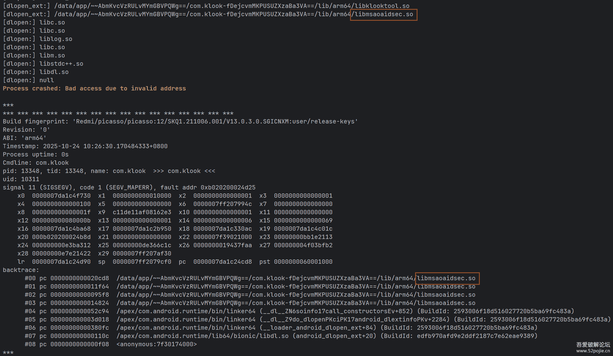

然后我学习类似过该`so`文件的教程，查看检测的线程和查找偏移

```javascript
function check_pthread_create(name = null) {

    var pthread_create_addr = Module.findExportByName(null, 'pthread_create');

    var pthread_create = new NativeFunction(pthread_create_addr, "int", ["pointer", "pointer", "pointer", "pointer"]);

    Interceptor.replace(pthread_create_addr, new NativeCallback(function (parg0, parg1, parg2, parg3) {

        var module = Process.findModuleByAddress(parg2)

        var so_base = module.base;

        var off = "0x" + parg2.sub(so_base).toString(16)

        var so_name = module.name;

        console.log('[pthread_create] ',so_name, off, parg3)

        return pthread_create(parg0, parg1, parg2, parg3);

    }, "int", ["pointer", "pointer", "pointer", "pointer"]))

}

setImmediate(check_pthread_create)
```

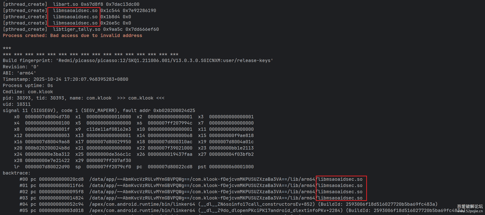

可是我后续 `nop` 掉相关的地址，还是没用。留着以后再解决吧......

用谷歌商店下载的无`frida`检测。

#### 2. 参数查找

首先打开`jadx`，可以搜索查找相关关键词，如我搜索了 `x-signature`

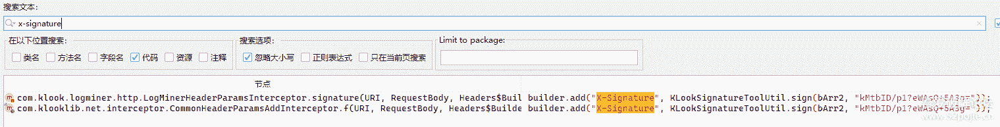

```java
builder.add("X-Signature", KLookSignatureToolUtil.sign(bArr2, "kMtbID/p1?eWAsQ+5A3g="));
```

这里搜索到的大小写有点差异，不过问题不大，我们可以复制`frida`脚本，试试究竟会不会走这对应的函数。这两个都是走的 `KLookSignatureToolUtil.sign` ，双击进入

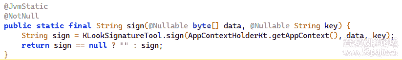

```java
String sign = KLookSignatureTool.sign(AppContextHolderKt.getAppContext(), data, key);
```

这里走的 `KLookSignatureTool.sign` ，一样双击进入

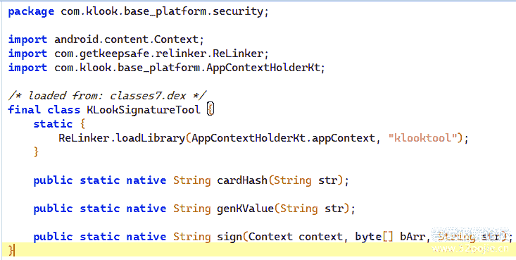

到此就可以先编写`hook`脚本查看是否是这几个进行的调用：

```javascript
function hookSign(){
    console.log("开始注入")

    let SignatureHandlerImpl = Java.use("com.klooklib.flutter.bridgeimpl.SignatureHandlerImpl");
    SignatureHandlerImpl["sign"].implementation = function (argument) {
        console.log(`SignatureHandlerImpl.sign 调用: argument=${argument}`);
        let result = this["sign"](argument);
        console.log(`SignatureHandlerImpl.sign result=${result}`);
        return result;
    };

    let KLookSignatureToolUtil = Java.use("com.klook.base_platform.security.KLookSignatureToolUtil");
    KLookSignatureToolUtil["sign"].implementation = function (data, key) {
        console.log(`KLookSignatureToolUtil.sign is 调用: data=${data}, key=${key}`);
        let result = this["sign"](data, key);
        console.log(`KLookSignatureToolUtil.sign result=${result}`);
        return result;
    };

    let KLookSignatureTool = Java.use("com.klook.base_platform.security.KLookSignatureTool");
        KLookSignatureTool["sign"].implementation = function (context, bArr, str) {
        console.log(`KLookSignatureTool.sign is called: context=${context}, bArr=${bArr}, str=${str}`);
        let result = this["sign"](context, bArr, str);
        console.log(`KLookSignatureTool.sign result=${result}`);
        return result;
    };
}

function main(){
    Java.perform(function (){
        hookSign()
    })
}
setImmediate(main);
```

把上述脚本进行注入，可以看到日志内容如下：

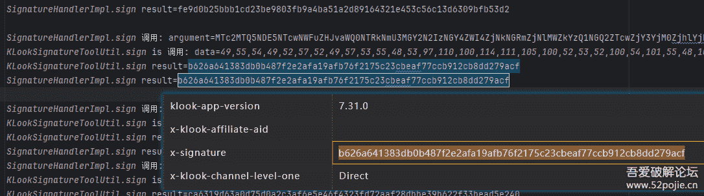

通过日志可以看到是 `KLookSignatureTool.sign` 被成功调用的，说明该函数确实是最后生成的地方，因此可以确定到是 `libklooktool.so` 这个文件实现了这个方法。

使用`ida`打开该`so`文件，左侧搜索一下`sign`可以看到对应的函数方法：

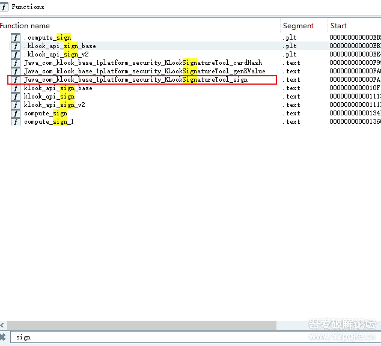

双击后按`F5`看相关代码，然后导入`jni.h`文件，再切换参数可以看到部分代码如下：

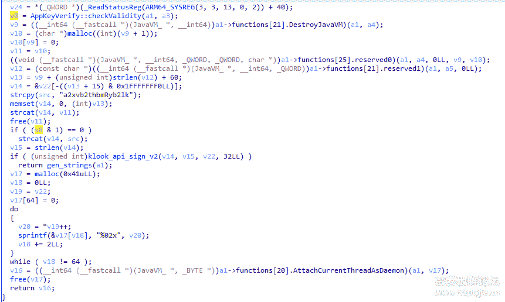

分析（看不懂可以直接丢给`AI`）：

- 通过`v8`的返回值，判断是否需要继续拼接一段固定盐 `a2xvb2thbmRyb2lk`
- 再把`v14`传入到 `klook_api_sign_v2` 中，生成签名转换成二进制最后返回`java`层

因此，我们可以跳过`v8`的返回值，直接去`hook` 函数 `klook_api_sign_v2` 的入参，就可以知道有没有拼接这段盐值。

进入函数 `klook_api_sign_v2` 可以看到：

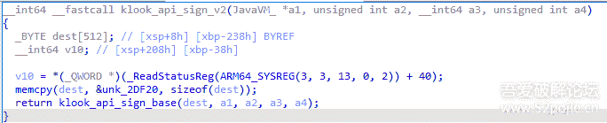

到这后可以先编写`hook`脚本，尝试打印 `klook_api_sign_v2` 的入参和返回值：

```javascript
var targetSo = 'libklooktool.so'

var pollIntervalMs = 500;

var maxWaitMs = 60 * 1000;

function toHex(byteArray) {

    if (!byteArray) return '';

    var u8 = new Uint8Array(byteArray);

    var out = [];

    for (var i = 0; i ', klook_api_sign_v2_addr);
        } catch (e) {}
        Interceptor.attach(klook_api_sign_v2_addr, {
            onEnter: function (args) {
                // ARM64 convention: x0.. -> args[0], args[1], ...
                this.input_ptr = args[0];
                // 可能是 size_t，尽量兼容
                try { this.len = args[1].toInt32(); } catch (e) { try { this.len = args[1].toInt64(); } catch (e2) { this.len = 0; } }
                this.out_ptr = args[2];
                try { this.out_len = args[3].toInt32(); } catch (e) { try { this.out_len = args[3].toInt64(); } catch (e2) { this.out_len = 0; } }
                console.log('\n---- klook_api_sign_v2 ENTER ----');
                console.log(' addr:', klook_api_sign_v2_addr, ' input_ptr=', this.input_ptr, ' len=', this.len, ' out_ptr=', this.out_ptr, ' out_len=', this.out_len);
                // 读取 input，按 len 读取（限制上限防止 OOM）
                try {
                    if (this.len > 0) {
                        var raw = Memory.readByteArray(this.input_ptr, this.len);
                        try {
                            var sutf = Memory.readUtf8String(this.input_ptr, this.len);
                            console.log(' input (utf8):', sutf);
                        } catch (e) {
                            console.log(' input (hex):', toHex(raw));
                        }
                    } else {
                        // 长度为 0 时尝试读取预览（64 bytes）
                        var pre = Memory.readByteArray(this.input_ptr, 64);
                        console.log(' input (preview hex):', toHex(pre));
                    }
                } catch (e) {
                    console.log('[!] 读取 input 失败：', e);
                }
            },
            onLeave: function (retval) {
                console.log('---- klook_api_sign_v2 LEAVE ----');
                // retval 一般是 int
                try {
                    var r = retval.toInt32();
                    console.log(' retval (int):', r);
                } catch (e) {
                    console.log('[!] 读取 retval 失败：', e);
                }
                // 读取 out buffer（优先 out_len，再 fallback 32）
                try {
                    var outbytes = Memory.readByteArray(this.out_ptr, this.out_len);
```


``` 
var hex = toHex(outbytes);

console.log(' out bytes (hex len=' + this.out_len + '):', hex);

} catch (e) {

console.log('[!] 读取 out buffer 失败：', e);

}

console.log('---- klook_api_sign_v2 END ----\n');

}

});

console.log(' klook_api_sign_v2 hook 安装成功 :', klook_api_sign_v2_addr);

return true;

} catch (e) {

console.log('[!] tryHookModule 异常:', e);

return false;

}

}

function pollForModule() {

var start = Date.now();

var timer = setInterval(function () {

var mods = Process.enumerateModulesSync();

for (var i = 0; i  maxWaitMs) {

clearInterval(timer);

console.log('[!] 超时未发现目标模块（' + targetSo + '）。');

}

}, pollIntervalMs);

}

setImmediate(function () {

console.log(' wait_and_hook 启动, targetSoHint =', targetSo);

// 先尝试一次立即查找

var mods = Process.enumerateModulesSync();

for (var i = 0; i 
```

这里我做了一个定时循环的操作，我不能很精准的把控hook时机，大佬们如果有好的写法也可以告送我一声。

看到结果如下，传入参数似乎是 时间戳 + android + 设备id + 设备id + url（不同的接口组成方式好像不同）

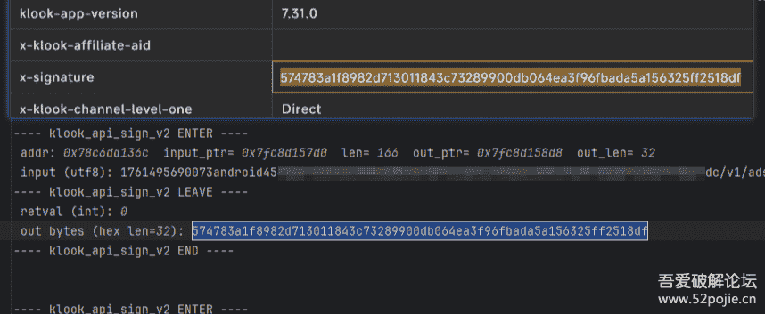

然后现在回过头去看 `klook_api_sign_v2` 的具体实现方式：

分析（看不懂就丢给AI）：

- `v10` 一顿猛虎操作，但是似乎没有传入下一个函数步骤？所以暂时不用理会。

- `dest`声明了一个512字节的缓冲区，然后把 `unk_2DF20` 其中的部分字节赋值给了`dest`。

- 最后把参数传入`klook_api_sign_base`中拿到结果。

`unk_2DF20`肯定是常量，取了其中512个字节，然后传入给了`klook_api_sign_base`。想拿到完整的`unk_2DF20`，然后再取512字节对我来说挺难的，所以我直接去hook `klook_api_sign_base`的入参似乎也能达到相同的效果。在刚刚的代码块中新增代码：

``` 
var klook_api_sign_base_addr = null;
var dump_context_len = 512; // klook_api_sign_v2 里 dest 长度
try {
    klook_api_sign_base_addr = Module.findExportByName(mod.name, 'klook_api_sign_base');
    if (klook_api_sign_base_addr) console.log(' findExportByName 找到 klook_api_sign_base ->', klook_api_sign_base_addr);
} catch (e) {}
Interceptor.attach(klook_api_sign_base_addr, {
    onEnter: function(args) {
        // args[0] 应该是 context (512 bytes copy of unk_2DF20)
        this.ctx_ptr = args[0];
        this.input_ptr = args[1];
        // len may be args[2] or args[2] is some jint, we will try both when reading
        try { this.len = args[2].toInt32(); } catch(e) { try { this.len = args[2].toInt64(); } catch(e2) { this.len = 0; } }
        this.out_ptr = args[3];
        try { this.out_len = args[4].toInt32(); } catch (e) {
            console.log("入参第四个参数转换错误:",e)
            console.log("args[4]:",args[4])
            this.out_len = 32;
        }

        console.log('---- klook_api_sign_base ENTER ----');
        console.log(' ctx_ptr=', this.ctx_ptr, ' input_ptr=', this.input_ptr, ' len=', this.len, ' out_ptr=', this.out_ptr, ' out_len=', this.out_len);

        try {
            var fullctx = Memory.readByteArray(this.ctx_ptr, dump_context_len);
            console.log('dest | 512 (hex):', toHex(fullctx));
        } catch (e) {
            console.log('[!] 读取 dest 失败:', e);
        }
    },
    onLeave: function(retval) {
        console.log('---- klook_api_sign_base LEAVE ----');
        var outBuf = null;
        try { console.log(' retval (int):', retval.toInt32()); } catch (e) { /* ignore */ }
        try {
            outBuf = Memory.readByteArray(this.out_ptr, this.out_len);
            if (outBuf) {
                var outHex = toHex(outBuf);
                console.log(' out (hex full):',outHex);
            } else {
                console.log('[!] out 读取到空 buf');
            }
        } catch (e) {
            console.log('[!] 读取 out buffer 失败:', e);
        }
        console.log('---- klook_api_sign_base END ----');
    }
});
console.log(' klook_api_sign_base hook 安装成功 :', klook_api_sign_base_addr);
```

利用上述代码，可以看到`dest`的值都是相同的

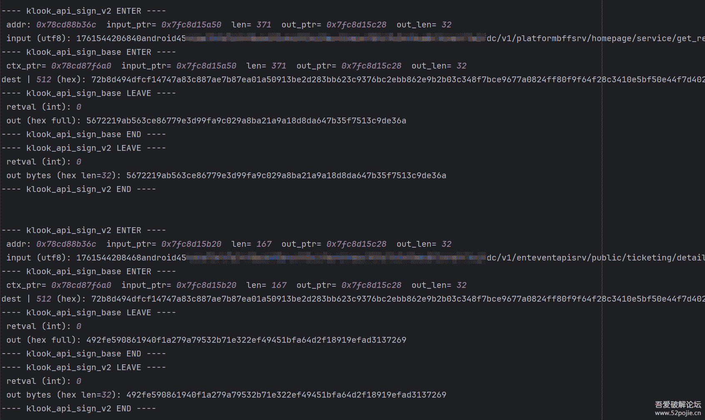

但是`klook_api_sign_base`并不只是传入了这一个参数，同时可以看看别的参数具体是什么，所以可以再次补充代码：

``` 
// 读取 input

try {

    if (this.input_ptr && this.len && this.len > 0 ) {

        try {

            var s = Memory.readUtf8String(this.input_ptr, this.len);

            console.log('完整 input (utf8):', s);

            var raw = Memory.readByteArray(this.input_ptr, this.len);

            var hex = toHex(raw);

            console.log('完整 input (hex):', hex);

        } catch (e) {

            // 如果不是纯 UTF-8 文本（可能是二进制）

            var raw = Memory.readByteArray(this.input_ptr, this.len);

            hex = toHex(raw);

            console.log('完整 input (hex):', hex);

            console.log('klook_api_sign_base onEnter input Error :',e)

        }

    } else {

        console.log('[!] input_ptr 或 len 无效, input_ptr=', this.input_ptr, ' len=', this.len);

    }

} catch (e) {

    console.log('[!] 读取 input 失败:', e);

}
```

得到日志内容如下。可以看到除了刚刚的`dest`，同时也把`klook_api_sign_v2`的参数一同传入。

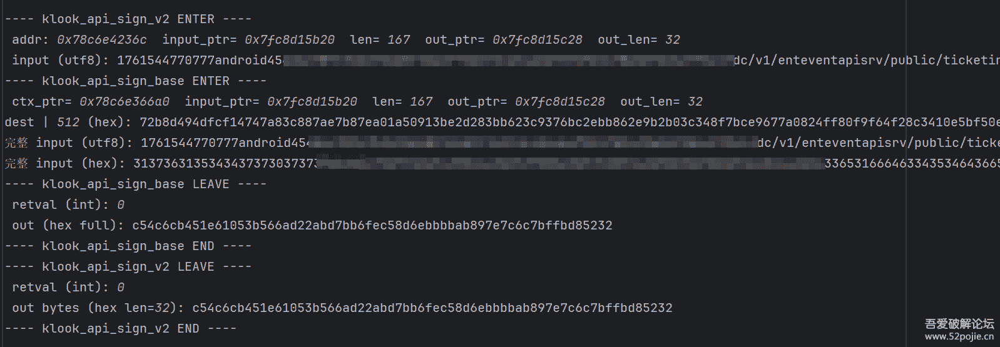

现在进入`klook_api_sign_base`内部，查看实现逻辑：

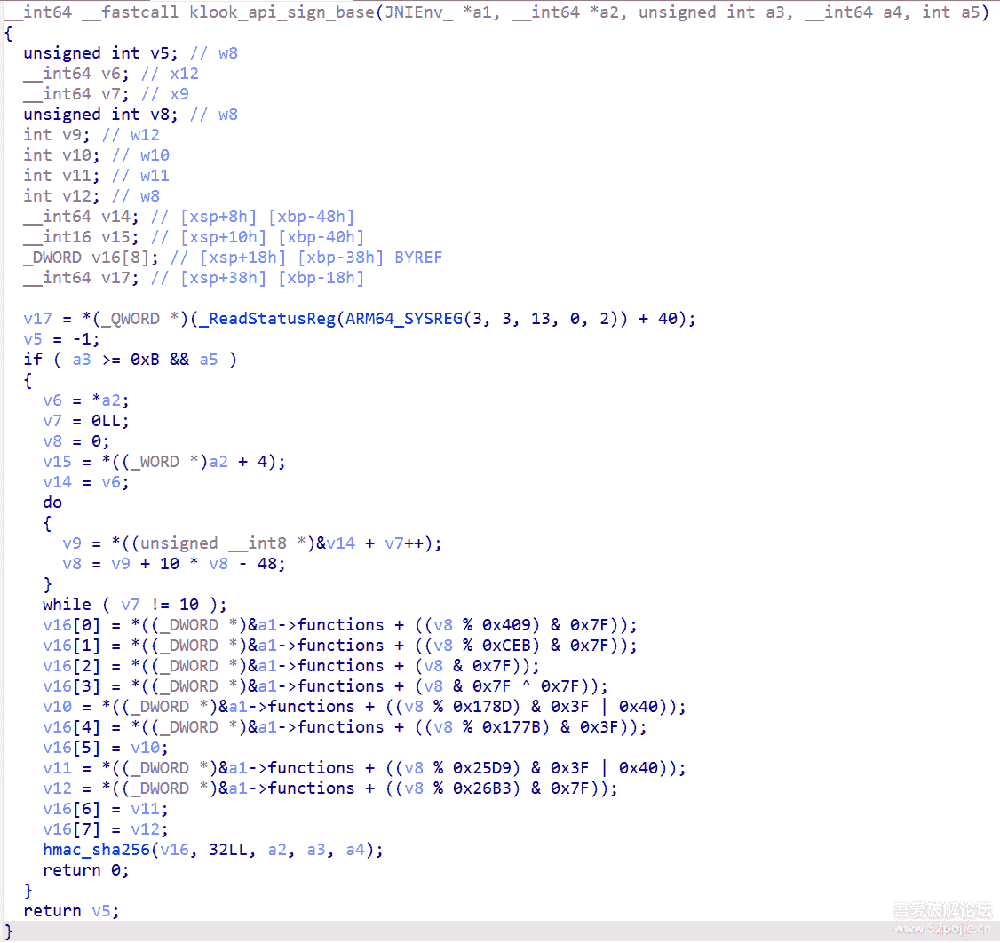

分析：

- 到这就有个很亮眼的`hmac_sha256`，大概可以知道是什么算法了，现在去尝试找一下密钥和待加密字符串。

- `a2` `a3` `a4`都是参数，中间没做过处理就传入`hmac_sha256`了，因此主要看`v8` `v16`的生成。

- `v8`就是把`a2`指向的那个内存中的前10个当作 ASCII 十进制字符逐位解析得到的十进制整数，`a2`是第二个参数，也就是我们刚刚日志打印中的那个`input_ptr`参数，这个地址对应的utf8的格式我们刚刚也是打印出来了，要取前10个字符，也就是时间戳的前10位。

- `v16`就是利用`v8`做了一些一些取模、按位运算后，以这些结果作为索引偏移，然后去`a1`指向的那个地址，每次取4个字节的内容，一共取8次，最终组成一个32字节的数组。`a1`是第一个参数，也就是我们刚刚得到的那个512字节的`dest`。

分析到这，可以对`klook_api_sign_base`的hook脚本进行补充，打印`v8`和`v16`的值分别是什么？同时去打印`hmac_sha256`的入参，可以确保分析的是否正确。


```javascript
var klook_api_sign_base_addr = null;
var dump_context_len = 512; // klook_api_sign_v2 里 dest 长度
try {
    klook_api_sign_base_addr = Module.findExportByName(mod.name, 'klook_api_sign_base');
    if (klook_api_sign_base_addr) console.log(' findExportByName 找到 klook_api_sign_base ->', klook_api_sign_base_addr);
} catch (e) {}
Interceptor.attach(klook_api_sign_base_addr, {
    onEnter: function(args) {
        // args[0] 应该是 context (512 bytes copy of unk_2DF20)
        this.ctx_ptr = args[0];
        this.input_ptr = args[1];
        // len may be args[2] or args[2] is some jint, we will try both when reading
        try { this.len = args[2].toInt32(); } catch(e) { try { this.len = args[2].toInt64(); } catch(e2) { this.len = 0; } }
        this.out_ptr = args[3];
        try { this.out_len = args[4].toInt32(); } catch (e) {
            console.log("入参第四个参数转换错误:",e)
            console.log("args[4]:",args[4])
            this.out_len = 32;
        }

        console.log('---- klook_api_sign_base ENTER ----');
        console.log(' ctx_ptr=', this.ctx_ptr, ' input_ptr=', this.input_ptr, ' len=', this.len, ' out_ptr=', this.out_ptr, ' out_len=', this.out_len);

        try {
            var fullctx = Memory.readByteArray(this.ctx_ptr, dump_context_len);
            console.log('dest | 512 (hex):', toHex(fullctx));
        } catch (e) {
            console.log('[!] 读取 dest 失败:', e);
        }

        // 读取 input
        try {
            if (this.input_ptr && this.len && this.len > 0 ) {
                try {
                    var s = Memory.readUtf8String(this.input_ptr, this.len);
                    console.log('完整 input (utf8):', s);
                    var raw = Memory.readByteArray(this.input_ptr, this.len);
                    var hex = toHex(raw);
                    console.log('完整 input (hex):', hex);
                } catch (e) {
                    // 如果不是纯 UTF-8 文本（可能是二进制）
                    var raw = Memory.readByteArray(this.input_ptr, this.len);
                    hex = toHex(raw);
                    console.log('完整 input (hex):', hex);
                    console.log('klook_api_sign_base onEnter input Error :',e)
                }
            } else {
                console.log('[!] input_ptr 或 len 无效, input_ptr=', this.input_ptr, ' len=', this.len);
            }
        } catch (e) {
            console.log('[!] 读取 input 失败:', e);
        }
        // 这里解析出 v8 和 v16
        var v8 = 0;
        for (var i = 0; i  ('00000000' + x.toString(16)).slice(-8)).join(' '));
        // 打印完整 32 字节 hex（小端顺序拼接）
        var keyHex = v16.map(x => {
            var b0 = (x & 0xFF).toString(16).padStart(2,'0');
            var b1 = ((x >> 8) & 0xFF).toString(16).padStart(2,'0');
            var b2 = ((x >> 16) & 0xFF).toString(16).padStart(2,'0');
            var b3 = ((x >> 24) & 0xFF).toString(16).padStart(2,'0');
            return b0 + b1 + b2 + b3;
        }).join('');
        console.log('v16 hex (32 bytes):', keyHex);
    },
    onLeave: function(retval) {
        console.log('---- klook_api_sign_base LEAVE ----');
        var outBuf = null;
        try { console.log(' retval (int):', retval.toInt32()); } catch (e) { /* ignore */ }
        try {
            outBuf = Memory.readByteArray(this.out_ptr, this.out_len);
            if (outBuf) {
                var outHex = toHex(outBuf);
                console.log(' out (hex full):',outHex);
            } else {
                console.log('[!] out 读取到空 buf');
            }
        } catch (e) {
            console.log('[!] 读取 out buffer 失败:', e);
        }
        console.log('---- klook_api_sign_base END ----');
    }
});
console.log(' klook_api_sign_base hook 安装成功 :', klook_api_sign_base_addr);

var hmac_sha256_addr = null;
try {
    hmac_sha256_addr = Module.findExportByName(mod.name, 'hmac_sha256');
    if (hmac_sha256_addr) console.log(' findExportByName 找到 hmac_sha256 ->', hmac_sha256_addr);
} catch (e) {}
Interceptor.attach(hmac_sha256_addr, {
    onEnter: function(args) {
        try {
            console.log('---- hmac_sha256 ENTER ----');
            this.a0 = args[0];
            this.a1 = args[1].toInt32 ? args[1].toInt32() : parseInt(args[1]);
            this.a2 = args[2];
            this.a3 = args[3].toInt32 ? args[3].toInt32() : parseInt(args[3]);
            this.a4 = args[4];
            this.a5 = args[5].toInt32 ? args[5].toInt32() : parseInt(args[5]);

            console.log(' arg0(ptr)=', this.a0, ' len=', this.a1);
            console.log(' arg2(ptr)=', this.a2, ' len=', this.a3);
            console.log(' arg4(ptr)=', this.a4, ' len=', this.a5);

            var data0 = Memory.readByteArray(this.a0, this.a1);
            console.log(' arg0(hex)=', toHex(data0));
            var data2 = Memory.readByteArray(this.a2, this.a3);
            console.log(' arg2(hex)=', toHex(data2));
            var s = Memory.readUtf8String(this.a2, this.a3);
            console.log(' arg2(utf8):', s);
            var data4 = Memory.readByteArray(this.a4, this.a5);
            console.log(' arg4(hex)=', toHex(data4));

        } catch (e) {
            console.log('[!] print args failed:', e);
        }
    },
    onLeave: function(retval) {
        try {
            console.log('---- hmac_sha256 LEAVE ----');
            try { console.log(' retval (int):', retval.toInt32()); } catch (e) { /* ignore */ }

            // 尝试读取输出缓冲区
            var outData = Memory.readByteArray(this.a4, this.a5);
            console.log('hmac_sha256 output(hex)=', toHex(outData));
            console.log('---- hmac_sha256 END ----');
        } catch (e) {
            console.log('hmac_sha256 ERROR :',e);
            console.log('hmac_sha256 onLeave retval (raw) =', retval);
        }
    }
});
console.log(' hmac_sha256 hook 安装成功 :', hmac_sha256_addr);
```

## 查看日志

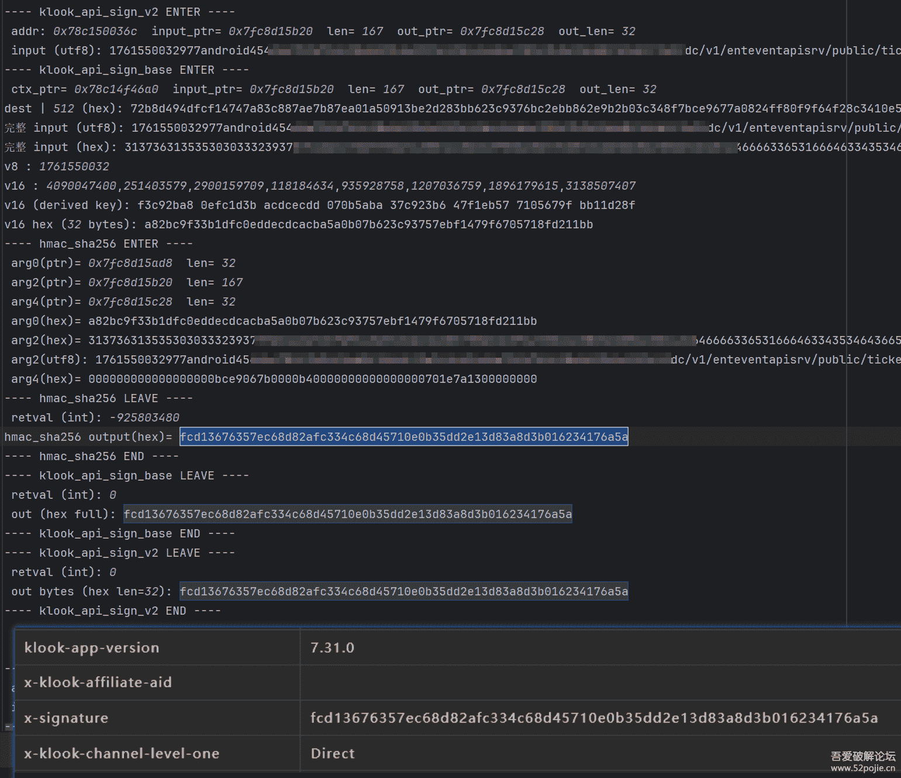

## 分析日志

查看`klook_api_sign_base`部分的`v8`和`v16`跟刚刚的分析相同，32字节的`v16`也是传入到了`hmac_sha256`中，现在可以去一些在线的加密网站中去验证加密是否正确，防止对算法进行了一些魔改什么的。

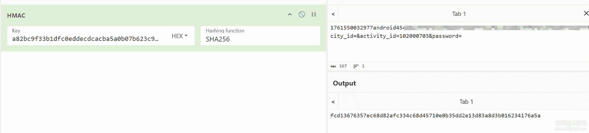

完美复现，是标准的加密，然后就可以使用`python`去还原加密流程了

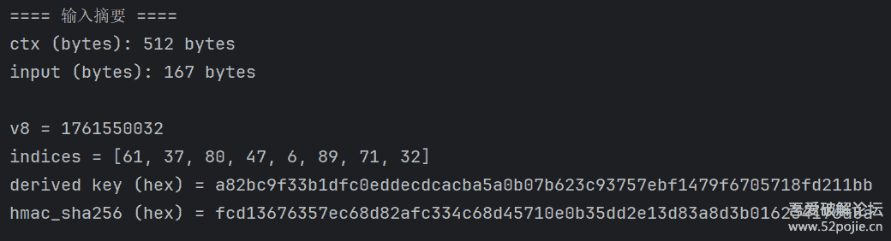

算法还原部分就不提供了，拿到完整的`dest`后可以让`AI`帮忙生成对应的代码就行了，后续接口请求也不再多说了。

### 结尾

第一次写文章，写的可能不是很好，大佬们见谅，如果有写的不对的地方可以告诉我一声，我再学学。中间提到的那个设备id，我也不知道是不是唯一的，不知道会不会有影响，也拜托各位不要用我这里显示的设备id去发请求，我怕.....

感谢！
