# [Android 原创] 某蜂窝app登录逆向分析

- 原帖: https://www.52pojie.cn/forum.php?mod=viewthread&tid=2070588
- 抓取时间: 2026-11-01T13:53:20.522Z

本文章中所有内容仅供学习交流使用，不用于其他任何目的，不提供完整代码，抓包内容、敏感网址、数据接口等均已做脱敏处理，严禁用于商业用途和非法用途，否则由此产生的一切后果均与作者无关.本文章未经许可禁止转载，禁止任何修改后二次传播，擅自使用本文讲解的技术而导致的任何意外，作者均不负责

## 一、样本基本信息

包名：`com.***.roadbook`

接口：[`//*****/rest/app/user/login/`](https://mapi.mafengwo.cn/rest/app/user/login/:https)

登录接口样本：某蜂窝

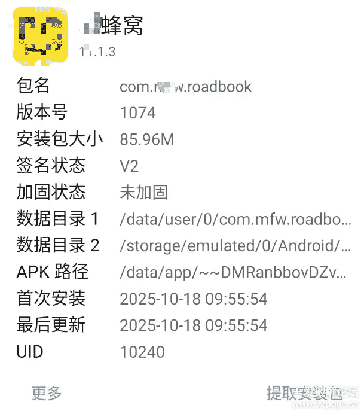

可疑参数：`oauth_nonce`、`oauth_signature`、`zzzghostsigh`

参考文章和视频：

- sha1视频算法详解：[aHR0cHM6Ly93d3cuYmlsaWJpbGkuY29tL3ZpZGVvL0JWMVYxNHkxVDdMTS8/c3BtX2lkX2Zyb209MzMzLjMzNy5zZWFyY2gtY2FyZC5hbGwuY2xpY2s=](https://www.bilibili.com/video/BV1V14y1T7LM/?spm_id_from=333.337.search-card.all.click)
- 常见算法原理之SHA1：[aHR0cHM6Ly9tcC53ZWl4aW4ucXEuY29tL3MvMmxuMGw1ay1wRmM4dDBRZWdNMEJXZw==](https://mp.weixin.qq.com/s/2ln0l5k-pFc8t0QegM0BWg)
- 一文读懂SHA-1：IGh0dHBzOi8vbXAud2VpeGluLnFxLmNvbS9zL1dncnQ2aHZ4TXJ0MElxQnZJWkRaTkE=
- 魔改app算法分析：aHR0cHM6Ly9tcC53ZWl4aW4ucXEuY29tL3MvRWdNSFNlWmlhVkdFUTFQZzhTMHl4Zw==

大佬文章中有详细的算法逻辑分析，本文主要是对sha1算法实现以及分析思路的一个复现记录，不涉及具体算法分析

## 二、抓包分析

首先利用小黄鸟对登录接口多次抓包对比动态参数

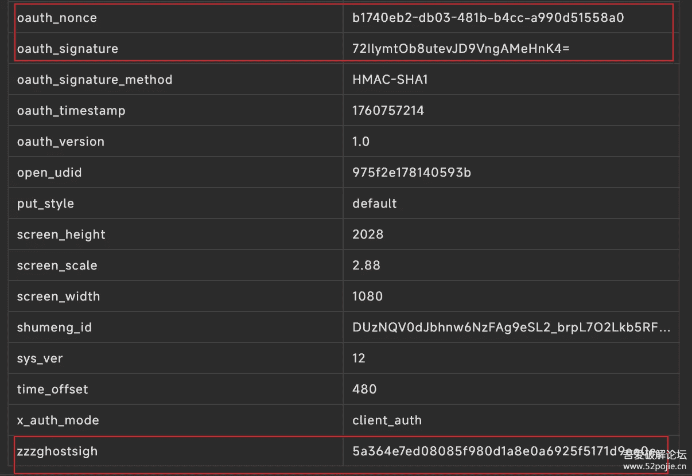

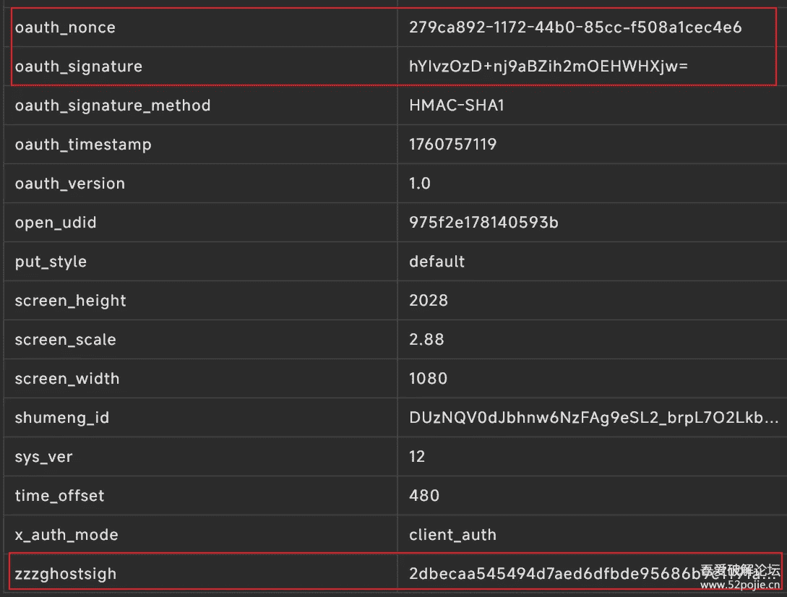

可以发现 `oauth_nonce`、`oauth_signature`、`zzzghostsigh` 三个参数是变化的

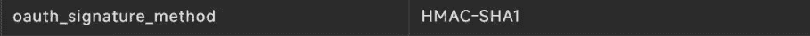

还贴心地返回了一个提示：HMAC-SHA1 算法对应 `oauth_signature` 的加密，到时候可以注意一下啊。目前我们可以简单确定就是这些要处理的参数内容

## 三、java层分析

首先按照国际惯例直接开展搜索大法，很显然搜不到任何有用的东西

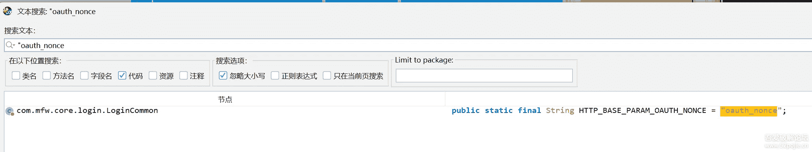

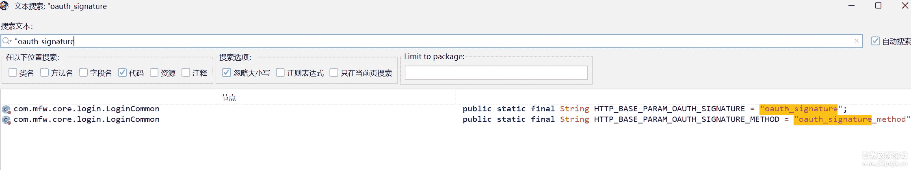

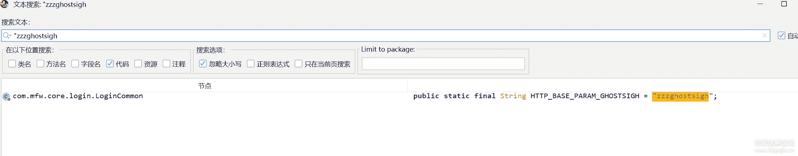

虽然我们发现这个搜索不到，但是这个东西很类似，他肯定在代码里面做了一些特殊的处理，我们另辟蹊径换个思路。我们知道他是在请求头里面的一个内容，他请求头里面的东西无非就是通过 `TreeMap`、`HashMap` 包括 `JSONObject` 等这一些东西去存储，我们可以粗略的自己去看一下代码的结构。发现很多东西他都使用 `TreeMap` 存储的，我们去 hook `put` 的方法，看看有没有我们遇到的参数，然后去打印堆栈

```javascript
function hook_url() {
  Java.perform(function () {
    let SecurityTools = Java.use("com.mfw.core.login.util.SecurityTools");
    SecurityTools["encodePramas"].implementation = function (str, str2, treeMap) {
      console.log(`SecurityTools.encodePramas is called:  treeMap=${treeMap}`);
      let result = this["encodePramas"](str, str2, treeMap);
      console.log(`SecurityTools.encodePramas result=${result}`);
      return result;
    };
  })
}
```

```javascript
function hook_treemap() {
  Java.perform(function () {
    var TreeMap = Java.use('java.util.TreeMap');
    TreeMap.put.implementation = function (key, value) {
      console.log(`TreeMap.put is called: key=${key}, value=${value}`)
      return this.put(key, value);
    };
  })
}
```

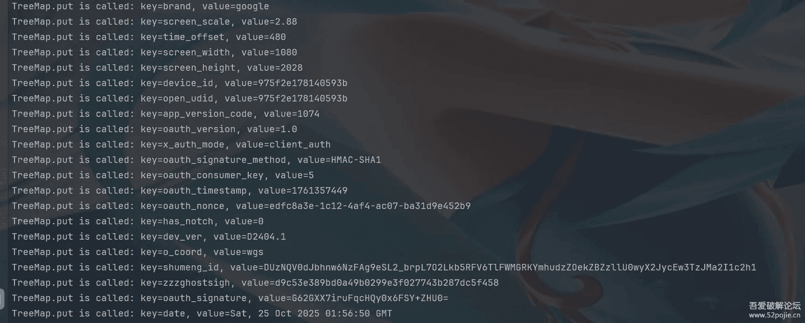

这样发现，我们的所有值都是通过 `TreeMap` 进行的一个存储，我们只需要添加判断，然后去打印堆栈就可以定位到他的一个生成的位置，以 `oauth_nonce` 为例。

```javascript
function hook_treemap() {
  Java.perform(function () {
    var TreeMap = Java.use('java.util.TreeMap');
    TreeMap.put.implementation = function (key, value) {
      if (key == 'oauth_nonce') {
        console.log(Java.use('android.util.Log').getStackTraceString(Java.use('java.lang.Throwable').$new()));
      }
      return this.put(key, value);
    };
  })
}
```

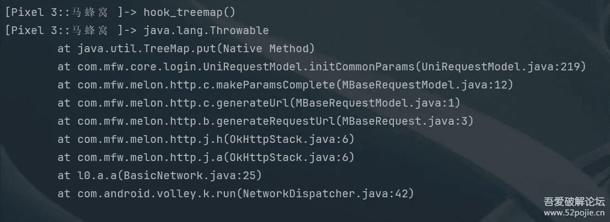

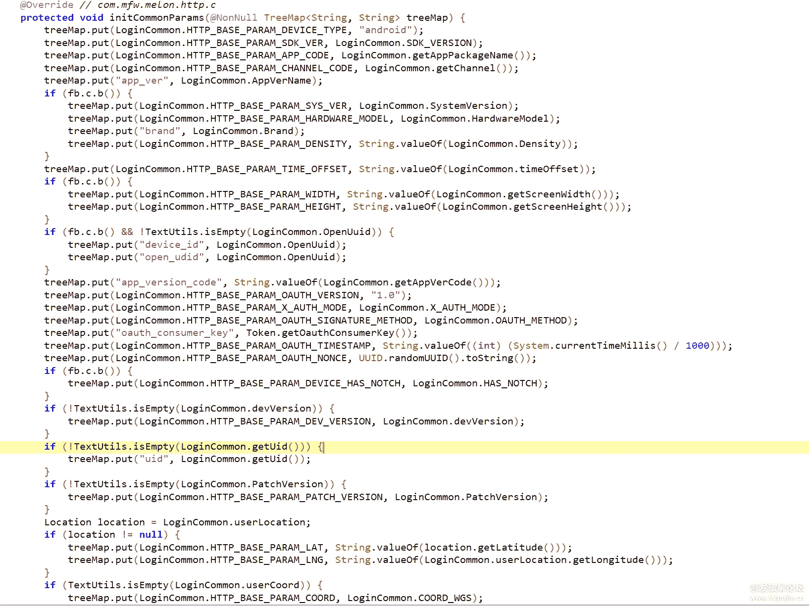

跟着堆栈就来到了这个位置，我们发现所有的 `put` 基本上都用了一个 `LoginCommon` 类，我们进去看看

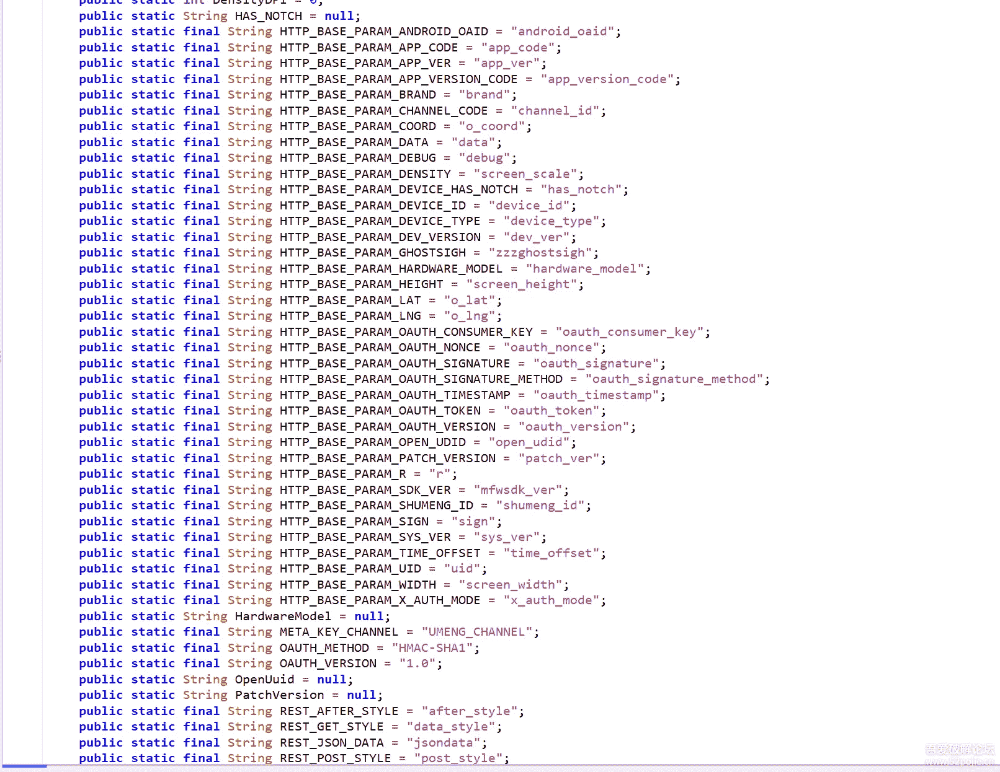

原来他就是用这样的方式来混淆防止我们直接定位到关键参数的位置，我们来找一下对应关系，来定位 `oauth_nonce` 这个参数的生成

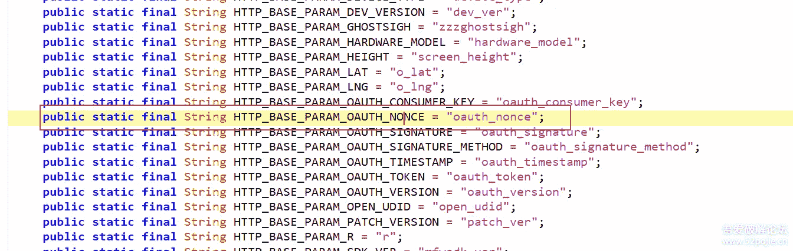

然后我们对应的在 `put` 里面找回来

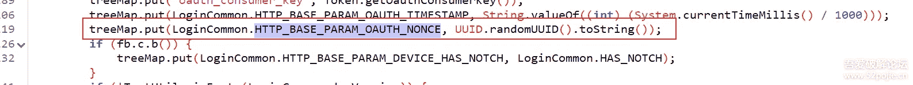

这样我们就定位到他的一个参数的生成，其实就是 `uuid`。同理，我们找到实现 `oauth_signature`、`zzzghostsigh` 函数的定位

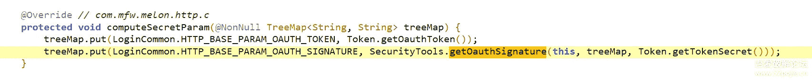

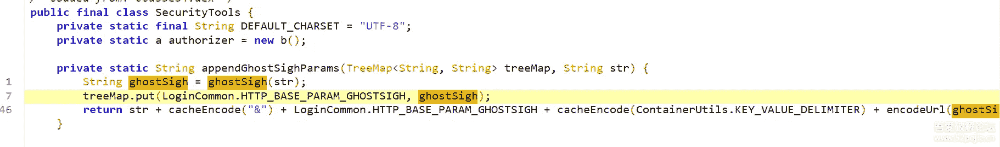

需要注意的是，`zzzghostsigh` 参数的地方他又玩了一个心眼子；他只是写了一个接口，并没有去实现。我们利用 `jadx` 的 `x` 快捷键定位引用

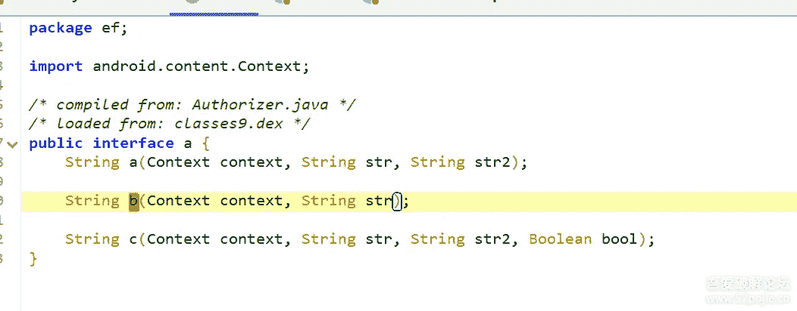

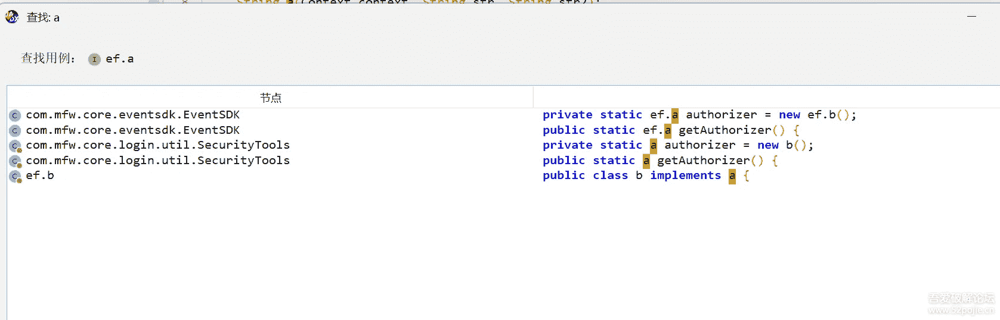

他在这一个地方实现的 `a` 接口

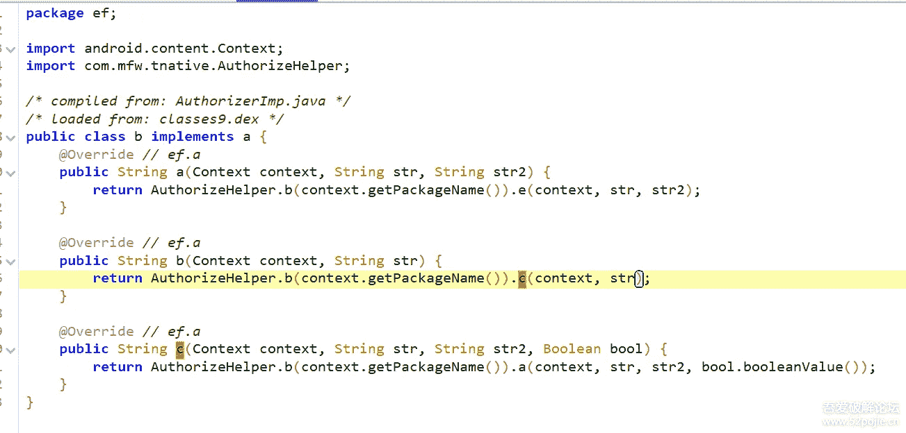

这样的话我们就得到了java层最终的一个分析结果

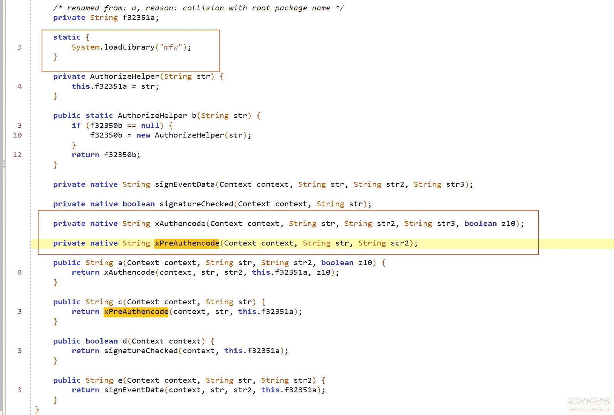

`oauth_signature`、`zzzghostsigh` 是在 native 层实现的，`oauth_nonce` 是 `uuid`，`xAuthencode` 对应的是 `oauth_signature`。需要注意的是，在抓包的过程中他提示了我们这个是什么算法，保持怀疑，但可以去尝试一下。`xPreAuthencode` 对应的是 `zzzghostsigh` 这个参数

```javascript
function hook_xAuthencode() {
    Java.perform(function () {
        let AuthorizeHelper = Java.use("com.mfw.tnative.AuthorizeHelper");
        AuthorizeHelper["xAuthencode"].implementation = function (context, str, str2, str3, z10) {
            console.log(`AuthorizeHelper.xAuthencode is called: context=${context}, str=${str}, str2=${str2}, str3=${str3}, z10=${z10}`);
            let result = this["xAuthencode"](context, str, str2, str3, z10);
            console.log(`AuthorizeHelper.xAuthencode result=${result}`);
            return result;
        };
    })
}
```

```javascript
function hook_xPreAuthencode() {
    Java.perform(function () {
        let AuthorizeHelper = Java.use("com.mfw.tnative.AuthorizeHelper");
        AuthorizeHelper["xPreAuthencode"].implementation = function (context, str, str2) {
            console.log(`AuthorizeHelper.xPreAuthencode is called: context=${context}, str=${str}, str2=${str2}`);
            let result = this["xPreAuthencode"](context, str, str2);
            console.log(`AuthorizeHelper.xPreAuthencode result=${result}`);
            return result;
        };
    })
}
```

最后我们去 hook 这两个 native 函数在 java 层的传参和返回值，确定无误之后进行 so 层的一个分析

## 四、so层分析

首先确定是动态注册函数还是静态注册函数


没毛病，动态注册，直接 hook 启动，开始分析 `xAuthencode` 函数

### 1、`xAuthencode`

```javascript
function hook_RegisterNatives() {  var addrRegisterNatives = null;

  var symbols = Module.enumerateSymbolsSync("libart.so");

  for (var i = 0; i = 0 &&

        symbol.name.indexOf("JNI") >= 0 &&

        symbol.name.indexOf("RegisterNatives") >= 0 &&

        symbol.name.indexOf("CheckJNI") ')

        var env = args[0];

        var java_class = args[1];

        var class_name = Java.vm.tryGetEnv().getClassName(java_class);

        var taget_class = "com.mfw.tnative.AuthorizeHelper";

        if (class_name === taget_class) {

          console.log("\n[RegisterNatives] method_count:", args[3]);

          var methods_ptr = ptr(args[2]);

          var method_count = parseInt(args[3]);

          for (var i = 0; i
```


```text
[RegisterNatives] method_count: 0x4
name: com.mfw.tnative.AuthorizeHelper signEventData sig: (Landroid/content/Context;Ljava/lang/String;Ljava/lang/String;Ljava/lang/String;)Ljava/lang/String; module_name: libmfw.so offset: 0x39d84 8
name: com.mfw.tnative.AuthorizeHelper xAuthencode sig: (Landroid/content/Context;Ljava/lang/String;Ljava/lang/String;Ljava/lang/String;Z)Ljava/lang/String; module_name: libmfw.so offset: 0x3998c 8
name: com.mfw.tnative.AuthorizeHelper xPreAuthencode sig: (Landroid/content/Context;Ljava/lang/String;Ljava/lang/String;)Ljava/lang/String; module_name: libmfw.so offset: 0x396c8 8
name: com.mfw.tnative.AuthorizeHelper signatureChecked sig: (Landroid/content/Context;Ljava/lang/String;)Z module_name: libmfw.so offset: 0x3a1c8 8
```

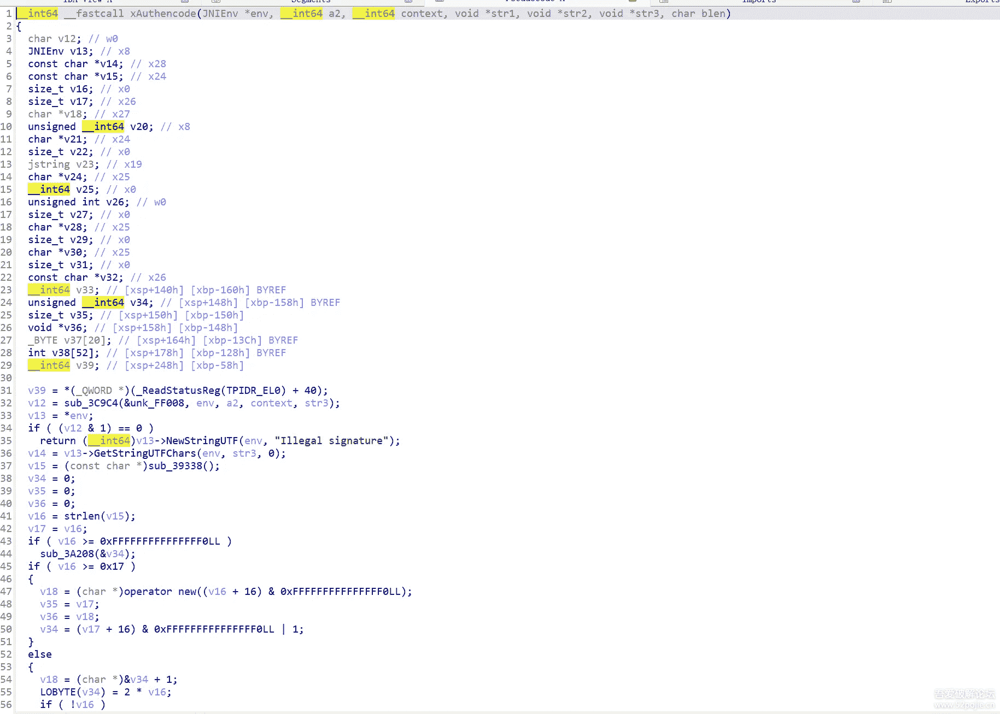

到位之后先改一下参数，然后开始我们的一个分析。首先来说它从 Java 层传入了五个参数

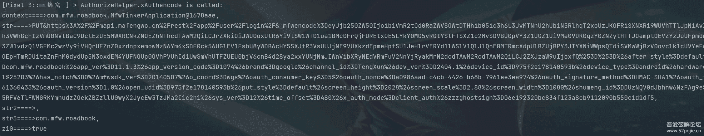

`str` 参数很有可能就是我们加密的数据。继续看 `ida` 进行分析

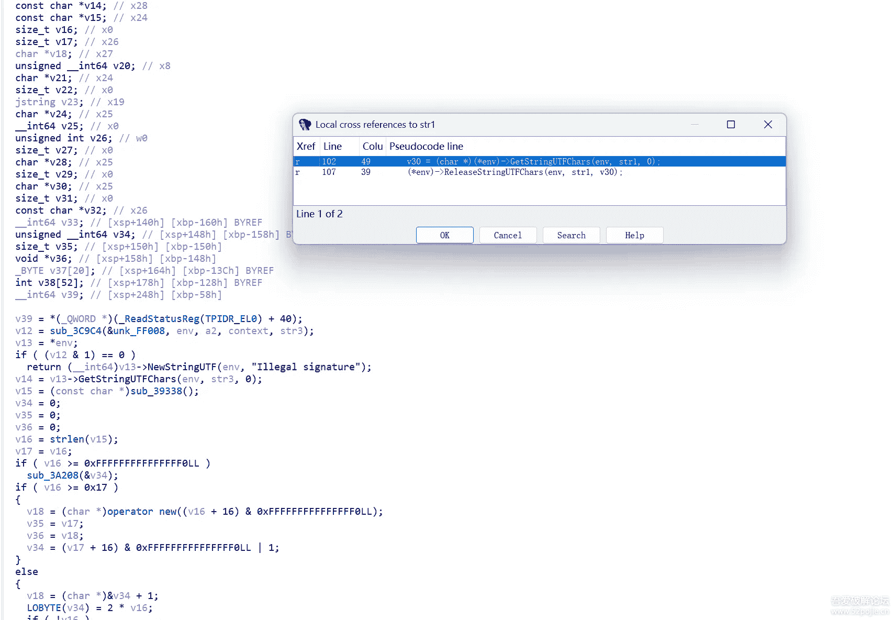

前面的部分很明显是一些 `jni` 函数操作，字符串的转化之类的，没有什么价值，我们直接从怀疑的 `str1` 调用进行分析。

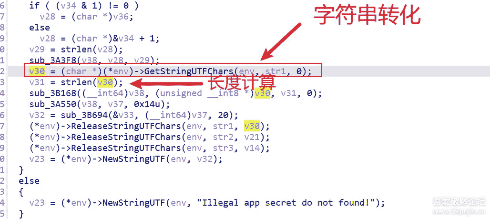

很明显 `3B168` 可能就是一个处理的函数，直接 `hook` 看看情况

```javascript
function print_arg(addr) {

    var module = Process.findRangeByAddress(addr);

    if (module != null) return hexdump(addr) + "\n";

    return ptr(addr) + "\n";

}

function hook_native_addr1(funcPtr, paramsNum) {

  var module = Process.findModuleByAddress(funcPtr);

  Interceptor.attach(funcPtr, {

    onEnter: function (args) {

      this.logs = [];

      this.params = [];

      this.logs.push("call " + module.name + "!" + ptr(funcPtr).sub(module.base) + "\n");

      for (let i = 0; i
```

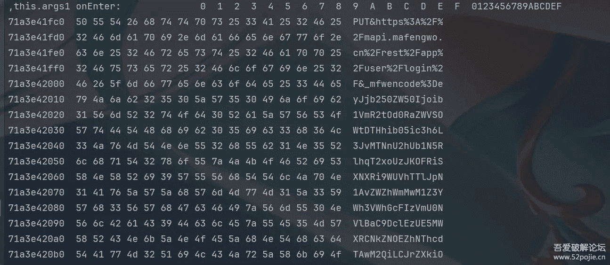

很明显看到了一个传参，但是它是一个多次调用的，所以有一些乱，需要注意。但是这里其实没有产生一个实质性的加密结果

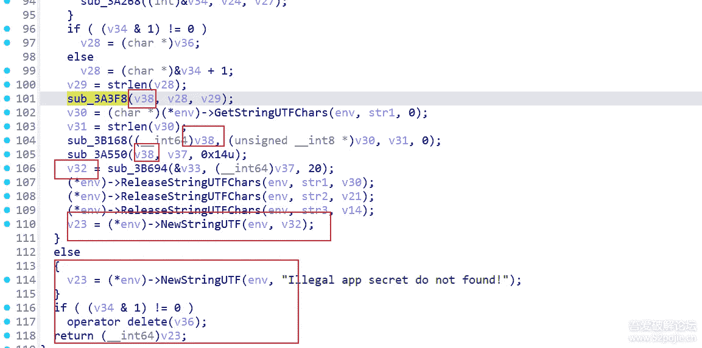

再继续分析一个代码逻辑，发现 `v38` 在不停的调用处理，最后是处理了一个 `v32`，返回了他的一个值，我们先去看看 `v38` 是个什么东西，直接去 `hook 3A3F8`

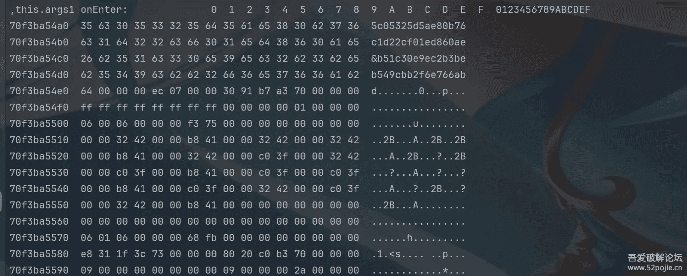

这里就发现一个非常有意思的东西，出现一个未知的字符串，结合之前的分析，这个可能是 `HMAC-SHA1` 算法的一个密钥，保持怀疑，但是可以试试。继续往下分析 `3B694` 这个函数，因为这是 `v32` 返回值的一个处理地方，这里发现出值了，我们进去看看函数一个逻辑

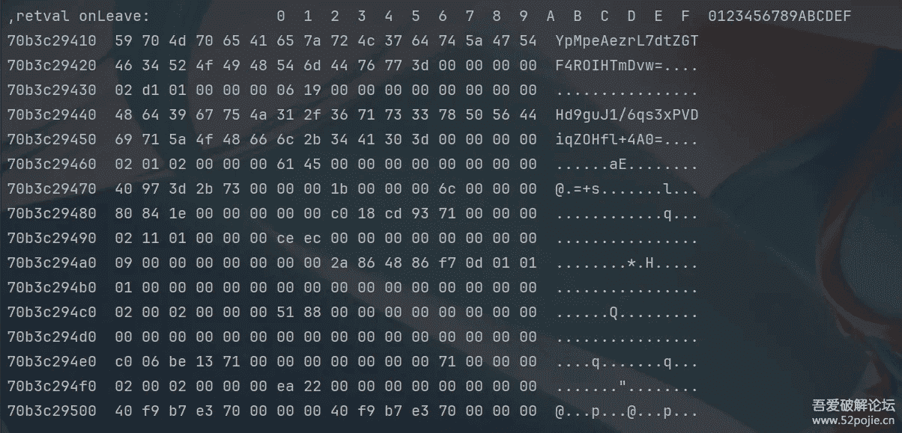

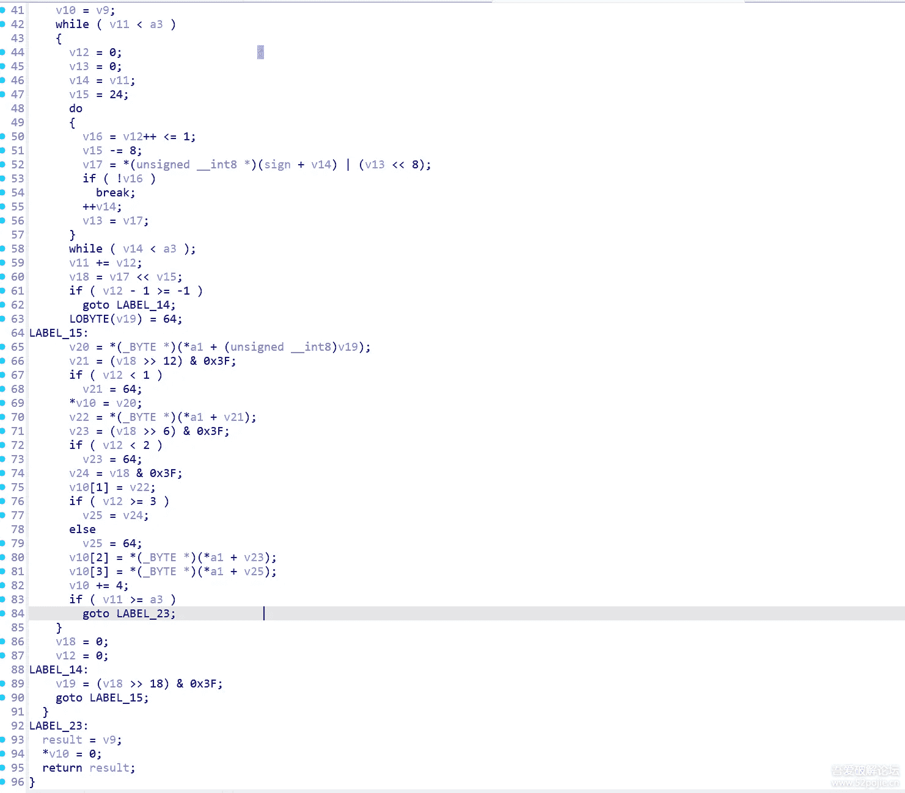

然后这个很简单，是一个标准的 `base64`，可以丢给 AI，也可以自己 `trace` 分析，他的一个码表就在 `.rodata` 段

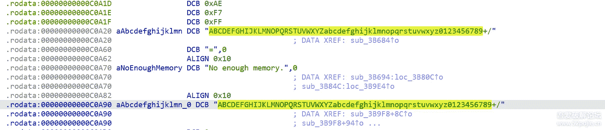

是一个标准的 `base64` 计算，我们先解码一下

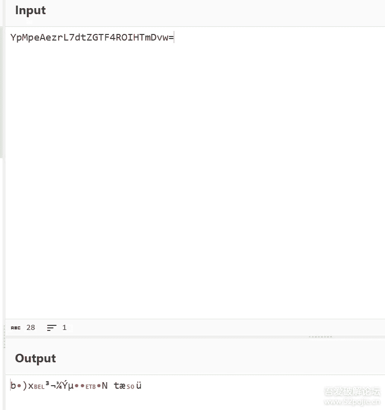

是个乱码的，其实在 `app` 里面很多都是 `hex` 的一个表现形式，我们 `tohex`

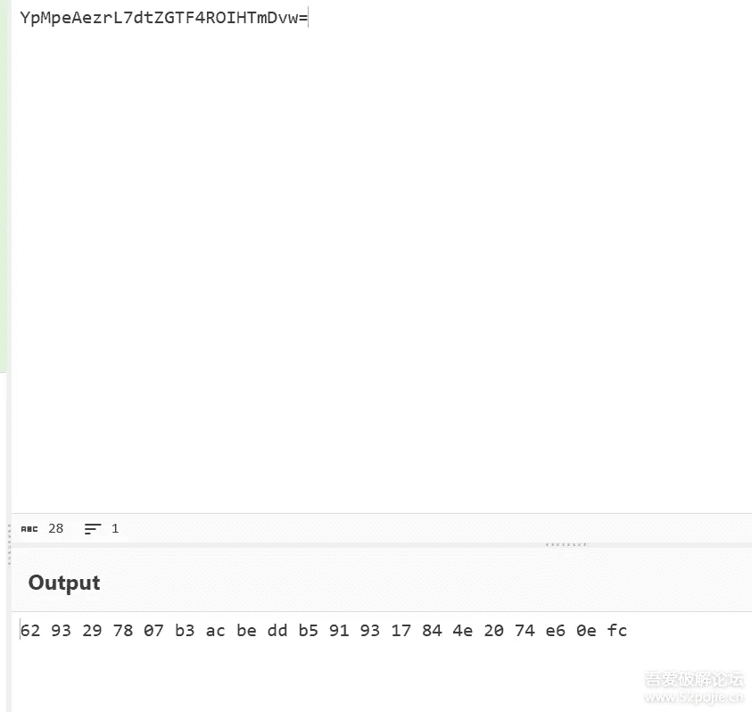

这样的话，我们就要同时去 `hook` 这一串 `hex` 在内存中生成位置，以及最后结果的产生位置，可以尝试去 `hook` 一下。记录一下结果

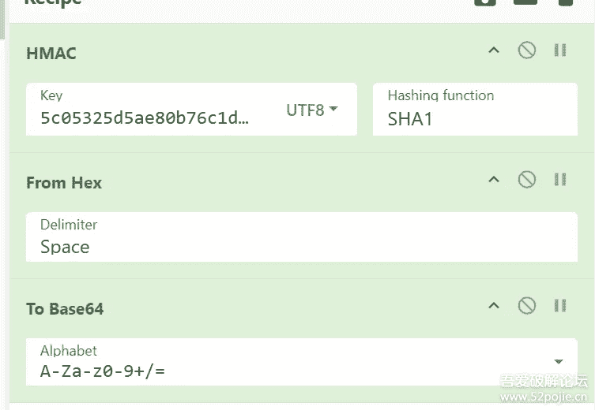

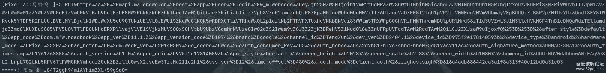

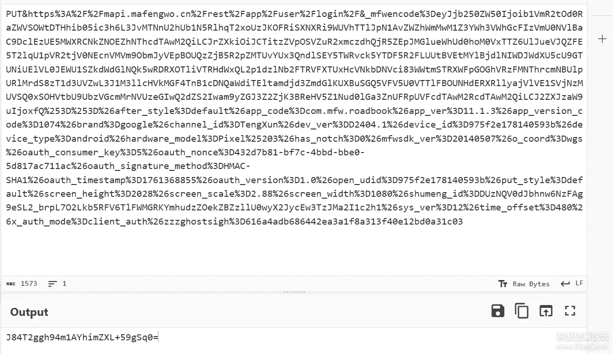

## 2、xPreAuthencode

参考 b 站 up 主视频，图片不会制作，直接借用

### （1）sha1算法分析

#### a、填充

①填充长度：需要把数据填充到64字节（512bit）的倍数，最少填充9个字节，最多填充（64+8）个字节

②填充：在原始数据后面填充 `0x80`，填充 `N` 个 0，使用大端序在最后面填充8个字节填充原来的数据的bit长度


这是一个41字节的数据，那么他按照规则填充，先追加一个 `0x80`，然后填充 `0044*8 = 328bit`，`328 = 0x148`，按照大端序填充

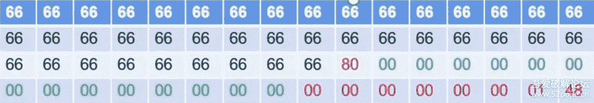

```python
original_byte_len = len(data)
original_bit_len = original_byte_len * 8
data += b'\x80'

while (len(data) + 8) % 64 != 0:
    data += b'\x00'

data += original_bit_len.to_bytes(8, 'big')
```

#### b、执行流程

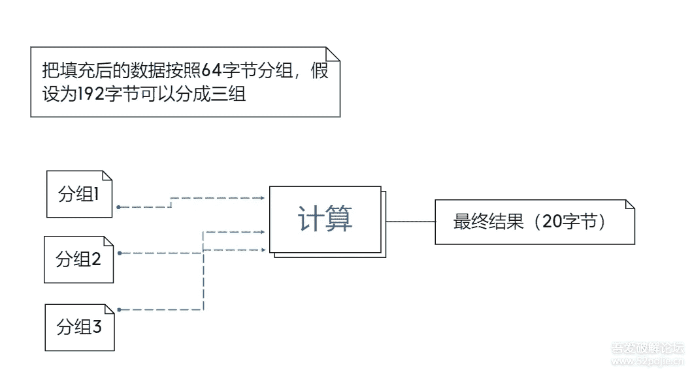

#### c、数据预处理

①数据扩充：64字节可以当作16个4字节，需要扩充到80个4字节

步骤1：前16个4字节，直接赋值原始的16个4字节

步骤2：其他（大端序取出当前位置的前面3个4字节 `^` 大端序取出当前位置的前面8个4字节 `^` 大端序取出当前位置的前面14个4字节 `^` 大端序取出当前位置的前面16个4字节 `^`）循环左移一位后用大端序存放

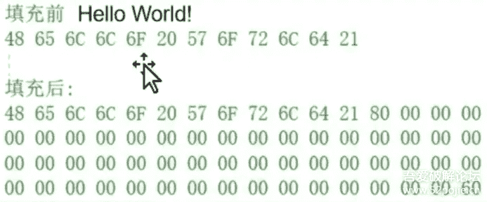

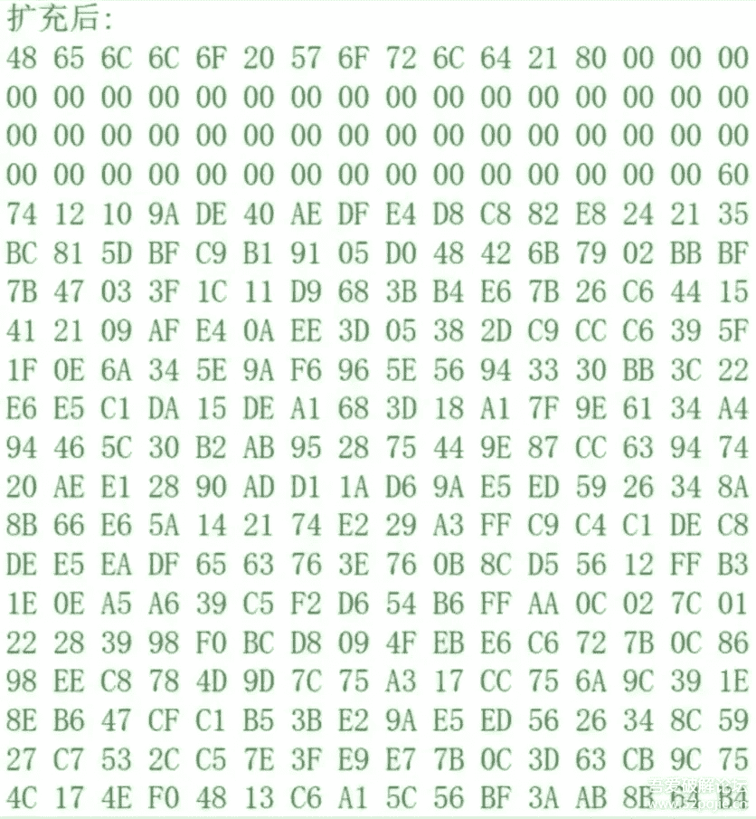

```python
for i in range(0, len(data), 64):

    w = [0] * 80

    chunk = data[i:i + 64]

    for j in range(16):

        w[j] = int.from_bytes(chunk[4 * j:4 * j + 4], 'big')

    for j in range(16, 80):

        w[j] = left_rotate(w[j - 3] ^ w[j - 8] ^ w[j - 14] ^ w[j - 16], 1)
```

#### d、计算

①初始化哈希值

```python
# 小端序
A = 0x67452301
B = 0xEFCDAB89
C = 0x98BADCFE
D = 0x10325476
E = 0xC3D2E1F0
```

②存储哈希值

```python
a = A

b = B

c = C

d = D

e = E
```

③计算过程

```javascript
e=(a
```

```javascript
e=((a > (32 - 5))) & 0xFFFFFFFF + f + e + k + w[i])
```

④计算过程

```javascript
b=b
```

```javascript
b = ((b > (32 - 30))) & 0xFFFFFFFF
```

⑤交换数据

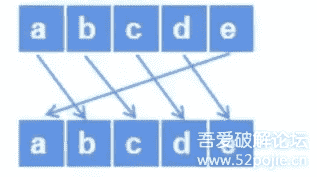

```python
e = d
d = c
c = b
b = a
a = e
```

③--⑤重复80次

⑥数据处理

```python
A = (A + a) & 0xFFFFFFFF

B = (B + b) & 0xFFFFFFFF

C = (C + c) & 0xFFFFFFFF

D = (D + d) & 0xFFFFFFFF

E = (E + e) & 0xFFFFFFFF
```

⑦最终结果

当最后一组数据计算完之后，`A` 的4个字节（大端序），加上 `B` 的四个字节（大端序），加上 `C` 的四个字节（大端序），加上 `D` 的四个字节（大端序），加上 `E` 的四个字节（大端序）就是最后的20字节结果。

```python
sha1_result = ''.join(f'{x:08x}' for x in [A, B, C, D, E])
```

### （2）魔改sha1

根据动态注册地址 `0x396c8`，找到 `xPreAuthencode` 函数位置，改个名字，方便查找

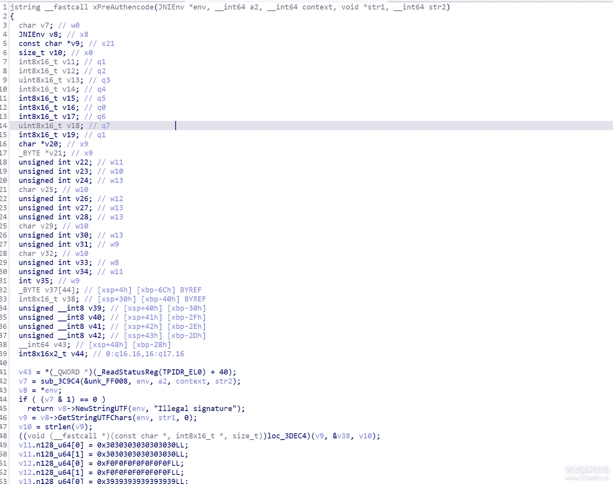

分析代码逻辑，根据 Java 层的入参情况可以知道，第一个参数是 `context` 上下文对象，`str1` 是核心的字符串，`str2` 是包名，我们入手点可以根据 `str1` 的交叉引用来找

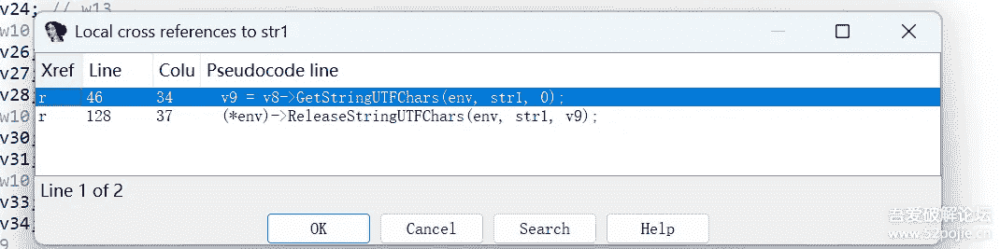

第一个是字符串的转化，第二个就是释放内存，所以核心在第一个

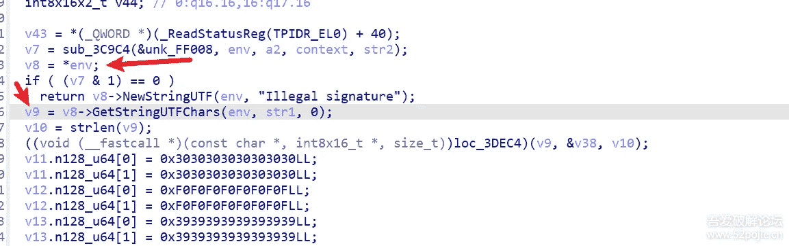

是 `*env`，`v9` 是调用 `v8` 的方法来转化 `str1`，所以来找 `v9` 的调用，首先就是 `loc_3DEC4` 以及 `v10` 取了 `v9` 的长度

`loc_`：用来标注一段代码中的某个位置，但不像 `sub_` 那样明确表示一个函数的开始。它可以是任何代码块内部的一个标签。

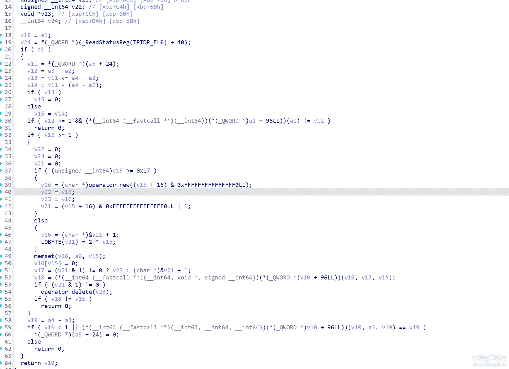

直接点击进来有点不明所以，不知道在干啥，这段代码，换成汇编分析一下试试

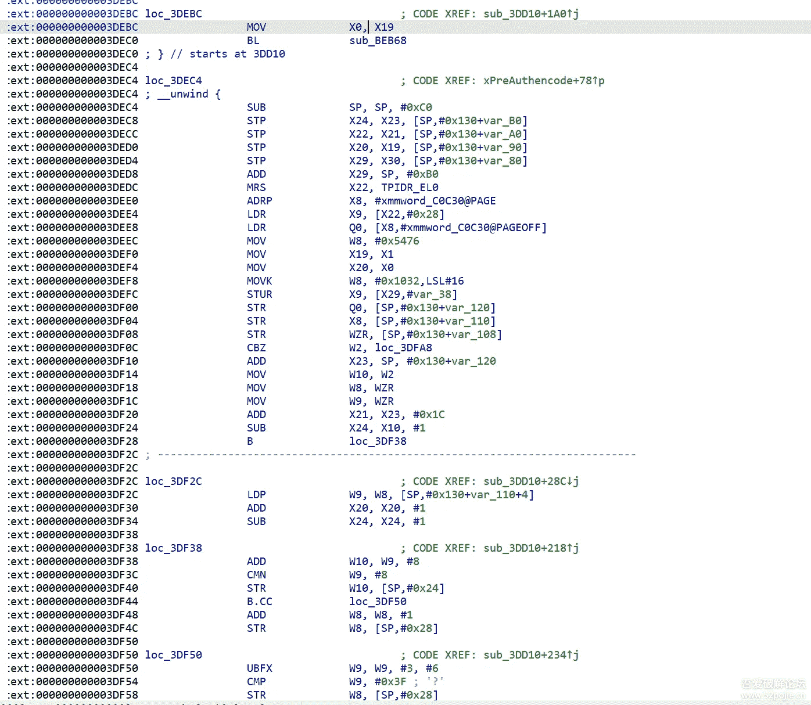

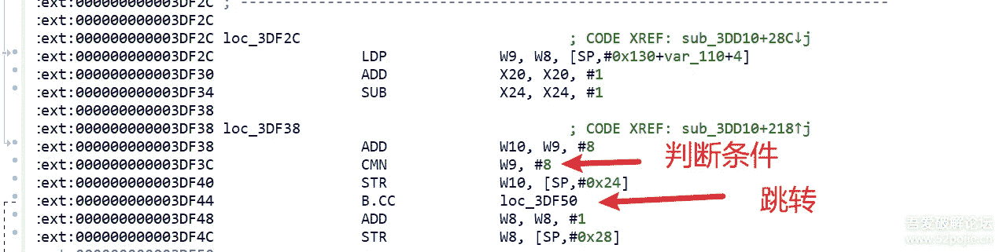

这里可以看到一个 `B.CC` 的指令用来做有条件的判断，判断条件根据 `CMN W9, #8` 指令，本质是计算 `W9 + 8`，并根据运算结果更新 `CPSR` 的标志位（重点是 `C` 进位标志位和 `Z` 零标志位）。

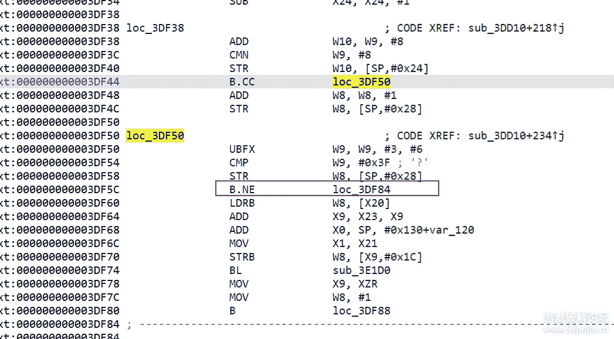

这里有了一个新的跳转指令 `B.NE`，判断逻辑在 `CMP W9, #0x3F ; '?'`

`B.NE` 是一条在 ARM 汇编语言中的条件分支指令（`B.NE` 的作用是当条件“不等于”成立时，跳转到指定的目标地址）

我们来打印 `x9` 寄存器，看什么是成立和不成立的情况

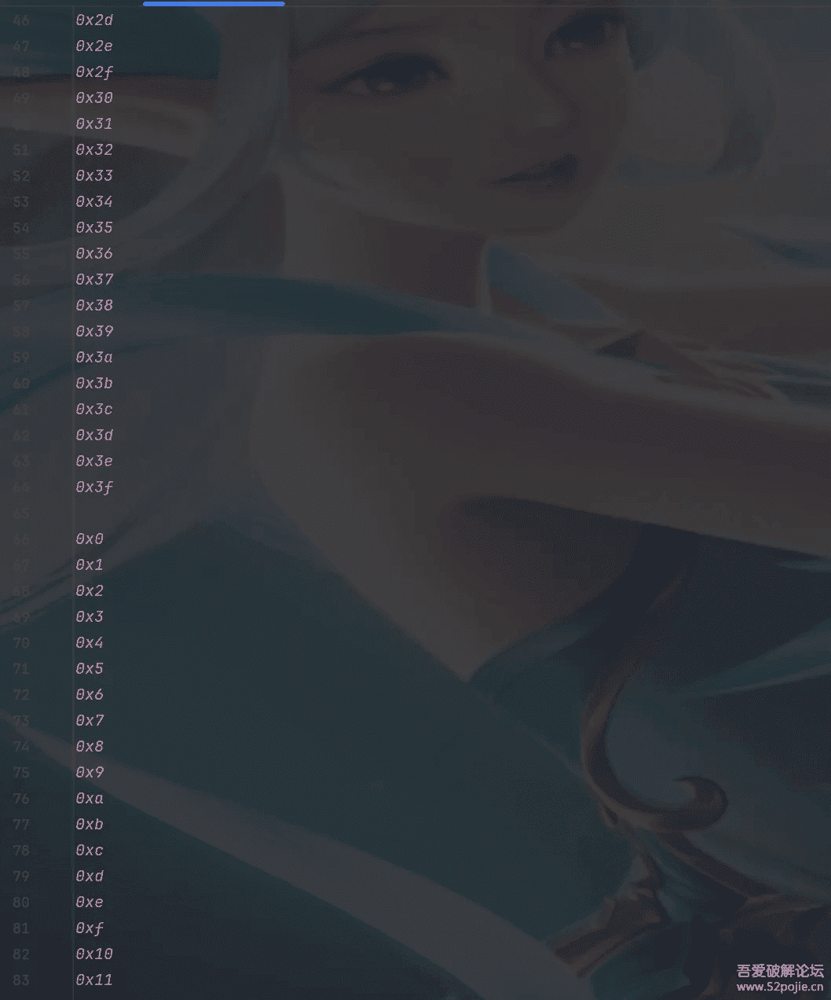

会发现每执行64次有一次不跳转

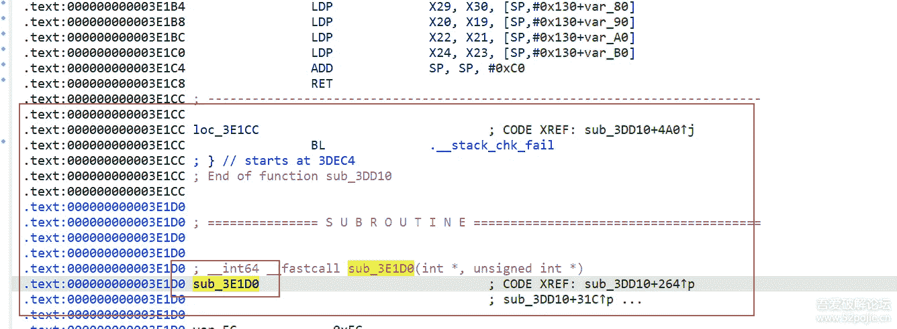

也就是会依次执行到 `sub_3E1D0` 函数位置，我们看看这个函数的逻辑

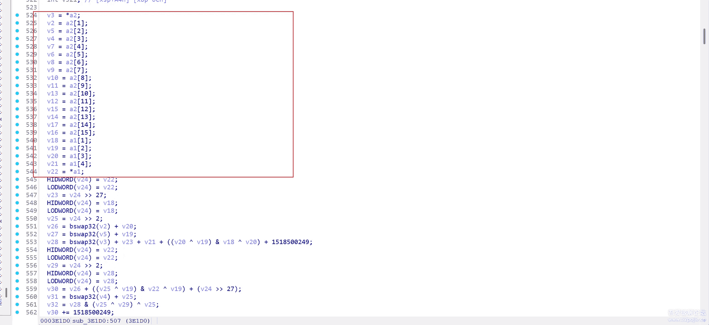

这个就是我们需要解决的 `sha1` 函数，在进行初始化哈希值操作以及根据入参字符串长度做分组，也就是 `sha1` 函数加密的基本逻辑

根据这里可以发现这就是五个初始值，对他进行小端序的处理，发现和我们标准的值有了区别

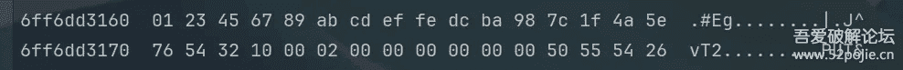

```python
0x67452301
0xefcdab89
0x98badcfe
0x5e4a1f7c
0x10325476
```

根据大佬总结的魔改SHA1算法：

魔改了初始化常量（魔幻值）没有改 `K` 值，但是对 `K` 值的使用和对应的 `F` 函数使用在加密中的轮次进行修改对最后的 `C`，`D` 赋值做了替换

总结 `K` 值出现的地方以及次数

- 0-15轮：`0x5A827999`（16次）
- 15-19轮：`0x6ED9EBA1`（4次）
- 20-39轮：`0x8F1BBCDC`（20次）
- 40-59轮：`0x5A827999`（20次）
- 60-79轮：`0xCA62C1D6`（20次）

这样就可以还原出算法的逻辑

```python
for j in range(0, 80):
    if 0 > 2)) & 0xFFFFFFFF
    if j == 79:
        a, b, d, c, e = temp, a, temp_b, c, d
    else:
        a, b, c, d, e = temp, a, temp_b, c, d
```

## 五、总结

本文主要是针对于 `sha1` 算法的学习，手写了两边，也是差不多熟悉了，静态分析也能比较清晰的把握关键东西，最后还是需要 `trace` 分析为主。还是很感谢大佬们无私分享的文章可以来学习{:1_932:}{:1_932:}

后续也会继续更新学习，先让我入职好好学学{:301_988:}
