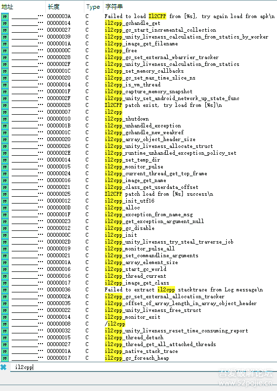
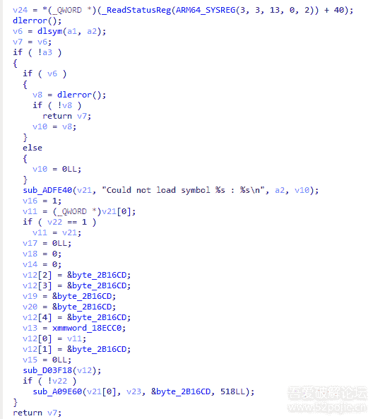
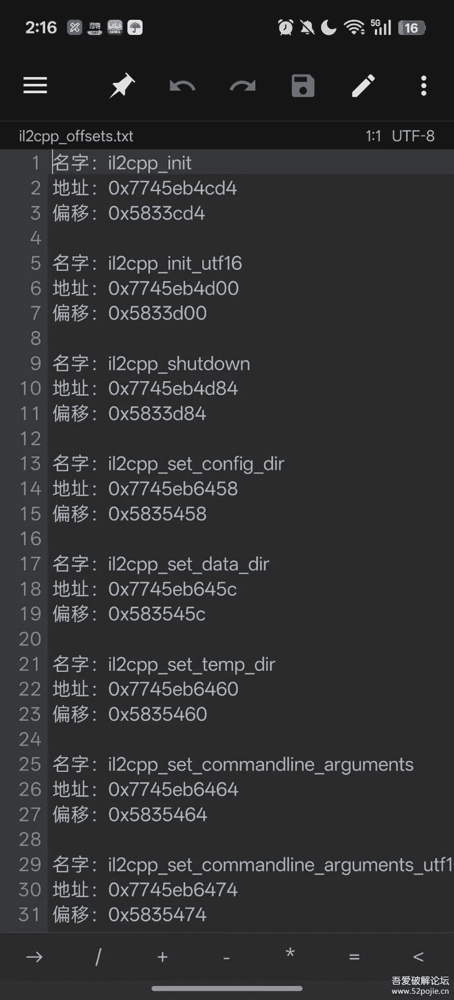

# [Android 原创] 无视某易针对`libil2cpp.so`的加固获取api

- 原帖: https://www.52pojie.cn/forum.php?mod=viewthread&tid=2071058
- 抓取时间: 2026-11-01T13:53:10.825Z

最近在分析某Unity游戏时，我偶然发现了一个有趣的现象——`libunity.so`的依赖库中竟然包含了`libil2cpp.so`。经过一番探索，我成功找到了一种无视厂商针对`il2cpp`加固获取`API`地址的方法，今天就来分享这段经历和实现原理。

架构：`arm64`
游戏：永xx间
参与人员：跟哥哥有糖（本人），魂梦灵

一切始于我闲着无聊把`libunity.so`丢到`ida`里面。在偶然翻到其依赖关系时，我意外地发现了`libil2cpp.so`的身影。

出于好奇，我开始在二进制文件中搜索相关`il2cpp`字符串，居然发现有`il2cpp_init`等`api`的身影

跳过去甚至发现有函数用到了这个字符串，于是我打算分析一下`unity.so`用这个字符串来干什么，转成伪`c`后，我发现字符串被作为一个参数传进去调用

再继续跟进和分析，可以发现这个函数是一个加载`il2cpp`的`api`的函数（如下）

调用 `dlerror()` 清空错误状态
用 `disym(句柄, 符号名)` 找符号地址
如果有问题就打印："Could not load symbol 符号名 : 错误信息"
返回找到的地址（不管成不成功都返回）

分析完后，我心中有一个想法——是否可以通过`hook`，无视游戏厂商针对`libil2cpp.so`的加固获取到`api`的地址

于是我进行了尝试

原本我是想直接`hook`这个函数的，但是经过 魂梦灵 大佬的提醒，我可以进行更底层的操作，对`dlsym`进行`hook`

我这边选择的是`github`上开源的`Dobby`框架进行`hook`（https://github.com/jmpews/Dobby）

## 流程

1. 创建文件 `/sdcard/Android/data/包名/il2cpp_offsets.txt`
2. 用 `Dobby` 把系统的 `dlsym` 函数替换成自己的 `hook_dlsym`
3. 当游戏调用 `dlsym` 时，对第二个参数进行过滤（`const char* symbol`）只要带`il2cpp`字符的，全部拦下
4. 按照
   名字：`il2cpp_symbol_name`
   地址：`0x7abc12345678`
   偏移：`0x123456`
   的格式输出到`il2cpp_offsets.txt`内

下图是经过测试成功的文件

代码已开源在`github`（https://github.com/EtherealPsyche/hook_dlsym_to_get_all_il2cpp_api）

## 使用方法

注入到游戏内

重点！！！
一定要游戏一启动就注入，不然你会错过这些`api`的
