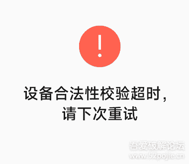
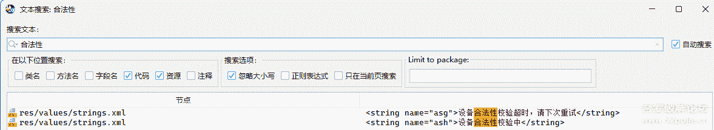
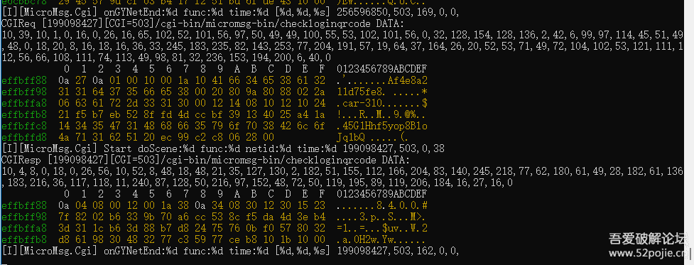
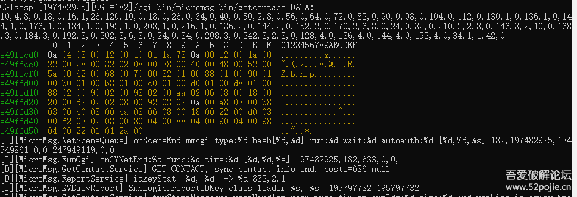

# [Android 原创] 以车载微信为例对微信协议请求进行抓包(理论全版本通杀)

- 原帖: https://www.52pojie.cn/forum.php?mod=viewthread&tid=2071262
- 抓取时间: 2026-11-01T13:53:04.657Z

## 以车载微信为例对微信协议请求进行抓包(理论全版本通杀)

是的又是我, 我又上学回来了(我讨厌高中). . . . . . 最近对微信协议有点兴趣, 所以研究一下

### 前言

由于微信客户端(不是小程序)请求加密走的是mmtls而不是标准TLS, 因而导致所有抓包软件均无法正常抓到微信请求, (这就导致我们是难以看到微信内部请求逻辑的).

因此, 本文使用Frida 微信Java层Hook发/收包的方法实现对其请求的抓包.

车载微信版本: wechat-v1.0.13.0.2472-release-202111232123

本文仅用于学习交流，严禁用于非法用途

### 屏蔽设备校验

如果你在正常手机上使用车载版的微信的话, 你首先得解决这个问题:



使用Jadx打开APK文件, 在资源中搜索"合法性"将会得到:



我们不难看到"设备合法性校验中"的`name`是`ash`, 在Jadx中搜索`.ash`可以找到这里:

```java
package com.tencent.mm.ui;
public class LauncherFloatView extends FloatView {
    /* ...... */
    static void a(LauncherFloatView launcherFloatView, boolean z, boolean z2, int i) {
                com.tencent.mm.sdk.platformtools.n.i("MicroMsg.LauncherFloatView", "ilink auth result: auth_get_result:" + z + " if_auth_pass:" + z2 + " err_code:" + i);
        if (launcherFloatView.fCT) {
            launcherFloatView.fCT = false;
            if (!z2) { // 验证失败
                launcherFloatView.b(false, false, z ? launcherFloatView.getResources().getString(R.string.asf) + "(" + i + ")" : launcherFloatView.getResources().getString(R.string.asg));
            } else if (launcherFloatView.aaw()) { // 验证通过
                launcherFloatView.b(false, true, "");
                launcherFloatView.aat(); // 这个不能忘哦
            }
        }
    }
        // 当z为true时提示"合法性校验中", z2为true时提示"扫码登录微信"
        private void b(boolean z, boolean z2, String str) {
        if (z) {
            aax();
            aaC();
            ((TextView) this.fCF.findViewById(R.id.sq)).setText(R.string.ash);
            a(this.fCF.findViewById(R.id.sn), this.fCQ);
            this.fCF.setVisibility(0);
            return;
        }
        if (z2) {
            aax();
            aaC();
            ((TextView) this.fCF.findViewById(R.id.sq)).setText(R.string.bfn);
            bS(this.fCF.findViewById(R.id.sn));
            this.fCF.setVisibility(8);
            return;
        }
        if (!this.fCU) {
            this.fCU = true;
            aax();
            p.a(str, "", null, null, false);
        }
    }
}
```

看到这顿时就豁然开朗了, 只要直接让他调用`aat`就可以了, 校验解决!

```javascript
Java.perform(function () {
    let LauncherFloatView = Java.use("com.tencent.mm.ui.LauncherFloatView");
    LauncherFloatView["b"].overload('boolean', 'boolean', 'java.lang.String').implementation = function (z, z2, str) {
        console.log(`LauncherFloatView.b is called: z=${z}, z2=${z2}, str=${str}`);
        this["b"](false, true, str);
        this.aat()
    };
})
```

### 3> 获取日志

那么从哪入手呢? 留意一下刚才的代码吧!

```java
package com.tencent.mm.ui;
public class LauncherFloatView extends FloatView {
    /* ...... */
    static void a(LauncherFloatView launcherFloatView, boolean z, boolean z2, int i) {
        com.tencent.mm.sdk.platformtools.n.i("MicroMsg.LauncherFloatView", "ilink auth result: auth_get_result:" + z + " if_auth_pass:" + z2 + " err_code:" + i);
    }
}
```

看到这里的日志了吗, 像这样的日志无处不在哦, 我们只要Hook一下下就能看到日志了~

跟过去看一下:

```java
package com.tencent.mm.sdk.platformtools;

public final class n {

    /* ... */

    public static void i(String str, String str2) {i(str, str2, null);}

    public static void d(String str, String str2) {d(str, str2, null);}

    // INFO日志, str: TAG, str2: 日志内容, objArr(用于填充str2中占位符)
    public static void i(String str, String str2, Object... objArr) {/* ... */}

    // DEBUG日志, 同理
    public static void d(String str, String str2, Object... objArr) {/*...*/}

}
```

Frida一下吧, 只需要`DEBUG`和`INFO`级别的日志就可以了 (不知道为什么, 有时候成功有时候却不行, 如果微信一启动就显示出很多的日志就表示成功了):

```javascript
Java.perform(function () {
    let n = Java.use("com.tencent.mm.sdk.platformtools.n");
    n["d"].overload('java.lang.String', 'java.lang.String', '[Ljava.lang.Object;').implementation = function (str, str2, objArr) {
        console.log(`[D][${str}] ${str2} ${objArr}`);
        this["d"](str, str2, objArr);
    };
    n["i"].overload('java.lang.String', 'java.lang.String', '[Ljava.lang.Object;').implementation = function (str, str2, objArr) {
        console.log(`[I][${str}] ${str2} ${objArr}`);
        this["i"](str, str2, objArr);
    };
})
```

### 3> 请求抓包

### 4> 分析日志

```text
......

[I][MicroMsg.Cgi] Start doScene:%d func:%d netid:%d time:%d 9929498,503,0,26

[I][MicroMsg.RemoteResp] bufToResp unpack ret[%b], jType[%d], noticeid[%d], headExtFlags[%d] true,503,0,255

[I][MicroMsg.RemoteResp] bufToResp using protobuf ok jType:%d, enType:%d errCode:%d, len:%d, headExtFlags:%d 503,3,0,244,255

[I][MicroMsg.Cgi] onGYNetEnd:%d func:%d time:%d [%d,%d,%s] 9929498,503,246,0,0,

......

[I][MicroMsg.RunCgi] Start doScene:%d func:%d netid:%d time:%d 245210210,684,3,124

......

[I][MicroMsg.RunCgi] onGYNetEnd:%d func:%d time:%d [%d,%d,%s] 245210210,684,283,0,0,

......
```

不难发现, 每次发送和接收都会经过`MicroMsg.Cgi`和`MicroMsg.RunCgi`, 只要在这两处Hook是不是就可以了呢?

### 4> 分析代码

搜索字符串可以定位到此处:

```java
package com.tencent.mm.q;
public class a {
        /* ... */
    public static class b extends k {
        com.tencent.mm.q.b cJB;
        com.tencent.mm.vending.g.b cJC;
        a cJD;
        e cJz = null;
        final k cJA = this;
        final long mStartTime = aq.XI();
        private com.tencent.mm.network.k cJE = new com.tencent.mm.network.k() { // from class: com.tencent.mm.q.a.b.1
            @Override // com.tencent.mm.network.k
            public final void a(int i, int i2, int i3, String str, com.tencent.mm.network.q qVar, byte[] bArr) {
                com.tencent.mm.vending.g.g.a(b.this.cJC, C0315a.a(i2, i3, str, (hv) b.this.cJB.cJH.cJP, b.this, b.this.cJD));
                b.this.cJz.a(i2, i3, str, b.this.cJA);
                com.tencent.mm.sdk.platformtools.n.i("MicroMsg.Cgi", "onGYNetEnd:%d func:%d time:%d [%d,%d,%s]", Integer.valueOf(b.this.cJA.hashCode()), Integer.valueOf(b.this.cJB.cJI), Long.valueOf(aq.XI() - b.this.mStartTime), Integer.valueOf(i2), Integer.valueOf(i3), str);  // 日志位置
            }
        };

        @Override // com.tencent.mm.q.k
        public final int a(com.tencent.mm.network.e eVar, e eVar2) {
            this.cJz = eVar2;
            int a2 = a(eVar, this.cJB, this.cJE);
            com.tencent.mm.sdk.platformtools.n.i("MicroMsg.Cgi", "Start doScene:%d func:%d netid:%d time:%d", Integer.valueOf(this.cJA.hashCode()), Integer.valueOf(this.cJB.cJI), Integer.valueOf(a2), Long.valueOf(aq.XI() - this.mStartTime)); // 日志, func表示cgi号, this.cJB是重点
            if (a2
```

继续追踪`com.tencent.mm.q.b cJB`

```java
package com.tencent.mm.q;

public final class b extends i {

    public C0316b cJG; // 请求Protobuf, 调用Ep()得到请求体

    public c cJH; // 响应Protobuf, 调用cJP.toBytesArray()得到响应体(原因见下)

    public String uri; // 请求的uri

    private int cJI; // 请求cgi

    /* ...... */

    private b(com.tencent.mm.ag.a aVar, com.tencent.mm.ag.a aVar2, String str, int i, int i2, int i3, boolean z) {

        /* ...... */

        this.cJG = new C0316b(aVar, i, i2, z2);

        this.cJH = new c(aVar2, i3, z);

        this.uri = str;

        this.cJI = i;

    }

    public static final class C0316b extends g.d implements g.b {

        private int cJI;

        public com.tencent.mm.ag.a cJP;

        private boolean cJQ;

        public int cmdId;

        public C0316b(com.tencent.mm.ag.a aVar, int i, int i2, boolean z) {

            this.cJP = aVar;

            this.cJI = i;

            this.cmdId = i2;

            this.cJQ = z;

        }

        /* ...... */

        // Protobuf实现中的toBytesArray, 调用即可

        @Override

        public final byte[] Ep() {

            if (this.cJP instanceof ho) {

                ((ho) this.cJP).eTu = com.tencent.mm.protocal.g.a(this);

            }

            return this.cJP.toByteArray(); // 这里cJP和下面cJP类型一样, 都有这个函数

        }

    }

    public static final class c extends g.e implements g.c {
```


```java
        public com.tencent.mm.ag.a cJP;
        private boolean cJQ;
        public int cmdId;

        public c(com.tencent.mm.ag.a aVar, int i, boolean z) {
            this.cJP = null;
            this.cJP = aVar;
            this.cmdId = i;
            this.cJQ = z;
        }

        // Protobuf实现中的parseFrom
        @Override
        public final int A(byte[] bArr) {
            this.cJP = this.cJP.T(bArr);
            if (this.cJP instanceof ih) {
                return ((ih) this.cJP).getRet();
            }
            com.tencent.mm.protocal.g.a(this, ((hv) this.cJP).eTO);
            return ((hv) this.cJP).eTO.eHv;
        }
    }
}
```

## 4> 写个Hook吧

```
// Jadx生成的代码, 手改了改, 可能有点乱, 见谅
Java.perform(function () {
    function javaByteArrayToJsArray(javaByteArray) {
        const len = javaByteArray.length;
        const jsArr = new Array(len);
        for (let i = 0; i 
```

## 3> 成果展示

抓包得到的Protobuf建议结合网上公开的微信协议源码看, 这样可以把抓到的和源码中的结构对照一下, 方便加深理解.

(我看了一下, 任何版本的微信你只要找到特征改一下就照样可以抓)




