# [Android 原创] byd王朝白盒AES分析

- 原帖：https://www.52pojie.cn/forum.php?mod=viewthread&tid=2071762
- 抓取时间：2026-11-01T13:52:56.990Z

## byd王朝白盒AES

### 1. 概述

- 版本：7.7.0
- 包名：`com.byd.aeri.caranywhere`
- 加固：梆梆加固企业版

- 样本有加固，先把前面的东西说了，脱壳使用`fart`或者其他方式，版本不高随便脱；
- 由于是 bb 加固，`frida`检测也是有的，但是版本比较低，检测强度也一般，读者需要复现的话请自行寻找魔改方案；
- 观看这篇文章需要对 AES 加密流程有一定的了解，默认你有；

### 2. 抓包

- 目标接口是登录，直接抓包发现网络超时；

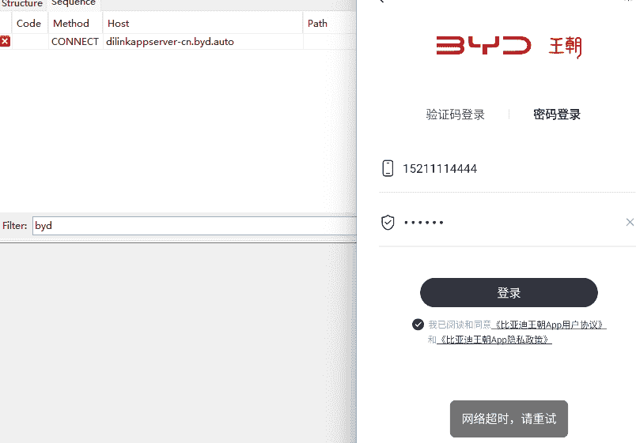

- 对应的包也是经典的 ssl pinning 报错，证明是有抓包检测的，先试试模块`JustTrustMe`，发现依旧是不行，由于抓包的时候已经知道了是 ssl 的问题，猜测可能是混淆了；
- 这里一般的方案是去找混淆的位置进行`hook`，这样会比较麻烦；这里有一个小技巧，军哥开发的算法助手有`JustTrustMe`功能，而且还是升级版，对混淆有很好的效果，如下图：

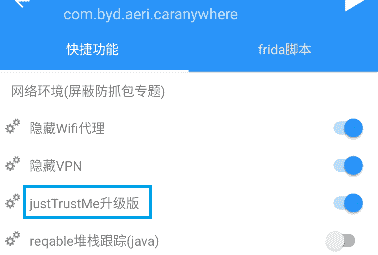

- 成功的抓到了包：

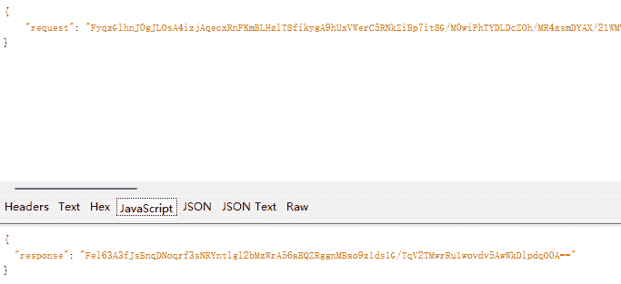

- 接下来的目标就是解决这两个被加密的数据；

### 3. 白盒AES分析

- 前面说了脱壳的方案，直接搜索`request`定位，比较好找，位置如下：

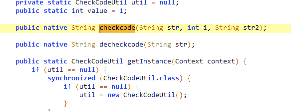

- `checkcode`应该是加密，`decheckcode`应该就是解密的方法了；对应的 so 应该是`libencrypt.so`；

- 先`hook`一下看看位置是不是正确；

```
function hook_java() {
    Java.perform(function () {
        let CheckCodeUtil = Java.use("com.bangcle.comapiprotect.CheckCodeUtil");
        CheckCodeUtil["checkcode"].overload('java.lang.String', 'int', 'java.lang.String').implementation = function (str, i, str2) {
            console.log(`CheckCodeUtil.checkcode is called: str=${str}, i=${i}, str2=${str2}`);
            let result = this["checkcode"](str, i, str2);
            console.log(`CheckCodeUtil.checkcode result=${result}`);
            return result;
        };
    })
}

hook_java()
```

- 依旧以`f`的方式启动，是没办法`attach`的；

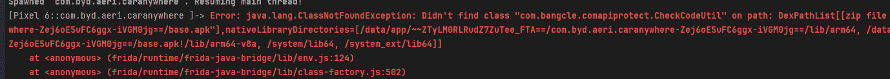

- 报错啦，经典的`classloader`问题，切换一下，脚本如下：

```
function hook_dyn_dex() {

    Java.perform(function () {

        //hook 动态加载的dex

        Java.enumerateClassLoaders({   //枚举classLoader

            onMatch: function (loader) {

                try {

                    if (loader.findClass("com.bangcle.comapiprotect.CheckCodeUtil")) {

                        console.log(loader);

                        Java.classFactory.loader = loader;      //切换classloader

                    }

                } catch (error) {

                }

            }, onComplete: function () {

            }

        });

    });

}

function hook_java() {

    Java.perform(function () {

        let CheckCodeUtil = Java.use("com.bangcle.comapiprotect.CheckCodeUtil");

        CheckCodeUtil["checkcode"].overload('java.lang.String', 'int', 'java.lang.String').implementation = function (str, i, str2) {

            console.log(`CheckCodeUtil.checkcode is called: str=${str}, i=${i}, str2=${str2}`);

            let result = this["checkcode"](str, i, str2);

            console.log(`CheckCodeUtil.checkcode result=${result}`);

            return result;

        };

    })

}

setTimeout(hook_dyn_dex, 1000)

setTimeout(hook_java, 2000)
```

- 这里稍微延迟一下，不然也会报错，虽然不影响`hook`；

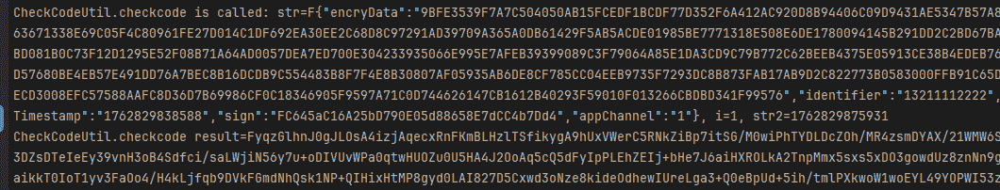

- 没有问题，位置没错，选定一组数据，后续以它为标准；

```
CheckCodeUtil.checkcode is called: str=F{"encryData":"949563ADA4143C41147A2034A9C0E8927F8574D8CBEE7C9E014DE4B25D77CB7DC360F64DA2C897655FFFCD928787B0E7585FBE259B2DB8ACA758CC689AFF470BC847187B90562F1EB65C8ED889EDBB26D6C9E2161A565A0FF79378A2868CEEF55BDC6604EDCF37C971FC389918A80412BEAB5969619A02F92CB8C8FA1EA87278AF6CD9ACD93D30F3BA46A30BCD76D74EB010A85AC8EFBE8301989DE9E65E92F152E96670000B089C7C795EA9BD5D0BBF8F789C40020BCC76809058F3F6D56FD98F21929907DF80E354BC06C9719145AFA7F83B13F59509E11A6D50DD23D99C1217C29C4818F0B48FFD487555FBF1665D928ED18DE4FC1FA4E0961C995B2C18F1C23C0357ADCE77C716A1C28C7D5CFA87EB92D862E261411B0CEDFA269A5D2BA9F9596B02567A2A2845CDB5A6D55B60F772C24B504545AD8F48A360FFEDC38F124924CB181D1F8BE9E3EE4CE04C81F2BA4C90C6974DC69DD0C6BC6BEA7FA305EF00002E8DD30A21BC96359B21659862F88A3070942C1658D3F309284684797B789FFF6CF6AB78CBA267CBE7A2251012B116FE4ABBA4CFF73F5C16C5A74F7091D46F2CFD31872D5A00CB3BA94AC1D23F1A68407AA287262060137009C7BB78C1EE7AF54AC5D0EF968024F7CDEF8CBC380734924F0B4CC01A583CC91FF50AC00DB9","identifier":"15233334444","identifierType":"0","imeiMD5":"5687F2D041BDEFD884DD468B3449004E","isAuto":"1","loginType":0,"reqTimestamp":"1762830389140","sign":"A3a36Aea92e699b378be542846c786415C60F9fa","appChannel":"1"}, i=1, str2=1762830426477
CheckCodeUtil.checkcode result=FG7zvCpTEprDTez3LK7OuzDuFk9vgIgKi4qvd2JkmB25PtXlpJ+R1e0ZVr5uQu5TY+XNWbOlisMR7LF7ZQ7CnZ6SB3/Qdzyikf78XpE1zZqenhiiLmrup1L1rjec7ixspOiceBOVhdGxBJUPPzcPPI9Hlj4ZTx2b+cRGa5vcvU3X1WnsAPsngm/moePo4oZraXVRfe59KRmhFo5eOF3lj9tQVmFgdXMyWz4GQhVALTxQ0PIzxF5wKgEL4Q1+A+UBRqcJpqBfjXS1+fofC4Zbe8SW7W63PiCkjrGYBumlwn5TuTf40ODA0woFZqi0UyhVT6kK9ofBexgyXIeJKOWfC+64MgZWrwZdbaVsQ+W/oxU1GWJ0EjjY0NrfsFiyONQ9Hvx6nKazQCAfuUHCUXeEBK2kfdiSFtA8W9dM5e7hotqnWR/08hcR7UpCX+ICk7zUSdZ2zrKB5MupwZNz8+BKpSYPfkkK+KmX4wuqTsq5mi47fIWbLtlWszDWHTWh0b4Ch/okBYcf5FDH4DWT74Hwhz3Z0GWjmDkKtprXMS8zcgUYrp1azbtSio951IoeaEXJ+umzNao2wFpsUEW/gLKUR6rqq0q+dEVrT7uzSjN3xsAJbz9naOm9wbJhDuee7a3ubrnxeHG/6yqBRTFUjONexKj+Yu4pmtINFiSZJLSv4uhmx2kdfxlJeYOyJTS0Vp6YH/686mjSYNqUufAfNmwD0k0LtZglJPTvy3XLU0HH9RA9A0I1f9wjOQQGdQDhJdcADhJHd3V1WPz0QXbu6CMqr5OGHv4KNLTvVJhbvAgjCpcjXxpYIvDSyhhsQc1IO/tkxP3AKqUyg8Tfsp8TIVKaLJ2Cma/dLgSVwshQzjJQlIB2wsvCTZeclNlW4O36UEGpfUonKlL4xt66PX8qPCZIJTWrmmPPOJ6iHS3lMi20NIpXwqz8tRlAfGJOym5eBKX9wxgTAMjPjT95+k5fwFCuWR6bYXeOGh+fOFKmBbBn8nnrFlu5wa+2pbr0dzTHSDeKBQ9fdDh8tr+Gmg/cKz7JRw5Kg0UlCBp4I24Z3BzWjXca4+7z7DKu1JLEKd05dbfkPAYBBEGxq1QRWrX/2o6kkfXr9hpebXZTUX1EpmO47d9RgNO53JYBNZjQOoCS1Z7l3a6mDJPd88tSOKFZl8NMzXm5i8zI9KleRFhZtdHIeolfYKhi8Tq56lscxBwMDalTKEINO13LJUjVYmEQFph1id7MSE+uaM2p/R2YtrqUJRmS960MdFZTDxNPechqbiXHofbKX2vimNSrQ6FTPjXM8ap9DhSMvbc0BcGy0zyA/aYblSIZnsmrp1CchWZq0Ih9nWdh4fZAJNyc3UDnf7QGuzIix3IoHAAvuB7THdc6UN9CKliuGUkcmSD3Uj03P92z1j0WXDNl2TVC+DtYSCfOynWLoZUqqJqtRQZHdjQ8BqnuV4tJIIqzDougZp0eUaFrUeIx4dJ/dHqVL3L0i2LeUQE/ihsOE2vn2hEP4tYScYijAZVevHdbOr4M+rAudusDA2dCg59Q1BAXV0bdXfNFq+rFyN1QRrQ8YJlFNsPXNXUviCWBZYypJ9UJC0Q+9v+n/UW28OVMMpznW2v5iXx72IAWmyja0VsD3IKDxZmFLbrEq3aafkTDfExJBT3Dg3dWPOt/5V7cRqj3BERzkFhRuxFqvkyzMKb4qS7IaXzb6Xj+tfnLyu+EmEcn6RLk378q1oIHA/6eqUfDSou0teaxdW4LzrqwwczYVlUjDjdoUAds9iGNHzsU2eDYuXYLHJvmXP70dwiHbgadUdyyxA2XdSNBaQk9zBEszwn+QxqvOpg4=
```

- 再去看看 so，这个样本不写主动调用，使用`unidbg`辅助分析；

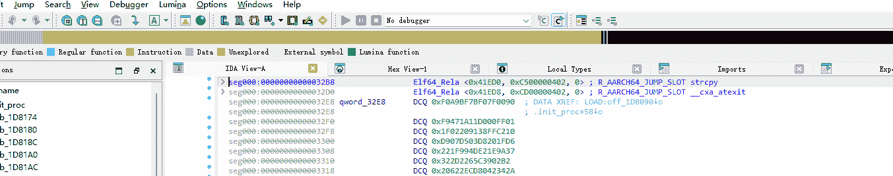

- 一眼加固，去`dump`一下，依旧一把梭；

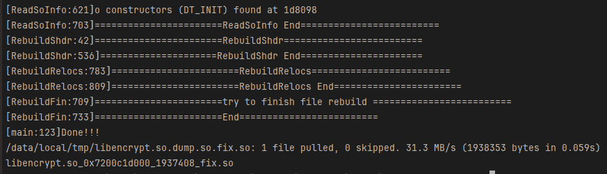

- 这里试探性的搜了一下，还真是静态注册，省事了；

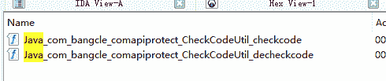

- 反编译，5000+行代码···

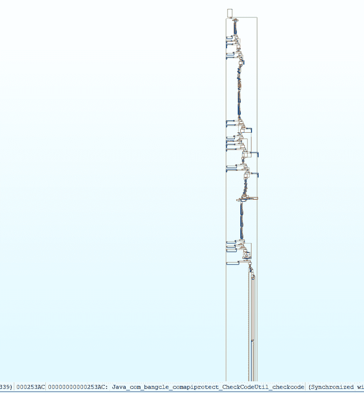

- 直接看伪代码就别想了，通过其他方式去定位数据来源吧，先模拟执行；
- 模拟执行没啥难度，补环境的代码这里也一并给出了，`maps`不补感觉也没什么关系，`call`的话是前面存的那组数据；

```
package com.Samples.byd;

import com.github.unidbg.AndroidEmulator;

import com.github.unidbg.Emulator;

import com.github.unidbg.Module;

import com.github.unidbg.arm.context.RegisterContext;

import com.github.unidbg.debugger.BreakPointCallback;

import com.github.unidbg.file.FileResult;

import com.github.unidbg.file.IOResolver;

import com.github.unidbg.linux.android.AndroidEmulatorBuilder;

import com.github.unidbg.linux.android.AndroidResolver;

import com.github.unidbg.linux.android.dvm.*;

import com.github.unidbg.linux.android.dvm.api.SystemService;

import com.github.unidbg.linux.file.SimpleFileIO;

import com.github.unidbg.memory.Memory;

import com.github.unidbg.pointer.UnidbgPointer;

import com.github.unidbg.utils.Inspector;
```


# 代码实现

```
import com.github.unidbg.virtualmodule.android.AndroidModule;

import java.io.File;

import java.util.ArrayList;

import java.util.List;

public class byd extends AbstractJni implements IOResolver {

    private final AndroidEmulator emulator;

    private final VM vm;

    private final Module module;

    @Override

    public FileResult resolve(Emulator emulator, String pathname, int oflags) {

        System.out.println("file open pathName:" + pathname);

        int pid = emulator.getPid();

        if (pathname.equals("/proc/" + pid + "/maps")) {

            return FileResult.success(new SimpleFileIO(oflags, new File("src/test/java/com/Samples/byd/file/maps"), pathname));

        }

        return null;

    }

    public byd() {

        emulator = AndroidEmulatorBuilder.for64Bit().setProcessName("com.byd.aeri.caranywhere").build();

        Memory memory = emulator.getMemory();

        memory.setLibraryResolver(new AndroidResolver(23));

        vm = emulator.createDalvikVM(new File("src/test/java/com/Samples/byd/file/比亚迪王朝v7.7.0.apk"));

        emulator.getSyscallHandler().addIOResolver(this);

        new AndroidModule(emulator, vm).register(memory);

        vm.setVerbose(true);

        vm.setJni(this);

        DalvikModule dm = vm.loadLibrary(new File("src/test/java/com/Samples/byd/file/libencrypt.so_0x7200c1d000_1937408_fix.so"), true);

        module = dm.getModule();

        dm.callJNI_OnLoad(emulator);

    }

    public static void main(String[] args) {

        byd demo = new byd();

        demo.hookMemcpy();

        ;

        String res = demo.call_checkcode();

        System.out.println("[+]主动调用result-->>" + res);

    }

    public String call_checkcode() {

        //arg list

        ArrayList list = new ArrayList<>(10);

        //jnienv

        list.add(vm.getJNIEnv());

        //jclazz

        list.add(0);

        //str1  参数1

        StringObject str1 = new StringObject(vm, "F{\"encryData\":\"949563ADA4143C41147A2034A9C0E8927F8574D8CBEE7C9E014DE4B25D77CB7DC360F64DA2C897655FFFCD928787B0E7585FBE259B2DB8ACA758CC689AFF470BC847187B90562F1EB65C8ED889EDBB26D6C9E2161A565A0FF79378A2868CEEF55BDC6604EDCF37C971FC389918A80412BEAB5969619A02F92CB8C8FA1EA87278AF6CD9ACD93D30F3BA46A30BCD76D74EB010A85AC8EFBE8301989DE9E65E92F152E96670000B089C7C795EA9BD5D0BBF8F789C40020BCC76809058F3F6D56FD98F21929907DF80E354BC06C9719145AFA7F83B13F59509E11A6D50DD23D99C1217C29C4818F0B48FFD487555FBF1665D928ED18DE4FC1FA4E0961C995B2C18F1C23C0357ADCE77C716A1C28C7D5CFA87EB92D862E261411B0CEDFA269A5D2BA9F9596B02567A2A2845CDB5A6D55B60F772C24B504545AD8F48A360FFEDC38F124924CB181D1F8BE9E3EE4CE04C81F2BA4C90C6974DC69DD0C6BC6BEA7FA305EF00002E8DD30A21BC96359B21659862F88A3070942C1658D3F309284684797B789FFF6CF6AB78CBA267CBE7A2251012B116FE4ABBA4CFF73F5C16C5A74F7091D46F2CFD31872D5A00CB3BA94AC1D23F1A68407AA287262060137009C7BB78C1EE7AF54AC5D0EF968024F7CDEF8CBC380734924F0B4CC01A583CC91FF50AC00DB9\",\"identifier\":\"15233334444\",\"identifierType\":\"0\",\"imeiMD5\":\"5687F2D041BDEFD884DD468B3449004E\",\"isAuto\":\"1\",\"loginType\":0,\"reqTimestamp\":\"1762830389140\",\"sign\":\"A3a36Aea92e699b378be542846c786415C60F9fa\",\"appChannel\":\"1\"}");

        list.add(vm.addLocalObject(str1));

        //int 参数2

        list.add(1);

        //str2 参数3

        StringObject str2 = new StringObject(vm, "1762830426477");

        list.add(vm.addLocalObject(str2));

        Number number = module.callFunction(emulator, 0x253ac, list.toArray());

        StringObject res = vm.getObject(number.intValue());

        return res.toString();

    }

    @Override

    public DvmObject callStaticObjectMethod(BaseVM vm, DvmClass dvmClass, String signature, VarArg varArg) {

        switch (signature) {

            case "android/app/ActivityThread->currentActivityThread()Landroid/app/ActivityThread;": {

                return dvmClass.newObject(null);

            }

            case "android/os/SystemProperties->get(Ljava/lang/String;Ljava/lang/String;)Ljava/lang/String;": {

                String arg0 = varArg.getObjectArg(0).getValue().toString();

                String arg1 = varArg.getObjectArg(1).getValue().toString();

                System.out.println(arg0 + "====" + arg1);

                if (arg0.equals("ro.serialno")) {

                    return new StringObject(vm, "unknown");

                }

                return new StringObject(vm, "");

            }

        }

        return super.callStaticObjectMethod(vm, dvmClass, signature, varArg);

    }

    @Override

    public DvmObject callObjectMethod(BaseVM vm, DvmObject dvmObject, String signature, VarArg varArg) {

        switch (signature) {

            case "android/app/ActivityThread->getSystemContext()Landroid/app/ContextImpl;": {

                return vm.resolveClass("android/app/ContextImpl").newObject(null);

            }

            case "android/app/ContextImpl->getPackageManager()Landroid/content/pm/PackageManager;": {

                DvmClass clazz = vm.resolveClass("android/content/pm/PackageManager");

                return clazz.newObject(signature);

            }

            case "android/app/ContextImpl->getSystemService(Ljava/lang/String;)Ljava/lang/Object;": {

                StringObject serviceName = varArg.getObjectArg(0);

                assert serviceName != null;

                System.out.println(serviceName.toString());

                return new SystemService(vm, serviceName.getValue());

            }

            case "android/net/wifi/WifiManager->getConnectionInfo()Landroid/net/wifi/WifiInfo;": {

                return vm.resolveClass("android/net/wifi/WifiInfo").newObject(null);

            }

            case "android/net/wifi/WifiInfo->getMacAddress()Ljava/lang/String;": {

                return new StringObject(vm, "da:c4:13:ef:95:aa");

            }

        }

        return super.callObjectMethod(vm, dvmObject, signature, varArg);

    }

    @Override

    public DvmObject getStaticObjectField(BaseVM vm, DvmClass dvmClass, String signature) {

        switch (signature) {

            case "android/os/Build->MODEL:Ljava/lang/String;": {

                return new StringObject(vm, "Pixel");

            }

            case "android/os/Build->MANUFACTURER:Ljava/lang/String;": {

                return new StringObject(vm, "Google");

            }

            case "android/os/Build$VERSION->SDK:Ljava/lang/String;": {

                return new StringObject(vm, "31");

            }

        }

        return super.getStaticObjectField(vm, dvmClass, signature);

    }

    private void hookMemcpy() {

        emulator.attach().addBreakPoint(module.base + 0x1A0EC);

        emulator.attach().addBreakPoint(module.findSymbolByName("memcpy").getAddress(), new BreakPointCallback() {

            @Override

            public boolean onHit(Emulator emulator, long address) {

                RegisterContext context = emulator.getContext();

                int len = context.getIntArg(2);

                UnidbgPointer pointer1 = context.getPointerArg(0);

                UnidbgPointer pointer2 = context.getPointerArg(1);

                UnidbgPointer pointer3 = context.getLRPointer();

                Inspector.inspect(pointer2.getByteArray(0, len), "dest " + Long.toHexString(pointer1.peer) + " src " + Long.toHexString(pointer2.peer) + " lr " + Long.toHexString(pointer3.peer));

                return true;

            }

        });

    }

}
```

## 分析说明

- 环境没有什么难度，在执行之前我比较习惯把`memcpy`给hook上，这是一个良好的习惯，在这个样本尤其体现出来；
- 另外，在执行之前需要说几个点，首先，结果的开头 `F` 是一个固定的，而且是额外拼接的；
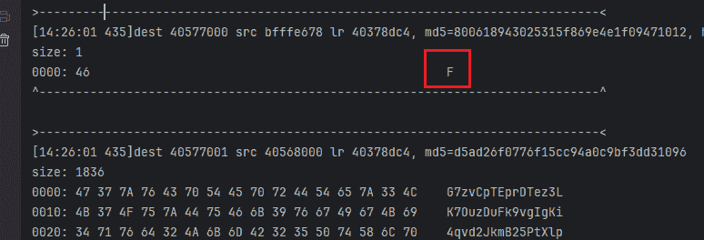
- `memcpy`也是可以证明这一点的，接下来开始找数据源从哪里来的；去`traceWrite` 40568000位置，这个地址的来源是上图的`src`；


# BYD 白盒 AES 分析

## 定位写入与打印结果

```
emulator.traceWrite(0x40568000, 0x40568000 + 2);
```

- 去看看打印结果；

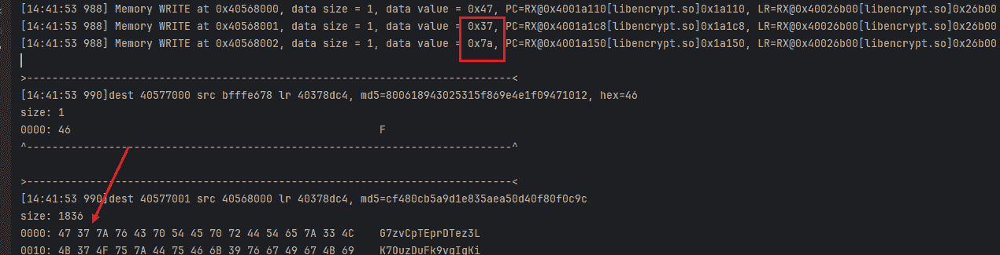

- 位置对了，这里去看 `pc` 处的偏移 `0x1a150`；

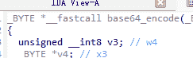

- 发现它在一个 `base64_encode` 函数，那就是最后做了一次 base64 编码，那我们手工解码回去；

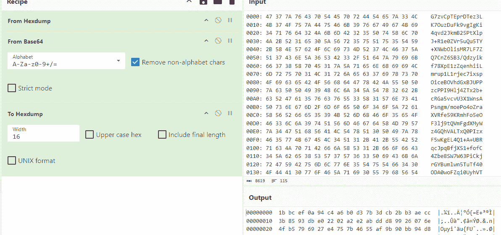

- 记住解码的结果，在分析的时候可以截个小图留在置顶方便分析；这里去看看 base64 传进来的是不是我们手工解码的数据，如果一直就证明它是标准的；

## 定位 AES 数据来源

```
emulator.attach().addBreakPoint(module.base + 0x1A0EC);
```

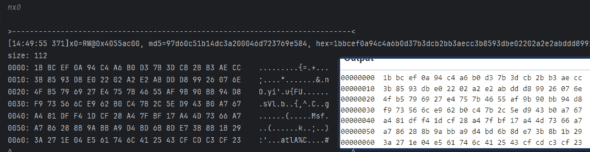

- 确实是标准的，所以现在的目标变成了找 `1b bc ef` 这一段怎么来的，继续 `traceWrite`，地址就是 `0x4055ac00`；

```
emulator.traceWrite(0x4055ac00, 0x4055ac00 + 2);
```

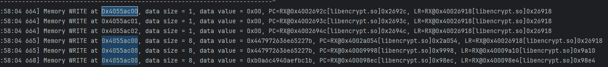

- 数据并不匹配，但是可以去看看 `0x98ec`；

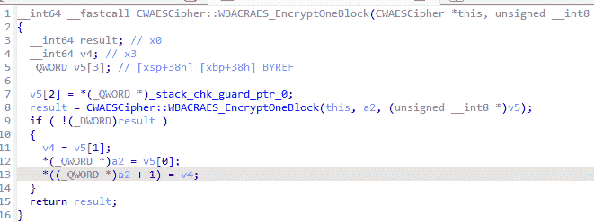

- 之所以要来看就是因为有符号提示你，本身猜测就是对称加密，这里就大概可以心里有点底了；

- 那 `1b bc ef` 可能就是 aes 加密的结果；

- `WBACRAES_EncryptOneBlock` 这个函数有些问题，找一下上图函数的交叉引用，它也叫 `WBACRAES_EncryptOneBlock`；

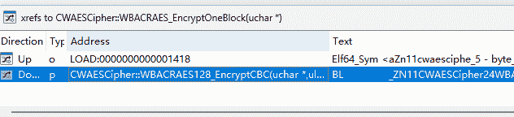

- 这里有关键性的提示，到这里我们先不着急，汇总一下已知的情况；

- `aes128`、`cbc`、白盒；

- 正常来说我们需要找 `key` 和 `iv`，白盒的话相对来说就不是正常的方法去找；

- 继续接着上面往下说，要确定走没走，`hook` 一下就知道了；

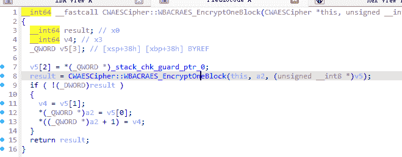

## 分析 WBACRAES_EncryptOneBlock

```
emulator.attach().addBreakPoint(module.base + 0x98B4);
```

- 这里肯定是找明文嘛，`x1` 寄存器就是明文；

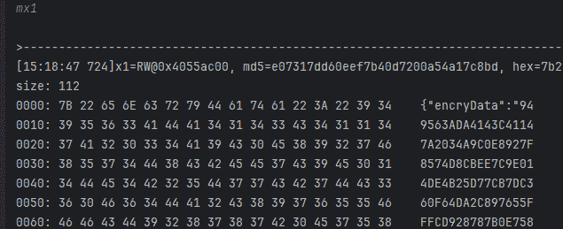

- `hook` 到了证明确实走了，那就继续往下跟，去看里面的 `CWAESCipher::WBACRAES_EncryptOneBlock`，它的偏移是 `9894`，它也是走了的，但是函数实现比较可怜；

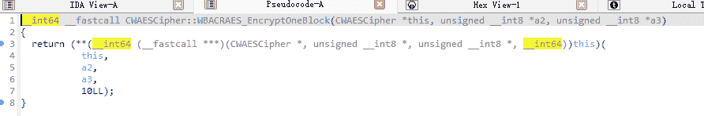

- 这种情况伪代码是不方便看了，那就去看汇编；

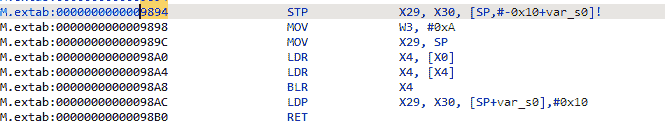

- 代码就几条，就不翻译了，`BLR` 就是跳转，那我们就去 inline hook 一下，看看 `x4` 的值是多少，就是对应的函数调用；

```
emulator.attach().addBreakPoint(module.base + 0x98A8);
```

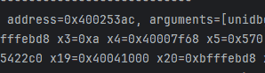

- 对应的地址是 `0x7f68`，跳过去看看；

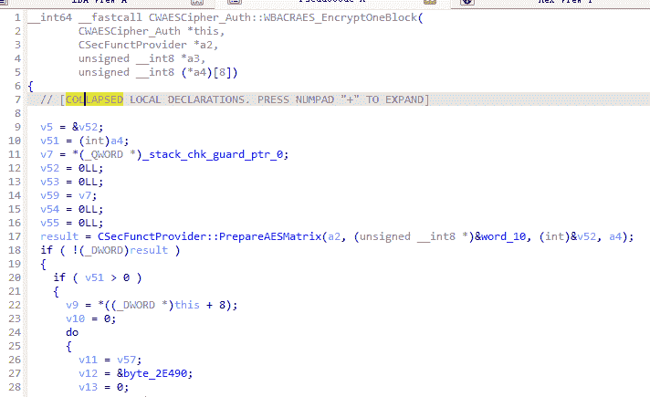

- 这就是它真正调用的位置了，读者可以 `hook` 验证，是没问题的；

- 接下来分析这个函数就行，最终的目的是 `dfa` 攻击，先看 `PrepareAESMatrix` 函数；

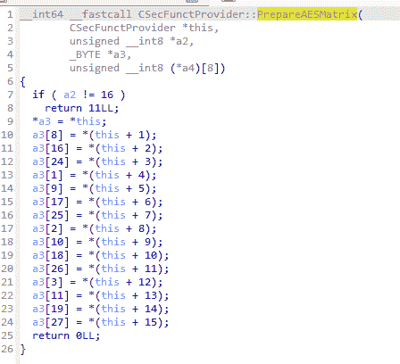

- 这个函数应该是一个矩阵 `state` 化的函数，应该说是一个矩阵准备函数，我们来验证一下；

- 这里的 `a3` 就是最后的矩阵，`hook` 的时候去看 `x2` 寄存器；

```
emulator.attach().addBreakPoint(module.base + 0x70E4);
```

- 这里需要注意，`x2` 直接看是得不出什么结论的，函数执行结束的时候再看，按 `blr` 下断点到 `lr` 寄存器，然后按 `c` 执行完成之后通过 `x2` 的值去读内容；这里切记是读地址而不是 `mx2`；

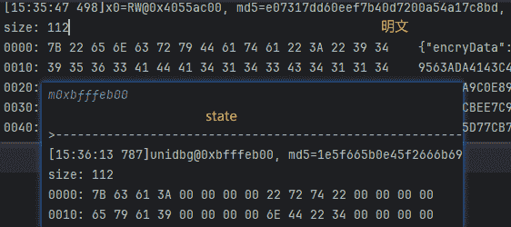

- 直接看可能看着有点模糊，我稍微修剪一下；

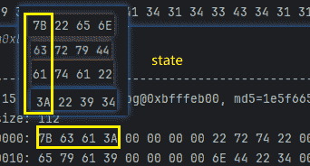

- 这样就直观多了，`0xbfffeb10` 就是 `state` 的地址；这个地址后续会和 `key` 进行初始轮密钥加，但是在开始之前它应该要喝 `iv` 进行异或，所以这里的值应该是异或之后的结果才对；并且我们知道，0 和其他数据异或，依旧是本身，这是一个特性，我们暂且猜测是这样；

## 定位 PrepareAESMatrix 与 state

- `dfa` 需要这样几个因素：找轮数、找 `state`、找时机；

- 轮数和时机可以看作一体，目标是最后两次列混淆之间进行就行，看下图就明白了；

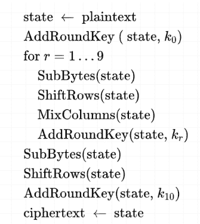

- 也就是说：第 8 次的轮密钥加和第 9 次的字节代换和第 9 次的循环左移这三个时机均可；

- 再就是找 `state`，这个前面刚刚说过；再看整体的轮次；

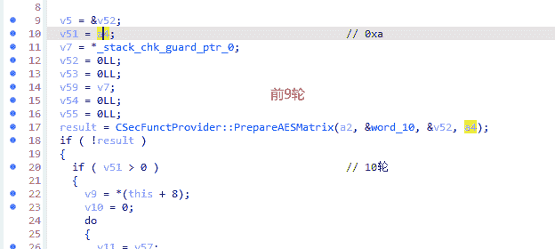

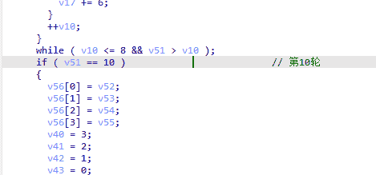

- 接下来就可以进行 `dfa` 了，找到一个合适的时机；这个读者可以随意选择，只要是在第一张图的 9 轮里里面就可以，先看看循环次数；这里有个点需要注意，明文记得改一下，否则分组次数太多了，我这里改的是 `hello`；

```
   public void call_dfa(){
        Debugger debugger = emulator.attach();
        debugger.addBreakPoint(module.base+0x7ffc,new BreakPointCallback() {
            UnidbgPointer pointer;
            int num = 1;                    //m0xbfffeb10
            @Override
            public boolean onHit(Emulator emulator, long address) {
                pointer = UnidbgPointer.pointer(emulator, 0xbfffeb10L); // state
                System.out.println("num->"+num);

                num+=1;
                return true;
            }

        });

    }
```

- 没问题，次数是合理的；

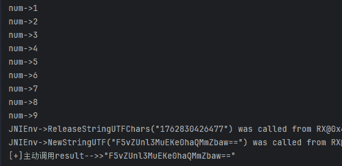

- 这里需要注意，万事俱备，但并没有所有事情都准备好，比如我们要看的是 aes 的结果，所以还需要额外写上一个看 aes 结果的 `hook`，这个无所谓哪个方法，只要能 `hook` 到 aes 的输出就可以，也可以参照我的代码写；

- 先看一次注入的结果，这里先不给 `dfa` 的代码：

```
正常：E6F6549E 5DCCB842 9ED21690 32665B6B

dfa：E6F6419E 5D6DB842 14D21690 32665BAF
```

## DFA 注入与故障密文

- 可以发现，异常出现在四个字节，这就是一个良好的故障密文，这个具体可以去看 `dfa` 的原理；接下来就是大量获取故障密文；

```
public static void main(String[] args) {
    byd demo = new byd();
    //        demo.hookMemcpy();
    for (int i = 0; i >" + res);
}

public static int randint(int min, int max) {
    Random rand = new Random();
    return rand.nextInt((max - min) + 1) + min;
}

public void call_dfa() {
    Debugger debugger = emulator.attach();
    debugger.addBreakPoint(module.base + 0x7ffc, new BreakPointCallback() {
        UnidbgPointer pointer;
        int num = 1;                    //m0xbfffeb10

        @Override
        public boolean onHit(Emulator emulator, long address) {
            pointer = UnidbgPointer.pointer(emulator, 0xbfffeb10L); // state
            //                System.out.println("num->" + num);
            if (num % 9 == 0) {
                Random random = new Random();
                int randomLine = random.nextInt(4); // 生成 0 到 3 之间的随机数
                int randnum = randint(0, 255);
                pointer.setByte(randint(0, 15), (byte) randnum); //随机注入
            }
            num += 1;
            return true;
        }
    });
}

public void HookByConsoleDebugger() {
    Debugger debugger = emulator.attach();
    debugger.addBreakPoint(module.base + 0x98b4, new BreakPointCallback() {
        int num = 0;

        @Override
        public boolean onHit(Emulator emulator, long address) {
            RegisterContext context = emulator.getContext();
            num += 1;
            long x1 = emulator.getBackend().reg_read(Arm64Const.UC_ARM64_REG_X1).longValue();
            emulator.attach().addBreakPoint(context.getLRPointer().peer, new BreakPointCallback() {
                @Override
                public boolean onHit(Emulator emulator, long address) {
                    if (num == 1) {
                        Backend backend = emulator.getBackend();
                        byte[] bytes = backend.mem_read(x1, 0x10);
                        StringBuilder hexString = new StringBuilder();
                        for (byte b : bytes) {
                            hexString.append(String.format("%02X", b & 0xFF));
                        }
                        System.out.println(hexString);
                    }
                    return true;
                }
            });
            return true;
        }
    });
}
}
```

- 打印密文之前把输出都取消掉，方便后续复制；

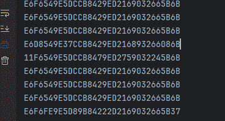

## 使用 phoenixAES 进行 DFA

- 我这里是跑了 30 次，拿去 `dfa`，这里要用到 `phoenixAES` 这个库，`pip` 即可；

```
import phoenixAES

with open('data','wb') as f:

    f.write("""

E6F6549E5DCCB8429ED2169032665B6B

E6F6549E5DCCB8429ED2169032665B6B

E6F6549E5DCCB8429ED2169032665B6B

E6F6549E5DCCB8429ED2169032665B6B

E6D8549E37CCB8429ED216893266086B

11F6549E5DCCB8479ED2759032245B6B

E6F6549E5DCCB8429ED2169032665B6B

E6F6549E5DCCB8429ED2169032665B6B
```


```
E6F6549E5DCCB8429ED2169032665B6B
E6F6FE9E5D89B84222D2169032665B37
E69F549EDACCB8429ED216B832662A6B
E6F6549E5DCCB8429ED2169032665B6B
E6F6549E5DCCB8429ED2169032665B6B
E68B549EE2CCB8429ED2168532664D6B
E609549E5FCCB8429ED216843266386B
E6F6549E5DCCB8429ED2169032665B6B
E6F6549E5DCCB8429ED2169032665B6B
94F6549E5DCCB8D09ED20F9032AA5B6B
E6F6549E5DCCB8429ED2169032665B6B
E6F6545B5DCCC9429EFA169022665B6B
E6F6549E5DCCB8429ED2169032665B6B
E6F6549E5DCCB8429ED2169032665B6B
E6F6549E5DCCB8429ED2169032665B6B
E6F6549E5DCCB8429ED2169032665B6B
E6B2549E8BCCB8429ED2161A3266F96B
E6F654435DCCC6429E011690CA665B6B
1CF6549E5DCCB8829ED2089032545B6B
E6F6549E5DCCB8429ED2169032665B6B
E6F6549E5DCCB8429ED2169032665B6B
E6F6829E5D62B842A2D2169032665B75
E6F6549E5DCCB8429ED2169032665B6B""".encode())

phoenixAES.crack_file('data', [], True, False, 3)
```

- 结果如下：

  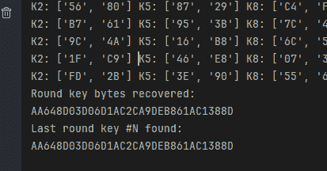

- 所以`k10`就是：`AA648D03D06D1AC2CA9DEB861AC1388D`；如果这里没推导出来就说明注入位置太单一了，换位置注入就好；

- 这还只是`k10`，最初的`key`应该是`k0`，这个也有工具可以实现；

项目地址：[//github.com/SideChannelMarvels/Stark](https://github.com/SideChannelMarvels/Stark:https)

- 里面有一个`aes_keyschedule.c`文件，将其拷贝到本地并编译为可执行文件就可以使用命令行：

  ```
  gcc aes_keyschedule.c -o WhiteBoxAes
  ```

- 使用方式跟上秘钥和轮数就好；

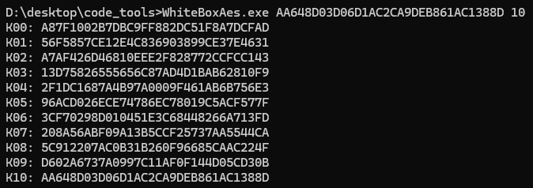

- 初始的`key`就是：`A87F1002B7DBC9FF882DC51F8A7DCFAD`；结合之前分析的`iv`应该是全0，去测试一下；

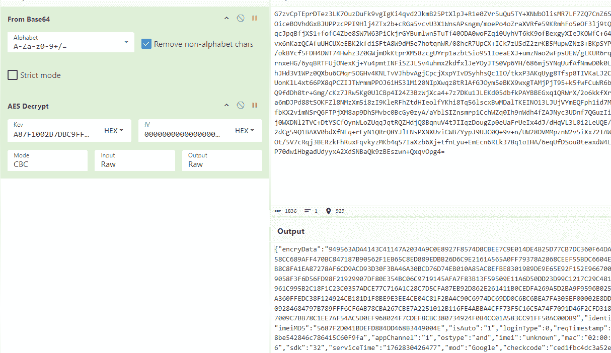

- 响应也是正常解密的；

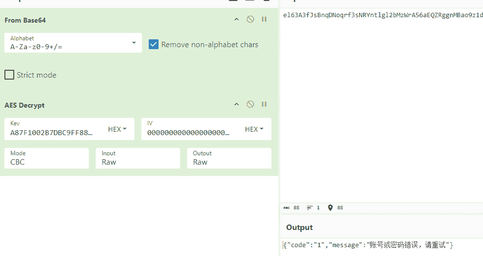

## 4. 总结

- 白盒AES的分析大概就是这么多，几百个字实际上分析起来没那么简单，还是花费了不少时间，你能独立把秘钥找出来白盒aes就基本不是难事了；

- 另外，参数里有大量未知数据，还有个不知道哪来的`checkcode`，看着像`md5`，感兴趣的读者可自行去分析；我不想再看了；

- 整体的逻辑可能不是特别通顺，毕竟分析的时候踩坑了到了写文章却会直奔正确答案，多多担待；

- by：2025-11-11；
