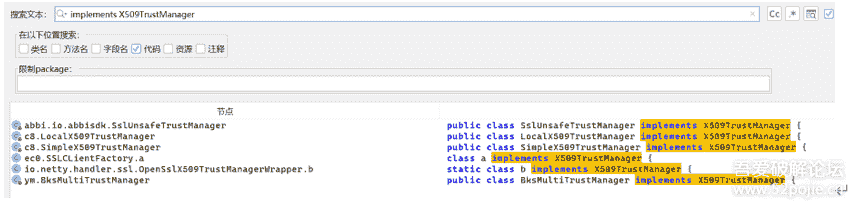
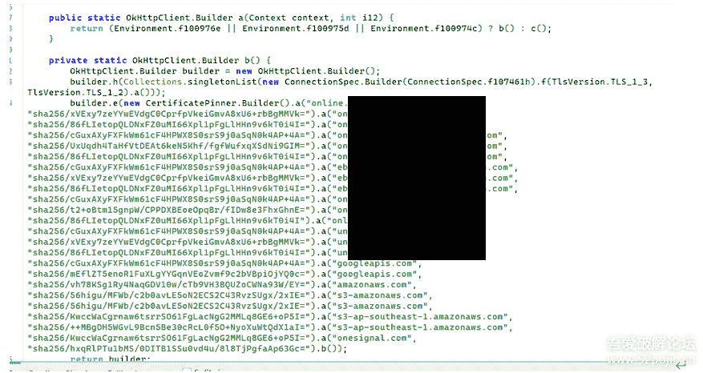
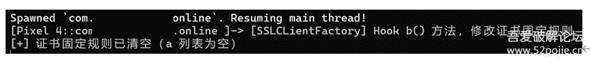

# [Android 原创] 记一次 SSL Pinning 绕过

- 原帖: https://www.52pojie.cn/forum.php?mod=viewthread&tid=2072499
- 抓取时间: 2026-11-01T13:52:40.060Z

目标APP：某海外金融APP。
工具链：Google pixel4真机、`Fiddler`、`JADX`、`Frida`。

## Frida 抓包分析


得到 2 个信息：
1. 能正常转发目标APP的流量，说明APP没用禁用系统代理。
2. 目标APP流量没用被解密，说明证书不被信任。

## 反编译分析

用 `JADX` 反编译目标 APK，搜索 `implements X509TrustManager`：



一共实现了 6 种自定义 `X509TrustManager`，暂时不知道启用的哪个，进入 `ec0.SSLClinentFactory` 类，该类会配置准备启用的 `X509TrustManager`。



可以看到并没有启用任何一个 `X509TrustManger`，而是使用 `Certificate Pinning` 来做证书校验，对关键域名启用了证书锁定。

## Frida 绕过脚本

编写 Frida 脚本如下：

```javascript
function main() {
    Java.perform(function () {
        const SSLCLientFactory = Java.use("ec0.a");
        const CertificatePinnerBuilder = Java.use("okhttp3.CertificatePinner$Builder");
        const JavaCollection = Java.use("java.util.Collection");

        SSLCLientFactory.b.implementation = function () {
            console.log("[SSLCLientFactory] Hook b() 方法，修改证书固定规则");

            // 获取原始 Builder
            let originalBuilder = this.b();

            // 获取原 CertificatePinner.Builder
            const field = originalBuilder.getClass().getDeclaredField("v");
            field.setAccessible(true);
            let certPinnerBuilder = field.get(originalBuilder);

            // 3. 获取 Builder 内部存储规则的列表 a
            const pinListField = certPinnerBuilder.getClass().getDeclaredField("a");
            pinListField.setAccessible(true);
            let pinList = pinListField.get(certPinnerBuilder);
            // 4. 清空列表

            const javaList = Java.cast(pinList, JavaCollection);
            javaList.clear();
            console.log("[+] 证书固定规则已清空（a 列表为空）");

            return originalBuilder;
    };
});
}

setImmediate(main);
```

运行脚本：



成功捕获到解密之后的登录数据包。


