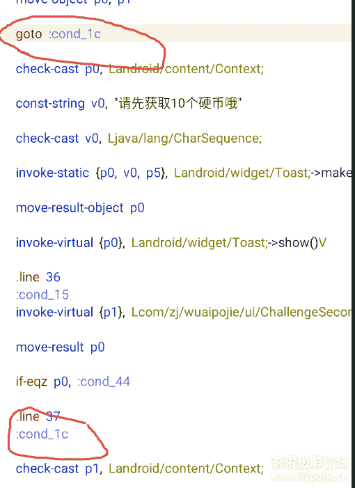
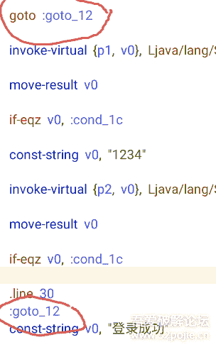
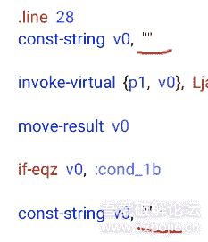
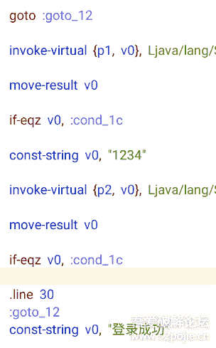
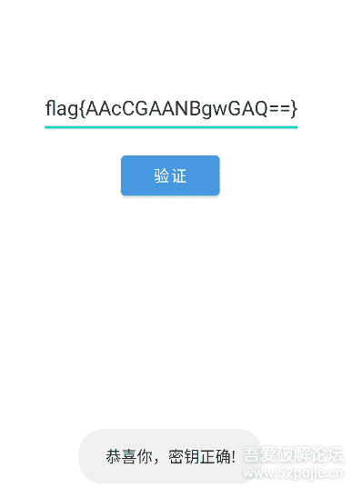
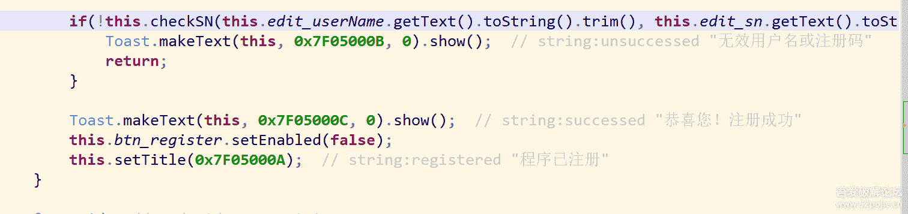
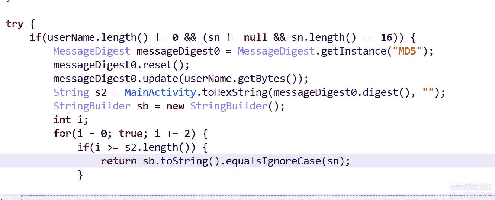
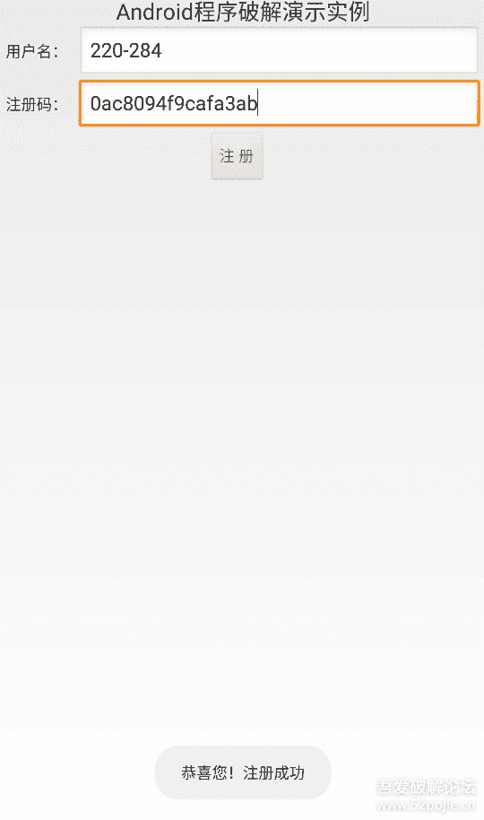

# [Android 原创] 关于安卓逆向的学习日记------（一）

- 原帖：<https://www.52pojie.cn/forum.php?mod=viewthread&tid=2073795>
- 抓取时间：2026-11-01T13:52:19.278Z

本贴主要记录学习安卓逆向遇到的问题和思考

（ps：主要是克服本人三分钟热度，怕坚持不下去。。。

）

## 一：在这里感谢大佬的学习分享《安卓逆向这档事》三、初识smali，vip终结者

<https://www.52pojie.cn/thread-1701353-1-1.html>

（出处：吾爱[破解](https://www.52pojie.cn/)论坛）

这是关于`goto`强制跳转的应用

作业---我也是通过强制跳转避开账号和密码的双重验证

第二种方法：登录验证是通过对比数据是否相同，因为smile里直接有数据，所有我把数据设为空（ps：方法很多）

## 二：《安卓逆向这档事》四、恭喜你获得广告&弹窗静默卡

<https://www.52pojie.cn/thread-1706691-1-1.html>

（出处：[吾爱破解](https://www.52pojie.cn/)论坛）

在教程demo中大佬直接将xml中的`versioncode`：1改为2，我不知道为什么要改为2，为什么不能是3，4，5。。。还是其他，于是我开始寻找答案

### 1. 我搜索关键字`versioncode`

`ui`应该表示交互界面，用户能看到，并且`getversioncode`直译为获取版本号，然而我与版本号有关的线索

我想了想，一号广告，二号广告不就是第三关的嘛，我关注到了新线索`checkUpdate`，因为一号广告是在二号之前的，`checkUpdate`也应该在一号广告之前

可以看到这两个判断语句，再联系一下上下文，ok搞定

## 三：这节主要学习`jde`调试

（ps：《安卓逆向这档事》五、1000-7=？&动态调试&`Log`插桩 <https://www.52pojie.cn/thread-1714727-1-1.html>（出处：吾爱破解论坛））

主要讲解课后题目：首先将课程demo导入`jde`，并快速搜索注册码

（图一）

转为java后可以看到如果要输出注册成功必须使`if`语句判定为0，即`checkSN`判定为1，转到`checkSN`

- 对`userName`进行 MD5 加密，得到 32 位十六进制字符串（`s2`）；
- 从32位的`s2`中每隔 1 位取一个字符（取索引 0、2、4...30 的字符），拼接成一个 16 位字符串；
- 若该 16 位字符串与`sn`忽略大小写相等，则返回`true`。

理解代码后答案很明显就是用户名md5加密取奇数项（ps：断点没找到，主要是没注意到`v5`是可以展开的

）

我想问一下就是有没有方法能够在（图一）不修改代码的情况下时跳过`if`语句判断，直接注册成功？
