# [Android 原创] 他x星qiu算法分析

- 原帖: https://www.52pojie.cn/forum.php?mod=viewthread&tid=2074694
- 抓取时间: 2026-11-01T13:52:00.533Z

## 他x星qiu算法分析

### 1. 概述

> 版本：1.8.7 分析的时候是最新版

包名：`com.xinhe.tataxingqiu`

加固：未加固

接口：`/ugctastar/recommend/home/feed`

- 首先，样本来源于我的好朋友，这里不能打广告就不提id了，他发的一篇文章里讲了这个样本的一部分算法，我在抓包的时候发现有另外的算法，可能是版本更新了的原因，于是我分析了这个算法，在此表达感谢；
- 首先，`jadx`这里使用的是1.5以上的版本，太低了反编译有些问题，如果读者复现有问题请切换版本；
- 目标的字段包括：请求头`access_token`、请求体、响应体；
- 整体算法其实还挺麻烦，还不止一套，不同的接口算法有区别，时间充裕我会尽量多写，相信你看完应该会有所收获；
- 文字太多我并不能保证每一步都记录，因为我不是边做边写的，分析完我才写的文章，若有不明白的可留言询问或者自己思考；

### 2. 抓包与定位

- 样本依旧没有防护，直接抓包就行，接口触发条件如下图(页面最下方导航栏选派对后选广场)：
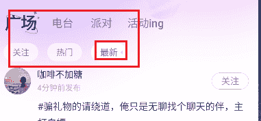
- 如果你要复现请跟我选择一样的接口，因为不同的接口可能不是一个`native`方法；
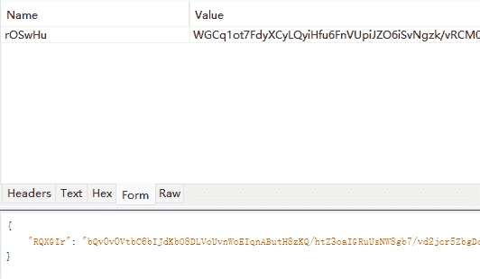
- 引入眼帘的就是两处加密位置，目标就是解密；
- 定位可以直接搜索，但这里使用另一种方案，hook `HashMap`的`put`方法来定位，脚本如下：

```
function showStacks() {
    console.log(
        Java.use("android.util.Log")
            .getStackTraceString(
                Java.use("java.lang.Throwable").$new()
            )
    );
}

function hook_hashmap(){
    Java.perform(function () {
    var hashMap = Java.use("java.util.HashMap");
    hashMap.put.implementation = function (a, b) {
        // 键名
        if(a.equals("rOSwHu")){
            showStacks();
            console.log("hashMap.put: ", a, b);
        }
        return this.put(a, b);
    }
})
}

function main() {
    hook_hashmap()
}

main()
```

`java.lang.Throwable`
        at java.util.HashMap.put(Native Method)
        at com.qsmy.business.httpnew.AppGlobalHttpRequestManager.b(SourceFile:62)
        at com.qsmy.business.httpnew.AppGlobalHttpRequestManager.d(SourceFile:101)
        at com.qsmy.business.http.HttpRequestKtx.a(SourceFile:72)
        at com.qsmy.business.http.HttpRequestKtx.b(SourceFile:97)
        at com.qsmy.business.http.HttpRequestKtx.c(SourceFile:45)
····
        at java.lang.reflect.Method.invoke(Native Method)
        at com.android.internal.os.RuntimeInit$MethodAndArgsCaller.run(RuntimeInit.java:548)
        at com.android.internal.os.ZygoteInit.main(ZygoteInit.java:1003)

`hashMap.put`:  `rOSwHu` `LBEsllmpGrBvOEUIDobybC/f·····vIFq5oMgakVoLfmiO7esQ==`

- 一些内容我就删去了，免得占太多篇幅，这里你还可以看到另一套算法，如果你时机把握不是很精准的话；
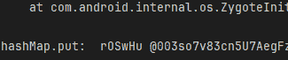
- 这个后续如果有时间我也会提，先看目标；直接去找堆栈的上层；
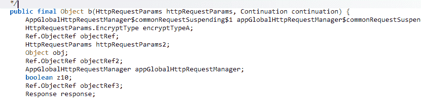
- 就是这个 `b` 方法，它非常长，但是往下找可以找到关键点；
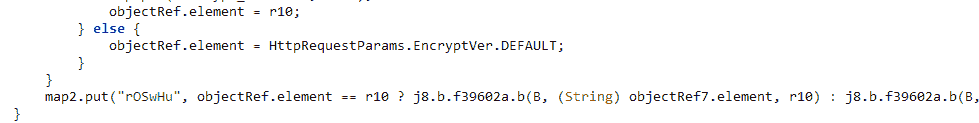
- 它就是从这里调用的，这一行也很长，拿下来看看；

```
map2.put("rOSwHu", objectRef.element == r10 ? j8.b.f39602a.b(B, (String) objectRef7.element, r10) : j8.b.f39602a.b(B, "", HttpRequestParams.EncryptVer.DEFAULT));
```

- 要么走前面要么走后面，这里走的是前面，其实都差不多，再点进去；
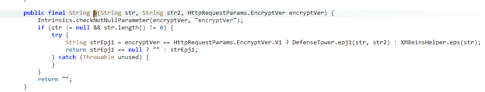
- 这里就能看出来应该有两套算法，目标的接口是前者，后者就是前面提到的有`@`开头的算法，这个简单很多；
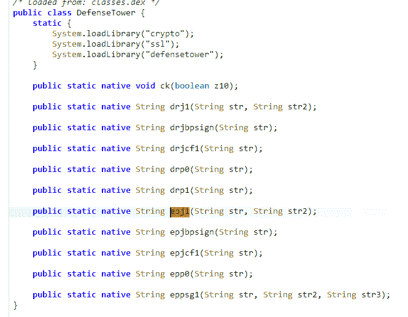
- 到这里定位就完毕了，后续还会用到`jadx`，先别关；
- 另外我想要提几句，最开始我使用的是1.4左右的版本，搜索发现有匹配但是定位到的是另一个算法为位置，就是这里；
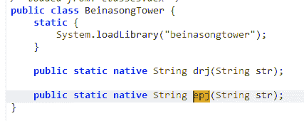
- 按照一般的想法其实就是`hook`验证了，我也一样，但是总是不对劲，后续我才使用了其他的定位方法；本来搜索也可以的，但是对应的`b`方法反编译失败了，自然也就搜不到对应的字符串，所以这里给读者建议就是多备几个版本，它们之间的反编译能力可能真的有很大的差别；

### 3. 算法分析

#### 3.1 请求体分析

- 第一步自然是`hook`了，此样本只使用`frida`；

```
function hook_epj1() {
    Java.perform(function () {
        let com_defense_pristine_DefenseTower = Java.use("com.defense.pristine.DefenseTower");
        com_defense_pristine_DefenseTower["epj1"].implementation = function (str, str2) {
            console.log("hook_epj1 str->", str)
            console.log("hook_epj1 str2->", str2)
            var retval = this["epj1"](str, str2);
            console.log(`[
```

- 去触发接口看看；

```
hook_epj1 str-> {"appverint":"010807","country":"xxx","devicebrand":"google","appversint":"","city":"xxx","timezone":"8","appver":"1.8.7","lt":"RDlHVERGZVRBVnJkZXVJWmYxZDJYQno3THFlY3g5c3l5aDdtSkdaNGgvTViTmttTis2VHdFUldTY0FZVVBRRGFxSTRvOTJYRkpoa2VueGNIQ3o0dDh6a3Fud0dkckVwaFI5czNEZ21LTlBJNS8yRzlnNHg3eExLYVRpdmplRExDS1lnaFpWMGltMUw3d3UvTUlVWGg5TWttQnF0Z0dlSTUvZjlFM2w3Y09YdUhrRVJXNjlnbUVaNU9lN0VlYXRYTkZiRHNvaURNS0wwVlRvZlk0dz09","srcinfo":"","apptypeid":"100139","network":"wifi","srcplat":"","istourist":"0","province":"广东","aaid":"","accid":"e2ce08d35b77ab801vE0V3","obatchid":"5fefbd2fbb0cb369","srcqid":"","lang":"zh-Hans","pixel":"1080*2240","appcqid"txyyb","oaid":"","userinfo":"{\"hmosver\":\"\",\"bd\":\"\",\"sys_lang\":\"zh\",\"sys_region\":\"CN\",\"regts\":\"1761722501\",\"lastinstall\":\"1763633184\",\"sex\":\"1\",\"sys_currency\":\"¥\\\/CNY\",\"usertype\":\"3\",\"hmos\":\"\",\"lang_region\":\"zh_CN_#Hans\",\"appsubid\":\"\"}","refqid":"","googleid":"","os":"Android","systemlanguage":"zh","deviceid":"ecb7068b6c7a50fd","appvers":"","appqid":"txyyb251120","muid":"","isyueyu":"0","imei":"","position":"广东","osversion":"12","region":"中国","device":"Pixel 6","ts":"1763694676"}
hook_epj1 str2-> z56DGMLfoGy9DerTFdEKn0OZQK6XTEyNctZ-ouRXwfU
[
```

- 返回值我截断了，这里意义不大的，参数的话有敏感信息，我也用`xxx`替代了，参数1应该就是明文，参数2暂时未知，写一个主动调用看看；里面的参数我也脱敏了；

```
function call_epj1() {
    Java.perform(function () {
        let DefenseTower = Java.use("com.defense.pristine.DefenseTower");
        let str1 = '{"appverint":"010807","country":"xx区","devicebrand":"google","appversint":"","city":"xx","timezone":"8","appver":"1.8.7","lt":"RDlHVERGZVRBVnJkZXVJWmYxZDJYQno3THFlY3g5c3l5aDdtSkdaNGgvTi9GQ3ViTmtVHdFUldTY0FZVVBRRGFxSTRvOTJYRkpoa2VueGNIQ3o0dDh6a3Fud0dkckVwaFI5czNEZ21LTlBJNS8yRzlnNHg3eExLYVRpdmplRExDS1lnaFpWMGltMUw3d3UvTUlVWGg5TWttQnF0Z0dlSTUvZjlFM2w0NTVzcWQrTUZiYnhNZWVFeHZ4RXRmYXRYTkZiRHNvaURNS0wwVlRvZlk0dz09","srcinfo":"","apptypeid":"100139","network":"wifi","srcplat":"","istourist":"0","province":"广东","aaid":"","accid":"e2ce08d35b77ab801vE0V3","obatchid":"6363ec0d9208a210","srcqid":"","lang":"zh-Hans","pixel":"1080*2240","appcqid":"txyyb",aid":"","userinfo":"{\"hmosver\":\"\",\"bd\":\"\",\"sys_lang\":\"zh\",\"sys_region\":\"CN\",\"regts\":\"1761722501\",\"lastinstall\":\"1761724486\",\"sex\":\"1\",\"sys_currency\":\"¥\\\/CNY\",\"usertype\":\"3\",\"hmos\":\"\",\"lang_region\":\"zh_CN_#Hans\",\"appsubid\":\"\"}","refqid":"","googleid":"","os":"Android","systemlanguage":"zh","deviceid":"ecb7068b6c7a50fd","appvers":"","appqid":"txyyb251029","muid":"","isyueyu":"0","callback":"2786730047225857","imei":"","position":"广东","osversion":"12","region":"中国","device":"Pixel 6","ts":"1763621358"}'
        let str2 = "z56DGMLfoGy9DerTFdEKn0OZQK6XTEyNctZ-ouRXwfU"
        let retval = DefenseTower["epj1"](str1, str2);
        console.log(`[
```

- 主动调用一下；
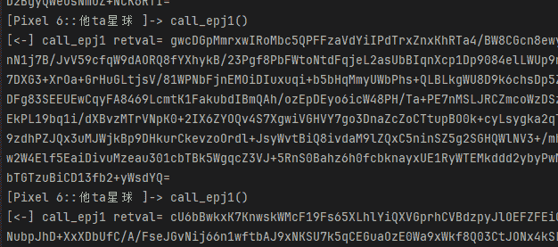
- 每次结果都不一样，看来是有随机数在参与了，这里用`unidbg`辅助也挺合适，但是前面的样本都是`unidbg`，这个就不用了，反正也不难；
- 主动调用写好了，可以去看`native`实现了，要先拿到地址；都是动态注册的，前面多次提过，直接去`hook`就好；


# `DefenseTower` 算法分析

## Native 方法注册与偏移信息

```
lookup_RegisterNative_method("com.defense.pristine.DefenseTower")
fnPtr='0x7b14d4f0cc libdefensetower.so!0x410cc' method='public static native void com.defense.pristine.DefenseTower.ck(boolean)'
fnPtr='0x7b14d4f114 libdefensetower.so!0x41114' method='public static native java.lang.String com.defense.pristine.DefenseTower.drj1(java.lang.String,java.lang.String)'
fnPtr='0x7b14d4f134 libdefensetower.so!0x41134' method='public static native java.lang.String com.defense.pristine.DefenseTower.drjbpsign(java.lang.String)'
fnPtr='0x7b14d4f124 libdefensetower.so!0x41124' method='public static native java.lang.String com.defense.pristine.DefenseTower.drjcf1(java.lang.String)'
fnPtr='0x7b14d4f0ec libdefensetower.so!0x410ec' method='public static native java.lang.String com.defense.pristine.DefenseTower.drp0(java.lang.String)'
fnPtr='0x7b14d4f104 libdefensetower.so!0x41104' method='public static native java.lang.String com.defense.pristine.DefenseTower.drp1(java.lang.String)'
fnPtr='0x7b14d4f110 libdefensetower.so!0x41110' method='public static native java.lang.String com.defense.pristine.DefenseTower.epj1(java.lang.String,java.lang.String)'
fnPtr='0x7b14d4f130 libdefensetower.so!0x41130' method='public static native java.lang.String com.defense.pristine.DefenseTower.epjbpsign(java.lang.String)'
fnPtr='0x7b14d4f118 libdefensetower.so!0x41118' method='public static native java.lang.String com.defense.pristine.DefenseTower.epjcf1(java.lang.String)'
fnPtr='0x7b14d4f0e0 libdefensetower.so!0x410e0' method='public static native java.lang.String com.defense.pristine.DefenseTower.epp0(java.lang.String)'
fnPtr='0x7b14d4f0f8 libdefensetower.so!0x410f8' method='public static native java.lang.String com.defense.pristine.DefenseTower.eppsg1(java.lang.String,java.lang.String,java.lang.String)'
```

- `epj1` 方法的偏移信息是：`libdefensetower.so!0x41110`；

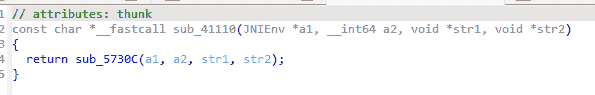

## 初步分析：`5730c` 函数与参数

- 点进 `5730c` 函数就可以开始分析了；

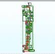

- 有一些混淆，但不碍事，首先观察整个函数；我们能看到一个很关键的函数；

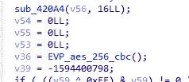

- 在 `jadx` 我们就已经看到了除了目标 `so` 还有两个 `so` 被加载，其中就有 `openssl` 相关的；但这里看到符号也只是其中一个佐证而已，具体的情况还需要再分析，心里有这种想法就好；大胆猜想，小心求证；

- 先看参数使用情况；

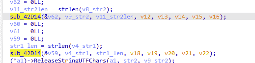

- 我改了一下变量名，这个函数可以看看做了些什么，改变量名快捷键是 `N`，右键也可以找到；尝试 `hook` 一下看看参数返回值之类的；

```
function hook_0x42D14() {
    let so_addr = Module.getBaseAddress("libdefensetower.so");
    let funcPtr = so_addr.add(0x42D14);
    let num = 0
    Interceptor.attach(funcPtr, {
        onEnter: function (args) {
                console.log("[+]0x42D14 参数0--->>>\r\n" + hexdump(args[0]));
                this.res = args[0]
                console.log("[+]0x42D14 参数1--->>>\r\n" + hexdump(args[1], {length: args[2].toInt32()}));
                console.log("[+]0x42D14 参数3--->>>\r\n" + (args[3]));
                console.log("[+]0x42D14 参数4--->>>\r\n" + (args[4]));
                console.log("[+]0x42D14 参数5--->>>\r\n" + (args[5]));
                console.log("[+]0x42D14 参数6--->>>\r\n" + (args[6]));
                console.log("[+]0x42D14 参数7--->>>\r\n" + (args[7]));
        },
        onLeave: function (retval) {
            console.log("[!]0x42D14 返回值--->>>\r\n" + hexdump(retval));
            console.log("[!]返回值res--->>>\r\n" + hexdump(this.res));
        }
    });
}
```

- 重要的差不多也就是参数1和返回值，看看下面这组数据，这里用的是前面的主动调用；

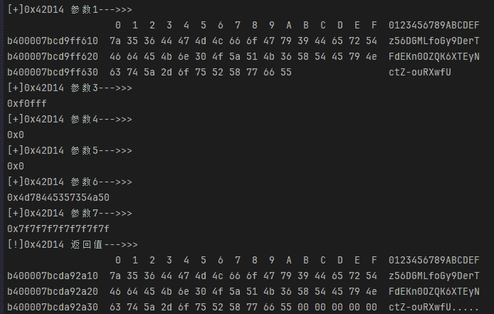

- 传进来是什么出去还是什么，这个函数可能是一个 `memcpy` 函数，先搁置，这里被调用了很多次；它的返回值应该是参数1；

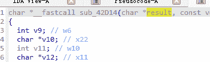

- 但是依靠前面的代码打印出来却对应不上，返回值 `res` 这一条输出将是：

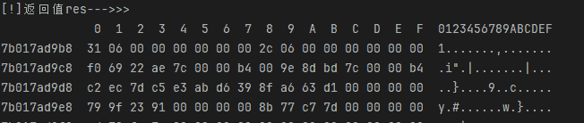

- 这里我没记错的话前面某一篇文章也有这种情况，它返回的实际上应该是结构体指针，可以看作以下情况：

```
*output_ptr = aligned_size;        // 存储大小
*(output_ptr + 1) = size;          // 存储原始大小
*(output_ptr + 2) = new_buffer;    // 存储缓冲区指针
```

- 我们就拿一段来举例：

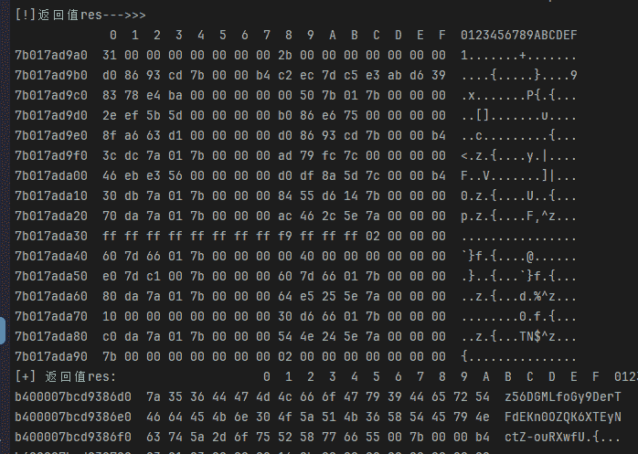

- 31不用管，后面的 `2b` 换成10进制就是 `43`，后续就是读地址的数据；恰好我们的源数据长度正是 `43`；

```
z56DGMLfoGy9DerTFdEKn0OZQK6XTEyNctZ-ouRXwfU // len = 43
```

- 读出来的结果也让我们非常满意，脚本改一下；

```
onLeave: function (retval) {
    console.log("[!]0x42D14 返回值--->>>\r\n" + hexdump(retval));
    const data_ptr = this.res.add(0x10).readPointer(); // 真实数据指针
    console.log("[+] 返回值res: " + hexdump(data_ptr));
}
```

## `0x42D14` 函数 `hook` 与分析

- 这里算个小插曲，接着往下看，看第一个调用的结果 `v67` 在哪里调用了；

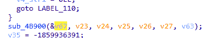

- `hook` 这个函数看看；

```
function hook_0x4B900() {
    let so_addr = Module.getBaseAddress("libdefensetower.so");
    let funcPtr = so_addr.add(0x4B900); // key iv
    Interceptor.attach(funcPtr, {
        onEnter: function (args) {
            // 正确读取输入结构体: [指针][长度]
            const data_ptr = args[0].add(0x10).readPointer(); // 真实数据指针
            console.log("[+]0x4B900 参数0: " + hexdump(data_ptr));
            console.log("[+]0x4B900 参数2--->>>\r\n" + hexdump(args[2]));
            this.arg2 = args[2];
        },
        onLeave: function (retval) {
            console.log("[!]返回值--->>>\r\n" + hexdump(retval));
            console.log("[!]hook_0x4B900 返回值res--->>>\r\n" + hexdump(this.arg2));
        }
    });
}
```

- 第一个参数和上面是一样的，读的时候注意区分；其他不重要的我没打印；

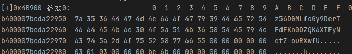

- 上面 `hook` 的代码表明了，参数2应该是返回值，因为它在后续 `sub_4D668` 函数中使用到了，但是 `hook` 的结果也并不是很理想；这里暂且先留个悬念，往下走走看；至少这里我们清楚了，这个函数一个重要因素就是我们传递的参数2；

## `0x4B900` 函数 `hook` 与后续分析

- 分析一下后续的 `sub_4D668` 函数；

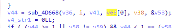

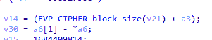

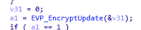

## `sub_4D668` 函数分析

- 可以发现一些类似的函数，这都是 `openssl` 的实现，`hook` 一下这个 `sub_4D668` 先；


# 加密算法分析

## `hook_0x4D668()`

```javascript
function hook_0x4D668() {
    let so_addr = Module.getBaseAddress("libdefensetower.so");
    let funcPtr = so_addr.add(0x4D668); // 加密
    // let funcPtr = so_addr.add(0x4B900); // key iv
    Interceptor.attach(funcPtr, {
        onEnter: function (args) {
            console.log("[+]参数1 明文--->>>\r\n" + hexdump(args[1], {length: args[2].toInt32()}));
            console.log("[+]参数3 key--->>>\r\n" + hexdump(args[3]));
            console.log("[+]参数4 iv--->>>\r\n" + hexdump(args[4]));
            this.res = args[5];
        },
        onLeave: function (retval) {
            // console.log("[!]返回值--->>>\r\n" + (retval));
            // console.log("[!]返回值res--->>>\r\n" + hexdump(this.res));

            const encryptedLen = retval.toInt32();
            // 从buffer结构中读取实际数据指针
            const dataPtr = this.res.readPointer();
            console.log(hexdump(dataPtr, {length: encryptedLen, header: false}));
        }
    });
}
```

- 参数1是明文，参数3和参数4就分别是 `key` 和 `iv` 了；
  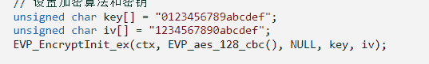

## 加密流程分析

- 去函数找对应的 `EVP_EncryptInit_ex`；
  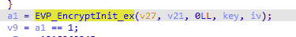

- 先看看 `hook` 情况，明文不放出来了，太长了，没有做过处理的；
  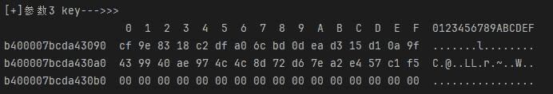

- `iv` 是这样的：
  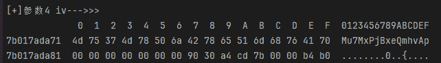

- 这也比较符合 `aes 256` 的要求，`key` 的长度是32字节，可以尝试去加密一下；
  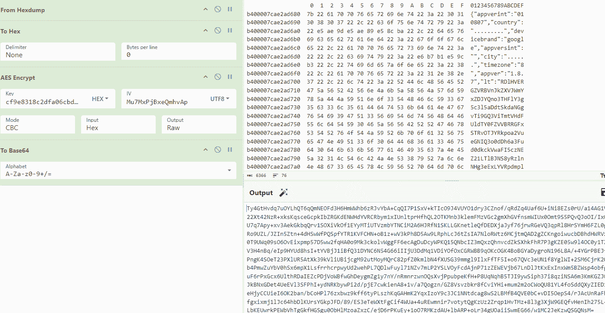

- 去对比一下结果；
  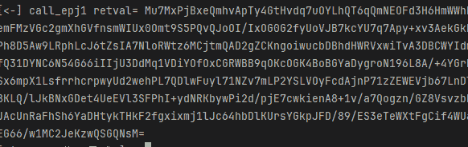

- 我们发现对不上，但是不是完全对不上，开头的数据应该很眼熟吧，其实就是 `iv`；去掉前16字节就是最终加密的结果了；
  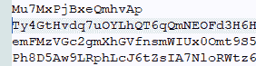

- 即使这里你看不出来，我们最后还打印了实际加密结果是16进制，也可以对比看是否正确，这里还没有拼接 `iv`，不放图了；
- 所以加密算法就应该是 `aes256` `cbc` 模式，汇总一下当前信息；
- 加密算法：已知，`aes256` `cbc`；
- 明文：已知，传递进来的参数；
- `key`：暂时已知，来源未知；
- `iv`：暂时已知，来源未知；
- 请求体就应该是这样的，现在就差 `key`、`iv` 的来源需要分析了；

### 3.1 `iv`

- 先看 `iv` 吧，既然密文拼接了 `iv`，那它毫无疑问应该是一个随机的，我们要做的就是找到它是随机出来的证据；
  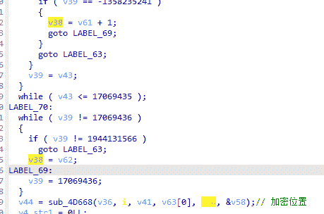

- `v38` 是 `iv`，它的来源可能有上方高亮的两个位置；
  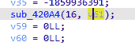

- 用我们聪明的脑袋想一下，应该是这里了；
  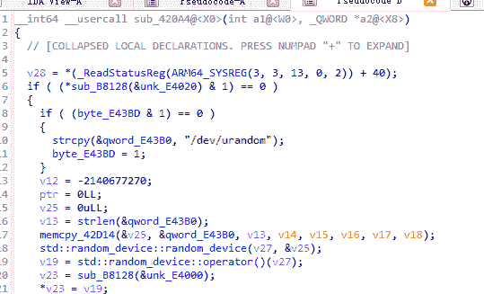

- 比较显然了，不分析了，它是随机出来的16字节；所以主动调用的结果每次都是变化的，这里也是佐证了；

### 3.2 `key`

- 随后需要找 `key` 的来源，这就又要回到 `sub_4B900` 这个函数了，`v63` 比较是我们的秘钥；
  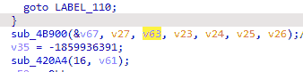

- 这里回顾前面留下的坑，当时 `hook` 的结果并不是很理想，具体体现在 `key` 的返回值并不是我们期待的；正常的返回值应该是：
  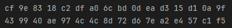

- 这里打印的值却是：
  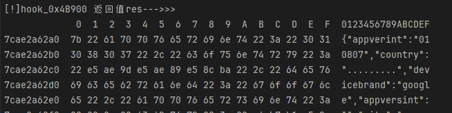

- 这显然不正常，我们点进函数看看；
  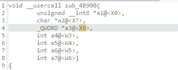

- `ida` 给了我们一些提示，`x8` 就是 `a3`，那我们是否可以尝试去读一下 `x8` 的值，调整一下 `hook` 代码；

```javascript
function hook_0x4B900() {
    let so_addr = Module.getBaseAddress("libdefensetower.so");
    let funcPtr = so_addr.add(0x4B900);
    Interceptor.attach(funcPtr, {
        onEnter: function (args) {
            // 正确读取输入结构体: [指针][长度]
            const data_ptr = args[0].add(0x10).readPointer(); // 真实数据指针
            console.log("[+]0x4B900 参数0: " + (data_ptr.readCString()));
            this.a7_ptr = this.context.x8; // a3参数在X8寄存器
        },
        onLeave: function (retval) {
            // 读取a7的内容，a7是一个_QWORD*，包含多个指针
            const keyPtr = this.a7_ptr.readPointer();
            console.log("[+] 生成的密钥内容 (32字节):");
            console.log(hexdump(keyPtr, {length: 32, offset: 0}));
        }
    });
}
```

- 这次我们把失去的一切都拿回来了；
  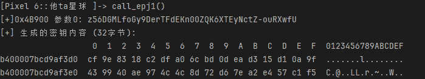

- 所以 `key` 的来源就在这个函数，现在就需要解决这个算法是什么？传进来的参数又是什么？
- 一个一个来，先看算法是什么，大致浏览一下这个函数；
  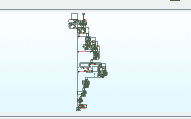

- 整个样本遇到的含糊几乎都是这种混淆，其实没什么太大的意义，抓住关键函数分析就好；
  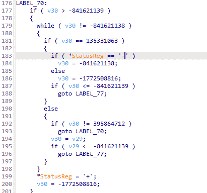

- 这里把 `-` 替换成了 `+`，原本是数值，按下 `r` 键将它转成字符串就是好这种形式；
  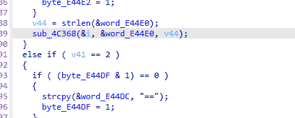

- 这里是在填充 `=` 符号，这个操作比较像 `base64` 相关的安全解码，找找看有没有经过什么 `base64` 相关的函数；
- `sub_4B230` 这个函数的调用涉及参数和 `base64`；
  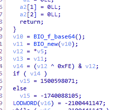

- 那我们尝试 `hook` 一下这个函数；

```javascript
function hook_0x4B230() {
    let so_addr = Module.getBaseAddress("libdefensetower.so");
    let funcPtr = so_addr.add(0x4B230);
    Interceptor.attach(funcPtr, {
        onEnter: function (args) {
            console.log("[+]hook_0x4B230 函数参数0--->>>\r\n" + args[0].add(0x10).readPointer().readCString());
            // console.log("[+]hook_0x4B230 函数参数1--->>>\r\n" + (args[1]));
            // this.res = args[1]
            this.res = this.context.x8;
        },
        onLeave: function (retval) {
            // console.log("[!]hook_0x4B230 返回值--->>>\r\n" + hexdump(retval));
            console.log("[!]返回值res--->>>\r\n" + hexdump(this.res.readPointer().readByteArray(0x20)));
        }
    })
}
```

- 这里有两个点需要注意，参数依旧需要用前面的方式读，返回值依然不理想，需要去读 `x8` 寄存器的值，返回值手动限制了长度；
  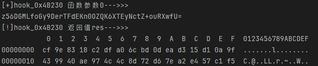

- 结果非常理想，看看参数与最开始的入参有何区别；

```text
begin: z56DGMLfoGy9DerTFdEKn0OZQK6XTEyNctZ-ouRXwfU
after: z56DGMLfoGy9DerTFdEKn0OZQK6XTEyNctZ+ouRXwfU=
```

- 首先，`-` 变成 `+` 了，这个我们前面说过，其次，`base64` 的填充是4的倍数，所以长度不够也要填充，这里也符合；
- 那么这里的算法应该是 `base64` 解码，解码之后看看还有没有什么操作；
  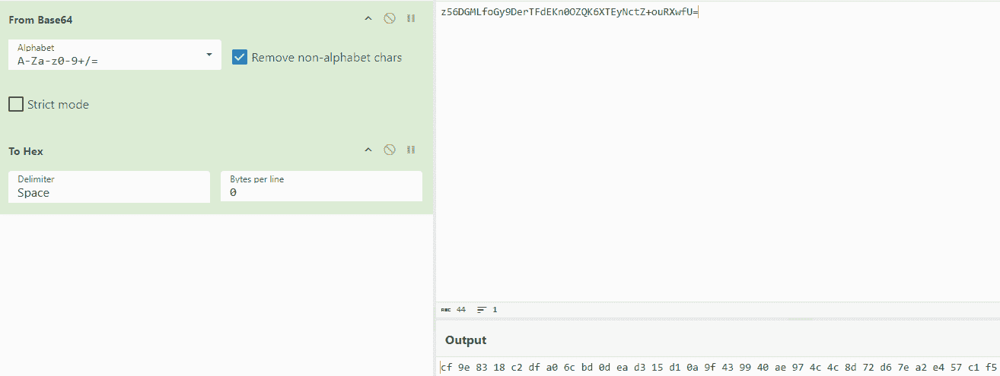

- 仅仅只是转成16进制而已，到这里 `key` 的运算规则我们知道了，那它的来源呢？
- 关于来源，那就要从它的传入位置说起，回到 `jadx`；
  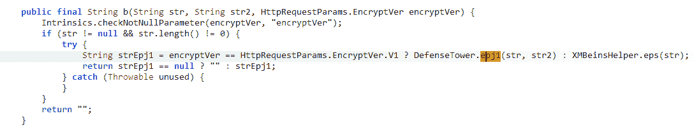

- 这里的 `str2` 就是 `key` 的原始字符串，我们现在开始追溯它的来源；
  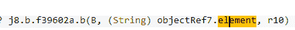

- 它是 `objectRef7.element`，往上看哪里赋值了；
  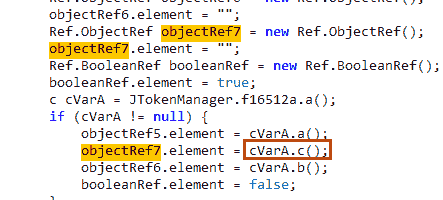

- 继续追，进入到下一个位置；
  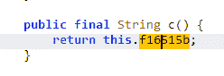

- 找谁给这个 `f16` 赋值；
  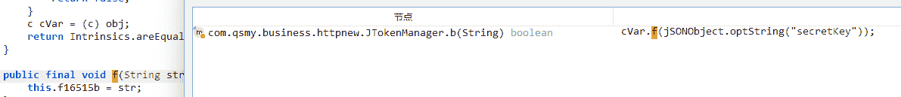

- `f()` 函数按 `x` 找谁调用了；
  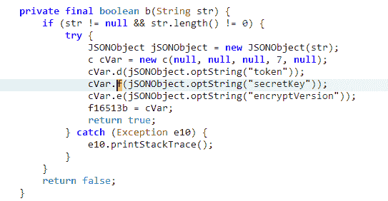


到这里才算是出现了一点端倪，从`jSONObject`里取的这三个东西，`new`的时候传的是`str`，还得继续，按下`x`继续找；

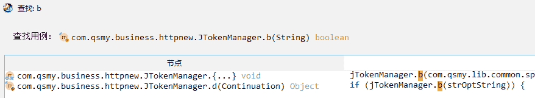

看第二个，就在当前函数；


这又是一个非常长的函数，自己观察一下关键点，从代码中可以看出，这个方法执行了一个网络请求`postCommonWithJson`，然后处理响应；在响应成功且状态码为`200`时，它从响应中提取了数据（`jSONObject.optString("data")`），并将这个数据字符串传递给之前分析的`b(String)`方法；

`str2`应该就是链接的地址，去看一下是哪一个；


去找一下这个请求，看看是否存在；我这里抓包时机不好，我们重启 app 试试抓包；


有了，但是这里出现了新的问题，这个请求体和响应体又是加密的，还需要继续分析；

那么现在去看看请求体怎么来的；


稍微根据这个跟一下，就会发现目标函数；


是在一个位置的另一个`native`函数，顺便把解密函数找一下；


这俩都不难找，稍微跟一下就好；

把他俩都`hook`上，看看位置是否正确，这里就用`spawm`的方式启动，这个`key`是应用启动时设置的；

```
function hook_mointor_epjcf1() {
    Java.perform(function () {
        let com_defense_pristine_DefenseTower = Java.use("com.defense.pristine.DefenseTower");
        com_defense_pristine_DefenseTower["epjcf1"].implementation = function (str) {
            console.log(`[->] hook_mointor_epjcf1 ->str= ${str}`);
            var retval = this["epjcf1"](str);
            console.log(`[] hook_mointor_drjcf1 str= ${str}`);
            var retval = this["drjcf1"](str);
            console.log(`[
```

这里时机稍稍晚一点，直接附加可能出现问题；

```
[Pixel 6::com.xinhe.tataxingqiu ]-> [->] hook_mointor_epjcf1 ->str= {"appverint":"010807","country":"xxxxx","devicebrand":"google","appversint":"","city":"深圳","timezone":"8","appver":"1.8.7","lt":"RDlHVERGZVR···",\"packagename\":\"com.xinhe.tataxingqiu\"}","position":"广东","osversion":"12","region":"中国","device":"Pixel 6","ts":"1763715142"}

[] hook_mointor_drjcf1 str= bMwWvg2cVaYqWWtGxcODniFSGcYWj9ud···Pb9D7WiRENs88fqoIcBeM=

[
```

为了不占太多篇幅，数据都做了筛检，总体来说，参数就是前面那一类，主要多了一些环境相关的参数，结果确实是请求体的密文；响应也确实如此，可以去走一遍最初的接口，看看`key`是否是用的这个；我这里不试了，确实是这个流程，并且`token`就是请求头的`access_token`，他们需要匹配，现在去分析加密和解密分别是什么算法；

把前面的注册地址拿过来；

```
fnPtr='0x7b14d4f124 libdefensetower.so!0x41124' method='public static native java.lang.String com.defense.pristine.DefenseTower.drjcf1(java.lang.String)'

fnPtr='0x7b14d4f118 libdefensetower.so!0x41118' method='public static native java.lang.String com.defense.pristine.DefenseTower.epjcf1(java.lang.String)'
```

先看加密方法，也就是`epjcf1`，偏移是`0x41118`；


再往里进长这样；


先改一下基本的变量名；


`sub_5933C`可以去看一下；


没做什么太多的东西，基本上也是`cpy`；


`sub_4F37C`值得一看；


出现了比较显眼的东西，按照经验它大概率就是一个`rsa`加密，我们需要做的就是找到它的公钥；


参数1应该是公钥，它赋值于`off_E4088`或者`off_E4080`；根据前面传入的数据，公钥应该是这个：


我们没有私钥，所以没办法验证加密结果是不是对得上，我们暂且这么认为吧；去看解密；


这里有一个`jumpout`，ida帮我们计算出了应该跳转的位置，单击`59594`进去；


我们发现它却直接跳转到`sub_5933C`，按下`tab`键看汇编也发现，偏移对不上；


这里我最开始没有想明白，咨询我的好友[xiaofeng]之后他为我提供了解决方案，在此表示感谢；

在`JUMPOUT`位置按下`tab`键转到汇编；


此时位置没错，我们要做的就是帮助ida，他把应该跳转的地址搞错了，我们去把`sub_5933C`按`U`给取消定义；


光标放在对应位置即可，然后去找对应的`59594`位置按下`P`键创建为一个函数；


可以发现，他是会报红的，在这里按下`P`；


此时函数识别就成功了，这个函数和加密其实非常非常像；去看一下几个函数就好；


它实际上是`rsa`解密，但是这里有个非常离谱的点；


按照前面的点，高亮处就应该是秘钥，点进去发现又是一个公钥；


他俩实际上在一个位置，但都是公钥，所以服务器维持了两套秘钥，加密是公钥1加密，服务器私钥1解密；返回响应时私钥2加密，用公钥2解密；有点意思的，至少做到了私钥一个不泄露；

接下来测试一下，随便拿一个数据去解密测试；


另一个解不开，所以它确实是加密用的，到这里基本上算法分析就结束了，后续总结回顾一下；

还有一个要说的就是第一个接口的请求体解密和加密是一样的，`key`同一个，`iv`在返回密文前16字节；

## 4. 总结

首先回顾整个流程：

- `feed`接口：请求体`aes 256 cbc`加密，`key`是`auth`接口返回的，`iv`是随机的，明文也知道；
- `auth`接口：请求体`rsa`加密，明文、公钥均已知；响应体`rsa`解密，也是公钥解；
- 整体算法不算复杂，有大量的混淆也并不干扰咱们分析，需要复现的读者我在这里将样本附上；

```
aHR0cHM6Ly9wYW4uYmFpZHUuY29tL3MvMTVwQ2NHZnRJRTBsV2diMHhGVkRTcUE/cHdkPXNhbmE=
```

- by：2025-11-21；
