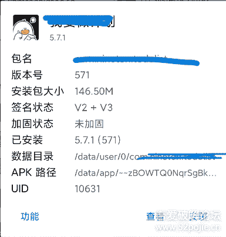
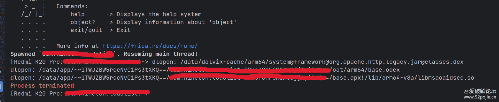
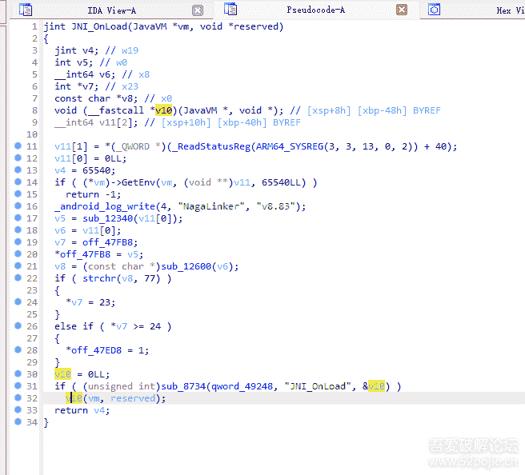
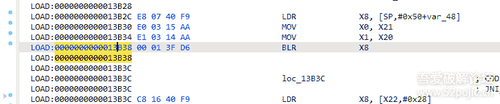
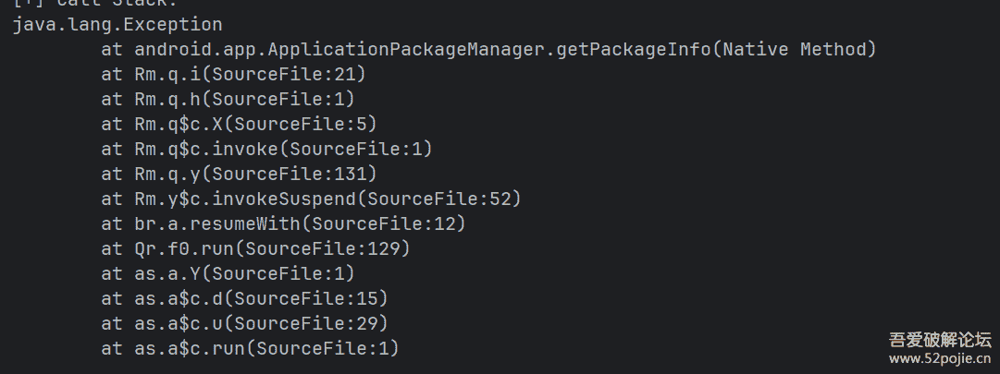
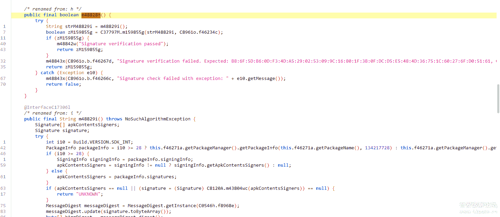
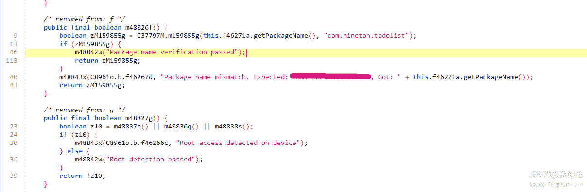
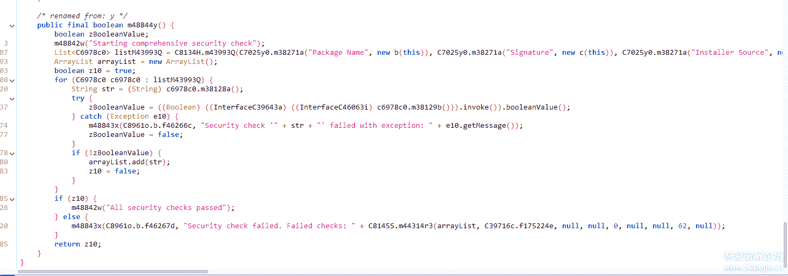

# [Android 原创] 一简单app绕检测

原帖：https://www.52pojie.cn/forum.php?mod=viewthread&tid=2075901  
抓取时间：2026-11-01T13:51:50.609Z

如图，无壳app

`frida`注入，发现有检测

上次遇到一个同样的`so`，已经patch掉了检测，但patch方法对这个app的`libmsaoaidsec`无效。

那既然上次那个能绕过，就直接拿过来替换了

修改也简单，`jnionload`第32行 `nop`掉就行

对应这句`blr x8`汇编

重签名后，app闪退，存在签名校验

直接hook `applicationpackagemanager`获取应用读取签名的信息

如图，定位到`q`类`i`方法

`jadx`反编译后，进入`q`类翻一下，你就能发现app的检测都在这个类里面了

签名校验

root检测，包名检测

最下面还有一个`y`方法，是总检测方法，直接将这个返回true就能绕过所有检查

