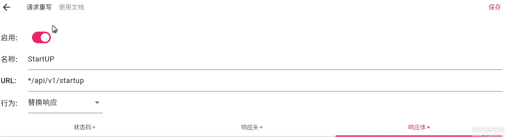
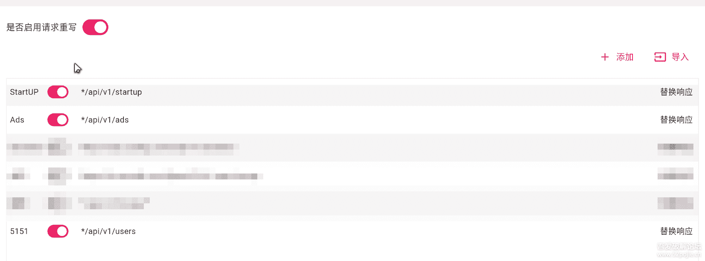

# [Android 分享] 某DB去开屏广告+本地vip（ProxyPin重写）

- 原帖：[https://www.52pojie.cn/forum.php?mod=viewthread&tid=2076382](https://www.52pojie.cn/forum.php?mod=viewthread&tid=2076382)
- 抓取时间：2026-11-01T23:54:29

本人小白同时也是论坛新人一枚，刚接触逆向，分析的不对还请指正。

## 一、准备工具

1. `mumu` 模拟器或真机（我用的是魔改的模拟器：[视频链接](https://www.bilibili.com/video/BV178tbzYEXh/?spm_id_from=333.337.search-card.all.click)）
2. [ProxyPin](https://gitee.com/wanghongenpin/proxypin)：模拟器开启 `ROOT`，将 `proxypin` 根证书安装到指定位置，这里不再详细介绍，参考网上教程

## 二、开始修改

打开要抓包的软件，开始抓包。发现接口响应都是以明文展示的。

关键字段分析：

- `enabled`：是否开启，`true` 改为 `false`
- `overtime`：广告倒计时，原本是 5 秒，改为 0
- `ad`：`{}` 广告来源，直接赋值 `NUlL`
- `promotion_days`：推广天数
- `vip_expired_at`：vip 到期时间
- `is_vip`：是否 vip

有了以上参数，开始重写。



`MuMuNxDevice_7f5sl0Tz1y.png`（48.41 KB，下载次数：1）

[附件链接](https://www.52pojie.cn/forum.php?mod=attachment&aid=MjgxNzU0NnxlMTE2NjFmMnwxNzkzNTc3MjY2fDE2ODA4NnwyMDc2Mzgy&nothumb=yes)

2025-11-28 21:08 上传

找到 `*/api/v1/startup` 类似的接口，鼠标长按接口选择请求重写，选择替换响应。

### 1. 去开屏广告

将消息体 `Body` 中 `splash_ad{ }` 替换为以下内容：其余不变。

```
    "splash_ad": {
      "enabled": false,
      "overtime": 0,
      "ad": null
    },

    UPDATE_DESCRIPTION = "";
    NOTICE = "";
    placeholder = "";
```

### 2. 去广告

`*/api/v1/ads`

```
    enabled = false;
    ads = {};
```

### 3. 本地VIP

`*/api/v1/users`

```
{
  "promotion_days": 9999,
  "vip_expired_at": "2099-09-09T09:09:09.000+09:00",
  "is_vip": true
}
```

这里注意，要在重写里面新增一个 `Hearders`。


`MuMuNxDevice_7q2TIA4LSB.png`（14.19 KB，下载次数：1）

[附件链接](https://www.52pojie.cn/forum.php?mod=attachment&aid=MjgxNzU0OHxmMDVkZjRiZXwxNzkzNTc3MjY2fDE2ODA4NnwyMDc2Mzgy&nothumb=yes)

2025-11-28 21:10 上传

因为接口默认开启缓存，导致请求 `304`，重写不生效。

这个重写要把状态码、请求头、请求体开关全部打开，保证 vip 重写能够生效。

最终重写列表：



`MuMuNxDevice_ANDD77Qhyy.png`（56.75 KB，下载次数：1）

[附件链接](https://www.52pojie.cn/forum.php?mod=attachment&aid=MjgxNzU0NHwxMjU4MjBmOXwxNzkzNTc3MjY2fDE2ODA4NnwyMDc2Mzgy&nothumb=yes)

2025-11-28 21:05 上传

不出意外，清除缓存并重启 APP 就可以实现无广告，本地 VIP。


`MuMuNxDevice_dS17yWbuXH.png`（13.32 KB，下载次数：1）

[附件链接](https://www.52pojie.cn/forum.php?mod=attachment&aid=MjgxNzU0NXxlMzE2ZmRlMXwxNzkzNTc3MjY2fDE2ODA4NnwyMDc2Mzgy&nothumb=yes)

2025-11-28 21:05 上传
