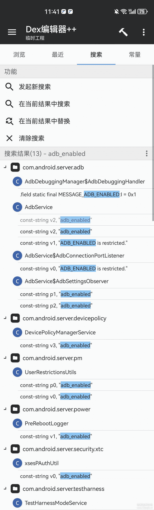
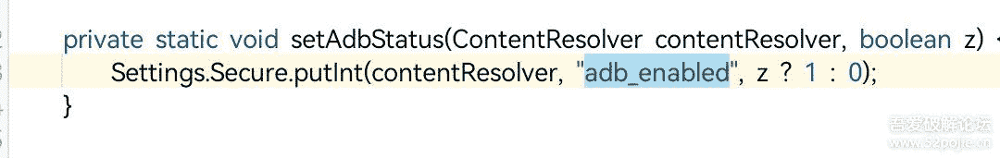
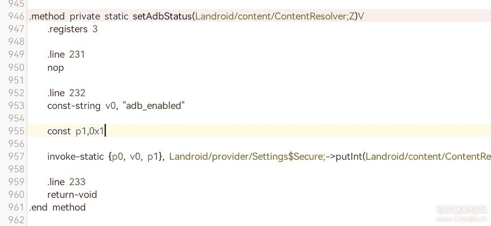
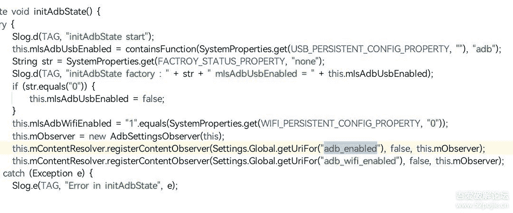
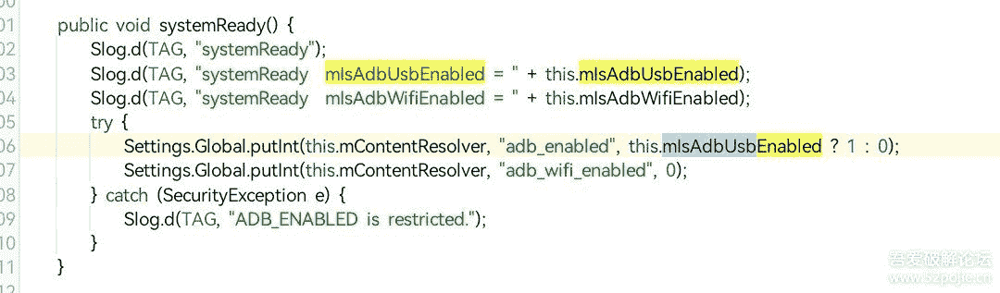
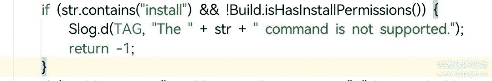
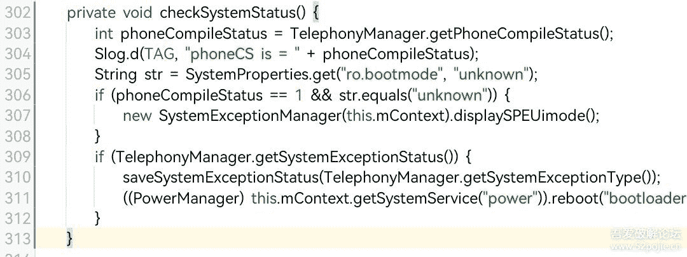
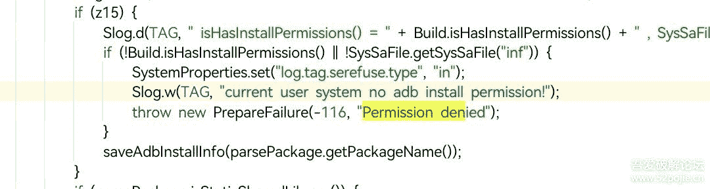
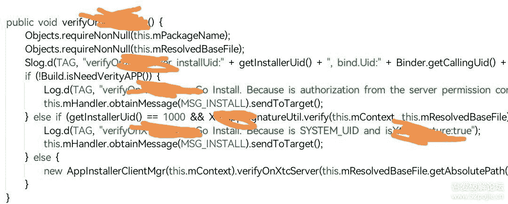
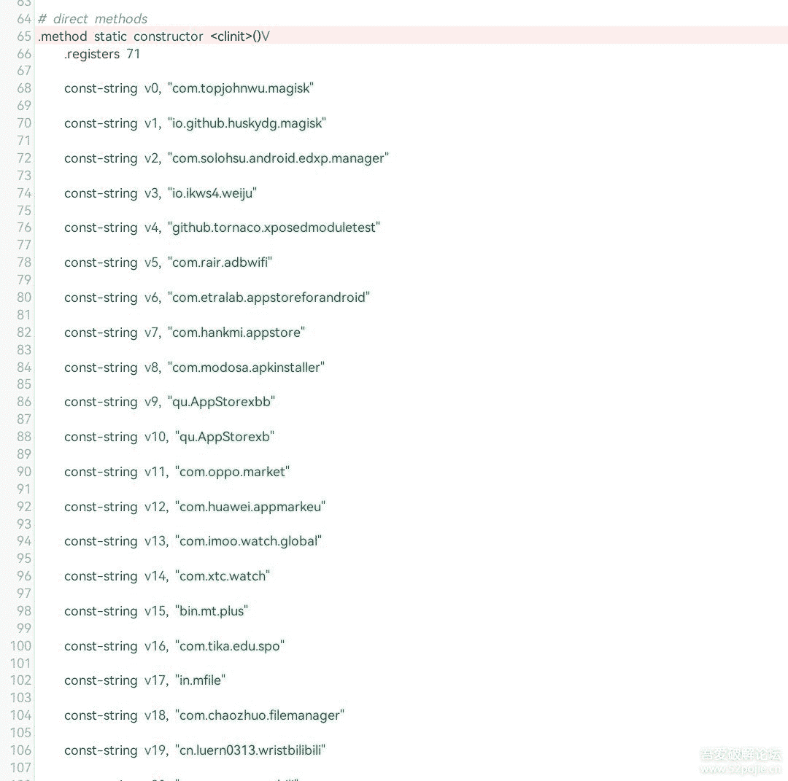

# [Android 分享] 记一次去除某设备的各种限制

- 原帖: https://www.52pojie.cn/forum.php?mod=viewthread&tid=2078087
- 抓取时间: 2026-11-01T13:51:25.683Z

注：本文只是做个记录，不特指某一设备，相关涉及的品牌信息已做隐藏处理

## ①解除ADB限制

该设备通过任何方法均无法正常开启`ADB`，编译了个`TWRP`，然后连接电脑

`adb shell twrp mount system`

`adb pull /system_root/system/framework/services.jar`

我怀疑是系统在开机时修改了`Settings.Global`项`adb_enabled`

直接搜索`adb_enabled`

我们找到了厂商自己写的一个服务并定位到了`setAdbStatus`方法

此处我直接在`smali`代码中添加了`const p1, 0x1`，使他永远默认开启`adb`

继续查看其他搜索结果，定位到`Lcom/android/server/adb/AdbService;`

发现厂商修改了`initAdbState`中原有的`mIsAdbUsbEnabled`的判断方法

根据`factory prop`来判断`isAdbEnabled`

查找使用了`mIsAdbUsbEnabled`的方法，找到了这段代码

通过`mIsAdbUsbEnabled`来判断是否开启`ADB`是`Google`原有的代码，厂商额外直接禁止了使用`WiFi ADB`，此处我们直接修改`mIsAdbUsbEnabled`为`true`即可

在`initAdbState`方法中找到

`iput-boolean v3, p0, Lcom/android/server/adb/AdbService;->mIsAdbUsbEnabled:Z`

在这行代码前面添加`iput-boolean v3, p0, Lcom/android/server/adb/AdbService;->mIsAdbUsbEnabled:Z`

同时删除 `if-eqz v2, :cond_4b`，修改完毕

打包`super`，发现开机仍然没有`adb`。此时怀疑厂商在`adbd`中也加了检测（后来发现确实是`adbd`也加了），当时没去看`adbd`，直接把那个`factory prop`设置为`1`了，开机成功自动打开`adb`

## ②去除安装限制

厂商添加了大量的安装限制，就算是测试机也会严格管控`adb install`。抓取`adb`安装应用时的日志，发现了报错`The pm install command is not supported.`。

定位到`Lcom/android/server/pm/PackageManagerShellCommand;`

我们在`smali`代码中找到`if-eqz v2, :cond_36`这一行，在这一行的前面直接加上`goto :cond_36`

改完之后看了一下这个方法，居然还有校验

此校验只要`!Build.IS_USER`即可绕过，所以我直接修改了`ro.build.type=userdebug`

打包`super`，开机发现`boot completed`后自动重启进入了`BL`，很明显的是厂商限制

搜索关键词`bootloader`，找到了如下代码

该方法会判断`cmdline`中的`buildtype`和系统`prop buildtype`是否一致，我们直接把这个方法`return-void`就好，再次打包，成功开机

测试`adb`安装

此时报错变成了`Permission denied`，并且日志出现`current user system no adb install permission!`

我们在`pms`中找到了如下代码

直接扬了即可，再次打包，开机测试`adb`安装

此时报错又变为了***（品牌名称） verify failed.

定位到`PackageInstallerSession`，发现如下代码

直接删除`if-nez v0, :cond_60`，使其默认进入`!Build.isNeedVerityApp`的逻辑即可

再次打包，开机，`adb`成功安装

但桌面没有图标

## ③去除应用启动限制

我们提取了`Launcher App`，搜索关键词`magisk`，找到了一份黑名单

直接删除`const-string v1`到`const string v70`的所有内容

并把`filled-new-array/range {v0 .. v70}, [Ljava/lang/String;`改为 `filled-new-array/range {v0 .. v0}, [Ljava/lang/String;`

`const-string v0, "com.topjohnwu.magisk"`改为`const-string v0, ""`

开机以后，图标成功出现

但是打不开，再次反编译`framework`，找到了`Lcom/android/server/am/ProcessList;`下的`isUnCertifiedAppProc`方法，直接`return false`。此时限制基本解除

## ④去除settings put command限制

我想通过`adb`修改熄屏时长，却发现报错`INVALID COMMAND`，检查后发现我的命令没有错误，于是反编译了`SettingsProvider`，发现果然是厂商的限制，解决方法为直接替换24年系统版本的`Settings Provider`
