# [Android 原创] frida检测对抗————`libmsaoaidsec.so`绕过

- 原帖: https://www.52pojie.cn/forum.php?mod=viewthread&tid=2079166
- 抓取时间: 2026-11-01T13:50:55.809Z

## 0x1 环境

- 案例：某黑盒v1.3.333
- 手机：redmi k40
- `frida`：16.6.6

## 0x2 问题

在尝试进行`frida` hook时发现手机正常进入，随后进程就被杀死了。

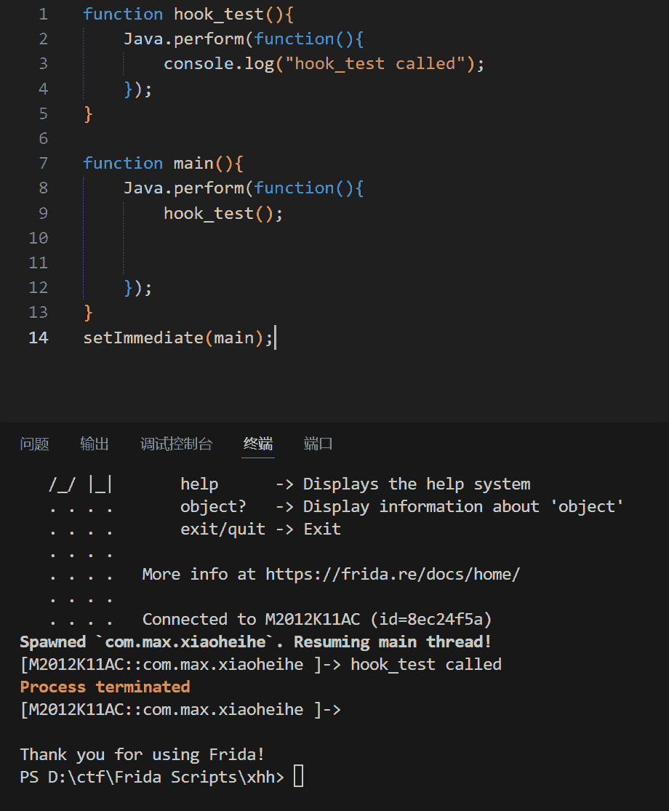

需要知道是那个so在检测`frida`，可以hook `dlopen`看一下so的加载流程。

```
function hook_dlopen() {
  var android_dlopen_ext = Module.findExportByName(null, "android_dlopen_ext");
  console.log("addr_android_dlopen_ext", android_dlopen_ext);
  Interceptor.attach(android_dlopen_ext, {
    onEnter: function (args) {
      var pathptr = args[0];
      if (pathptr != null && pathptr != undefined) {
        var path = ptr(pathptr).readCString();
        console.log("android_dlopen_ext:", path)
      }
    },
    onLeave: function (retvel) {
    }
  })
}

setImmediate(hook_dlopen);
```

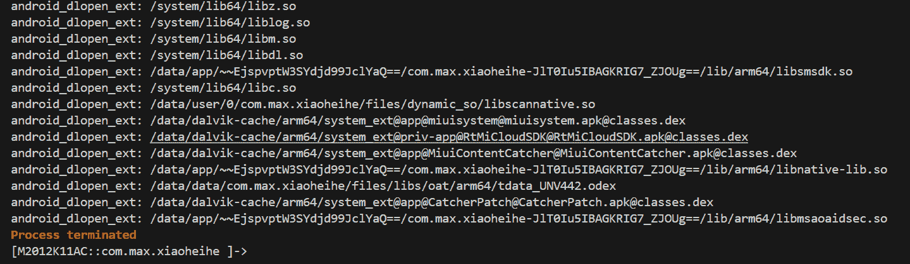

由so的加载流程可知，当`libmsaoaidsec.so`被加载之后，`frida`进程就被杀掉了，因此监测点在`libmsaoaidsec.so`中。

### so加载流程

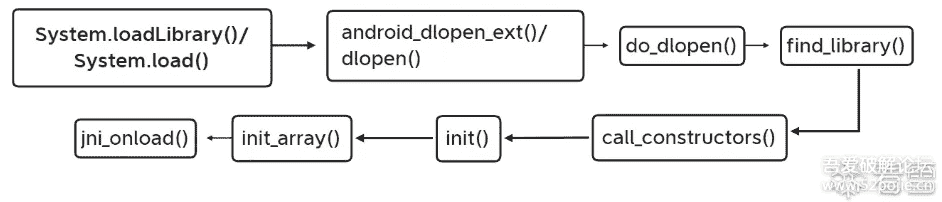

Java 层：`System.loadLibrary`到`dlopen`

```
static {

   System.loadLibrary("mylib");   // 对应 libmylib.so

}

// 或者

System.load("/data/local/tmp/libmylib.so");
```

差别：

- `loadLibrary("mylib")`：
  - 会在默认搜索路径里找`libmylib.so`。
  - 搜索路径跟进程的`LD_LIBRARY_PATH` / 系统默认路径 / app 自己的`nativeLibraryDir`有关。
- `load("/full/path/libxxx.so")`：
  - 直接给`linkermap`绝对路径，不走库名解析。

Native 层：`dlopen`调用链

Java → ART → `dlopen`的简化链条大致是：

- `Runtime.nativeLoad(String filename, ClassLoader loader, String librarySearchPath)`
- 调用到`libart`或`libnativeloader`里的加载逻辑
- 最终走到`libc`提供的`dlopen()`（实现由`linker`提供）
- `linker`内部：真正的 ELF 加载流程

`linker`会先对so进行加载与链接，然后调用so的`.init_proc`函数，接着调用`.init_array`中的函数，最后才是`JNI_OnLoad`函数。

### 定位检测

现在不清楚具体检测点在哪，先hook一下`JNI_onLoad`看看会不会触发检测。

```
function hook_dlopen() {
  var android_dlopen_ext = Module.findExportByName(null, "android_dlopen_ext");
  console.log("addr_android_dlopen_ext", android_dlopen_ext);
  Interceptor.attach(android_dlopen_ext, {
    onEnter: function (args) {
      var pathptr = args[0];
      if (pathptr != null && pathptr != undefined) {
        var path = ptr(pathptr).readCString();
        //console.log("android_dlopen_ext:", path)
      }
    },
    onLeave: function (retvel) {
      hook_JNI_OnLoad
    }
  })
}

function hook_JNI_OnLoad(){
    let module = Process.findModuleByName("libmsaoaidsec.so")
    Interceptor.attach(module.base.add(0xC6DC + 1), {
        onEnter(args){
            console.log("call JNI_OnLoad")
        }
    })
}
setImmediate(hook_dlopen);
```

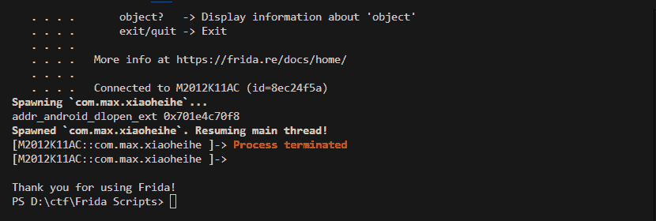

日志没有输出，那么检测在`.init_proc`。

## 0x3 解决

### 思路一

直接hook `linker64`的`call_constructors`来替换`init_proc`函数的执行。

原理：

- 当 SO 被加载时，系统`Linker`会负责调用 SO 中的`.init`段和`.init_array`段（即 C++ 构造函数）。反调试检测通常最早就在这里启动。
- 这个脚本直接 Hook 了`linker64`模块内部的一个函数（偏移`0x52838` `call_constructors`）。
- 这个偏移通常指向`call_constructors`或者在调用构造函数之前的某个关键节点。

时机：

- 此时`libmsaoaidsec.so`已经被映射到内存（`Process.findModuleByName`能找到它）。
- 但是！它的任何初始化代码、反调试线程都还没有运行。
- 这是一个“时间静止”的绝对安全窗口。

```
function my_hook_dlopen(soName) {

  var name = Module.findExportByName(null, "android_dlopen_ext");

  console.log(name);

  Interceptor.attach(name, {

    onEnter: function (args) {

      var pathptr = args[0];

      if (pathptr !== undefined && pathptr != null) {

        var path = ptr(pathptr).readCString();

        console.log(path);

        if (path.indexOf(soName) != -1) {

            hook_call_constructors()

        }

      }

    },

    onLeave: function (retval) {

      if (this.is_can_hook) {

        dump_so(soName);

      }

    },

  });

}

var first = false;

function hook_call_constructors() {

  var linker = Process.findModuleByName("linker64");

  Interceptor.attach(linker.base.add(0x52838), {//hook call_constructors

    onEnter: function () {

      var module = Process.findModuleByName("libmsaoaidsec.so");

      if (module && !first) {

        first = true;

        Interceptor.replace(

          module.base.add(0x14400),//替换init_proc函数

          new NativeCallback(

            function () {

              console.log("Bypassed sub_14400");

            },

            "void",

            []

          )

        );

        Interceptor.replace(

          module.base.add(0x13A4C), new NativeCallback(//替换JNI_OnLoad函数

            function (vm, reserved) {

              console.log("[+] Fake JNI_OnLoad called!");

        // 原始功能（可选调用原函数）

        // const old_ret = old_jni_onload(vm, reserved);

        // 返回版本号（通常0x10004 for JNI 1.4）

        return 0x10006; // JNI 1.6

    },

    "int", ["pointer", "pointer"]

))

      }

    },

  });

}

function main() {

  my_hook_dlopen("libmsaoaidsec.so");

}

setImmediate(main);
```

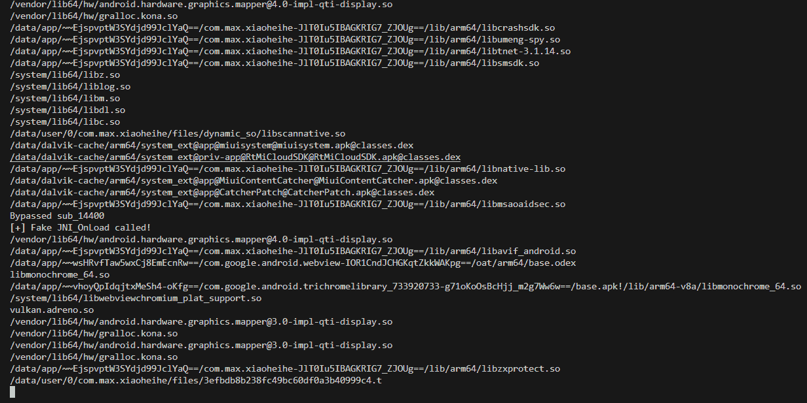

可以直接跑通。

### 思路二

`nop`检测函数

已知监测点在`init_proc`中，在不hook `linker`的情况下，思路是在`.init_proc`函数中找一个调用了外部函数的位置，时机越早越好。

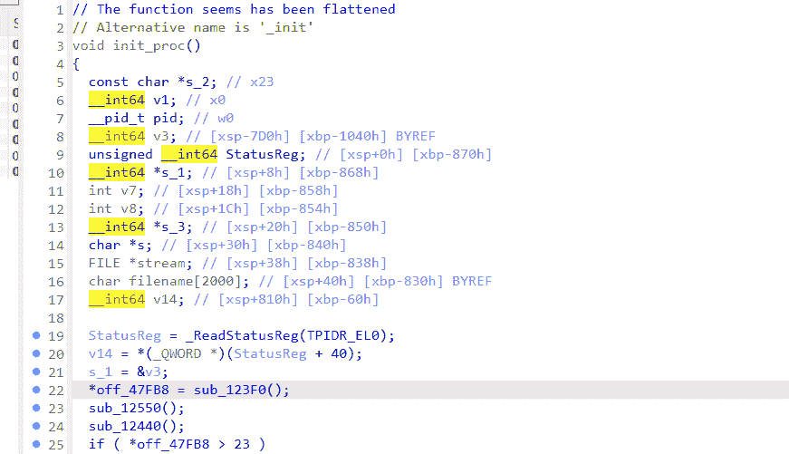

这里选取`sub_123F0`

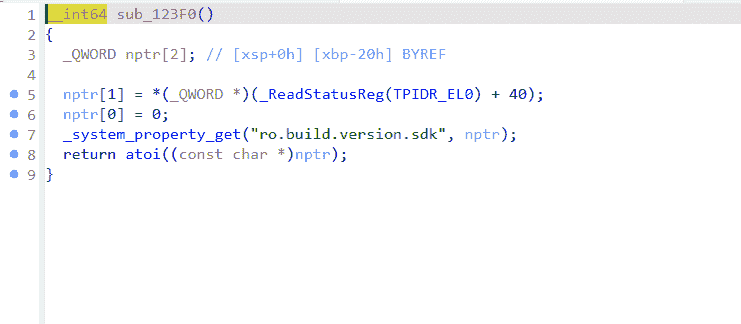

接下来使用`frida` hook `dlopen`函数，当加载`libmsaoaidsec.so`时，在`onEnter`回调方法中hook `_system_property_get`函数，以`"ro.build.version.sdk"`字符串作为过滤器。

如果`_system_property_get`函数被调用了，那么这个时候也就是`.init_proc`函数刚刚调用的时候，在这个时机点可以注入我想要的代码，具体实现如下：

```
function hook_dlopen(soName = '') {
    Interceptor.attach(Module.findExportByName(null, "android_dlopen_ext"),
        {
            onEnter: function (args) {
                var pathptr = args[0];
                if (pathptr !== undefined && pathptr != null) {
                    var path = ptr(pathptr).readCString();
                    if (path.indexOf(soName) >= 0) {
                        locate_init()
                    }
                }
            }
        }
    );
}

function locate_init() {//
    let secmodule = null
    Interceptor.attach(Module.findExportByName(null, "__system_property_get"),
        {
            // _system_property_get("ro.build.version.sdk", v1);
            onEnter: function (args) {
                secmodule = Process.findModuleByName("libmsaoaidsec.so")
                var name = args[0];
                if (name !== undefined && name != null) {
                    name = ptr(name).readCString();
                    if (name.indexOf("ro.build.version.sdk") >= 0) {
                        // 这是.init_proc刚开始执行的地方，是一个比较早的时机点
                        // do something
                        // hook_pthread_create()
                        bypass()
                    }
                }
            }
        }
    );
}

function hook_pthread_create() {
    console.log("libmsaoaidsec.so --- " + Process.findModuleByName("libmsaoaidsec.so").base)
    Interceptor.attach(Module.findExportByName("libc.so", "pthread_create"), {
        onEnter(args) {
            let func_addr = args[2]
            console.log("The thread function address is " + func_addr)
        }
    })
}

function nopFunc(parg2) {
    // 修改内存保护，使其可写
    Memory.protect(parg2, 4, 'rwx');
    // 使用 Arm64Writer 写入 'ret' 指令
    var writer = new Arm64Writer(parg2);
    writer.putRet();
    writer.flush();
    writer.dispose();
    console.log("nop " + parg2 + " success");
}

function bypass(){
    let module = Process.findModuleByName("libmsaoaidsec.so")
    nopFunc(module.base.add(0x1c544))
    nopFunc(module.base.add(0x1b8d4))
    nopFunc(module.base.add(0x26e5c))

}
// pthread\_create libmsaoaidsec.so 0x1c544 0x731552b960\
// pthread\_create libmsaoaidsec.so 0x1b8d4 0x0\
// pthread\_create libmsaoaidsec.so 0x26e5c 0x0

setImmediate(hook_dlopen, "libmsaoaidsec.so")
```

实现过程中如果在`system_property_get`函数内hook `pthread_create`来找检测函数时找不到的，可能`system_property_get`函数触发的还不够早。因此直接打印所有`pthread_create`调用。

```
function hook_pthread_create() {

    // pthread_create 在 libc.so 内
```


```
var pth = Module.findExportByName("libc.so", "pthread_create");
console.log("\n- pthread_create =", pth);
Interceptor.attach(pth, {
    onEnter: function (args) {
        // pthread_create(pthread_t*, attr, start_routine, arg)
        this.start_routine = args[2];  // 新线程入口地址
    },
    onLeave: function (retval) {
        var entry = this.start_routine;
        if (!entry) return;
        var entryPtr = ptr(entry);
        var mod = Process.findModuleByAddress(entryPtr);
        var tid = Process.getCurrentThreadId();
        var name = getThreadName(tid);
        console.log("\n================= New Thread =================");
        console.log("Thread ID     :", tid);
        console.log("Thread Name   :", name);
        console.log("Entry Address :", entryPtr);
        if (mod) {
            console.log("Module        :", mod.name);
            console.log("Offset        :", entryPtr.sub(mod.base));
        } else {
            console.log("Module        : ");
        }
        console.log("================================================\n");
    }
});
}
function getThreadName(tid) {
    try {
        var f = new File("/proc/self/task/" + tid + "/comm", "r");
        var name = f.readLine();
        f.close();
        return name.trim();
    } catch (_) {
        return "unknown";
    }
}
setImmediate(hook_pthread_create);
```

找到三哥检测函数

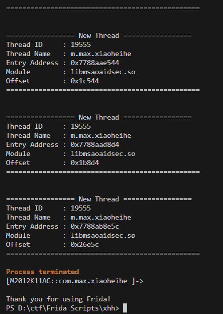

再去`nop`这三个函数

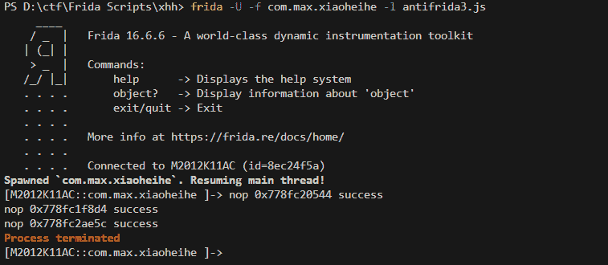

令人失望的是，进程依然被杀死了，样本似乎有完整性检验

## 4> 思路三

### fake替换

拦截`pthread_create`，将检测线程的入口函数替换为空函数

```
/*
 * MSA (libmsaoaidsec.so) 反调试绕过脚本 - 修复版
 * 原理：拦截 pthread_create，将检测线程的入口函数替换为空函数
 * 优点：不修改内存代码段，不会触发 CRC/完整性校验崩溃
 */

// 1. 定义一个“假”的线程入口函数
// 相当于 C 语言中的: void* fake_worker(void* args) { return NULL; }
var fake_thread_func = new NativeCallback(function (arg) {
    console.log("   [+] 成功拦截检测线程，当前通过假函数执行 (无害化处理)");
    // 某些检测逻辑可能会检查线程是否存活，稍微休眠一下模拟正常线程（可选）
    // Thread.sleep(0.05);
    return ptr(0);
}, 'pointer', ['pointer']);

// 2. 核心 Hook 逻辑
function hook_pthread_create() {
    var pth_create_addr = Module.findExportByName("libc.so", "pthread_create");
    console.log("\n- Hooking pthread_create at: " + pth_create_addr);

    if (!pth_create_addr) {
        console.error("[-] 无法找到 pthread_create，脚本无法运行");
        return;
    }

    Interceptor.attach(pth_create_addr, {
        onEnter: function (args) {
            // args[0]: thread指针
            // args[1]: 属性
            // args[2]: 线程入口函数地址 (start_routine)
            console.log("\n- 发现 MSA 尝试创建线程 | 偏移: " + offset);

            // 3. 匹配你日志中出现的检测线程偏移
            // 注意：如果版本更新，这些偏移量可能会变，需要看日志更新这里
            if (offset.equals(0x1c544) ||
                offset.equals(0x1b8d4) ||
                offset.equals(0x26e5c)) {

                console.warn("   [!] ⚠️ 命中反调试/检测线程 (偏移: " + offset + ")");
                console.warn("   [!] 正在替换线程入口 -> fake_thread_func");

                // 核心操作：替换入口函数
                args[2] = fake_thread_func;
            } else {
                console.log("   [?] 发现未知的 MSA 线程 (偏移: " + offset + ")，暂时放行...");
                // 如果程序依然崩溃，请把这个新的偏移也加到上面的 if 判断里
            }
        },
        onLeave: function (retval) {
        }
    });
}

// 4. 辅助：为了保证不漏掉最早期的线程，我们在加载 SO 时就准备好
function monitor_dlopen() {
    var android_dlopen_ext = Module.findExportByName(null, "android_dlopen_ext");
    if (android_dlopen_ext) {
        Interceptor.attach(android_dlopen_ext, {
            onEnter: function (args) {
                var pathPtr = args[0];
                if (pathPtr) {
                    var path = pathPtr.readCString();
                    if (path && path.indexOf("libmsaoaidsec.so") >= 0) {
                        console.log("[+] 目标 SO 正在加载: " + path);
                        // 其实 pthread_create 是全局 Hook，这里只是为了打印提示
                    }
                }
            }
        });
    }
}

function main() {
    console.log("========================================");
    console.log("   MSA Anti-Debug Bypass Script Loaded  ");
    console.log("========================================");

    // 启动 dlopen 监控（可选）
    monitor_dlopen();

    // 启动核心 Hook
    hook_pthread_create();
}

setImmediate(main);
```

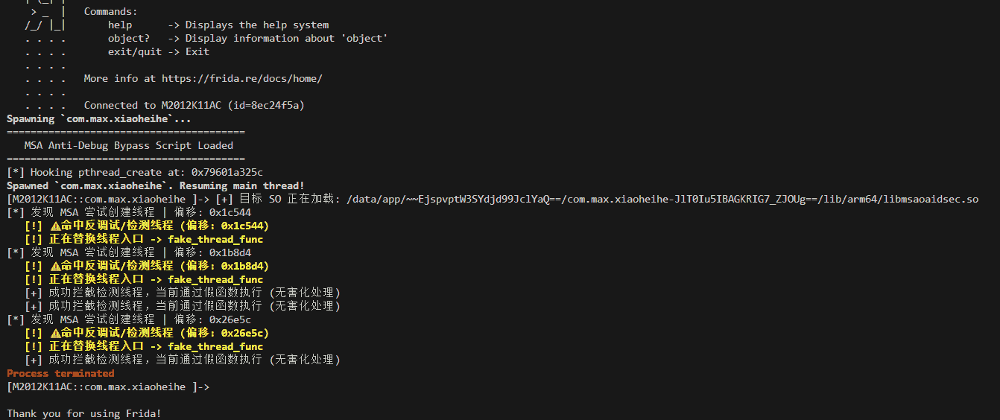

进程依然被杀死了

既然不能替换入口函数，那我们来试试替换`pthread_create`

```
function create_fake_pthread_create() {
    const fake_pthread_create = Memory.alloc(4096)
    Memory.protect(fake_pthread_create, 4096, "rwx")
    Memory.patchCode(fake_pthread_create, 4096, code => {
        const cw = new Arm64Writer(code, { pc: ptr(fake_pthread_create) })
        cw.putRet()
    })
    return fake_pthread_create
}

function hook_dlsym() {
    var count = 0
    console.log("=== HOOKING dlsym ===")
    var interceptor = Interceptor.attach(Module.findExportByName(null, "dlsym"), {
        onEnter: function (args) {
            const name = ptr(args[1]).readCString()
            console.log("[dlsym]", name)
            if (name == "pthread_create") {
                count++
            }
        },
        onLeave: function (retval) {
            if (count == 1) {
                retval.replace(fake_pthread_create)
            } else if (count == 2) {
                retval.replace(fake_pthread_create)
            } else if (count == 3) {
                retval.replace(fake_pthread_create)
                interceptor.detach()
                // 完成3次替换, 停止hook dlsym
            }
        }
    })
    return Interceptor
}

function hook_dlopen() {
    var interceptor = Interceptor.attach(Module.findExportByName(null, "android_dlopen_ext"), {
        onEnter: function (args) {
            var pathptr = args[0];
            if (pathptr !== undefined && pathptr != null) {
                var path = ptr(pathptr).readCString();
                console.log("[LOAD]", path)
                if (path.indexOf("libmsaoaidsec.so") > -1) {
                    hook_dlsym()
                }
            }
        }
    })
    return interceptor
}

// 创建虚假pthread_create
var fake_pthread_create = create_fake_pthread_create()
var dlopen_interceptor = hook_dlopen()
```

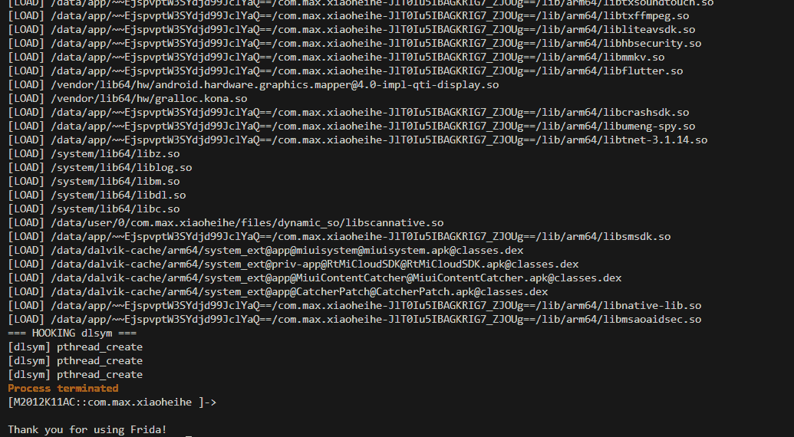

下面是思路三两个脚本的对比：

- 拦截时机与切入点不同
  - 脚本 A (`hook_pthread_create`) —— 【安检门拦截】
    - 切入点：`libc.so` 的 `pthread_create` 函数。
    - 逻辑：这是创建线程的必经之路（安检门）。脚本守在这里，检查每一个要过关（创建）的线程。如果发现是 MSA 的“坏人”（通过偏移量判断），就把他拦下来，换成一个“假人”（空函数）放过去。
    - 时机：运行时（Runtime）。是在 MSA 已经拿到了创建线程的能力，真正要去执行创建动作的那一瞬间拦截。
  - 脚本 B (`hook_dlsym`) —— 【供应链投毒/发假证件】
    - 切入点：`dlsym` 函数。
    - 逻辑：MSA 刚启动时，会问系统：“请给我 `pthread_create` 的地址，我要用它”。脚本拦截了这个请求，给 MSA 返回了一个假的地址（指向一个只有 `RET` 指令的内存块）。MSA 以为自己拿到了真的函数，高高兴兴地拿回去用。
    - 时机：准备阶段（Resolution）。是在 MSA 还没开始创建线程，正在寻找“工具”的时候，给它一个假工具。
- 对抗“Inline Hook 检测”的能力不同
  - 脚本 A (风险较高)
    - 它直接 Hook 了全局的 `pthread_create`。
    - Frida 会修改 `pthread_create` 的头部指令（插入跳转代码）。
    - 弱点：如果 MSA 在调用 `pthread_create` 之前，先检查一下这个函数的头部指令是不是原厂的（检测 Inline Hook），就会发现被修改了，从而崩溃或自杀。
  - 脚本 B (极度隐蔽)
    - 它完全没有碰 `pthread_create` 函数本身。真正的 `pthread_create` 依然是纯净的原厂状态。
    - 它只是骗了 MSA，让 MSA 去调用另一个地方。
    - 优势：即使 MSA 疯狂检查 `pthread_create` 有没有被 Hook，也查不出任何问题，因为它确实没被 Hook。
