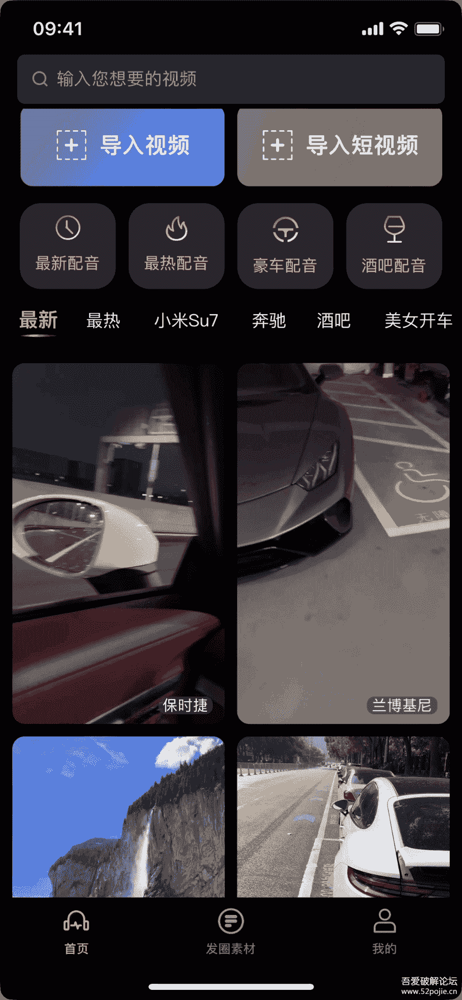

# [iOS 原创] iOS应用逆向攻防实战-雅俗共赏

- 原帖: https://www.52pojie.cn/forum.php?mod=viewthread&tid=2079337

- 抓取时间: 2026-11-01T13:50:51.011Z

今天有个群友发我了一款软件，想让我分析一下，原因是想发朋友圈了，故大体看了一下。

本教程详细记录了对 iOS 应用“雅俗共赏”进行逆向分析的完整流程。旨在帮助开发者理解 iOS 逆向工程的核心方法论：

侦查 (Recon) -> 动态分析 (Dynamic Analysis) -> 漏洞利用 (Exploitation) -> 持久化 (Persistence)。



## 1. 侦查与定位 (Discovery)

逆向的第一步是了解目标。我们需要知道应用在系统中的身份（`PID`, `BundleID`）。

### 1.1 获取进程信息

确保越狱设备已连接并安装 Frida 服务端。在 Mac 终端运行：

```
frida-ps -Ua
```

输出分析：

我们立刻找到了目标应用：

- Name: 雅俗共赏

- Bundle Identifier: `com.flnsygs.cn`

- `PID`: 3813 (每次启动会变)

## 2. 界面层级分析 (UI Analysis)

知道 `PID` 后，我们需要通过界面找到对应的代码逻辑入口。

比如，“开通会员”按钮背后是哪个控制器在处理？

### 2.1 编写界面分析脚本 (`inspect_ui.js`)

我们编写了一个 Frida 脚本来遍历当前的 `UIWindow` 层级。

核心逻辑：

```
// 获取当前 Window 的 RootViewController，并递归找到最顶层的 VC

var topVC = getTopViewController(rootVC);

console.log("[+] 当前顶层控制器: " + topVC.class().toString());
```

### 2.2 运行观察

运行命令：`frida -U -n "雅俗共赏" -l inspect_ui.js`

结果：

- 当前控制器: `VSMineViewController` (我的页面)

- 关键文本: 界面上扫描到了 "请点击登录" 和 "立即开通" 等 `Label`。

- 线索: 控制器类名以 `VS` 开头，这很可能是该应用自定义类的前缀。

## 3. 核心逻辑定位 (Targeting)

有了 `VS` 前缀，我们可以缩小搜索范围，专门寻找处理用户信息（`User/Vip`）的类。

### 3.1 编写类搜索脚本 (`search_vip_info.js`)

利用 Objective-C Runtime 遍历所有类，过滤出符合 `VS` + `User/Vip` 模式的类，并打印其方法。

核心逻辑：

```
for (var className in ObjC.classes) {
    if (className.startsWith("VS") && className.includes("Model")) {
        // 打印方法列表...
    }
}
```

### 3.2 运行结果

运行命令：`frida -U -n "雅俗共赏" -l search_vip_info.js`

我们发现了“宝藏”类：`VSUserModel`。

它包含了极其露骨的方法：

- `-(BOOL)isForeverVip;`  (是否永久会员)

- `-(NSInteger)memberStatus;`

- `-(NSString*)memberExpireTimeStr;`

## 4. 动态调试与验证 (Hooking)

找到 `isForeverVip` 后，我们不急着改代码，先用 Frida 动态验证一下：如果我强行让它返回 `YES`，App 会真的给我会员吗？

### 4.1 编写 Hook 脚本 (`hook_vip.js`)

使用 `Interceptor.attach` 拦截该方法的返回值。

核心代码：

```
var method = ObjC.classes.VSUserModel["- isForeverVip"];

Interceptor.attach(method.implementation, {

    onLeave: function (retval) {

        // 强行篡改返回值为 1 (True)

        retval.replace(ptr(1)); 

        console.log("[+] Hooked! isForeverVip -> YES");

    }

});
```

### 4.2 验证结果

- 运行脚本。

- 在手机上下拉刷新“我的”页面。

- 结果：手机界面瞬间从“立即开通”变成了“永久会员”，且过期时间变成了我们伪造的 2099 年。验证成功！

## 5. 插件开发与持久化 (Tweak Development)

Frida 的修改是临时的。要制作一个永久生效的插件（即使没有电脑也能用），我们需要编写 `Logos` 代码并编译为 `dylib`。

### 5.1 编写 Tweak 代码 (`Tweak.xm`)

将上述 Hook 逻辑翻译成 Theos 支持的 `Logos` 语法：

```
#import 

// Hook 目标类
%hook VSUserModel

// 重写 isForeverVip 方法
- (BOOL)isForeverVip {
    return YES; // 永久会员
}

// 重写会员状态
- (NSInteger)memberStatus {
    return 1;
}

// 重写过期时间
- (NSString *)memberExpireTimeStr {
    return @"2099-12-31";
}

%end

%hook VSVipModel
- (NSString *)payPrice { return @"0.00"; }
%end
```

### 5.2 编译与安装

- 创建工程: 使用 `/opt/theos/bin/nic.pl` 创建 `iphone/tweak` 工程。

- 配置 `Makefile`:

```
THEOS_DEVICE_IP = 192.168.x.x

target = iphone:latest:7.0

ARCHS = arm64
```

- 替换源码: 将上面的 `Tweak.xm` 内容复制到工程中。

- 打包安装:

```
make package install
```

## 最终效果

设备重启后，该应用依然保持 VIP 解锁状态。

## 总结

本次逆向分析展示了标准的“黑盒测试”流程。关键在于：

- Observability (可观测性)：通过 Frida 脚本让 App 内部结构（UI/Classes）可视化。

- Hypothesis (假设)：根据 UI 猜测类名前缀，根据类名猜测 VIP 逻辑。

- Verification (验证)：通过动态 Hook 验证假设。
