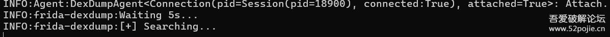
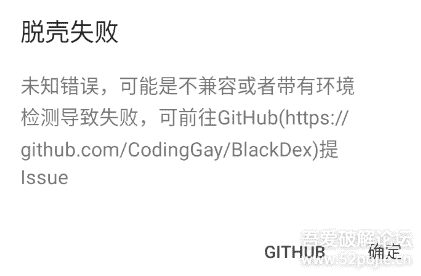
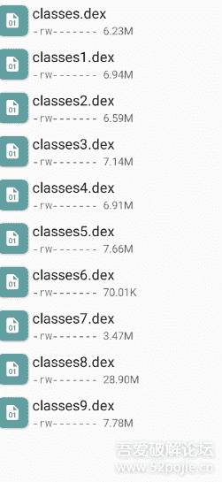
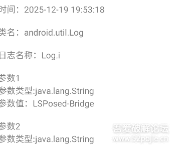
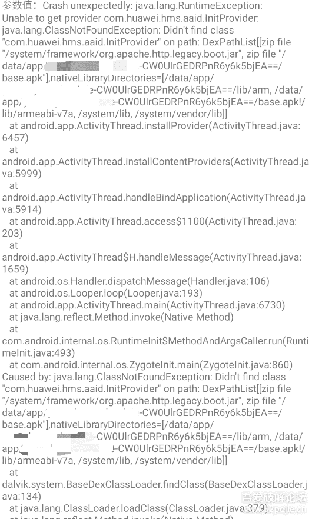
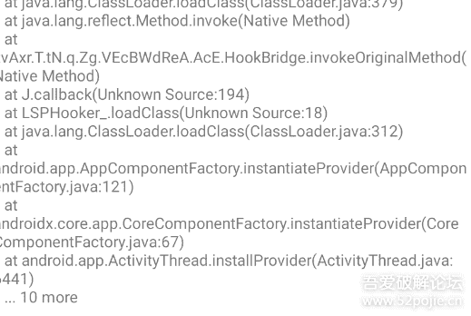
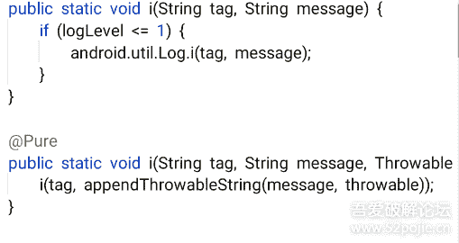

# [Android 原创] 安卓逆向新手关于某运动健康app的脱壳修复(未完成)

- 原帖: https://www.52pojie.cn/forum.php?mod=viewthread&tid=2081184
- 抓取时间: 2026-11-01T13:50:40.289Z

## 脱壳尝试

首先，这个app有壳，`mt`自带的检测表示是三个数字的加固


### 方法1：使用 `frida-dexdump -U -f 包名` 来脱壳

然后就一直卡在这个界面，gg



### 方法2：使用小黑盒脱壳

gg



### 方法3：使用 `DITOR` 脱壳

在网上找资料下了一个`DITOR`（好像是b站下的忘了，大概看了下好像也是基于`frida`去脱壳的），给我脱下来了，一共有10个`dex`文件，有一个是跟原app一样的`dex`要删掉，还有一个是壳`dex`（有`stub`）也要删掉，然后去`xml`中找到`android:icon`下面的`android:name`那一行删掉，因为`dex`中没有入口，修复脱出来的`dex`，添加进原app覆盖即可。





#### `DITOR`的方法

```javascript
Java.perform(function () {
    var class_name = "请输入类名"
    var method_name = "请输入方法名"
    var log_path = undefined
    function frida_hook(targetClass,targetMethod) {
        var hook = Java.classFactory.use(targetClass);
            hook.targetMethod.overload("请输入参数类型").implementation = function() {
            //print stack trice
            var bt = Java.use("android.util.Log").getStackTraceString(Java.use("java.lang.Exception").$new());
            write("nBacktrace:n" + bt);
            //please start your creation↓↓↓
            var retval = this.targetMethod.apply(this, arguments);
            return retval;
        }
    } 
      function write(str){
        if(log_path == undefined) log_path = '/sdcard/'+ method_name + '.txt'
        console.log(str)
        var file = new File(log_path,'a')
        if(file != undefined){
        file.write(str + '\n')
        file.flush()
        file.close()
    }
  }
        var Application = Java.use("android.app.Application");
        console.log("hook Application...");
        Application.attach.overload("android.content.Context").implementation = function(context){
        console.log("hooked attachBaseContext...");
        var result = this.attachBaseContext(context);
        Java.classFactory.loader = context.getClassLoader();
        frida_hook(class_name,method_name);
        return result;
       }
});
```

## 签名校验

然后就是签名校验，`mt`提示是`V1+V2`，直接用`mt`去签闪退，授权`算法助手`查看日志，定位代码，卡这了










## VIP方法

这是它的vip方法，就是用当前方法主要功能：处理VIP用户状态更新和界面刷新。下次试试运行中用`frida`去`hook`这个方法

```java
public Object invoke(Object obj) {

// 调用具体类型的方法

invoke((UserResp) obj);

// 返回Kotlin单位类型（相当于void）

return Unit.INSTANCE;

}

public final void invoke(UserResp userResp) {

// 检查userResp参数不为空

Intrinsics.checkNotNullParameter(userResp, "result");

// 访问外部类的isVipUser属性
CourseDetailActivity.access$isVipUser$p(this.this$0);

// 获取视图绑定对象并触发智能刷新布局的自动刷新
CourseDetailActivity.access$getViewBinding(this.this$0).smartRefreshLayout.autoRefresh();

// 根据响应数据设置VIP用户状态
CourseDetailActivity.access$setVipUser$p(this.this$0, userResp.isVip());

}

}
```

## 小tips

关于在物理机用`adb`连接模拟器时，输入`su`有时候会提示`permission denied`，打开`面具`，从下面打开超级用户授权就可以了


