# [Android 原创] 某wx小游戏反编译逆向分析

- 原帖：`https://www.52pojie.cn/forum.php?mod=viewthread&tid=2081826`
- 抓取时间：2026-11-01T13:50:30.592Z

这两天在某直播平台看到有人直播玩这个游戏，也就点进去玩了会感觉挺有意思的。所以就想着看能不能逆向下，因为这个平台的小游戏逆向不了解，所以到wx小程序搜索了下果然也有这个游戏。直接`fiddler`抓包试下看到了个登录接口，请求参数是加密的，返回数据竟然是未加密。

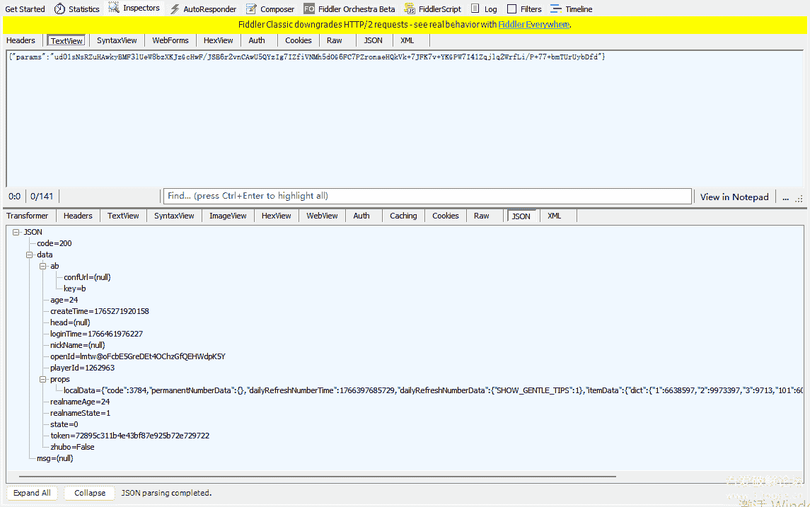

## 抓包与修改金币钻石

把请求拖进`AutoResponder`，修改`response`数据，对比了下游戏中我的资源定位了大概这里是游戏的金币和钻石，直接修改数值大一点。

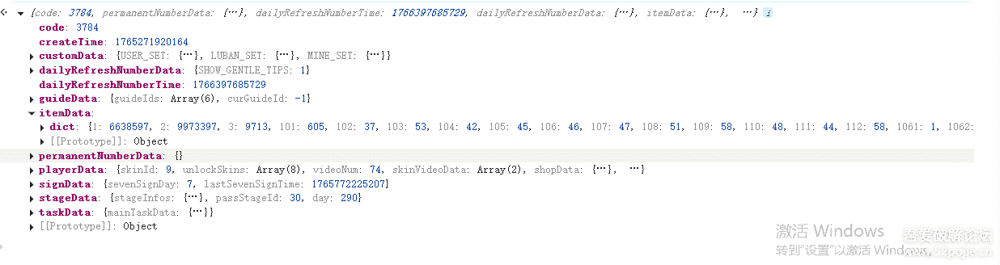

关闭然后重新进游戏，发现果然金币和钻石数据变了，说明修改成功。简单的测试了下其他数据如下

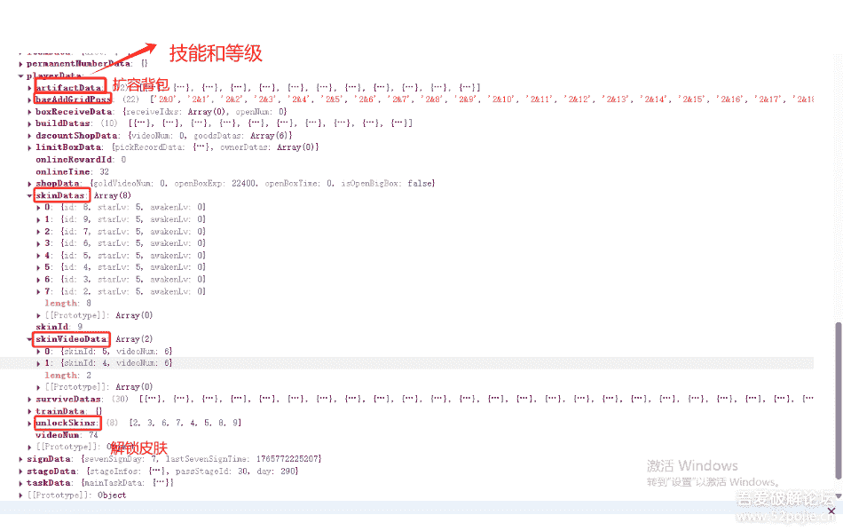

感觉只改这些还是不爽，因为修改技能等级最大打后面关卡还是打不过，就想着能不能拿到反编译代码，修改每局的道具逻辑。

## 反编译小游戏

反编译小游戏，我使用的是`wxapkg`，`scan`一下。

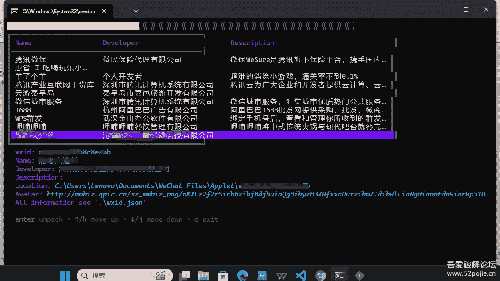

直接回车，开始自动反编译代码。

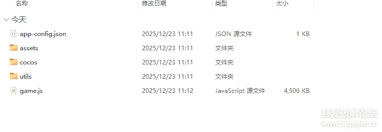

把`app-config.json`文件手动改成`game.json`，`game.json`中的`gamePlugins`改完`plugins`。

## 导入开发者工具与修复运行问题

导入项目到wx开发者工具里运行。提示这个错误，看着应该是缺少`cocos2d-js-min.js`，网上搜索了个js放到`cocos`文件夹下。

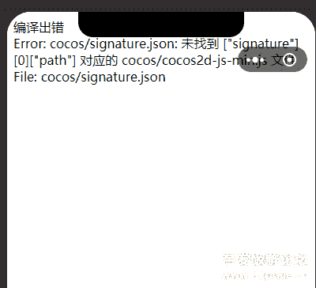

又出现了`md5`不一致问题，复制提示文字中的`md5`到`signature.json`文件中替换`md5`值。

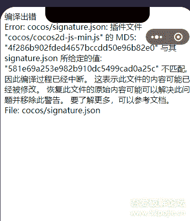

终于这个问题解决了，又遇到新问题了。开发者工具中报错`ERROR 4930, please go to https://github.com/cocos-creator/engine/blob/master/EngineErrorMap.md#4930 to see details.`，应该是游戏图片中的问题，定位报错位置试着去掉`new Error`的代码。

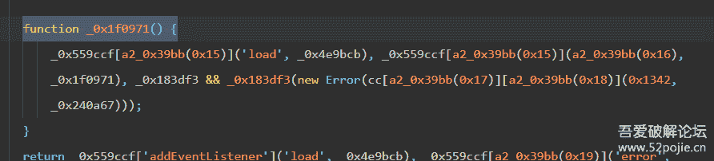

这里登录的`openid`不对，登录一直失败使用代理，用`fiddler`抓到的包替换，返回正常的登录信息。可以进到游戏页面了，但是因为我注释的代码原因导致游戏中图片显示不出来，看来是玩不了了。

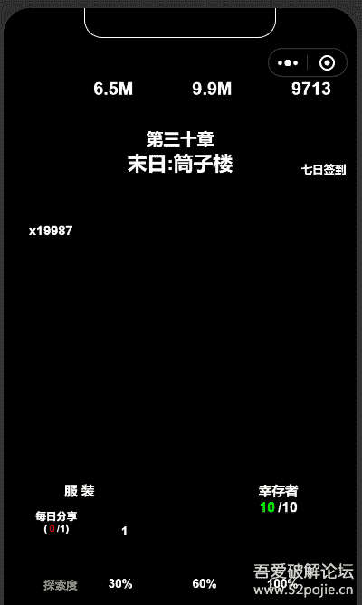

## 登录失败与加密算法分析

无奈放弃本地玩了，只能想着能不能逆向出来加密算法，所以接着查看`game.js`文件，游戏逻辑全在这个文件里。搜索`encrypt`关键词，找到了一个可疑方法搜索`encryptStr`，这里应该是所有接口请求的加密解密方法。

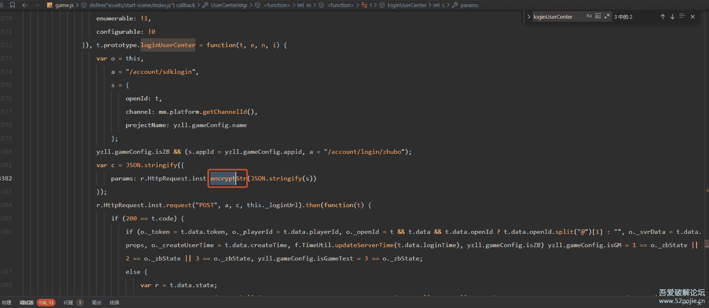

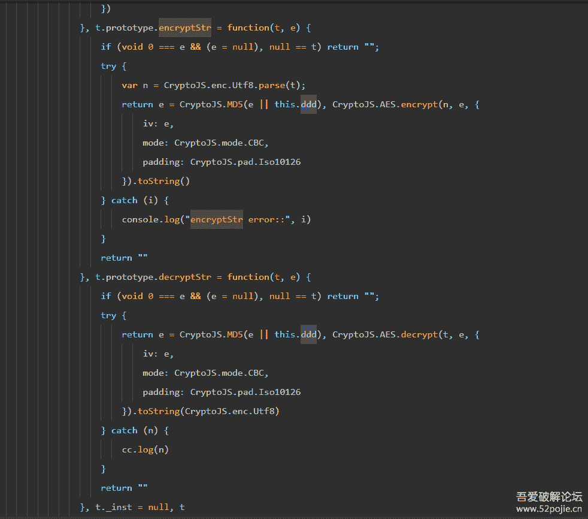

把代码直接放到AI里分析，使用的是`AES`的`CBC`加密，`this.ddd`作为默认密钥，在代码里找到了`ddd`的字符串，让AI给我生成了一段js代码实现数据加密解密，运行一下看到解密成功。先到这里，时间有点急，排版有点乱。

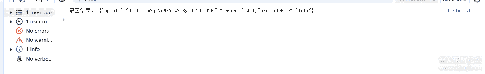
