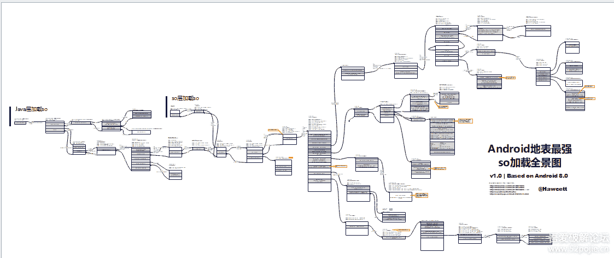

# [Android 原创] 地表最强 Android so加载全景图

- 原帖: https://www.52pojie.cn/forum.php?mod=viewthread&tid=2083097
- 抓取时间: 2026-11-01T13:50:14.410Z

so加载的流程又臭又长，学习的过程中的一个痛点是：经常就忘了现在这个函数是哪到哪了，在整个加载流程中，是处于哪个位置。于是自己画了一张图，供各位在学习过程中，能够快速定位到位置

暂时先这样，后续过程中可能还会对图片进行升级，到时候再发新版，图中有什么错误也可以在评论区指出，感谢你的支持

因为论坛的编辑框限制了上传图片的分辨率，所以上面的图片是个缩略图，很模糊。没关系，我已经备好了PNG格式的原图，烦请大家移步网盘下载

压缩包内含两个版本
一份是标清版的，个人喜欢这一版，因为宋体的字体在13号以下都是像素风的风格，比较符合楼主的口味
一份是高清版的，后面带HD的

网盘地址：https://mkc.lanzouu.com/ikx2u3es89fi
