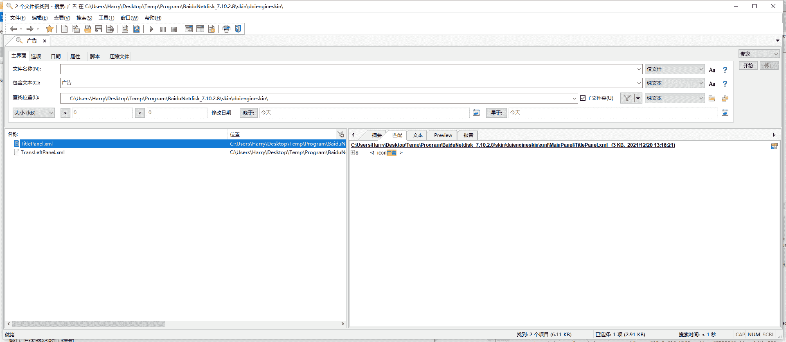
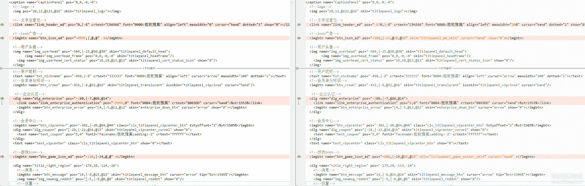
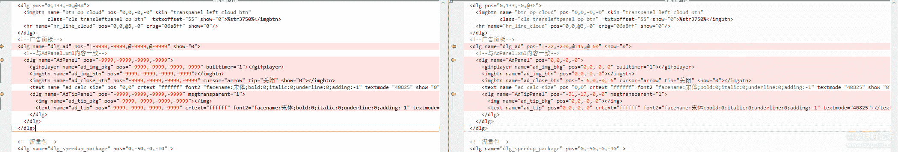

# [原创] 百X云 PC版去广告
- 原帖: https://www.52pojie.cn/forum.php?mod=viewthread&tid=1570933
- 抓取时间: 2026-11-01T23:42:57

## BDY PC版去广告教程
这里以官网下载的最新版本7.10.2.8为例,其他版本请自行测试

不提供成品

不提供成品

不提供成品

想要成品的请绕道

### 去广告

#### 原理
修改皮肤文件,修改弹窗的位置达到使弹窗不可见

#### 相关路径
皮肤文件路径

> 
`软件根目录\skin\duiengineskin.zip`

#### 前期准备
解压上述路径的压缩包

#### 思路
用内容搜索工具搜索整个文件夹,关键字为`广告`,效果如图



#### 修改文件

##### TitlePanel.xml
我们打开`TitlePanel.xml`以后看到如下内容,篇幅原因做了删减,仅展示了广告有关的代码

```
  
  
- 

  
   

   
  
    
- %str1553%
    
  

  
  

  
```

我们可以清晰的看到每个部分的布局代码,这样我们就可以依照自己的需求做改动.对于去除广告,我们可以修改它们的显示位置,也就是`pos`这个属性.下面我举几个例子

- 
- 修改前: 
```
- 
```
- 修改后
```
- 
```
- 
- 修改前: 
```
```
- 修改后
```
 
其他的修改位置你们可以参照这张图



image.png (176.26 KB, 下载次数: 0)

[href="forum.php?mod=attachment&aid=MjM2Mjc4NXwwMDg2MmRlMnwxNzkzNTc2NTc1fDE2ODA4NnwxNTcwOTMz&nothumb=yes" target="_blank"](https://www.52pojie.cn/forum.php?mod=attachment&aid=MjM2Mjc4NXwwMDg2MmRlMnwxNzkzNTc2NTc1fDE2ODA4NnwxNTcwOTMz&nothumb=yes)

2022-1-3 21:55 上传

##### TransLeftPanel.xml
我们接着打开`TransLeftPanel.xml`,看到以下内容

```
```

我们除了和刚刚一样的操作外,还看到了一条注释.

> 
与`AdPanel.xml`内容一致

我们修改完这个文件后,再去寻找`AdPanel.xml`

修改方式和之前的雷同,这里就不在赘述了. 详情请看图



微信截图_20220103215607.png (91.77 KB, 下载次数: 1)

[href="forum.php?mod=attachment&aid=MjM2Mjc4NnwxYjkyMzRmNHwxNzkzNTc2NTc1fDE2ODA4NnwxNTcwOTMz&nothumb=yes" target="_blank"](https://www.www.52pojie.cn/forum.php?mod=attachment&aid=MjM2Mjc4NnwxYjkyMzRmNHwxNzkzNTc2NTc1fDE2ODA4NnwxNTcwOTMz&nothumb=yes)

2022-1-3 21:56 上传

##### AdPanel.xml (`AdCardWnd.xml`)
我们并没有找到这个文件,但是找到了类似的文件名`AdCardWnd.xml`

```
   
       
          
    
  
```

老规矩,这里把`body`里面的内容都删了就可以,或者修改`pos`的值也可以.

```
```

#### 重新打包
这样修改完成后,重新打包为`zip`文件,重新打开百度云就可以了
