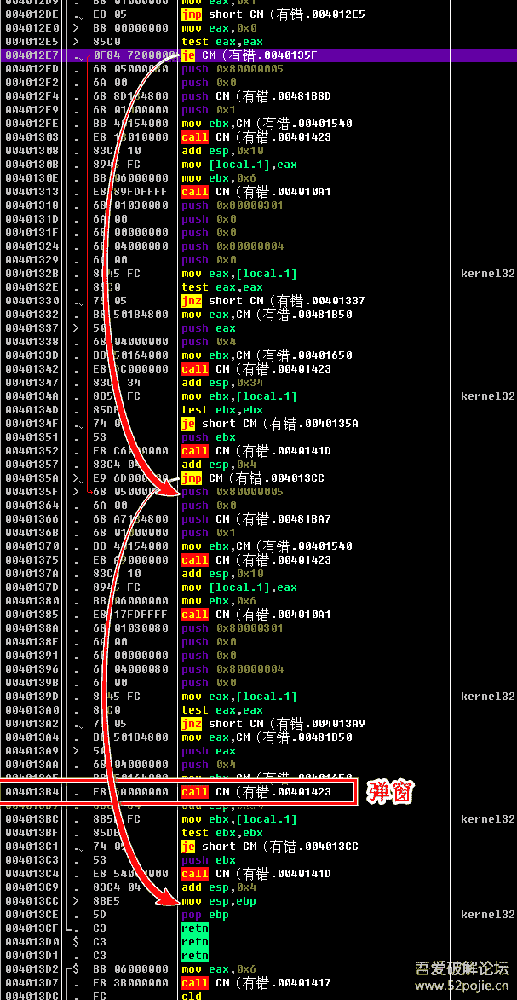

# [分享] 玩玩破解第九集学习心得分享

- 原帖: https://www.52pojie.cn/forum.php?mod=viewthread&tid=1571382
- 抓取时间: 2026-11-01T23:42:55

纯小白，偶然发现yyhd大佬写的教程，特意注册了号来学习，学到 https://www.52pojie.cn/thread-1360574-1-1.html，发现后半段不是很明白，经过多次尝试和思考，终于学会。现分享我的心得如下：

1. 从断点开始，`F8`一步一步向下，一直到程序弹出“登录失败”窗口，此时地址：`004013B4`
2. 于是思考，弹窗等于失败，不弹窗是不是就可能等于成功，想要不弹窗，是不是需要有个命令跳过他，命令跳过来是不是要一个落脚点，于是往下找落脚点（一个一个的点），点到`004013CC`的位置，果然发现有一根红线指过来
3. 从`004013CC`往上找，发现`0040135A`和`004011D2`都跳到`004013CC`，于是先看`0040135A`能不能跳过判断，如果不能，再去看`004011D2`
4. 接下来就要确保`0040135A`的`JMP`顺利运行，不被跳过，同上，从`0040135A`往下找落脚点，发现只有`0040135F`是从外边跳进来的，完美躲过了上面的`JMP`
5. 于是顺着`0040135F`往上，找到了`004012E7`位置的`JE`，双击改成`NOP`，保存，运行，成功破解

QQ截图20220104172736.png (93.15 KB, 下载次数: 0)

https://www.52pojie.cn/forum.php?mod=attachment&aid=MjM2MzEwMXxiMjNhODRlMHwxNzkzNTc2NTcyfDE2ODA4NnwxNTcxMzgy&nothumb=yes

2022-1-4 18:25 上传
