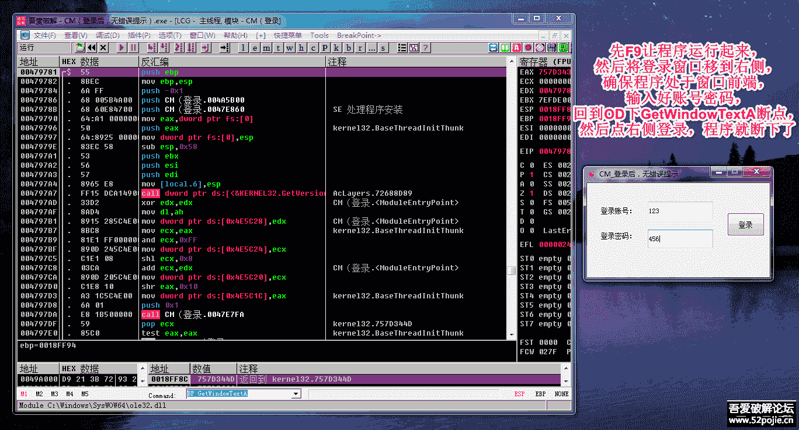
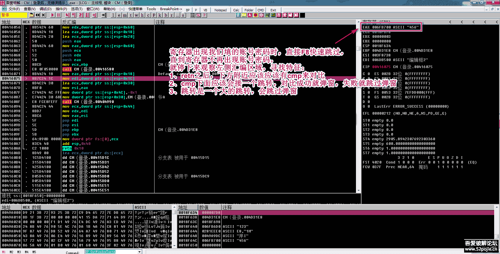
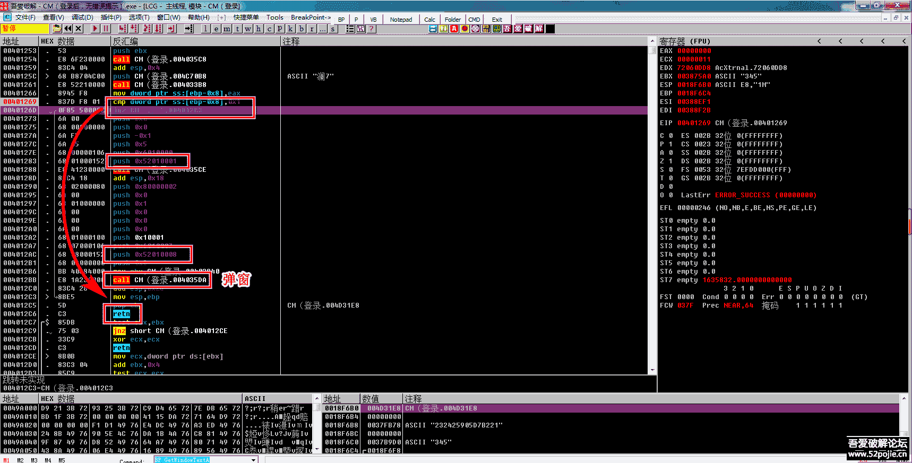
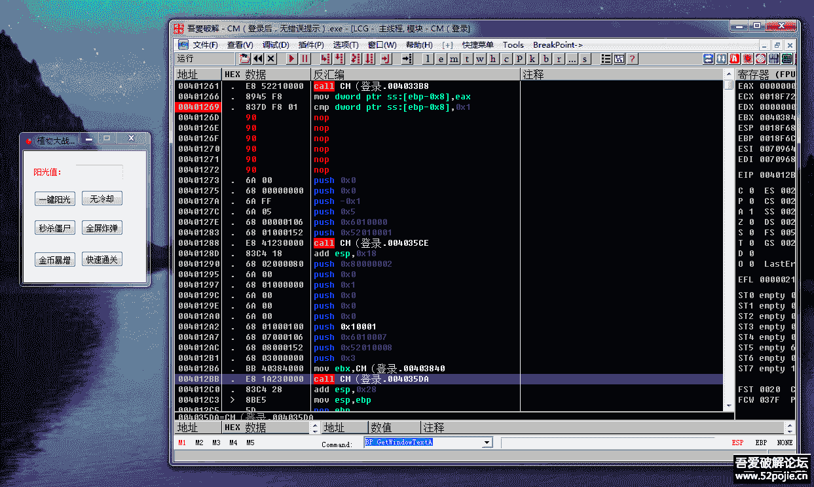

# [分享] 玩玩破解第十集学习心得分享

- 原帖：[https://www.52pojie.cn/forum.php?mod=viewthread&tid=1573097](https://www.52pojie.cn/forum.php?mod=viewthread&tid=1573097)
- 抓取时间：2026-11-01T23:42:46

原贴：[https://www.52pojie.cn/thread-1361115-1-1.html](https://www.52pojie.cn/thread-1361115-1-1.html)

为了 `retn` 到关键位置，研究了2天，每次都是 `retn` 个十多次左右就放弃了（前面几课都是 `retn` 个两三次就到关键位置，这个程序要 `retn` 二十多次）。这也让我学到了，[www.52pojie.cn](https://www.52pojie.cn)并不是玩玩，需要坚持和耐心。

这一课有个关键点，看下图：

`20220108093847.png` (114.71 KB, 下载次数: 1)

[附件](https://www.52pojie.cn/forum.php?mod=attachment&aid=MjM2Mzg2N3xiNzY4ODI3N3wxNzkzNTc2NTY0fDE2ODA4NnwxNTczMDk3&nothumb=yes)

2022-1-8 09:48 上传

接下来先整理思路：

1. 程序已经在 `GetWindowTextA` 断下来了，说明程序已经拿到了我们填的账号 `123` 密码 `456`，接下来应该就是计算、对比，对比成功就弹窗，失败就调过弹窗，什么都不做

2. 根据前面学到的，在 `00401000` 位置，判断程序是易语言，所以 `push 52010001` 这样的窗口ID也是特征

3. 总结一下就是，当寄存器出现我们的账号密码，说明还没开始对比，此时大胆 `F8`，快速跳过，直到寄存器不再出现我们的账号密码，这个时候就 `F8` 一步一步观察左侧有没有符合特征的：

    `retn -> cmp -> 成功就弹窗，失败就跳转`

`20220108101016.png` (90.14 KB, 下载次数: 1)

[附件](https://www.52pojie.cn/forum.php?mod=attachment&aid=MjM2MzkwNHxkNTQ0Zjk3OXwxNzkzNTc2NTY0fDE2ODA4NnwxNTczMDk3&nothumb=yes)

2022-1-8 11:25 上传

遇到相似特征的地方，可以下个断点，方便下次重跑

`retn` 个二十几次（没仔细数），然后就找到了下图这个地方：

`20220108110644.png` (53.81 KB, 下载次数: 0)

[附件](https://www.52pojie.cn/forum.php?mod=attachment&aid=MjM2MzkwNnw1MDAzNjhlNnwxNzkzNTc2NTY0fDE2ODA4NnwxNTczMDk3&nothumb=yes)

2022-1-8 11:30 上传

此时我们刚刚 `retn` 回来，并且下面不远的地方就有个 `cmp` 对比，紧接着就是一个 `jnz` 跳转，然后跳转完紧接着又是一个 `retn`，并且 `jnz` 下边有弹窗，很符合账号密码正确就弹窗，账号密码错误就什么都不做的设定

那么我们尝试将 `jnz` 改为 `nop`，发现破解成功

`20220108111406.png` (91.6 KB, 下载次数: 1)

[附件](https://www.52pojie.cn/forum.php?mod=attachment&aid=MjM2MzkwMnxlYTljZmMxMnwxNzkzNTc2NTY0fDE2ODA4NnwxNTczMDk3&nothumb=yes)

2022-1-8 11:15 上传

最后的最后，我的总结：勇于尝试、有耐心、遇到有可能的关键位置多下断点，方便下次尝试

以上是我多次尝试，成功后，基于上帝视角总结出来的，不知道对不对
