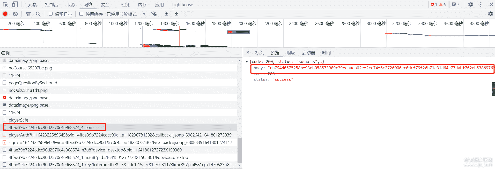
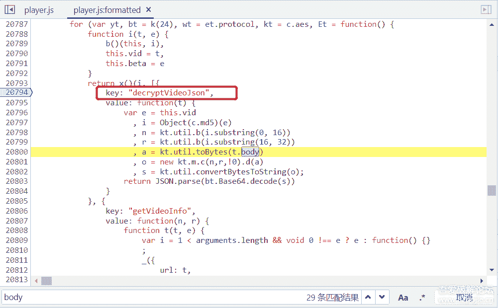
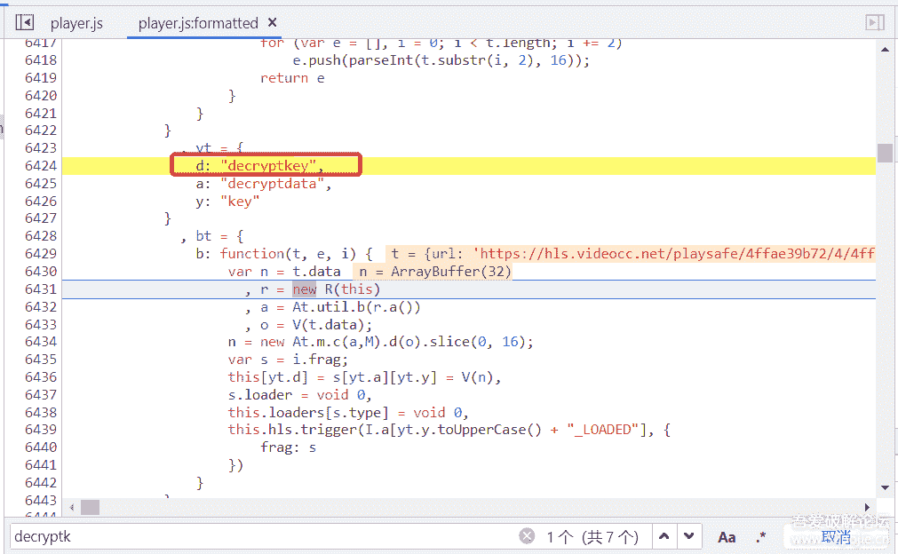

# [Web逆向] 某利威32位key算法逆向
- 原帖: https://www.52pojie.cn/forum.php?mod=viewthread&tid=1574013
- 抓取时间: 2026-11-01T23:42:38

## 某利微32位key算法逆向，新手学逆向，大佬看笑话

### 直入正题吧
众所周知 `m3u8` 可进行 `aes` 加密播放，一般 `m3u8` 加密后的 `key` 为 16 位，而某利微返回 `key` 为 32 位的，初步判断是经过二次加密的，如果想要下载视频的话，必须要找到真实的 `key` 值

- 首先需要解密 `vid.json` 数据

`json.png` (104.8 KB, 下载次数: 0)
[href="forum.php?mod=attachment&aid=MjM2NDYzMHxjYjNiYjU0ZHwxNzkzNTc2NTU1fDE2ODA4NnwxNTc0MDEz&nothumb=yes" target="_blank"](https://www.52pojie.cn/forum.php?mod=attachment&aid=MjM2NDYzMHxjYjNiYjU0ZHwxNzkzNTc2NTU1fDE2ODA4NnwxNTc0MDEz&nothumb=yes)
2022-1-10 16:09 上传
- 通过关键字定位到 `js` 解密代码处，打断点分析得 `vid.json` 的 `body` 数据是由 `AES` 对称加密的，使用 `vid` 进行 `md5` 加密后，前 16 位为 `key`，后 16 位为 `iv`

`decryptJSon.png` (81.36 KB, 下载次数: 0)
[href="forum.php?mod=attachment&aid=MjM2NDYzMnw1MGY3ZmIyM3wxNzkzNTc2NTU1fDE2ODA4NnwxNTc0MDEz&nothumb=yes" target="_blank"](https://www.52pojie.cn/forum.php?mod=attachment&aid=MjM2NDYzMnw1MGY3ZmIyM3wxNzkzNTc2NTU1fDE2ODA4NnwxNTc0MDEz&nothumb=yes)
2022-1-10 16:10 上传
- 通过猜测关键字定位 `key` 解密位置，断点调试分析得知 `key` 值也是通过 `AES` 加密过的，`vid.json` 解密 `body` 中 `seed_const` 值进行 `md5` 加密后，取前 16 位作为 `key`，`iv` 固定为 “AQIDBQcLDRETFx0HBQMCAQ==” （需 `base64` 解密）

`decryptKey.png` (74.37 KB, 下载次数: 0)
[href="forum.php?mod=attachment&aid=MjM2NDYzM3w0MjU2ODU4NnwxNzkzNTc2NTU1fDE2ODA4NnwxNTc0MDEz&nothumb=yes" target="_blank"](https://www.52pojie.cn/forum.php?mod=attachment&aid=MjM2NDYzM3w0MjU2ODU4NnwxNzkzNTc2NTU1fDE2ODA4NnwxNTc0MDEz&nothumb=yes)
2022-1-10 16:16 上传
最后通过 `AES` 解密得到的 `key` 取前 16 位即为视频真实 `key`，可通过 `m3u8` 下载软件填充 `key`、`iv` 进行尝试解密下载
