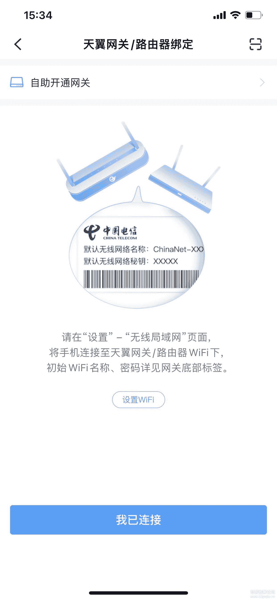
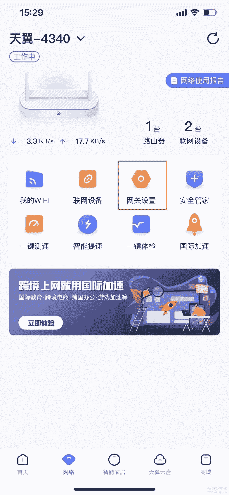
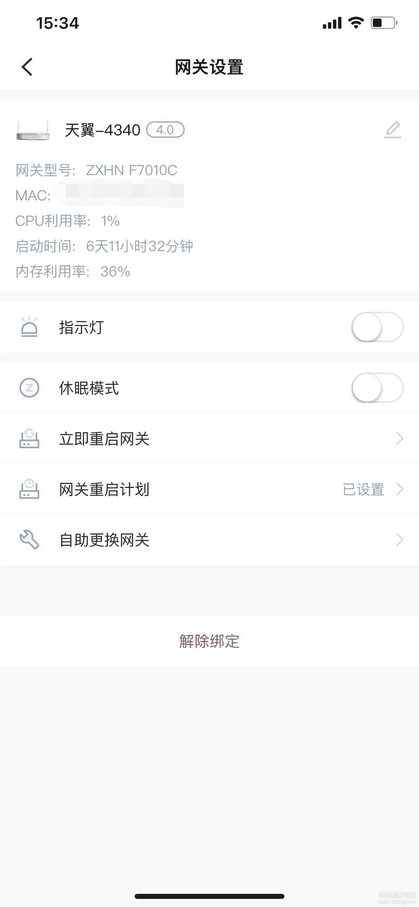
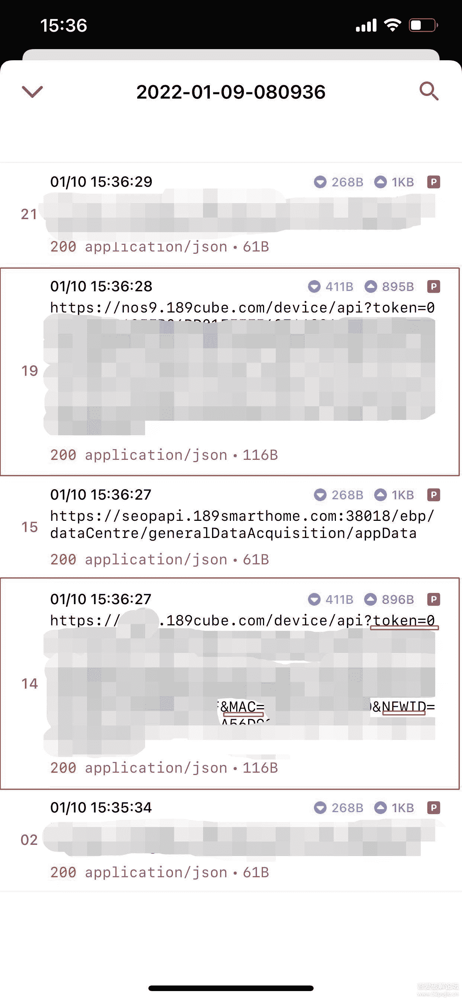
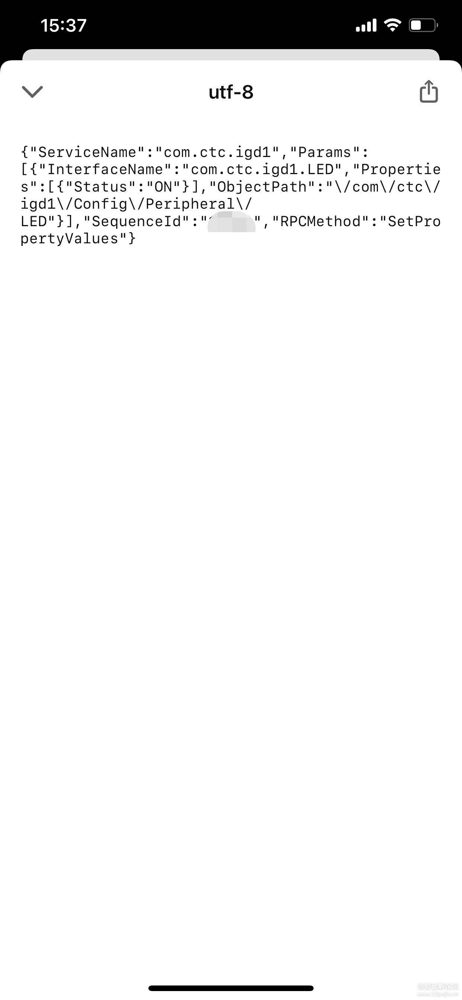
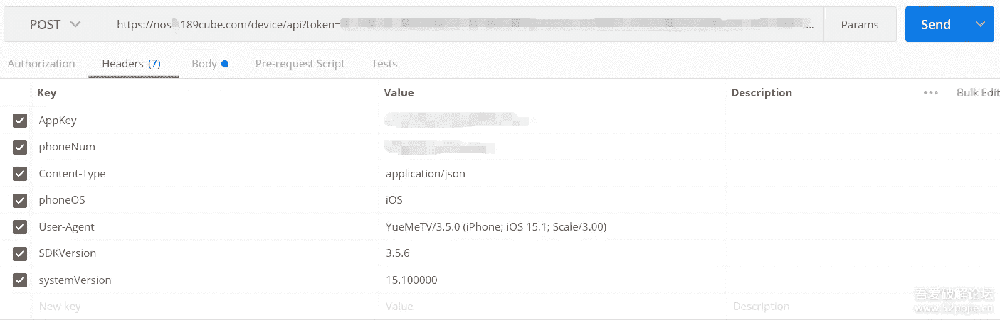
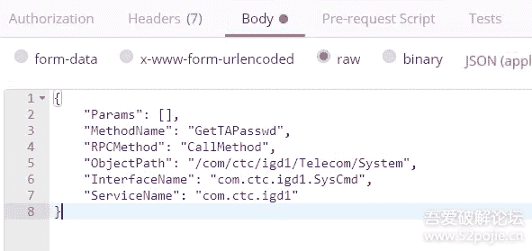
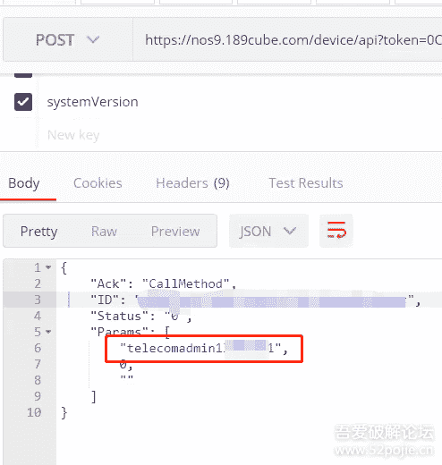

# [原创] 通过小翼管家获取电信光猫 `telecomadmin` 超级管理员密码，理论支持电信各版本光猫

- 原帖: `https://www.52pojie.cn/forum.php?mod=viewthread&tid=1574087`
- 抓取时间: `2026-11-01T23:42:34`

潜水多年首次发帖 八十多收藏了 很欣慰{:1_919:}
看到回复有很多人成功了就很满足！
登陆超级管理员的作用基本就是改桥接 开 `ipv6`
建议改桥接顺便加一个拨号 不然小翼管家离线就没法调接口了
或者删除管理那条 顺便记录一下密码
走过路过别白嫖哦 免费评个分 评个论
家里新换了光猫，版本很新，不包含 `U` 口，所以网上很多通过 `U盘` 获取配置文件的方法并不适用。
偶然间 通过抓包 小翼管家，发现，可以通过一些设备接口，查看到电信光猫的 `telecomadmin` 管理员密码。如果使用的光猫支持绑定小翼管家，理论上都可以进行 `telecomadmin` 管理员密码查看。

## Step 1
- 下载小翼管家

- 通过小翼管家 绑定自己的光猫 绑定方法参照 app 中的绑定方法（如：连接光猫 `wifi`、扫码）


## Step 2
- 使用抓包工具对小翼管家进行抓包，抓包方法不限，自行选择
- 开启抓包后，使用小翼管家中的网关设置功能 -> 指示灯或任意操作光猫的功能


- 在抓包结果中找到对应的请求



## Step 3
- 使用 `postman` 或各种方法构建请求，`header` 和 `url` 使用抓包获得的 `header` 和 `url` 获取设备的超级管理员密码



```
{ "Params": [], "MethodName": "GetTAPasswd", "RPCMethod": "CallMethod", "ObjectPath": "/com/ctc/igd1/Telecom/System", "InterfaceName": "com.ctc.igd1.SysCmd", "ServiceName": "com.ctc.igd1" }
```

- 返回结果


该接口还可以调用其他功能如 重启光猫等。具体参照《中国电信智能家庭网关技术要求》
