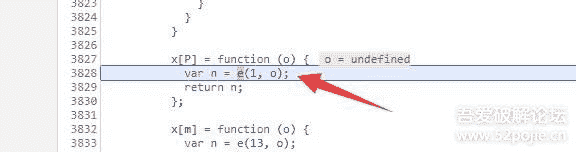
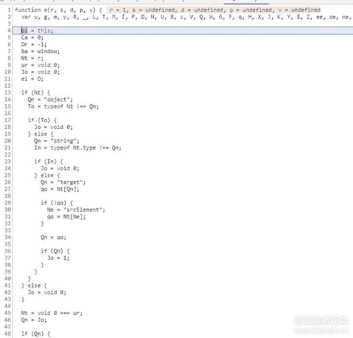
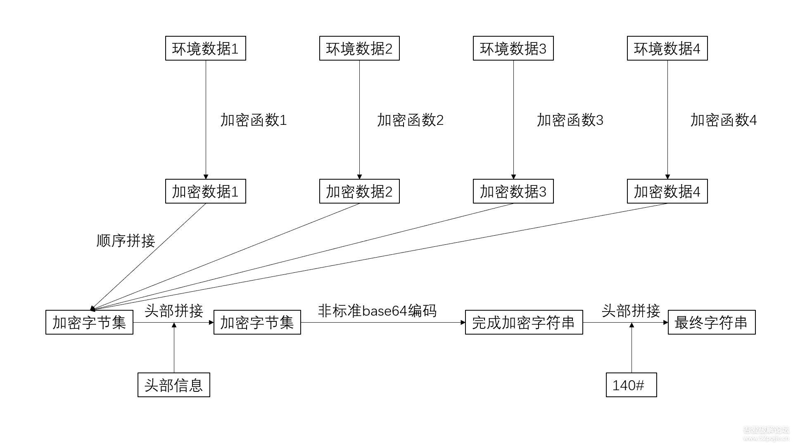
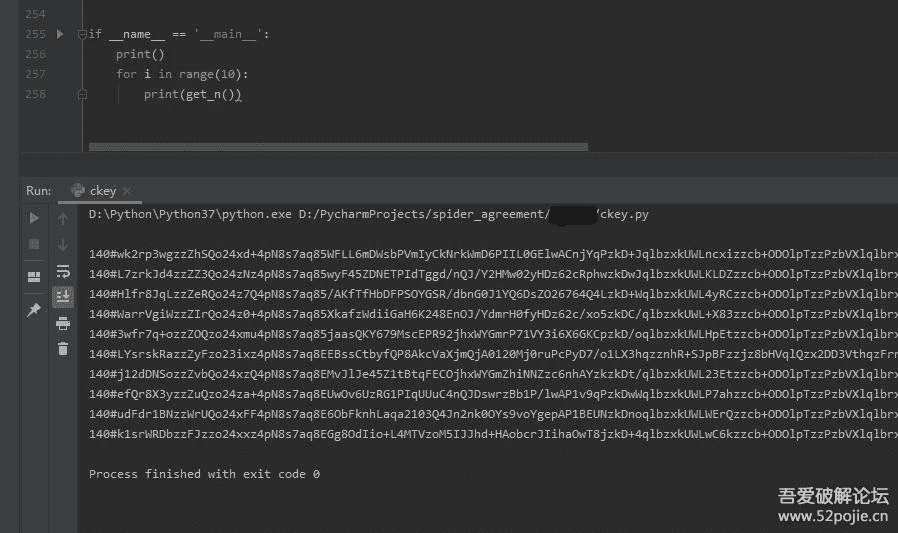
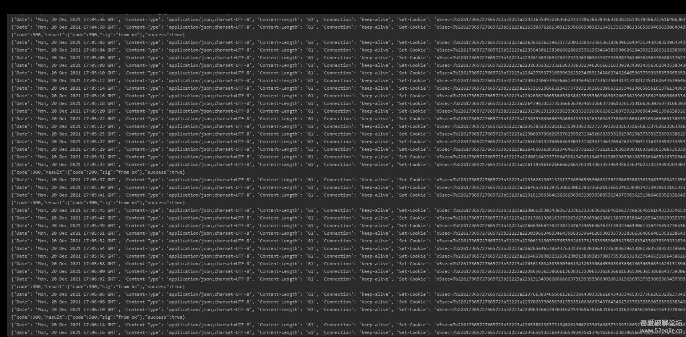

# [Web逆向] 某酷ckey签名生成算法系列--（五）调用js生成结果

- 原帖: https://www.52pojie.cn/forum.php?mod=viewthread&tid=1574225
- 抓取时间: 2026-11-01T23:42:32

@[rel="nofollow noopener" href="某酷ckey签名生成算法系列--（五）调用js生成结果" target="_blank" rel="noopener noreferrer nofollow"](https://www.52pojie.cn/某酷ckey签名生成算法系列--（五）调用js生成结果)

通过替换本地js后，继续在第一篇里面说到的`this.uabModule`处下一个断点。这次我们跟入到 `this.uabModule.getUA` 这个函数内部

1.png (13.34 KB, 下载次数: 0)

[href="forum.php?mod=attachment&aid=MjcyNzkyNnwxNGU0NjYyZHwxNzkzNTc2NTUwfDE2ODA4NnwxNTc0MjI1&nothumb=yes" target="_blank"](https://www.52pojie.cn/forum.php?mod=attachment&aid=MjcyNzkyNnwxNGU0NjYyZHwxNzkzNTc2NTUwfDE2ODA4NnwxNTc0MjI1&nothumb=yes)

2024-10-11 17:30 上传

发现是调用【`e(1, o)`】得到的结果，`o`就是传入的参数，这里是undefined，那么参数都清楚了，看看函数内部做了什么

2.png (44.91 KB, 下载次数: 0)

[href="forum.php?mod=attachment&aid=MjcyNzkyN3xlM2MzOTgyNnwxNzkzNTc2NTUwfDE2ODA4NnwxNTc0MjI1&nothumb=yes" target="_blank"](https://www.52pojie.cn/forum.php?mod=attachment&aid=MjcyNzkyN3xlM2MzOTgyNnwxNzkzNTc2NTUwfDE2ODA4NnwxNTc0MjI1&nothumb=yes)

2024-10-11 17:30 上传

整个函数非常非常之长，里面实际包含了多个函数，主要是通过第一个参数的数值，来判断具体执行的是哪一个函数。因为已经去除了控制流，现在就是繁琐的从上往下一步一步的分析数值是怎么来的了。

在调试过程中可以发现，里面检测了非常多的设备信息。包括但不限于各种鼠标和触摸事件、dom和bom属性和方法、插件和画布等等。所有信息序列化，拼接在一起，最后才得出这个【140#.......】的`ckey`

因为调试过程非常繁琐，就不多叙述，下图的大致的计算流程

3.png (138.93 KB, 下载次数: 0)

[href="forum.php?mod=attachment&aid=MjcyNzkyOHxkNmMxYzQ2NnwxNzkzNTc2NTUwfDE2ODA4NnwxNTc0MjI1&nothumb=yes" target="_blank"](https://www.52pojie.cn/forum.php?mod=attachment&aid=MjcyNzkyOHxkNmMxYzQ2NnwxNzkzNTc2NTUwfDE2ODA4NnwxNTc0MjI1&nothumb=yes)

2024-10-11 17:30 上传

分析完成后，尝试使用`node`调用来生成这个`ckey`

4.png (91.21 KB, 下载次数: 0)

[href="forum.php?mod=attachment&aid=MjcyNzkyOXwwYjY5OGM4YXwxNzkzNTc2NTUwfDE2ODA4NnwxNTc0MjI1&nothumb=yes" target="_blank"](https://www.52pojie.cn/forum.php?mod=attachment&aid=MjcyNzkyOXwwYjY5OGM4YXwxNzkzNTc2NTUwfDE2ODA4NnwxNTc0MjI1&nothumb=yes)

2024-10-11 17:30 上传

经历了多少错误，重新分析后，终于出来了，放入到某酷的接口中请求，可以正常返回数据，说明算法没有问题了。尝试移植到其他地方使用，依然是没有问题的，整个分析算是完结了，整个反混淆加分析用了大概一月的时间。

5.png (475.24 KB, 下载次数: 0)

[href="forum.php?mod=attachment&aid=MjcyNzkzMHw2NzU4OTAzNnwxNzkzNTc2NTUwfDE2ODA4NnwxNTc0MjI1&nothumb=yes" target="_blank"](https://www.52pojie.cn/forum.php?mod=attachment&aid=MjcyNzkzMHw2NzU4OTAzNnwxNzkzNTc2NTUwfDE2ODA4NnwxNTc0MjI1&nothumb=yes)

2024-10-11 17:30 上传
