# [原创] 记录一次 U3D il2cpp 游戏逆向解包

- 原帖：<https://www.52pojie.cn/forum.php?mod=viewthread&tid=1580642>
- 抓取时间：2026-11-01T23:38:21

纯记录贴，怕下次自己忘了。

目标：steam 锁国区某日游，因无中文语言，所以想做一下汉化。

使用工具：
- `CPP2IL`（[GitHub](https://github.com/SamboyCoding/Cpp2IL)）
- `Il2CppInspector`
- `AssetStudioGUI`
- `dnspy`
- `ida`
- `x64dbg`

用到的工具比较多。

## 一、先找语言文件

先打开 `AssetStudioGUI`。

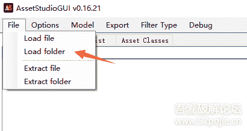

`image.png`（14.28 KB，下载次数：3）

附件：[下载](https://www.52pojie.cn/forum.php?mod=attachment&aid=MjM2ODQwOXxiMWExNjRmN3wxNzkzNTc2Mjk4fDE2ODA4NnwxNTgwNjQy&nothumb=yes)（2022-1-25 16:00 上传）

直接加载游戏文件目录，等他跑一小会，随便搜搜关键字筛选一下看看。

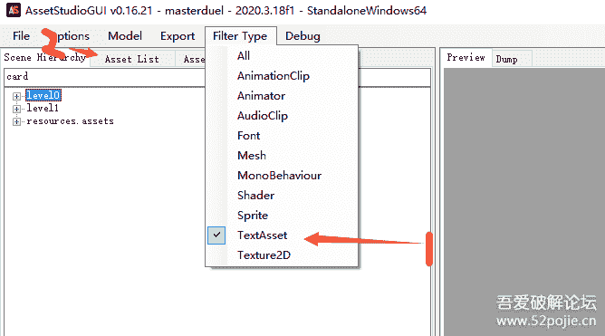

`image.png`（24.66 KB，下载次数：3）

附件：[下载](https://www.52pojie.cn/forum.php?mod=attachment&aid=MjM2ODQxMHw3Yjc4NTc1ZnwxNzkzNTc2Mjk4fDE2ODA4NnwxNTgwNjQy&nothumb=yes)（2022-1-25 16:02 上传）

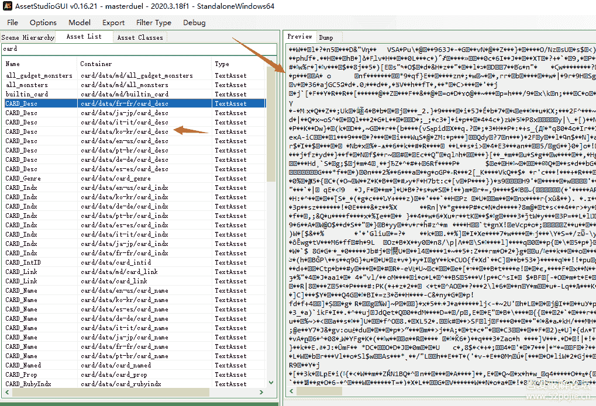

`image.png`（136.12 KB，下载次数：3）

附件：[下载](https://www.52pojie.cn/forum.php?mod=attachment&aid=MjM2ODQxMXw0ODJhN2EyNnwxNzkzNTc2Mjk4fDE2ODA4NnwxNTgwNjQy&nothumb=yes)（2022-1-25 16:03 上传）

能看到多语言文件都是加密过的，先右键导出个英文的文件准备开干。

## 二、解包 `GameAssembly.dll`

下载好 `Cpp2il`，填上 `bat` 命令行，一键导出，或者使用 `Il2CppInspector`。

命令行：`Cpp2IL.exe --game-path="D:\Program Files (x86)\Steam\steamapps\common\Yu-Gi-Oh! Master Duel" --exe-name="masterduel"`

经过漫长无比的等待后

`cpp2il` 文件目录下会输出若干文件

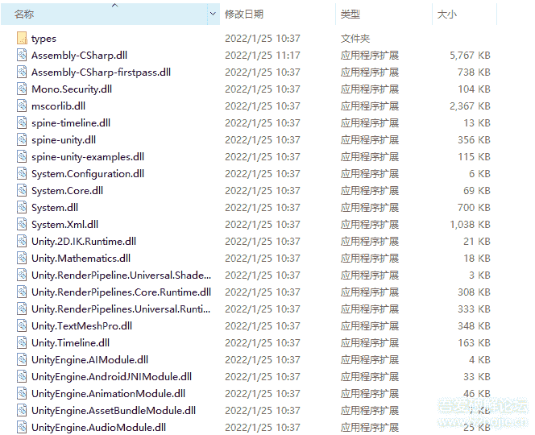

`image.png`（89.43 KB，下载次数：3）

附件：[下载](https://www.52pojie.cn/forum.php?mod=attachment&aid=MjM2ODQxM3w0MTlmODBlYXwxNzkzNTc2Mjk4fDE2ODA4NnwxNTgwNjQy&nothumb=yes)（2022-1-25 16:09 上传）

## 三、分析 `Assembly-CSharp.dll`

拖进 `dnspy` 可以看到类似这样，看不到函数内部，只能看到函数名，够用了，开始找解密函数

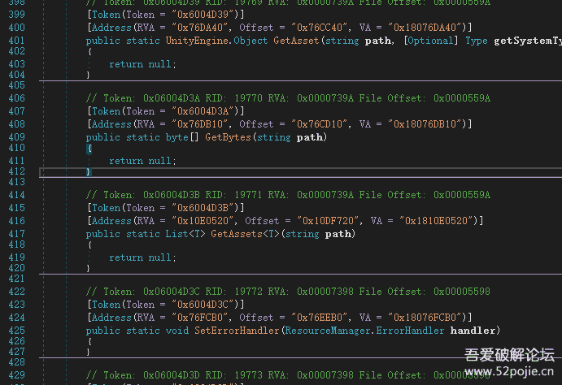

`image.png`（26.76 KB，下载次数：3）

附件：[下载](https://www.52pojie.cn/forum.php?mod=attachment&aid=MjM2ODQxNHwwNmI3NmVkNHwxNzkzNTc2Mjk4fDE2ODA4NnwxNTgwNjQy&nothumb=yes)（2022-1-25 16:11 上传）

搜索 `Decrypt` 方法，只有一个符合，我这里已经知道这个函数就是解密函数了，所以直接拿他开整。

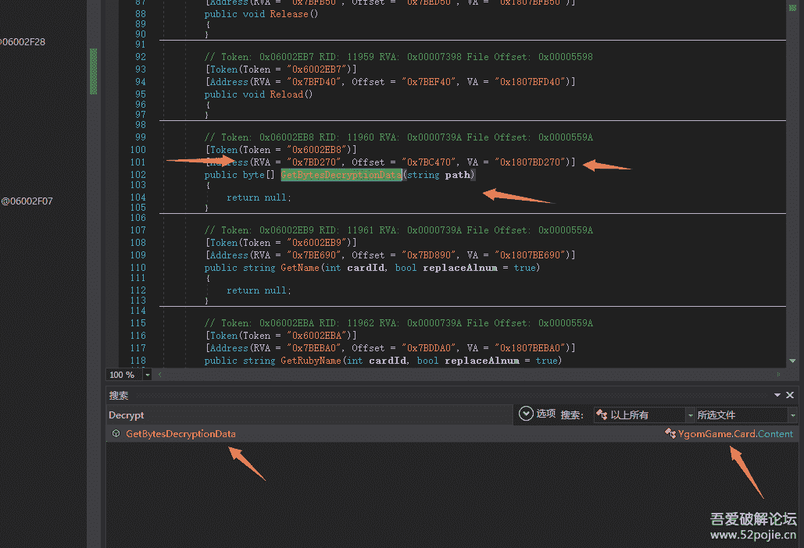

`image.png`（43.96 KB，下载次数：2）

附件：[下载](https://www.52pojie.cn/forum.php?mod=attachment&aid=MjM2ODQxNXw3NjJlMjBmN3wxNzkzNTc2Mjk4fDE2ODA4NnwxNTgwNjQy&nothumb=yes)（2022-1-25 16:13 上传）

记录下地址：`[Address(RVA = "0x7BD270", Offset = "0x7BC470", VA = "0x1807BD270")]`，`dnspy` 先别关一会还有用

## 四、分析 `GetBytesDecryptionData` 解密函数

掏出 `IDA` 拖入 `GameAssembly.dll`，抽根烟开始漫长的等待。跑完之后直接去 `00000001807BD270` 处 `F5` 看一下伪代码

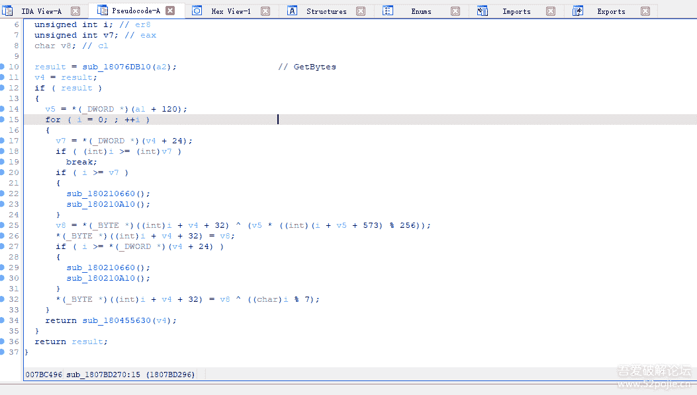

`image.png`（54.15 KB，下载次数：2）

附件：[下载](https://www.52pojie.cn/forum.php?mod=attachment&aid=MjM2ODQxN3xhMDc3NDRkNXwxNzkzNTc2Mjk4fDE2ODA4NnwxNTgwNjQy&nothumb=yes)（2022-1-25 16:17 上传）

很简单的逻辑，在去 `dbg` 里跑一下看一眼变量。

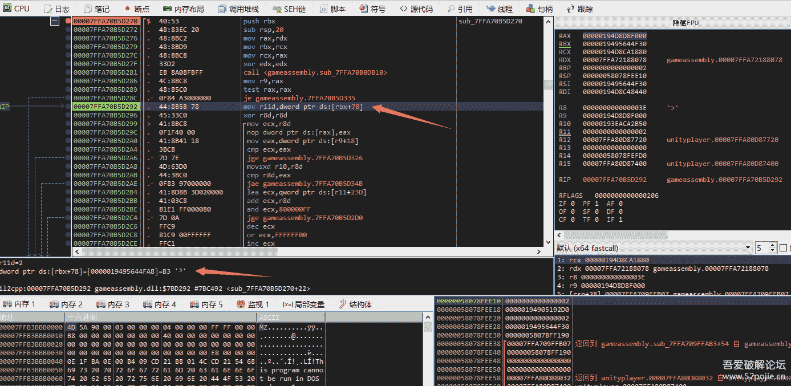

`image.png`（169.88 KB，下载次数：3）

附件：[下载](https://www.52pojie.cn/forum.php?mod=attachment&aid=MjM2ODQyMHw0YTgzZjhiN3wxNzkzNTc2Mjk4fDE2ODA4NnwxNTgwNjQy&nothumb=yes)（2022-1-25 16:23 上传）

这里 `rbx+78` 对应的 `a1 + 120`，拿到 `v5` 的数值，接下来写个算法就好了，其实就两行。

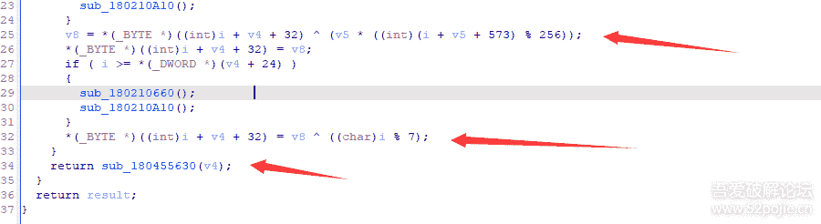

`image.png`（26.24 KB，下载次数：3）

附件：[下载](https://www.52pojie.cn/forum.php?mod=attachment&aid=MjM2ODQyMXxhY2U0NGFhMXwxNzkzNTc2Mjk4fDE2ODA4NnwxNTgwNjQy&nothumb=yes)（2022-1-25 16:25 上传）

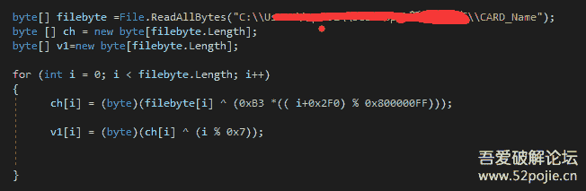

`image.png`（22.93 KB，下载次数：2）

附件：[下载](https://www.52pojie.cn/forum.php?mod=attachment&aid=MjM2ODQyMnw0NDk3YmEwYXwxNzkzNTc2Mjk4fDE2ODA4NnwxNTgwNjQy&nothumb=yes)（2022-1-25 16:25 上传）

简单的运算，没啥好讲的，解密之后发现还是加密的状态，后来我仔细找了找，返回值还有一个 `call` 双击进去，复制 `1806ED310`，`dnspy` 搜一下字符串

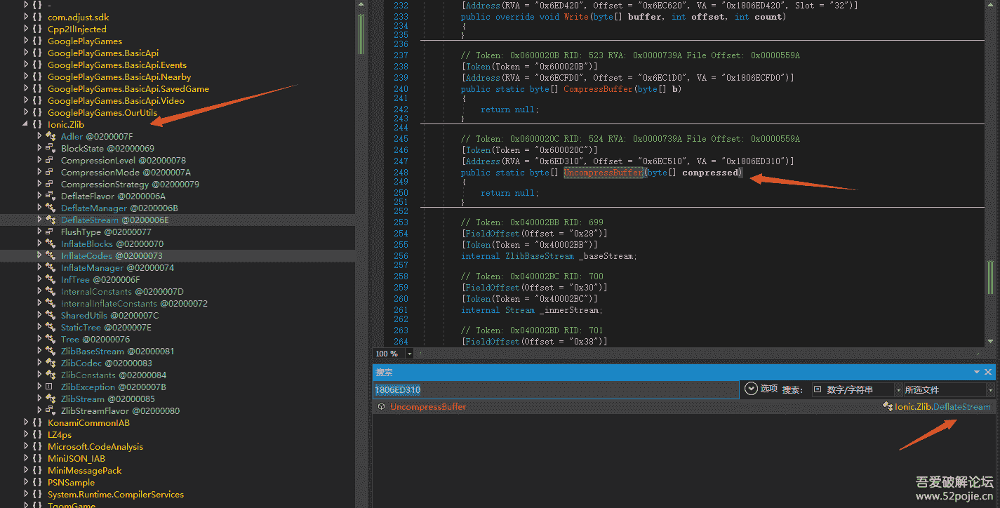

`image.png`（116.53 KB，下载次数：2）

附件：[下载](https://www.52pojie.cn/forum.php?mod=attachment&aid=MjM2ODQyNHw3YWEwYTkzMnwxNzkzNTc2Mjk4fDE2ODA4NnwxNTgwNjQy&nothumb=yes)（2022-1-25 16:28 上传）

对应的应该是 `zlib` 算法里的解压函数，下载一个 `zlib` 类库看下源码

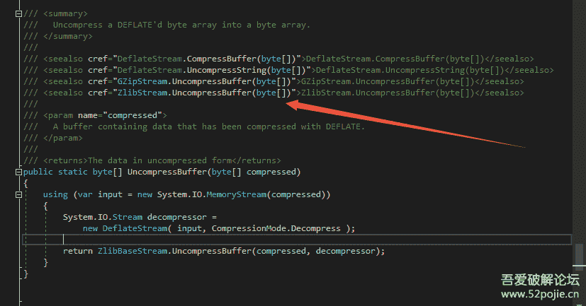

`image.png`（51.94 KB，下载次数：2）

附件：[下载](https://www.52pojie.cn/forum.php?mod=attachment&aid=MjM2ODQyNnxkZmMxOGJlMXwxNzkzNTc2Mjk4fDE2ODA4NnwxNTgwNjQy&nothumb=yes)（2022-1-25 16:30 上传）

OK，引用到项目，测试一下完活

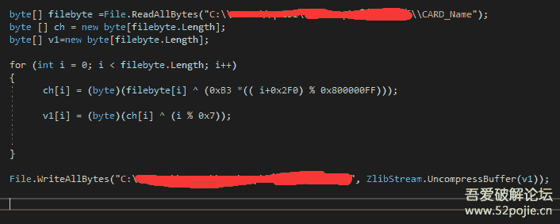

`image.png`（29.33 KB，下载次数：1）

附件：[下载](https://www.52pojie.cn/forum.php?mod=attachment&aid=MjM2ODQyN3wyMTA0YzVhZXwxNzkzNTc2Mjk4fDE2ODA4NnwxNTgwNjQy&nothumb=yes)（2022-1-25 16:31 上传）

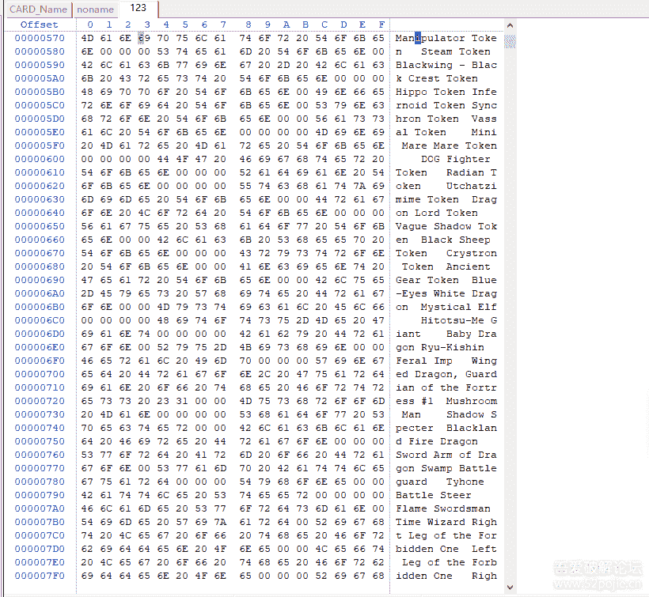

`image.png`（100.23 KB，下载次数：1）

附件：[下载](https://www.52pojie.cn/forum.php?mod=attachment&aid=MjM2ODQyOHwzNmY4MTgzNnwxNzkzNTc2Mjk4fDE2ODA4NnwxNTgwNjQy&nothumb=yes)（2022-1-25 16:31 上传）
